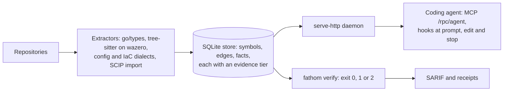

# fathom

fathom indexes your repositories into a local evidence store and serves it to coding
agents through MCP tools and harness hooks. The store holds symbols, call edges, imports,
config references, plans and rules, and records how each fact was found. fathom's job is
proof more than search. It tells an agent what breaks if a file changes, which rules
govern the file it is about to edit, and whether a task it marked done is really done.
Answers carry each fact's evidence tier, and graph answers name the indexed commit. fathom
is one pure-Go binary that runs locally and makes no model calls by default.

**Status:** v0.11.0 beta. Build from source on macOS or Linux (Windows is untested).
Claude Code and Codex are the verified harnesses. Licence: FSL-1.1-ALv2 ([below](#licence)).
The [overview](docs/overview.md) is a 15-minute tour of the design and its evidence.

## What is different

1. **Done means proven.** `fathom verify` checks every `[x]` row of a Markdown plan
   against the index: the symbol exists, a test statically reaches it, and for Go a
   product entry point calls it through typed edges. A failed claim exits 1 with the
   reason. Step 2 below shows it ([usage/verify.md](docs/usage/verify.md)).
2. **Extraction quality is measured against independent oracles.** Each language and
   tool format is scored against an oracle fathom does not own (its own indexer or
   compiler where one exists), on subjects chosen before the run. The [board](docs/languages.md#excellence-board-generated)
   is generated from the committed readings, and `TestLanguagesTrackerIsGenerated` fails
   if any row claims more than its reading shows. It tracks 37 languages and 63 tool
   formats; 19 and 45 meet their target, and the misses (Go's typed level among them)
   are listed.
3. **Every answer says how it knows.** Each symbol and edge carries an evidence tier, and
   call answers count typed and heuristic edges separately. A heuristic edge is served
   with its label but never proves a plan row. Reports name the commit they were computed
   at, and `fathom receipt verify` re-checks a saved Go answer using only git. Output is
   deterministic, and tests pin that (`TestBlastRadius_Determinism`).

## Quick start

Measured on an Apple M4, cold Go cache: clone 6.8 s, build 28.6 s, daemon under 1 s,
`fathom init` on [psf/requests](https://github.com/psf/requests) (130 files) 0.55 s, answers
under 30 ms ([reading](docs/bench/readings/reach/quickstart-2026-10-15.md)). Needs Go
1.26.2 (Go 1.21 or later fetches it through `GOTOOLCHAIN=auto`).

**1. Build.**

```sh
git clone https://github.com/GeoffMillerAZ/fathom.git && cd fathom
CGO_ENABLED=1 MACOSX_DEPLOYMENT_TARGET=14.0 go build -o bin/fathom ./cmd/fathom  # macOS (Xcode CLT)
CGO_ENABLED=0 go build -o bin/fathom ./cmd/fathom                                # Linux (no C compiler)
export PATH="$PWD/bin:$PATH" && fathom version    # fathom v0.11.0 @ <commit>
```

**2. Watch the gate reject false claims.** This needs no daemon and writes only to
`/tmp/fathom-demo`.

```sh
mkdir -p /tmp/fathom-demo && cp -r internal/connector/testdata/fauxtown/checkout-service /tmp/fathom-demo/
cd /tmp/fathom-demo && cat > plan.md <<'EOF'
- [x] FetchItem is defined {id: D-1, oracle: lexical, path: checkout-service/checkout.go, pattern: "^func FetchItem"}
- [x] FetchItem is done and tested {id: D-2, symbol: FetchItem}
- [x] CancelOrder is done {id: D-3, symbol: CancelOrder}
EOF
fathom ingest --service demo --path checkout-service --store demo.sqlite
fathom verify --service demo --plan plan.md --store demo.sqlite; echo "exit $?"; cd -
```

```text
✓ [D-1] FetchItem is defined
✗ [D-2] FetchItem is done and tested
    test_reaches: no Test* statically reaches it
✗ [D-3] CancelOrder is done
    symbol_present: "CancelOrder" not found in the index

3 tasks total; 3 claimed: 1 verified, 2 failing
exit 1
```

**3. Start the daemon** in its own terminal, from the fathom checkout. The default memory
budget is 512 MiB; 2 GiB covers a repository the size of fathom (about 10,000 files).

```sh
mkdir -p ~/.fathom/db
FATHOM_TENANCY_BUDGET=2GiB bin/fathom serve-http --store ~/.fathom/db/fathom.sqlite \
  --idle-exit=0 --ttl=0 --auto-refresh=true          # listens on 127.0.0.1:7575
```

**4. Wire a repository and Claude Code.** Run these from the root of any git repository.
A scratch clone makes a good first target.

```sh
fathom init --skills     # expect: ok ingest (service "<dir>" indexed: <n> symbols, <language>)
claude mcp add --transport http --scope user fathom http://127.0.0.1:7575/rpc/agent
```

`init` only adds files (`git status` lists them): `.fathomignore`, `.fathom/`, a marked
stanza in `AGENTS.md`, hooks in `.claude/settings.json` and ten skills in `.claude/skills/`,
plus `~/.fathom/` and a `~/.local/bin/fathom` shim. Its `MANUAL:` lines are optional.
Codex: [docs/adoption/codex.md](docs/adoption/codex.md).

**5. Ask.** In a new Claude Code session there, ask "who calls `<a function>`?" The
agent calls `symbol_context`. Or call it yourself (the service is the directory name):

```sh
curl -s localhost:7575/rpc/agent -H 'Content-Type: application/json' -d '{"jsonrpc":"2.0","id":1,
  "method":"tools/call","params":{"name":"symbol_context","arguments":{"service":"requests","symbol":"merge_setting"}}}'
```

On psf/requests it returns the three callers grep finds, the indexed commit, and
`"resolution":{"typed":0,"heuristic":5}`: every edge is heuristic because no
`scip-python` index was imported. `fathom doctor` checks the wiring. Daily use (launchd,
upgrades, cloud sessions) is in [docs/early-testers.md](docs/early-testers.md).

## Status (v0.11.0 beta)

**Works today**
- Typed edges: Go's from `go/types`. TypeScript, JavaScript, Python, Java, C#, C, C++,
  PHP, Rust and Dart read L4 when you import their own SCIP indexer's output
  (`fathom ingest --scip`, or an `index.scip` at the root). Without it, their edges are
  file-resolved heuristics, labelled so.
- MCP: eight tools on `/rpc/agent` (`find_symbol`, `symbol_context`, `blast_radius`,
  `review_diff`, `obligations`, `verify_plan`, `read_source`, `search`), 21 on
  `/rpc/extended`, 25 registered ([mcp-tools.md](docs/mcp-tools.md)). Hooks for Claude
  Code and Codex; Gemini CLI, Cursor and Copilot are wired but unverified.
- `fathom verify` reads its own plan grammar and Spec Kit, OpenSpec, Kiro and Task Master
  task files. SARIF output is stamped with its commit; `fathom receipt verify` is Go only.

**Planned** (not built; [roadmap](docs/vision/38-proof-layer-roadmap.md)): a
cross-service graph of routes, RPCs, topics and tables; full-text retrieval over docs and
decisions; proof history and progress views; dependency API indexes; test intelligence.

**Known limits:** no prebuilt binaries. Every published measurement comes from one
adopter's machine, and no benchmark yet shows that fathom makes an agent faster or
cheaper. The managed macOS daemon needs a local code-signing identity, and Linux has no
systemd unit yet. `pkg/client` cannot be fetched with `go get`, because two private
dependencies are mirrored in `third_party/`. Full list: [early-testers.md](docs/early-testers.md#known-limits).

## Architecture at a glance



Ingest is hash-gated, parallel and deterministic. Grammars run as WebAssembly inside the
binary, so Linux builds with `CGO_ENABLED=0` (`TestLinuxBuildIsCgoFree`); macOS uses cgo
only for two memory readers. See [architecture.md](docs/architecture.md) and the
decisions in [ADR.md](ADR.md), indexed in [docs/intent/decisions/](docs/intent/decisions/README.md).

## Evaluate it in 15 minutes

1. Run the quick start, including the step 2 demo.
2. Open a reading behind the board, such as
   [typescript.json](docs/bench/readings/lang/typescript.json): subject SHAs, oracle and
   version, raw counts, computed grade.
3. Try to make the gate lie: claim a row no test reaches, then run `fathom verify --strict`.
4. Read what an agent receives: the `AGENTS.md` stanza, `.claude/settings.json`, and
   `tools/list` on `/rpc/agent`.
5. Run `bash scripts/stranger-check.sh`: a copy of the tree, a throwaway daemon and HOME,
   `init`, `doctor`, and a timed first proven answer. It passed in 3 min 23 s on
   2026-10-15, 175 s of it indexing fathom's own tree
   ([reading](docs/bench/readings/reach/quickstart-2026-10-15.md#stranger-check)).

## Docs

| | |
|---|---|
| [docs/overview.md](docs/overview.md) | The engineer's tour: evidence model, pipeline, agent surface, measurement, limits |
| [docs/early-testers.md](docs/early-testers.md) | Install for daily use, what works per language, known limits, reporting problems |
| [adoption/claude-code.md](docs/adoption/claude-code.md), [codex.md](docs/adoption/codex.md) | Full wiring guides per harness |
| [docs/languages.md](docs/languages.md) | Per-language extraction, typed-edge sources, the generated board |
| [docs/mcp-tools.md](docs/mcp-tools.md), [docs/usage.md](docs/usage.md) | MCP tools and surfaces; the CLI reference |
| [docs/architecture.md](docs/architecture.md) | Layers, data model, fusion pipeline, store |
| [docs/intent/README.md](docs/intent/README.md) | Principles, invariants, scope and non-goals, decisions |
| [CHANGELOG.md](CHANGELOG.md) | Releases; `### Breaking` lines link migration notes in `docs/upgrades/` |
| [early-testers.md#install-from-source](docs/early-testers.md#install-from-source) | Working on fathom: the gate's tool pins, `lefthook install`, `task validate` |

## Licence

Source-available under [FSL-1.1-ALv2](LICENSE.md): use, modify and redistribute fathom
for any purpose except a commercial product or service that competes with it. Each
release becomes Apache-2.0 two years after it is published. `third_party/agentic-kit`
and `third_party/app-kit` share this licence; `third_party/scip` is Apache-2.0.
