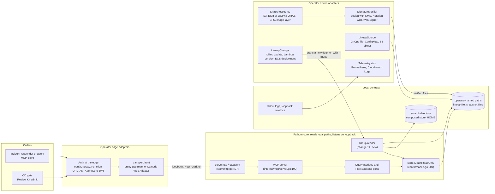
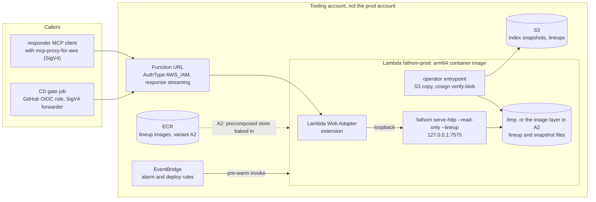
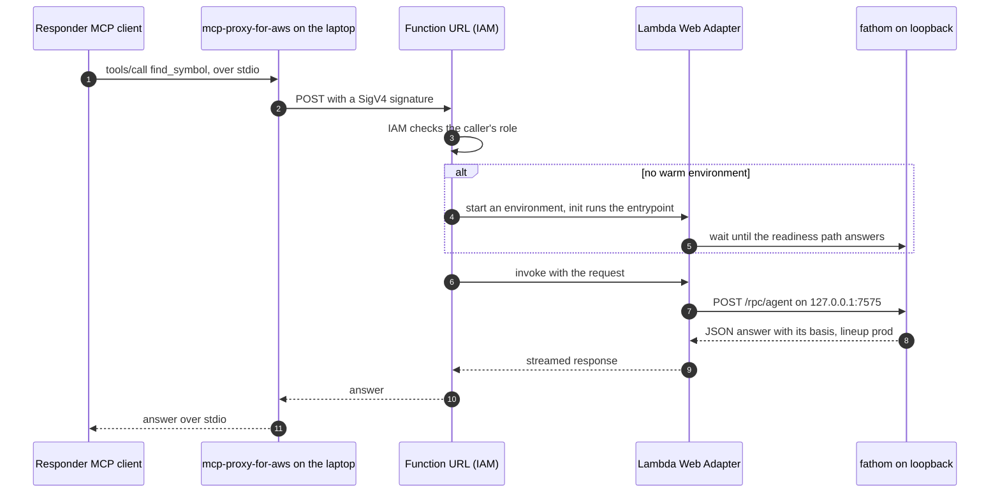
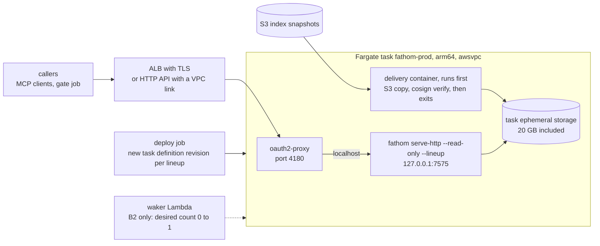
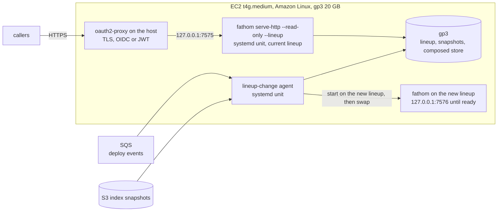
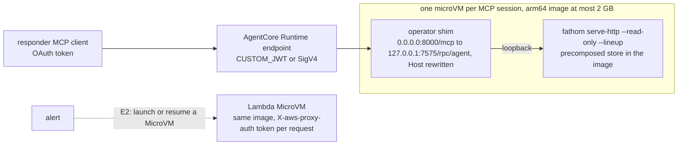
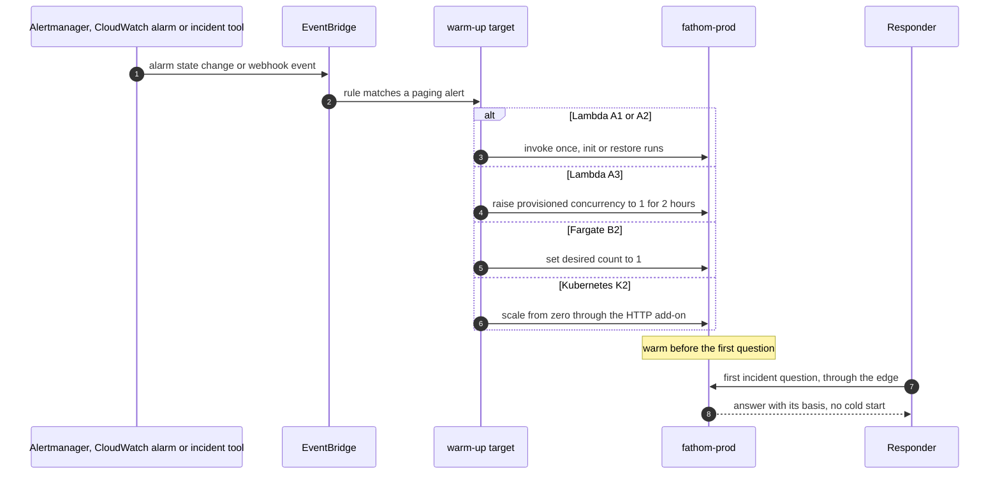
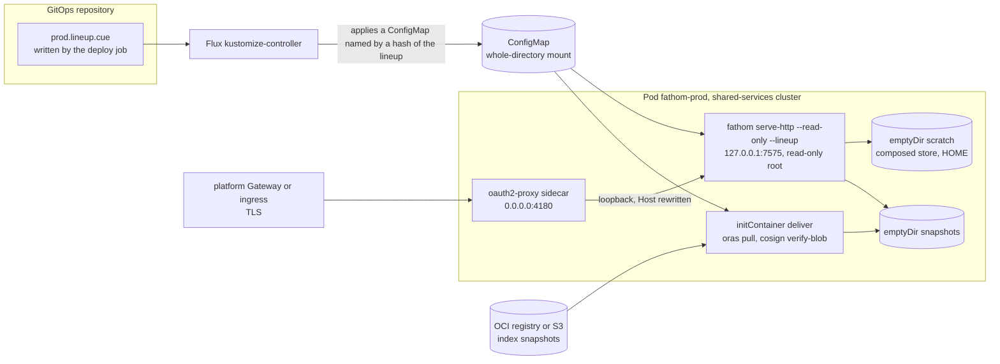
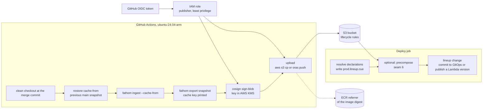

# Index snapshots: deployment

Companion to the main design, `docs/design/index-snapshots.md`. Status: accepted as research, parked with the
design (2026-10-11); nothing is built. Read at fathom `1639b37c` and platform-engineering `84f9d41`.

**Names.** This research was written in parallel with the design's naming critique and normalized to its final
names when it landed (2026-10-11): index snapshot (one service at one commit), lineup and lineup change, environment
daemon, composed store, read-only sidecar, local daemon, answer basis, `export snapshot` and `import snapshot`, and
plan ids `IXS-`. Where the research assumed an in-place lineup change over a control socket, the text now follows the
design's default, a Kubernetes rolling update with no fathom verb and no socket (design section 3.4), and names the
in-place change only as the design's question 8 fallback: built only if IXS-M7's compose bar fails, with a verb that
is not `reload`.

How to read this file:
- Plain paths are fathom. `pe:` is platform-engineering. `rk:` is `pe:kits/review-kit/`.
- [J] marks a judgment. [S#] is a source in section 9. Every source was read on 2026-10-11. Every AWS or
  Kubernetes fact and every price is "read 2026-10-11, verify at use": prices change, and all prices are
  us-east-1 unless stated.
- Names follow the design's glossary (`docs/design/index-snapshots.md` section 1.5). The design's change numbers 1
  to 15 and its measurement ids IXS-M0 to IXS-M9 are reused. Anything new here says "proposed", and its id is
  checked for collisions at landing.
- Every mermaid diagram has a short reading under it.

Sizing inputs, measured on fathom itself: an index snapshot of fathom is 154.8 MB; cold ingest 299.3 s at 1.81 GB peak
RSS; warm 76.1 s at 2.09 GB (docs/bench/readings/efficiency-wave/typed-cold-cost.md:149-156). Linux builds are pure
Go for amd64 and arm64 (ADR-066, ADR.md:4185-4215). Environment daemon RSS per lineup size, compose time and
lineup-change time are unmeasured (IXS-M7). Every number that depends on them is [J].

Usage profiles used throughout:
- **P1**, one team: 10 services; 20 gate checks and 30 incident questions a day; 30 index snapshots kept per
  service; 4 merges per service per workday [J]. A gate check is about 5 MCP calls and an incident question about
  10 [J]: 12,000 calls a month. Composed lineup: 1.55 GB at fathom size (upper bound), about 0.5 GB if a typical
  service is a third of fathom [J].
- **P2**, the assessment's fleet illustration: 50 services; 10 merges and 4 deploys per service per workday
  (assessment 2 section 12); 200 gate checks a day; 150 incident questions a day [J]: 75,000 calls a month.
  Retention per the design (last 20 per service on main, deployed commits for 90 days, then monthly): about
  2.16 TB at fathom size. Composed lineup: 7.75 GB upper bound, about 2.5 GB typical [J].
- An average MCP call is 0.5 s of daemon time [J, unmeasured: IXS-M7].

## 1. Verdict

**Recommended for the owner now: the Kubernetes recipe on the existing platform (option K1).** Run `fathom-prod`
as one always-on Deployment in the shared-services cluster class (pe:docs/adr/0005-cluster-topology.md), never in
the general cluster it investigates. The pod has three parts: the daemon on loopback, the authenticating proxy as
a same-pod sidecar, and a delivery step (an init container) that pulls and verifies the lineup's index snapshots
with ORAS and cosign. A lineup change is a rolling update: a new pod delivers, composes and turns ready before the
old one drains. Marginal cost at P1 is about $15 to $25 a month. Why:
- The platform already runs flux, ingress, cert-manager, an identity-aware proxy, signed images (pe ADR-0115) and
  observability. The recipe adds one Helm chart or Kustomize base and nothing new to operate [J].
- Always-on means the first incident question pays no cold start, for less than an engineer-hour a month [J].
- A lineup change is a Kubernetes rolling update (design section 3.4): no fathom verb, no control socket. An
  in-place change is the design's question 8 fallback, only if IXS-M7's compose bar fails.
- It fits every accepted constraint as written: same-pod proxy over loopback, no non-loopback bind in fathom,
  delivery and signature checks in operator-owned steps (I56; ADR-068 decision 7).
- Its weakness is a shared failure domain: same account, region, identity provider and platform control plane as
  prod. At compact scale, control-plane and shared-services collapse into one cluster, and for the smallest
  organizations general may collapse in too (pe:docs/adr/0005-cluster-topology.md:31-35). Then it fails with
  prod. Placement in shared-services is the minimum. A second region or account is the stronger answer.

**Cheapest capable AWS option: AWS Lambda, arm64 container image, in a separate tooling account (option A).**
The Lambda Web Adapter fronts `serve-http` on loopback. A Function URL with `AWS_IAM` auth and response streaming
is the edge. Index snapshots live in S3. Two variants:
- **A1, download at init**: about $2 to $5 a month at P1, and $0 compute inside the Lambda free tier. Cold start
  for an incident question is about 7 to 22 s of download for a 0.5 to 1.55 GB composed lineup at the default
  625 Mbps, plus up to 10 s more when init passes its 10 s limit and is retried at the first invoke [S61]. With
  the bandwidth quota raise it is about 1.5 to 4.5 s at 10,240 MB memory; bandwidth scales with memory from
  2,048 MB, so at P1's 4,096 MB expect about 3.5 to 11 s [S3][S11][J: interpolated]. A pre-warm on alert hides
  most of it (section 3.F).
- **A2, SnapStart with a precomposed store baked into the image**: about $20 a month at P1 with one cached
  version, about $36 with the previous version also kept cached for rollback. On a non-Java runtime a SnapStart
  version bills until it is deleted, at least 3 hours each [S1][S4][S62]. Cold start is a snapshot restore ("as
  low as sub-second" [S4]) plus first page reads, about 1 to 3 s [J]. A lineup change is an image build, a new
  function version and an atomic alias switch.
- Why Lambda: lowest cost for bursty use; no server, VPC or load balancer; best independence from the prod
  cluster. Its open point is the proxy contract. The authenticator is IAM at the Function URL, not a same-pod
  proxy (section 3.A.5). The owner-architect decides whether that meets the contract, proven by IXS-M8.

**For the CD gate, the cheapest path may need no daemon at all [J].** If the deploy job publishes a precomposed
store (seam 6, section 2.4), the gate job can run a read-only sidecar over that one file, in region, and
never depend on fathom-prod being up. The environment daemon then exists for incidents. This contradicts the main
design's section 3.5 (the gate's prod side asks fathom-prod), so the owner-architect decides.

**Table 1. Options at P1** (prices read 2026-10-11, verify at use). Costs exclude CI (section 5), which is the same
for every option. Sizes are the fathom-sized upper bound (1.55 GB composed lineup).

| Option | Monthly cost, P1 | Cold start, first incident question | Operational burden [J] | Failure-domain independence from prod [J] | Fit with accepted constraints [J] |
|---|---|---|---|---|---|
| K1: Kubernetes, shared-services cluster, always-on | $15-25 [S24][J] | none, warm | low: one chart on a platform that runs the rest | medium: own cluster; same account, region, IdP | full: same-pod proxy, loopback, operator delivery |
| K2: Kubernetes, scale to zero (KEDA HTTP add-on or Knative) | $3-8 plus the always-on interceptor or activator [J] | 15-60 s; minutes if a node must be added [J] | medium: the KEDA HTTP add-on is beta [S51] | as K1 | full, if the proxy stays the only authenticated entry in front of the interceptor |
| K0: Kubernetes inside the prod workload cluster | as K1 | none | low | low: fails with what it investigates | full, but defeats incident use |
| A1: Lambda, download to /tmp | $2-5 [S1][S2][S26] | 7-22 s of download at 625 Mbps, plus up to 10 s when init passes 10 s [S61]; 1.5-4.5 s with the quota raise at 10,240 MB [S3][S11] | low | high: no cluster, separate account | partial: auth is IAM at the Function URL |
| A2: Lambda SnapStart, precomposed store in the image | about $20 with one cached version; about $36 with a cached rollback version [S1][S62] | about 1-3 s [J] | low-medium: an image per lineup change; delete superseded versions | high | partial, as A1 |
| A3: Lambda with provisioned concurrency 1 | about $37-40 [S2] | double-digit ms [S4] | low | high | partial, as A1 |
| B1: ECS on Fargate, arm64, always-on, ALB | about $52 [S16][S21][S22] | none | medium: VPC, ALB, ECS service | high in a tooling account | full: same-task proxy over localhost [J] |
| B2: Fargate scaled to zero with a waker | about $4-8 [J] | 30-60 s: about 11 s host provisioning [S17] plus image pull and index download | medium-high: waker logic | high | full, as B1 |
| C: App Runner | n/a | n/a | n/a | n/a | closed to new customers [S20]; the date 2026-04-30 is unconfirmed on the AWS page |
| D: EC2 t4g.medium, gp3, always-on | $23 (1-year reserved) to $32 [S22][S23][S25] | none | medium: patching, one instance | medium: one instance in one AZ | full: same-host proxy |
| E1: Bedrock AgentCore Runtime | $7-35 at v1 rates; v2 consumption rates are higher [S39][J] | a new microVM per MCP session; unmeasured | medium: path and port shim; 2 GB image cap [S38] | high | partial: auth at AgentCore's front door; the image cap blocks large lineups |
| E2: Lambda MicroVMs | about $10 [S1][J] | resume 1.86 s, one third-party test [S14] | medium-high: launched 2026-06-22; per-request token; 8 h cap [S3][S13] | high | partial: a per-request token at AWS's proxy |

**Table 2. Recommended option per situation** (prices read 2026-10-11, verify at use).

| Situation | Recommended | Why |
|---|---|---|
| The owner: an existing Kubernetes platform on AWS, low and bursty use | K1 in shared-services | lowest effort, always warm, full constraint fit |
| No cluster, or the incident tool must survive a platform outage | A2, or A1 with pre-warm, in a tooling account | cheapest, independent of the platform |
| A composed lineup above about 9 GB, or answers above 200 MB | K1 or D | Lambda's 10 GB image and 200 MB stream caps [S3] |
| Every question must be fast, independent of the platform | A3 or D | always warm |
| A CD gate only, no incident use | a read-only sidecar in the CD job | no standing cost [J] |
| An existing App Runner customer | B1 instead | App Runner gets no new features [S20] |

## 2. Hexagonal design (ports and adapters)

### 2.1 The core that exists today

| Part | Where | What it gives the design |
|---|---|---|
| Read-only open | `store.MountReadOnly`, internal/store/conformance.go:201; DSN `mode=ro` only, `sqliteReadOnlyDSN` at conformance.go:182-188 | opens an index snapshot without writes; on read-only media a WAL-mode file needs more (seam 3, IXS-12) |
| Store port | `store.Store`, internal/store/store.go:246 | the storage contract under the query engine |
| Query port | `mcp.QueryInterface`, internal/mcp/server.go:45 | what the MCP server reads through |
| Fleet port | `mcp.FleetBackend`, internal/mcp/platform_tools.go:27; adapter `newFleetAdapter` at cmd/fathom/fleetadapter.go:14, wired at cmd/fathom/servehttp_store.go:183-187 | cross-service reads over the daemon's own store |
| MCP server | `NewServerWithFleetAndLogger`, internal/mcp/server.go:190; `HandleRequest`, server.go:335 | the tool registry and dispatch |
| HTTP driving adapter | `POST /rpc` and `/rpc/{surface}`, cmd/fathom/servehttp.go:497-512; one JSON-RPC message per POST, answered `application/json` (servehttp.go:427-494); `MCP-Protocol-Version` answered on every call (servehttp.go:475) | MCP over Streamable HTTP without SSE. A buffered Lambda answer is valid up to 6 MB, a streamed one up to 200 MB [S3] |
| stdio driving adapter | `serve-mcp --url`, cmd/fathom/servemcp_front.go:17-29; answers capped at 64 MB (servemcp_front.go:37) | a stdio MCP client reaches a daemon over HTTP |
| Health and metrics | `GET /healthz` always answers "ok" (servehttp.go:523-532); `/metrics` with Prometheus names (servehttp.go:548) | liveness; telemetry |
| A reload stub | `POST /reload` answers ok and does nothing (servehttp.go:653-665) | on the serving address: refused under `--read-only` or removed (seam 2, IXS-13) |
| Edge guard | `requireLoopbackHost`, cmd/fathom/admission_http.go:143; default bind `127.0.0.1:7575`, cmd/fathom/servehttp_config.go:59 | the proxy must rewrite `Host` and drop `Origin` |
| Lifetime bounds | unmanaged daemons exit after 20 min idle and 8 h (servehttp_config.go:65-66; internal/tenancy/unmanaged.go:20-21); SIGHUP exits an unmanaged daemon (cmd/fathom/servehttp_lifecycle.go:268) | idle exit is a free scale-to-zero lever (B2); an environment daemon turns both off |
| Module mounts | `--module` mounts read-only at start (servehttp_lifecycle.go:104-125), feeding `obligations` only | the precedent for start-time mounts |
| CLI client | `FATHOM_HTTP` names the daemon (pkg/client/caller_transport.go:13,50); nothing in pkg/client or cmd/fathom sets an `Authorization` header [J: grep] | a remote caller's credentials come from an operator adapter |
| Gate adapter | Review Kit shells out to the fathom binary (rk:internal/evidence/adapters.go:341-343); `Admit` at rk:internal/assurance/assurance.go:583; `runAdmit` at rk:internal/cli/assurance.go:589 | the gate is a driving adapter outside fathom |

### 2.2 Ports and adapters

Driving ports (who asks):

| Port | Adapter | Lives in |
|---|---|---|
| MCP over Streamable HTTP | `serve-http`, `/rpc/agent` on loopback | fathom (exists) |
| stdio MCP | `serve-mcp --url` | fathom (exists) |
| CLI | `fathom` verbs with `FATHOM_HTTP` | fathom (exists) |
| CD gate admit | Review Kit's fathom adapter | Review Kit (exists) |
| Lifecycle | a process started with `--lineup`, and its readiness answer (seam 4) | fathom (changes 14 and 17) |
| Transport front | Lambda Web Adapter, oauth2-proxy, an AgentCore path shim | operator |

Driven ports (what the core needs), with an adapter per platform:

| Port | What fathom core sees | Adapters | Lives in | Why |
|---|---|---|---|---|
| SnapshotSource | a local file path the lineup names | local path; S3 copy in an entrypoint; ECR or any OCI registry via `oras pull`; a Kubernetes image volume; an EFS or S3 Files mount; a file baked into a Lambda image | operator recipe | I56: fathom never fetches |
| LineupSource | a local CUE file (`--lineup`) | a file in the image; a ConfigMap volume; an S3 object copied by the entrypoint; a GitOps checkout | operator; fathom parses (change 15) | I56 |
| LineupChange | nothing: a new process starts on the new lineup (no fathom verb, no socket) | a Kubernetes rolling update; a new Lambda version behind an alias; a new ECS task definition revision; a unit swap on one host; triggered by GitOps (Flux, Argo CD) or the deploy job | operator | orchestrators, listeners and cloud SDKs stay outside core |
| SignatureVerifier | nothing: fathom checks sha256 and the cache key only | `cosign verify-blob --key awskms:///...` [S34]; Notation with AWS Signer for ECR [S32]; `ssh-keygen -Y verify` | operator | ADR-068 decision 7: fathom holds no key and verifies no signature (ADR.md:4582-4586) |
| Auth at the edge | loopback HTTP, `Host` rewritten, `Origin` dropped | oauth2-proxy sidecar [S54]; Function URL `AWS_IAM` [S9]; API Gateway JWT authorizer [S36]; AgentCore `CUSTOM_JWT` [S37]; client side `mcp-proxy-for-aws` [S43] and `aws-sigv4-proxy` [S44] | operator | the draft ADR-069 decision 11: fathom never binds beyond loopback; the bearer path was deleted (GKE-MH-7) |
| Telemetry | stdout logs and `/metrics` on loopback | a Prometheus scrape through the proxy with a service-account token; CloudWatch Logs from stdout; OpenCost | operator | no extra listener |
| Scratch | a writable directory for the composed store and `$HOME` state | emptyDir; Lambda /tmp; gp3 | operator sizes it | |



Reading:
1. Callers reach fathom only through the operator's edge. The edge authenticates and forwards over loopback.
2. Inside the core, nothing is new except the lineup reader (change 14). A lineup change is a new process, started
   by the operator's orchestrator; there is no control channel.
3. The core touches four things: operator-named paths, a scratch directory, loopback, and stdout.
4. Everything that speaks a network protocol or holds a credential is an operator adapter on the right.

### 2.3 Which adapters live in fathom, and why

The rule [J]: **fathom core reads local paths, listens on loopback, and writes to stdout and a scratch directory.
Every network adapter is outside fathom core.** Two accepted records force it:
- I56: "Fathom never downloads on its own authority ... unless the operator names the source in that invocation"
  (docs/intent/invariants.md:85). The accepted reading for this capability is stricter: an index or lineup is read
  only from a path the operator names. So S3, ECR, OCI and EFS clients are operator adapters.
- ADR-068 decision 7: authenticity is the operator's tool; "Fathom holds no key, verifies no signature, makes no
  network call" (ADR.md:4582-4586). So signature verification is an operator adapter, run before the file lands.

What fathom ships for adapters is documentation and recipes: the guide section "## Run an environment daemon",
the Helm chart or Kustomize base (section 4.6), and the Lambda Dockerfile (section 3.A). The operator owns and
runs them.

### 2.4 The smallest fathom-side seams

| # | Seam | Status | Size [J] | Notes |
|---|---|---|---|---|
| 1 | Lineup reader: parse a CUE lineup from a path; check each entry's sha256 and recorded cache key | change 14 and schema change 15 | M | the only new input format |
| 2 | No control channel, and the reload stub closed (IXS-13) | defect | XS | a lineup change is a new process (design section 3.4), so the daemon needs no socket or endpoint. The `POST /reload` stub sits on the serving address (servehttp.go:653-665): refuse it under `--read-only` or delete it, so a proxied request can never reach it |
| 3 | Immutable read-only open (proposed change 16; IXS-12) | defect | S | SQLite opens a WAL-mode file on read-only media only if the `-shm` and `-wal` files exist, the directory is writable, or the URI says `immutable=1` [S55]. `sqliteReadOnlyDSN` sets only `mode=ro` (conformance.go:182-188), and the store spec describes a WAL-mode store (docs/spec/store-format-v0.md:29-37). Lambda image layers and Kubernetes image volumes are read-only media. Fix: `export snapshot` writes `journal_mode=DELETE` into the index snapshot, which is SQLite's own advice [S55], or the lineup mount adds `immutable=1`. Test: mount from a read-only directory |
| 4 | Readiness (proposed change 17) | new | S | `/healthz` is unconditional. Add a loopback readiness answer that turns ready only after the lineup's entries are checked and composed. The Lambda Web Adapter's readiness check [S10] and a Kubernetes exec probe both call it |
| 5 | Container posture (proposed, with 17) | new, mostly docs | XS | a documented flag set: `--exit-with-parent=false`, idle exit and TTL off for an environment daemon (on for B2); `HOME` and the call log on a scratch directory or stdout, because a read-only root file system cannot take `~/.fathom/daemon/` (servehttp_config.go:61,68) |
| 6 | Precomposed store (proposed; owner-architect decides): a composed store the deploy job builds | new | S, given change 10 | the deploy job runs the compose that change 14 runs in the daemon (`fathom import snapshot` per entry into a scratch store), and the result is served as a one-entry lineup. It makes A2, the gate sidecar and fast cold starts possible. Cost: one more artifact per deploy, the size of the composed store |

Rejected seam: an in-process read-only SQLite VFS over S3 range requests. The driver is `modernc.org/sqlite`
(go.mod:21), and it ships `vfs.New(fs.FS)`, a VFS with "no write path" over any `fs.FS` [S56]. An S3-backed
`fs.FS` is small to write. It is rejected [J]:
- It is a network client inside fathom's process, which the accepted reading of I56 refuses.
- An operator module cannot link it in, because Go's `internal/` packages are closed to other modules.
- Every page-cache miss becomes a ranged GET. A cold `blast_radius` would pay one S3 round trip per missed page
  [J, unmeasured].
- Revisit only if a measured cold start forces it and the owner amends I56.

## 3. AWS options

### 3.0 Pieces every AWS option shares

**Where index snapshots live** (prices read 2026-10-11, verify at use).

| | S3 | ECR (OCI) |
|---|---|---|
| Storage price | Standard $0.023/GB-month; Standard-IA $0.0125 plus $0.01/GB retrieval; Glacier Instant Retrieval $0.004 plus $0.03/GB [S26] | $0.10/GB-month [S28] |
| P2's 2.16 TB | $49.7 a month; about $36 with Standard-IA after 30 days [J split] | about $216 a month |
| Transfer to compute in the region | free [S26] | free [S28] |
| Retention rules | lifecycle rules filter by prefix, tag and size; noncurrent versions keep the newest 1 to 100 (`NewerNoncurrentVersions`); 1,000 rules a bucket [S27] | `imageCountMoreThan` and `sinceImagePushed` expire or archive; `sinceImagePulled` archives only; by tag prefix or pattern; actions land within 24 h [S29] |
| Tie to the image | none | an OCI referrer of the image digest; ECR expires referrers within 24 h of their subject [S29][S30] |
| Tooling | `aws s3 cp` | `oras push`, `oras pull` [S31]; one report of a 405 on `oras copy -r` of referrers [S30] |

Recommendation [J]: S3 is the archive that enforces the retention cap. ECR holds only what is pulled as an image:
the lineup images of variant A2, and, where image-kit's flow wants it, the index snapshot as a referrer of the
deployed image digest. A sketch of the S3 layout and rules:
- `s3://<bucket>/main/<repo-id>/<commit>.sqlite.zst`: expire by age, set per merge rate. The last 20 merges
  are 2 workdays at P2's 10 a day and 5 at P1's 4 [J]. For an exact count, also write a versioned
  `main/<repo-id>/latest.sqlite.zst` and keep `NewerNoncurrentVersions=19` [S27]. S3 lifecycle has no
  count-per-prefix rule; ECR has one (`imageCountMoreThan` [S29]).
- `s3://<bucket>/deployed/<env>/<repo-id>/<commit>.sqlite.zst`: the deploy job copies the index snapshot here
  when a lineup names it. Transition to Standard-IA at 30 days, expire at 90 days after the deploy job last refreshed
  it. The deploy job refreshes every entry a current lineup names, so such a snapshot never expires (the design's
  retention root).
- `s3://<bucket>/monthly/...`: one per service per month, per owner ruling D13.
- `s3://<bucket>/lineups/<env>/<lineup-digest>.cue` and, with seam 6, `composed/<env>/<lineup-digest>.sqlite`.

**Signing, by the operator.** `cosign sign-blob --key awskms:///alias/index-snapshots` signs each file [S34]. The
KMS key costs $1 a month and an asymmetric sign $0.15 per 10,000 [S33]. The key never leaves KMS, which suits pe
ADR-0115's key mode with no public transparency log [J]. For artifacts kept in ECR, Notation with AWS Signer costs
nothing extra [S32]. Verification runs in the operator's delivery step: `cosign verify-blob` with the public key.

**Pre-warm and failure domain**: sections 3.F and 3.G.

### 3.A AWS Lambda (serverless)

#### 3.A.1 Shape



Reading:
1. Packaging: a container image from `provided.al2023` or a minimal base, with the pure-Go fathom binary, the
   Lambda Web Adapter (one `COPY` line [S10]) and an operator entrypoint. Images go up to 10 GB [S3].
2. In A1 the entrypoint copies the lineup and its files from S3 to /tmp and verifies them, then starts fathom.
   In A2 the precomposed store is already in the image, so the entrypoint only starts fathom.
3. The adapter turns each Function URL request into an HTTP request to fathom on loopback.
4. Each execution environment is one daemon. Lambda sends it one request at a time [S65].

Settings [J]: arm64; memory 4,096 MB at P1 (up to 10,240 MB [S3]); ephemeral storage 2,048 MB for A1 (512 to
10,240 MB [S3]); timeout 60 s (900 s max [S3]); reserved concurrency 4 to bound parallel cold starts;
`AWS_LWA_INVOKE_MODE=response_stream`, `AWS_LWA_PORT=7575`, `AWS_LWA_READINESS_CHECK_PATH` set to seam 4's
readiness path [S10]; `HOME=/tmp`. A new AWS account starts with reduced Lambda concurrency and memory quotas,
which AWS raises automatically with use [S3]: check a fresh tooling account's quotas before relying on 4,096 MB
or 10,240 MB. Reserved concurrency also needs headroom: Lambda always keeps 100 units of the account's concurrency
unreserved [S65].

#### 3.A.2 Request paths



Reading:
1. An incident question is several calls in one MCP session. Only the first call can be cold.
2. Human MCP clients do not sign SigV4. AWS's `mcp-proxy-for-aws` (generally available 2025-10-31) is a local
   stdio bridge that signs with the caller's AWS credentials [S43].
3. The CD gate path is the same, with a different client: the job assumes a role through GitHub OIDC (no stored
   keys [S48]), runs `aws-sigv4-proxy` on loopback [S44], and points `FATHOM_HTTP` at it. Review Kit shells out to
   fathom as today (rk:internal/evidence/adapters.go:341-343). Whether `aws-sigv4-proxy` signs Function URL
   requests with `--name lambda` is undocumented: test it [S44].
4. Fathom answers JSON per POST, so the buffered mode works up to 6 MB per answer. Response streaming raises it to
   200 MB, at 2 MBps after the first 6 MB [S3][S8]. Function URLs cannot stream from inside a VPC [S8], so A runs
   outside a VPC.

#### 3.A.3 Lineup change

- **A1**: the deploy job writes the new lineup to S3, then publishes a new function version with the lineup digest
  in an environment variable, then moves the `live` alias. New environments load the new set; old ones finish
  their requests and age out. The alias switch is atomic [J]. No fathom verb is involved: a new version is a new
  process, Lambda's form of a rolling update.
- **A2**: the deploy job builds the precomposed store (seam 6), builds `FROM fathom-base` plus that file, pushes it
  to ECR, updates the function code, publishes a version (SnapStart takes its snapshot then; init plus hooks may
  run up to max(timeout, 130 s) [S5]), and moves the alias. A lineup change takes the image build and push plus the
  SnapStart snapshot, about 2 to 5 minutes [J, unmeasured].
- Rollback is the previous version behind the alias. On a non-Java runtime, Lambda deletes a snapshot only when
  the version is deleted; the 14-day idle deletion applies to Java alone [S62]. Each cached version bills for at
  least 3 hours and then for as long as it exists [S1][S4]. So the deploy job deletes superseded versions. Keeping
  the previous version cached for instant rollback doubles the cache cost; the cheaper rollback re-publishes the
  previous image, which takes minutes [J].
- Lineup-change cadence [J]. Every lineup change is a new version. At P2, 4 deploys per service per workday is 200
  lineup changes a workday per environment, about one every 2.4 minutes over 8 hours, the same order as A2's
  rebuild time. Batch them: move to the latest lineup at most every 30 to 60 minutes and accept the lag. On A1
  every new version also discards the warm environments, so unbatched lineup changes make nearly every session
  cold.

#### 3.A.4 Storage of the snapshots on Lambda

| Approach | Cold start | Fit | Verdict [J] |
|---|---|---|---|
| Download to /tmp at init (A1) | one S3 copy of the composed lineup: about 13.6 to 13.9 s per GB at the default 625 Mbps; 2.89 s per GB at 10,240 MB memory after the bandwidth raise, which only non-VPC functions get and which scales with memory from 2,048 MB to 3,000 Mbps at 10,240 MB [S3][S11] | simple. Init has a 10 s limit for on-demand functions; past it, Lambda retries init at the first invoke under the function timeout [S61], so the first 10 s of a slow download are wasted [J] | first build; keep the composed lineup under about 1.5 GB or raise the quota |
| Baked into the image, with SnapStart (A2) | snapshot restore plus lazy image reads, about 1-3 s [J]; the runtime load and after-restore hooks must finish within 10 s [S61] | SnapStart now covers container images, including `provided.al2023` and custom bases, through the label `com.amazonaws.lambda.feature.snapstart="Allow"` or the restore hooks [S5][S6]. The Lambda Web Adapter has its own SnapStart hooks (`AWS_LWA_SNAPSTART_BEFORE_CHECKPOINT_PATH`, `AWS_LWA_SNAPSTART_AFTER_RESTORE_PATH`) [S10]. Not zip on an OS-only runtime, not with provisioned concurrency, EFS, S3 Files, or /tmp above 512 MB [S4]. So the store must be in the image | best latency per dollar; needs seams 3 and 6 |
| EFS or S3 Files mount | first reads from the network file system | needs a VPC, which removes Function URL streaming [S8]; no SnapStart [S4]. S3 Files streams from S3 every read of data not on its fast tier and every read of 1 MiB or more; only files under the import threshold (128 KiB by default) are imported, unless the threshold is raised [S40]. Its fast tier is about $0.30/GB-month (an example rate on the S3 pricing page, region unstated: unconfirmed for us-east-1) [S26]. EFS Standard $0.30/GB-month plus $0.03/GB Elastic Throughput read [S41] | not for Lambda; possible for B and D |
| Read-only SQLite VFS over S3 ranges | no copy, a GET per page miss | rejected in section 2.4 | no |

SnapStart facts that matter here: Go on a container image is supported through the custom-base path [S5]; the
snapshot includes memory and disk state [S4]; generate unique values after restore [S4]. Fathom's per-process
ids are not random: the lifecycle ledger id defaults to `addr-<port>-<pid>` (cmd/fathom/daemon_records.go:52) and
request ids come from a counter (cmd/fathom/servehttp.go:293-297, 346); internal/tenancy draws no random value
[grep at `1639b37c`]. Every environment restored from one snapshot shares both, so log correlation ids collide
across environments [J: harmless to answers; check the call log and lifecycle ledger under restore].

#### 3.A.5 Auth and the proxy contract

- Edge: the Function URL with `AuthType AWS_IAM`. The caller needs `lambda:InvokeFunctionUrl` and
  `lambda:InvokeFunction`; AWS says new function URLs require both from October 2025. A cross-account caller needs
  both an identity policy and the function's resource policy; scope `lambda:InvokeFunction` with the
  `lambda:InvokedViaFunctionUrl` condition [S9]. Nothing else can reach the sandbox's loopback port [J].
- The same-host leg: the Lambda Web Adapter in the same execution environment, over loopback.
- The gap against the contract: the proxy that authenticates is AWS's Function URL front, not a process in the
  "pod". Whether the adapter keeps the Function URL's `Host` header is undocumented [S10]. If it does,
  `requireLoopbackHost` refuses every call (admission_http.go:143). Then the recipe adds a Host-rewriting step in
  the entrypoint [J]. Fathom should not grow a trusted-host flag for this.
- Decision for the owner-architect: does "IAM at the Function URL plus a same-sandbox loopback hop" satisfy the
  proxy contract? Proof: IXS-M8's hostile sweep run against the Function URL (unsigned, wrong role, cross-account)
  [J].
- Alternative edge: API Gateway HTTP API with a JWT authorizer, so MCP clients can use the organization's OAuth
  tokens. It costs $1.00 per million requests, metered in 512 KB increments of payload, but it has a 30 s
  integration timeout that cannot be raised and a 10 MB payload cap [S36].

#### 3.A.6 Limits and risks

| Limit | Value | Consequence [J] |
|---|---|---|
| Memory | 128 MB to 10,240 MB; one vCPU at 1,769 MB [S3] | P2's upper-bound lineup needs the top of the range |
| /tmp | 512 MB to 10,240 MB [S3] | A1's ceiling on the composed lineup |
| Image | 10 GB uncompressed [S3] | A2's ceiling on the composed lineup |
| Timeout | 900 s [S3] | fine for MCP calls |
| Payload | 6 MB buffered; 200 MB streamed, 2 MBps after the first 6 MB [S3] | stream; fathom's stdio front already caps at 64 MB |
| Concurrency | one request per environment [S65] | parallel tool calls start extra environments, each cold in A1 |
| Network | 625 Mbps per environment; on request, non-VPC only, scaling with memory from 2,048 MB up to 3,000 Mbps at 10,240 MB [S3][S11] | the main term in A1's cold start |
| Init | 10 s for on-demand, retried at the first invoke when exceeded [S61]; billed for container images [S7] | keep A1 under 10 s or use A2 |
| SnapStart cost | $0.0000015046 per GB-s cached, 3 h minimum; $0.0001397998 per GB restored [S1]; billed until the version is deleted on non-Java runtimes [S62] | about $15.8 a month per cached 4 GB version |
| Provisioned concurrency | arm $0.0000033334 per GB-s, plus arm duration at $0.0000077778 per GB-s [S2]; x86 $0.0000041667 [S1] | $35 a month for one 4 GB arm environment |
| New accounts | reduced concurrency and memory quotas, raised automatically with use [S3] | a fresh tooling account may not allow 4,096 MB at first |
| Region | response streaming is not in every region [S8] | check the tooling account's region |

#### 3.A.7 Cost at P1 (prices read 2026-10-11, verify at use)

- Compute: 12,000 warm calls at 0.5 s and 4 GB is 24,000 GB-s. Worst case, every gate check and incident session
  is cold: 1,500 inits of about 25 s at 4 GB is 150,000 GB-s. Total 174,000 GB-s at arm's $0.0000133334 [S2] is
  $2.32 a month, and $0 inside the 400,000 GB-s free tier [S1].
- Requests: 13,500 at $0.20 per million is under $0.01 [S1]. Ephemeral storage beyond 512 MB: under $0.01 [S1].
- S3: 46.5 GB at $0.023 is $1.07; 145,000 ranged GETs for cold downloads is $0.06 [S26].
- Signing key: $1.01 [S33].
- Total: A1 about $2 to $5. A2 adds SnapStart: about $16.7 with one cached version, for about $20; about $32.5
  with the previous version also cached, for about $36. Lineup changes faster than one per 3 hours add more, because each
  version bills at least 3 hours [S1]. A3 adds $35.

### 3.B Amazon ECS on AWS Fargate



Reading:
1. Containers in one awsvpc task share localhost, so the proxy is same-task over loopback [J: verify at use].
2. The delivery container copies and verifies the lineup's files and exits; fathom starts after it succeeds (an ECS
   container dependency [J: verify at use]).
3. A lineup change [J]: the deploy job registers a new task definition revision with the new lineup digest and
   lets ECS replace the task, a rolling deployment. The load balancer switch is the atomic step. No fathom verb.

Facts:
- Price: arm $0.0000089944 per vCPU-second and $0.0000009889 per GB-second; x86 $0.000011244 and $0.000001235;
  20 GB of ephemeral storage included; per second with a 1-minute minimum; Fargate Spot up to 70% off [S16].
- Graviton is about 20% cheaper per vCPU-hour than x86 at these rates [S16], and arm64 tasks started faster than
  amd64 in a 2026 measurement [S17].
- Scale to zero: a service's desired count can be 0. Service Auto Scaling raises desired count to the minimum
  [S18]; scaling to 0 with target tracking is a community-documented pattern [S18]. Nothing wakes the service on
  an HTTP request. The wake-up path is a waker: an API in front returns 503 with `Retry-After` and sets the
  desired count to 1, or an EventBridge rule does it on an alert. Wake time: about 11 s of host provisioning [S17],
  plus image pull, plus the index copy, so 30 to 60 s [J].
- Free scale-down [J]: run B2 as a standalone task with fathom's idle exit on (20 minutes by default,
  internal/tenancy/unmanaged.go:20-21). The task exits when idle. No scaling policy is needed.
- Fargate Spot fits B2's short bursts; an interruption costs one cold start [J]. It does not fit B1 for incidents.
  The pricing page lists a Spot Linux/ARM table and an x86/ARM footnote, so arm64 Spot looks supported; the
  footnote is garbled and the Spot rates did not render (unconfirmed) [S16].
- Ingress costs more than compute at P1: an ALB is $0.0225 an hour plus $0.008 per LCU-hour [S21][S64], and its
  two public IPv4 addresses are $0.005 an hour each [S22][S64], so about $24 a month. An HTTP API with a VPC link costs
  $1.00 per million requests [S36], with the 30 s timeout. Keep the task in a public subnet with a public IPv4
  address or an S3 gateway endpoint (no charge [S58]), not behind a NAT gateway, which bills hourly [S58].
- ECS Express Mode (2025-11-21) builds this stack in one call at no additional charge and shares an ALB across up
  to 25 services [S19]. Scale to zero is not documented for it [S19].
- Cost at P1 (read 2026-10-11, verify at use): 0.5 vCPU and 4 GB arm always-on is $22.21 a month; with ALB, two IPv4
  addresses, the task's IPv4, S3 and KMS, about $52. B2 at 60 task-hours a month is about $1.8 of compute, so about
  $4 to $8 in total [J].

### 3.C AWS App Runner

App Runner is closed to new customers. Existing customers keep using it, including creating new services. AWS
plans no new features and points to ECS Express Mode [S20]. The AWS page states no date; third-party reports give
2026-04-30 (unconfirmed). Option C is therefore not available to a new account and is not recommended to an
existing one. For an existing customer, its idle billing would have suited bursty use: a provisioned but idle
instance pays memory only, $0.007 per GB-hour, and an active one $0.064 per vCPU-hour plus $0.007 per GB-hour
[S63]. A 4 GB instance idle all month is about $20.44 [S63][J]. It has no diagram: its shape would be B1's with
App Runner in place of the ALB and the ECS service.

### 3.D One small Graviton EC2 instance



Reading:
1. The same-host proxy meets the contract as written.
2. A lineup change on one host [J]: the agent long-polls SQS (fed by an EventBridge rule on deploy events), copies
   and verifies the new files, starts a second fathom unit on the new lineup at another loopback port, waits for
   its readiness answer (seam 4), points the proxy's upstream at it and stops the old unit. It is a rolling update
   on one machine; fathom gets no verb.
3. Alternative edge without a public address: CloudFront VPC origins reach a private EC2 instance at no extra
   cost [S42]. The proxy still authenticates every request.

Facts and cost:
- t4g.medium: 2 vCPU, 4 GiB, $0.0336 an hour on demand (AWS price data [S23]); $0.021 one-year reserved and
  about $0.017 spot are third-party figures [S23]. That is $24.53 a month on demand, or $15.33 reserved.
- gp3: $0.08 per GB-month with 3,000 IOPS and 125 MB/s included [S25]: $1.60 for 20 GB. The page shows $0.08 in
  an example without a region (unconfirmed for us-east-1).
- A public IPv4 address: $0.005 an hour, $3.65 a month [S22].
- Total at P1 (read 2026-10-11, verify at use): about $32 on demand, $23 reserved, including S3 and KMS.
- 4 GiB may be too small for the daemon plus page cache at P1's upper bound. That is unmeasured (IXS-M7). The next
  size doubles the instance cost [J].
- Burden: OS patching, the AMI, one instance in one AZ, and unlimited-mode CPU credits if bursts run long [J].

### 3.E Newer AWS services (2025 and 2026)

| Service | What it is | Fit for an environment daemon [J] |
|---|---|---|
| Lambda SnapStart for container images (2026-09-02) [S6] | snapshots for image-packaged functions; custom bases need the "Allow" label or the restore hooks [S5] | the enabler for A2. Recommended for the AWS path |
| Lambda MicroVMs (2026-06-22) [S13] | Firecracker microVMs from a Dockerfile image, each with its own HTTPS URL; suspend and resume with state kept; arm64; five regions [S13][S14]. Each request carries a short-lived token in `X-aws-proxy-auth` [S14]. At most 8 hours per microVM [S3]. arm $0.0000276944 per vCPU-second and $0.0000036667 per GB-second in us-east-1, plus snapshot writes, reads and storage [S1] | close to the ideal shape for bursty use: launch on alert, suspend when idle, resume in about 2 s. Against it: new, the token header needs a client adapter, and the 8 h cap forces relaunches. Watch, do not build first |
| Bedrock AgentCore Runtime (MCP hosting) [S37] | hosts an MCP server container at `0.0.0.0:8000/mcp`; inbound OAuth (`CUSTOM_JWT`) or SigV4; one microVM per session; 15 min idle and 8 h session defaults, both adjustable; 2 GB image; 2 vCPU and 8 GB per session; 100 MB payloads; 1 GB session storage [S37][S38]. v1 rates $0.0895 per vCPU-hour and $0.00945 per GB-hour; v2 consumption rates $0.1276 and $0.0169; per second, CPU not billed during I/O wait, memory billed from microVM ready to termination [S39] | its OAuth front is what MCP clients speak natively, a real plus for responders. Against it: a path and bind shim, because fathom serves `/rpc/agent` on loopback; every new session is a cold microVM; the 2 GB image cap blocks lineups above about 1.9 GB. Fits P1-sized lineups only |
| Amazon S3 Files (GA 2026-04-07) [S40] | an NFS 4.1/4.2 file system over an S3 bucket, mountable from EC2, ECS, EKS and Lambda; small files go to a fast tier; reads of large files and of large ranges stream from S3 [S40] | a shared read-only mount of index snapshots for B or D, if the import threshold is raised. Not for A: VPC only, and no SnapStart [S4] |
| Lambda Managed Instances [S12] | Lambda on EC2 instances with many requests per environment; 15% fee on the EC2 price [S1]; does not scale to zero, keeps a minimum of environments [S12] | no: it costs what D costs, plus the fee |
| ECS Express Mode (2025-11-21) [S19] | one-call ECS stack, shared ALB, no extra charge | a quicker B1, not cheaper |
| ECR pull-through cache referrers (2026-04) [S30] | referrers follow cached upstream images | only if index snapshots live in a registry outside AWS |
| CloudFront VPC origins (2024-11, cross-account 2025-11) [S42] | CloudFront to a private ALB, NLB or EC2 instance, no extra cost | an edge for D without a public instance address |



Reading:
1. E1: AgentCore authenticates at its endpoint and starts a microVM for each new MCP session [S37][S38]. An
   operator shim maps its fixed `/mcp` path and port to fathom's loopback address. A lineup change is a new
   runtime version with a new image.
2. E2: the same image runs as a Lambda MicroVM. The alert launches or resumes it; idle suspends it. Every request
   needs a short-lived token header, so an operator-side client adapter mints and adds it [S14].
3. Both need seams 3 and 6, because the store is baked into a read-only image.

### 3.F Pre-warm on alert



Reading:
1. CloudWatch alarm state changes reach the default event bus. The pricing page says AWS management events are
   ingested free; whether that wording covers alarm state-change events is unconfirmed [S35]. Alertmanager and
   incident tools post a webhook into EventBridge through a small receiver; an inbound webhook is a custom event,
   $1 per million [S35]. (API destinations, $0.20 per million, are EventBridge's outbound calls [S35].)
2. A responder takes tens of seconds to open a terminal after a page [J], so a warm-up started by the page usually
   finishes first.
3. A cool-down rule reverts A3 and B2 after the incident window. EventBridge Scheduler costs $1 per million after
   14 million free [S35].
4. Cost: one cold start per page, about $0.001 on Lambda [J]; two hours of provisioned concurrency at 4 GB arm is
   about $0.10 [S2].

### 3.G Failure domain

An environment daemon that runs inside the production cluster it investigates fails with that cluster: node
pressure, a broken CNI, an IdP outage at the cluster's proxy, or a bad platform rollout takes the incident tool
down with the incident [J]. Independence, from weakest to strongest [J]:
1. K0, inside the prod workload cluster: shared fate. Do not use for incidents.
2. K1, in the shared-services class: a different cluster, same account, region, IdP and control plane. At
   compact scale, shared-services shares a cluster with control-plane, and general may join them for the smallest
   organizations (pe:docs/adr/0005-cluster-topology.md:31-35); then most of the gain is lost.
3. D or B in a tooling account: no cluster, but a VPC and a region.
4. A, E1 or E2 in a tooling account or a second region: no cluster, no VPC; depends on Lambda, S3, IAM and STS
   in that region.
Whatever runs it, the fallback chain in the design still holds: a read-only sidecar from the same files, then a
local daemon with imports, then the forge at the deployed commit (design section 7).

## 4. The Kubernetes option

### 4.1 Shape



Reading:
1. The deploy job commits the lineup to the GitOps repository. Flux applies it as a ConfigMap whose name carries a
   hash of its content (Kustomize's `configMapGenerator` [J]), so a changed lineup changes the pod template.
2. The init container pulls each index snapshot the lineup names with ORAS, verifies its signature with cosign,
   and writes it to an emptyDir. Fathom never sees the registry.
3. The daemon reads the lineup and the files once, composes its store in scratch, and serves on loopback.
4. The proxy is the only port the pod exposes. It authenticates every request. Containers in a pod share the
   network namespace [S60], so the proxy reaches fathom over loopback.
5. A lineup change is a rolling update (design section 3.4): the new pod delivers, composes and turns ready, then
   the old pod drains. There is no reloader, no control socket and no fathom verb.

### 4.2 Manifest sketch

```yaml
apiVersion: apps/v1
kind: Deployment
metadata: {name: fathom-prod, namespace: fathom}
spec:
  replicas: 1
  strategy: {type: RollingUpdate, rollingUpdate: {maxSurge: 1, maxUnavailable: 0}}   # the old pod serves until the new one is ready
  progressDeadlineSeconds: 900                    # a failed compose marks the rollout failed; the old pod keeps serving
  selector: {matchLabels: {app: fathom-prod}}
  template:
    metadata: {labels: {app: fathom-prod}}
    spec:
      automountServiceAccountToken: false
      securityContext: {runAsNonRoot: true, seccompProfile: {type: RuntimeDefault}}
      initContainers:
        - name: deliver            # operator image: oras, cosign and the operator's deliver script; signed by image-kit; no fathom in it
          image: registry.example/fathom-delivery@sha256:...
          args: [deliver, --lineup, /lineup/prod.lineup.cue, --to, /snapshots, --key, /keys/snapshots.pub]
          volumeMounts: [{name: lineup, mountPath: /lineup, readOnly: true},
                         {name: snapshots, mountPath: /snapshots}, {name: keys, mountPath: /keys, readOnly: true}]
      containers:
        - name: fathom
          image: registry.example/fathom@sha256:...      # pure Go, linux/arm64 (ADR-066)
          args: [serve-http, --read-only, --lineup, /lineup/prod.lineup.cue,
                 --addr, "127.0.0.1:7575", --exit-with-parent=false, --idle-exit=0, --ttl=0]
          env: [{name: HOME, value: /scratch/home}]
          securityContext: {readOnlyRootFilesystem: true, allowPrivilegeEscalation: false,
                            capabilities: {drop: [ALL]}}
          startupProbe:  {exec: {command: [/fathom, daemon, status, --url, "http://127.0.0.1:7575"]},
                          periodSeconds: 10, failureThreshold: 60}
          livenessProbe: {exec: {command: [/fathom, daemon, status, --url, "http://127.0.0.1:7575"]},
                          periodSeconds: 30, failureThreshold: 3}
          readinessProbe: {exec: {command: [/fathom, daemon, ready]}, periodSeconds: 10}   # seam 4, proposed
          resources: {requests: {cpu: 250m, memory: 3Gi}, limits: {memory: 4Gi}}
          volumeMounts: [{name: lineup, mountPath: /lineup, readOnly: true},
                         {name: snapshots, mountPath: /snapshots, readOnly: true},
                         {name: scratch, mountPath: /scratch}]
        - name: proxy
          image: quay.io/oauth2-proxy/oauth2-proxy@sha256:...
          args: [--http-address=0.0.0.0:4180, "--upstream=http://127.0.0.1:7575/rpc/",
                 --pass-host-header=false, --skip-jwt-bearer-tokens=true,
                 "--extra-jwt-issuers=https://token.actions.githubusercontent.com=fathom-prod"]
          ports: [{containerPort: 4180}]
      volumes:
        - {name: lineup, configMap: {name: fathom-prod-lineup}}          # whole directory, never subPath; Kustomize
                                                                         # appends the content hash to this name
        - {name: snapshots, emptyDir: {sizeLimit: 8Gi}}
        - {name: scratch, emptyDir: {sizeLimit: 8Gi}}                   # twice the composed store (design section 7)
        - {name: keys, configMap: {name: index-snapshot-signing-pubkey}}
```

Notes:
- **Probes done right.** Kubernetes restarts a container on failed liveness and only removes it from endpoints
  on failed readiness; a liveness check that depends on a back end causes cascading restarts; slow starts belong
  to a startup probe [S49]. So liveness asks only "does the process answer `/healthz`", never the registry, S3,
  the IdP or the proxy. Readiness asks "are the lineup's entries checked and composed" (seam 4). A startup probe
  covers the compose.
- **Why exec probes.** The kubelet's HTTP probe targets the pod IP, and fathom binds only loopback. `fathom daemon
  status --url` probes `/healthz` (cmd/fathom/daemon.go:419-421, :561-566) and returns non-zero when unreachable
  [J: confirm its exit codes on Linux, where the launchd branches do not apply]. No non-loopback listener is added,
  which keeps the draft ADR-069 decision 11 intact.
- **Proxy.** `--pass-host-header=false` makes the upstream `Host` the loopback address that `requireLoopbackHost`
  accepts; the default is to pass the client's `Host` [S54]. `--skip-jwt-bearer-tokens` with
  `--extra-jwt-issuers` lets CI callers present a GitHub OIDC token and humans log in through the IdP [S54]. If the
  proxy cannot drop `Origin`, fathom refuses browser-origin calls, which is the safe failure [J]. The upstream is
  only `/rpc/`: the observatory and `/metrics` stay unexposed unless the operator adds a route.
- **Metrics.** Prometheus scrapes `/metrics` through the proxy with a projected service-account token as a JWT
  [J]. The proxy still authenticates every request.
- **Lineup ConfigMap.** A mounted ConfigMap updates in place, after up to the kubelet sync period plus the cache
  delay; a `subPath` mount never updates [S57]. The daemon reads its lineup once, at start, so an in-place update
  changes nothing it serves; the hash-suffixed name is what turns a lineup change into a new pod [J]. Mount the
  directory.
- **PDB.** With one replica, `minAvailable: 1` blocks every voluntary eviction, including drains [S59]. For P1,
  run one replica with no PDB and accept a short gap on node maintenance [J]. If prod incidents need it through
  drains, run two replicas (stateless, each composes its own store) and `minAvailable: 1`, at twice the cost. A
  rolling update with `maxSurge: 1` briefly runs two pods either way, so size the node for two composes [J].
- **Resources** are [J] until IXS-M7 reads the RSS for 1, 5 and 20 snapshots. 3 GiB requested and 4 GiB limit at
  P1; 8 GiB at P2's upper bound.

### 4.3 Lineup change on Kubernetes

| Trigger | How | Latency [J] |
|---|---|---|
| Rolling update (the design's default) | the deploy job commits the lineup; Flux applies a ConfigMap with a new hash-suffixed name, the pod template changes, and the Deployment rolls; the new pod delivers, composes and turns ready, then the old pod drains; Kubernetes replaces an update still in flight with the newest | Flux's reconcile interval, then delivery plus compose |
| A shorter wait | the deploy job asks Flux to reconcile now after its commit (an operator step; Flux's receivers were not among the sources read) | seconds, then delivery plus compose |
| In-place change (the design's question 8 fallback) | only if IXS-M7's compose bar fails: the daemon composes the new lineup beside the old and switches; it needs a verb that is not `reload` and a channel the deploy job reaches without the serving address; not designed | delivery plus compose, no pod start |

A failed entry keeps the new pod unready, the old pod keeps serving, and the rollout fails at its progress deadline
(design section 3.4). The operator retries; fathom never retries.

### 4.4 Scale to zero

- **KEDA HTTP add-on**: scales HTTP servers to and from zero on traffic; labelled beta, with breaking changes
  possible before v1.0 [S51]. An always-on interceptor holds requests while a pod starts [J: see the add-on's
  cold-start docs].
- **Knative Serving**: scale to zero needs the Knative Pod Autoscaler; defaults are a 30 s grace period and 0 s
  last-pod retention [S52].
- **Cold-start cost** [J]: scheduling, plus the image from the node cache, plus delivery of the lineup (in-cluster
  pull from ECR at node bandwidth, signature checks), plus compose: 15 to 60 s; minutes when Karpenter must add a
  node. That is the same order as B2 and worse than A2.
- **Where the proxy goes**: in front of the interceptor or activator, so it stays the first hop that
  authenticates. In-pod placement still works with the interceptor in front of the Service, but then the
  interceptor sees unauthenticated traffic [J].
- Verdict [J]: not worth it at P1. The always-on pod costs $12 to $22 a month, and scale to zero adds a beta
  component and a cold start to the incident path.

### 4.5 Alternative delivery: Kubernetes image volumes

Kubernetes image volumes mount an OCI image or artifact read-only into a pod. The feature is stable in v1.36
(alpha v1.31, beta v1.34, on by default from v1.35) and needs a runtime that supports it [S50]. The KEP and the
task page name no minimum version; "containerd 2.1 or later" is unconfirmed. An index snapshot packaged as a
one-layer image could mount with no init container [J]. Constraints:
- the mount is read-only media, so seam 3 is required;
- a lineup change is a new pod, as in the default, because the volume reference is fixed for the pod's life [J];
- EKS support depends on the cluster version and node AMI's runtime [J: S50 does not cover EKS];
- admission policies that verify image signatures may not cover volume references [J: check the policy engine].
Use it when the platform runs v1.36 and the init container becomes the bottleneck [J].

### 4.6 Packaging and marginal cost (prices read 2026-10-11, verify at use)

- A Helm chart or Kustomize base `fathom-environment-daemon` in pe's substrates, instantiated per environment, with
  the lineup ConfigMap generated from the GitOps repository [J]. The chart is an operator recipe. Fathom documents
  it; platform-engineering owns it (design section 9.2).
- Ingress: the cluster's existing Gateway or NLB (pe ADR-0012, referenced in ADR-0005) adds $0 marginal [J].
- Marginal compute at P1: 0.25 vCPU and 3 GiB is 3/8 of an m7g.large (2 vCPU, 8 GiB, $0.0816 an hour on demand,
  $0.045 spot [S24]): $22.34 a month on demand or $12.32 on spot nodes. The proxy adds about $0.50 [J].
- Storage: emptyDir on node disk at no marginal cost; S3 for index snapshots as in section 3.0.
- Total at P1: about $15 to $25 a month [J]. At P2: one vCPU and 8 GiB is a whole m7g.large, $33 to $60 a month
  per environment [J].

## 5. CI and the publish side



Reading:
1. The publisher runs on each merge to main from a clean checkout. It starts from the previous index snapshot
   (`--cache-from`), exports, signs and uploads.
2. GitHub OIDC gives the job short-lived AWS credentials. No keys are stored [S48]. The trust policy must restrict the
   `sub` claim to the repository and branch [S48].
3. The deploy job writes the lineup and starts the lineup change in whatever form the deployment option uses.

Workflow sketch (the operator's, not fathom's):

```yaml
name: publish-index-snapshot
on: {push: {branches: [main]}}
permissions: {id-token: write, contents: read}
jobs:
  publish:
    runs-on: ubuntu-24.04-arm            # 2 CPU, 8 GB RAM, $0.005/min for private repositories
    steps:
      - uses: actions/checkout@<sha>
      - uses: aws-actions/configure-aws-credentials@<sha>
        with: {role-to-assume: "arn:aws:iam::<tooling>:role/fathom-publisher", aws-region: us-east-1}
      - run: aws s3 cp "s3://$BUCKET/main/$REPO_ID/latest.sqlite.zst" prev.sqlite.zst || true
      - run: |
          zstd -d prev.sqlite.zst -o prev.sqlite 2>/dev/null && FROM="--cache-from prev.sqlite" || FROM=""
          fathom ingest --path . --service "$SERVICE" $FROM
          fathom export snapshot --service "$SERVICE" -o "$GITHUB_SHA.sqlite"
          zstd -19 "$GITHUB_SHA.sqlite"
          cosign sign-blob --yes --key awskms:///alias/index-snapshots \
            --bundle "$GITHUB_SHA.sqlite.zst.bundle" "$GITHUB_SHA.sqlite.zst"
      - run: |
          aws s3 cp "$GITHUB_SHA.sqlite.zst" "s3://$BUCKET/main/$REPO_ID/$GITHUB_SHA.sqlite.zst"
          aws s3 cp "$GITHUB_SHA.sqlite.zst.bundle" "s3://$BUCKET/main/$REPO_ID/$GITHUB_SHA.sqlite.zst.bundle"
          aws s3 cp "$GITHUB_SHA.sqlite.zst" "s3://$BUCKET/main/$REPO_ID/latest.sqlite.zst"   # versioned key
```

Notes:
- The cosign v3 flags for key mode with no transparency log follow pe ADR-0115 (a signing config with no
  services); the sketch elides them [J].
- Compression and dedup ratios are unmeasured (IXS-M7). zstd is a [J] choice.
- The runner: `ubuntu-24.04-arm` has 2 CPUs, 8 GB RAM and 14 GB SSD, and is available to private repositories
  [S46]. 8 GB covers the 2.09 GB peak. Two CPUs will be slower than the bench host [J, unmeasured: IXS-M1 must read
  on this runner class].
- CodeBuild is the in-AWS alternative. Its free tier is 100 build minutes a month on `general1.small` or
  `arm1.small`; Lambda compute is `lambda.arm.1GB` at $0.00001 a second [S47], too small for a 2.1 GB peak. The
  larger CodeBuild rates were not on the page read [S47].
- Retention: S3 lifecycle rules (section 3.0) or ECR lifecycle rules (`imageCountMoreThan` 20 on tag prefix
  `main-`; `sinceImagePushed` 90 on `deployed-`; referrers expire with their image) [S29].

**The egress trap [J]** (prices read 2026-10-11, verify at use). GitHub-hosted runners are outside AWS. Each
cache-from download is S3 data transfer to the internet: $0.09 per GB after the first 100 GB a month [S26]. At P2
that is 10,500 downloads of up to 155 MB, about 1.6 TB, or about $137 a month, more than any daemon option. Avoid it
in one of three ways:
- run the publisher on runners inside AWS (CodeBuild, or the shared-services cluster's CI runners, which pe
  ADR-0005 names as GitLab runners with a Kubernetes executor, pe:docs/adr/0005-cluster-topology.md:22-24; a
  GitHub Actions workflow would need self-hosted runners there instead [J]);
- keep the cache-from snapshot in the repository's Actions cache and use S3 only for uploads, which are free inbound
  [J: check the Actions cache size limit];
- publish only at deploy candidates (4 a day per service at P2, not 10), which cuts builds by 60% but loses
  per-merge cache-from freshness for developers [J].

**CI minutes** (read 2026-10-11, verify at use). GitHub bills arm64 2-core at $0.005 a minute and rounds each job up
to a whole minute [S45]. A 99 s cache-from build (IXS-M1's bar) bills 2 minutes, plus about 1 minute of job overhead
[J].

| | P1 (840 builds a month) | P2 (10,500 builds a month) |
|---|---|---|
| cache-from at the IXS-M1 bar, 3 billed minutes | $12.60 | $157.50 |
| cold (299.3 s), 6 billed minutes | $25.20 | $315.00 |
| S3 egress to GitHub-hosted runners | $2.70 (130 GB, 100 GB free) | about $137 |
| on runners inside AWS | minutes become node-hours on existing capacity; egress $0 | same |

## 6. Cost model

Monthly, us-east-1, prices read 2026-10-11 and "verify at use", fathom-sized upper bounds (divide the storage and
transfer rows by about 3 for a typical service [J]). CI is in section 5 and is not repeated. "free" means the price
is $0 per the cited page.

**Table 3. P1** (10 services, 20 gate checks and 30 incident questions a day, 30 index snapshots kept per
service; prices read 2026-10-11, verify at use).

| Row | K1 Kubernetes, shared-services | A1 Lambda, download | A2 Lambda, SnapStart baked | B1 Fargate, always-on | D EC2 t4g.medium |
|---|---|---|---|---|---|
| Compute | $12.32 spot to $22.34 on demand (3/8 of an m7g.large) [S24][J] | $0 in the free tier, else $2.32 [S1][S2] | about $0.48 (warm calls and restores) [S2][J] | $22.21 (0.5 vCPU, 4 GB, arm) [S16] | $24.53 on demand; $15.33 one-year reserved [S23] |
| Storage, index snapshots (46.5 GB) | S3 $1.07 [S26]; ECR would be $4.65 [S28] | S3 $1.07 | S3 $1.07 | S3 $1.07 | S3 $1.07 |
| Storage, local | emptyDir, $0 [J] | /tmp beyond 512 MB, under $0.01 [S1] | lineup images in ECR, about $0.48 [S28][J] | 20 GB included [S16] | gp3 20 GB, $1.60 [S25] |
| Requests | $0 [J] | Lambda under $0.01; S3 GETs $0.06 [S1][S26] | under $0.01 [S1] | $0 | $0 |
| Data transfer, in region | free [S26][S28] | free | free | free | free |
| Ingress | existing Gateway, $0 [J] | Function URL, $0 [S1] | Function URL, $0 | ALB $16.43 + LCU about $0.10 + two IPv4 $7.30 [S21][S22] | public IPv4 $3.65 [S22] |
| Registry | none beyond S3 | none | ECR as above | none | none |
| Events | Flux, $0 [J] | deploy events under $0.01 [S35] | under $0.01 | SQS within the free tier [J] | SQS within the free tier [J] |
| Auth | oauth2-proxy sidecar, about $0.50 compute [J] | IAM, $0 [S9] | IAM, $0 | oauth2-proxy in the task, $0 [J] | oauth2-proxy on the host, $0 [J] |
| Signing | KMS $1.01 [S33] | $1.01 | $1.01 | $1.01 | $1.01 |
| Pre-warm or provisioned capacity | none needed | alert-triggered invoke, about $0.001 each [J]; optional provisioned concurrency +$35.04 [S2] | SnapStart cache $15.82 per cached version + restores $0.84 [S1]; +$15.82 if the rollback version stays cached [S62] | none needed | none needed |
| Other | none | none | none | task public IPv4 $3.65 [S22] | none |
| **Total** | **$15-25** | **$2-5** (+$35 with provisioned concurrency) | **about $20** (one version); **about $36** (rollback cached) | **about $52** | **$23-32** |

**Table 4. P2** (50 services, 200 gate checks and 150 incident questions a day; 2.16 TB retained; 7.75 GB
composed lineup; prices read 2026-10-11, verify at use). Daemon rows are per environment. Shared rows are paid
once.

| Row | K1 Kubernetes | A1 Lambda, download | A2 Lambda, SnapStart baked | B1 Fargate, always-on | D EC2 t4g.large |
|---|---|---|---|---|---|
| Compute | $32.85 spot to $59.57 on demand (one m7g.large) [S24][J] | about $8.40 if about 1,000 sessions a month start cold (630,000 GB-s at 10 GB) [S2][J]; about $40 if all 10,500 do (3.0 million GB-s), which unbatched lineup changes cause [J] | about $5 warm (375,000 GB-s) [S2][J] | $44.43 (1 vCPU, 8 GB, arm) [S16] | $49.06 (t4g.large, $0.0672 an hour) [S23] |
| Storage, local | emptyDir, $0 [J] | 10 GB /tmp, about $0.02 [S1] | lineup images 23 GB in ECR, about $2.34 [S28][J] | 20 GB included; extra at $0.0000000308 per GB-s [S16] | gp3 40 GB, $3.20 [S25] |
| Requests | $0 | Lambda about $0.02; S3 GETs about $0.19 [S1][S26] | about $0.02 [S1] | $0 | $0 |
| Ingress | $0 [J] | $0 | $0 | ALB, LCU and IPv4, about $24 [S21][S22] | IPv4 $3.65 [S22] |
| Pre-warm or provisioned capacity | none | provisioned concurrency at 10 GB, +$87.60 if used [S2] | SnapStart cache $39.54 per 10 GB version cached all month + restores $1.40 [S1]; hourly-batched lineup changes on workdays, each version billed at least 3 h, add about $18; a cached rollback version adds about $40 [J] | none | none |
| Per-environment total | **$33-60** | **about $9 to $42** (cold starts of about 25 s with the bandwidth raise: too slow without pre-warm) | **about $48 to $106** | **about $72** | **about $56** |
| Shared: index snapshots (2.16 TB) | S3 Standard $49.7, about $36 with Standard-IA after 30 days [S26][J]; ECR would be about $216 [S28] | same | same | same | same |
| Shared: PUTs (105,000 parts) | $0.53 [S26] | same | same | same | same |
| Shared: signing | KMS $1.16 [S33] | same | same | same | same |
| Shared: events | deploy events about $0.004 [S35] | same | same | same | same |

Readings [J]:
- At P1, the options run from about $2 (A1) to about $52 (B1) a month, the same order as the CI that feeds them
  on GitHub-hosted runners ($15 to $28 with egress, section 5). Every option is cheap. The deployment choice is
  about latency, burden and failure domain more than price.
- At P2, storage and CI egress dominate. S3 instead of ECR saves about $180 a month. Runners inside AWS save
  about $137.
- A2's SnapStart cache scales with memory and with the number of cached versions. At P2's upper bound, one version
  and rare lineup changes cost about what K1 on demand costs ($48 against $60). Hourly lineup changes plus a cached
  rollback version cost about $106, more than any always-on option. A typical 2.5 GB lineup at 4 GB memory brings
  one cached version back to about $16 [J].
- Lineup-change cadence, not price, is A2's limit at P2: 200 lineup changes a workday against a 2 to 5 minute
  image rebuild forces batching (section 3.A.3) [J].

## 7. Recommendation and phasing

**Build first: the Kubernetes recipe (K1)**, as the guide section "## Run an environment daemon" plus the chart
base in platform-engineering. Run it in the shared-services class, one replica, always-on. Put the AWS Lambda
recipe (A2 with an A1 fallback) beside it as a measured option, not a default.

Mapping onto the design's phases (design section 12):
- Phases 0 to 2 (H0 to H2): no deployment. The publish recipe (section 5) starts in phase 2. The egress trap and
  the runner choice are decided there.
- Phase 3 (H3, `--read-only`, the answer basis, a read-only sidecar): the read-only sidecar recipe, loopback only.
  A CI job or an incident agent's pod runs it over one index snapshot. Seams 2, 3 and 5 land here (IXS-13 and
  IXS-12 with `--read-only`), since the sidecar already mounts from read-only media. No U1 needed.
- Phase 4 (H4, `import snapshot`): seam 6 (precompose) becomes possible, because it is change 10 run by the deploy
  job.
- Phase 5 (H5, environment daemon, lineup, lineup change, needs U1): K1 first. Seams 1 and 4 land here. Lambda A2
  is a measured option inside phase 5. Any network-reachable form, K1 and A alike, needs U1, because both answer
  requests from outside one machine.

**What to measure** (proposed IXS-M10, "environment daemon deployment readings", one file per option under
`docs/bench/readings/index-snapshots/`; not yet a plan row):

| Reading | Definition | Bar [J] |
|---|---|---|
| Cold start p95, incident question | from the first MCP call of a session to its answer, with the daemon idle for an hour before; 20 trials | K1: under 2 s; A2: under 5 s; A1 with pre-warm: under 5 s |
| Alert to warm | page to the first warm answer, with pre-warm on | under 60 s |
| Lineup-change time | the deploy job's commit to the new pod's start line `serving lineup <env>@<digest>`, or to the alias switch on Lambda | under 5 minutes; a failed lineup change keeps the old pod serving (design section 3.4) |
| Monthly cost | OpenCost for the namespace (pe ADR-0005 runs OpenCost); Cost Explorer by tag on AWS | under $30 at P1 |
| Daemon RSS | IXS-M7, with 1, 5 and 20 snapshots | sets the memory rows above |

**Kill and switch criteria** [J]:
- Switch K1 to A2 if fathom-prod is unavailable during a prod incident because of shared fate with the platform,
  even once; or if K1's measured marginal cost passes $50 a month at P1.
- Promote A2 from option to default when all hold: IXS-M8 passes against the Function URL path; the owner-architect
  accepts IAM-at-the-Function-URL as meeting the proxy contract; A2's cold start p95 is under 5 s over 20 trials;
  the composed lineup is under 9 GB.
- Drop the Lambda recipe if: cold start p95 stays above 15 s with pre-warm; or answers need more than 200 MB; or
  the composed lineup passes 9 GB; or no session recorded with a law 6 stamp file uses it within 60 days (the
  IXS-M9 rule).
- Revisit E2 (Lambda MicroVMs) when it reaches general availability in the tooling account's region and an MCP
  client can send its token header without a custom adapter.
- Revisit E1 (AgentCore) if the image cap rises above the composed lineup, or if responders need native OAuth
  against an MCP endpoint and the proxy cannot provide it.

**U1.** None of this runs beyond loopback before the owner answers U1. The read-only sidecar recipe of phase 3 is
the only deployment that needs no U1 answer.

**Jev, weighed.** No typed question in this file is a judgment: the choice of host, the ports, the cost tables and
the readings are operator decisions and measurements. With provider none, the default, everything here holds, and
an environment daemon or a read-only sidecar holds the decision port at provider `none` (design section 6.1), so
no deployment option adds model spend. The measurement that keeps it so is IXS-M3's sweep, which names `POST /route`
and asserts no provider call.

## 8. Records this adds

Ids follow the design's reservations. New numbers are proposed and must be collision-checked at landing (records
are written by parallel agents).

**F74 amendment** (append to F74's text in the design's section 13; owner decides):

```markdown
- Deployment recipes (`docs/design/index-snapshots-deployment.md`): the Kubernetes recipe first, on the
  operator's existing platform, in a cluster other than the one the daemon investigates. AWS serverless (Lambda,
  arm64 container image, SnapStart, a Function URL with IAM auth, index snapshots in S3) is a measured option:
  Promote when IXS-M8 passes against the Function URL path, the owner-architect accepts IAM at the Function URL as
  meeting the proxy contract, and the cold start p95 of an incident question is under 5 s over 20 trials (IXS-M10).
  Drop the serverless recipe if the cold start p95 stays above 15 s with pre-warm, or the composed lineup passes
  the 10 GB image limit, or no session recorded with a law 6 stamp file uses it within 60 days.
- Do not build: a fathom-run deployment, a fathom-maintained cloud account, or any cloud SDK in fathom core.
```

**ADR-069 decision 15** (proposed; owner-architect decides; decision 14 is the design's retention decision; or a new
ADR at the next free number when landed):

```markdown
15. *Ports and adapters: fathom core reads files; network adapters are the operator's.* The environment daemon
    and the read-only sidecar are a core with local ports only: operator-named paths (lineup and index snapshot
    files), a scratch directory, loopback HTTP and stdout. Every adapter that speaks a network protocol or holds a
    credential is the operator's and lives outside fathom core: SnapshotSource (S3, ECR or any OCI registry, EFS,
    S3 Files, image layers), LineupSource, the lineup change (a Kubernetes rolling update, a Lambda version and
    alias, an ECS deployment, a unit swap on one host), SignatureVerifier (cosign, Notation, ssh-keygen), auth at
    the edge (oauth2-proxy,
    Lambda Function URL IAM, API Gateway, AgentCore), and telemetry sinks. Fathom ships recipes, not adapters.
    This extends I56 (fathom never fetches) and ADR-068 decision 7 (fathom holds no key and verifies no signature)
    from ingest to serving. Rejected: an in-process SQLite VFS over S3 range requests, which would put a network
    client in core. Revisit when a measured cold start or a lineup size cannot be met by any file-based adapter,
    and the owner amends I56.
```

**Design change rows** (proposed for the design's section 9.1; owner-architect decides):

```markdown
| 16 | Immutable read-only open (IXS-12): `export snapshot` writes `journal_mode=DELETE`, or a lineup mount opens with `immutable=1`, so an index snapshot opens from read-only media (a Lambda image layer, an image volume) | internal/store/conformance.go:182-188; cmd/fathom export | S | 3 |
| 17 | Readiness and container posture: a loopback readiness answer that turns ready after the lineup set is composed; a documented flag set for containers (exit-with-parent, idle exit and TTL off, HOME and the call log on scratch or stdout); `POST /reload` (cmd/fathom/servehttp.go:653-665) removed or refused under `--read-only` (IXS-13) | cmd/fathom serve-http | S | 3 and 5 |
| 18 | Precomposed store: the deploy job composes the lineup with `import snapshot` and serves it as a one-entry lineup; the noun follows "composed store" | cmd/fathom import, export; the guide | S, after change 10 | 4 and 5 |
```

**Open questions for the owner and owner-architect.**
1. Does IAM at a Lambda Function URL, plus a same-sandbox loopback hop, satisfy the proxy contract? (Section
   3.A.5.)
2. Should the CD gate's prod side use a read-only sidecar over a precomposed store instead of fathom-prod?
   (Section 1; it changes the design's section 3.5.)
3. Which cluster hosts fathom-prod: shared-services in the same region, or a second region or account for real
   independence? (Section 3.G.)
4. Where does the publisher run: GitHub-hosted arm64 runners with the egress cost, or runners inside AWS?
   (Section 5.)
5. S3 as the archive and ECR only for images and referrers, or ECR for everything at about 4 times the storage
   price? (Section 3.0.)
6. One replica with no PDB, or two replicas for drains during incidents? (Section 4.2.)

## 9. Sources

All read 2026-10-11. Verify at use: prices change; us-east-1 unless stated.

Verifier pass, 2026-10-11: S1, S2 (now the AWS Price List API), S3 to S10, S13, S16, S19, S20, S21 and S22
(through S64), S23 and S24 (on-demand only), S25, S26, S28 to S30, S33, S35, S36, S38 to S41, S45, S46, S50, S51,
S54 and the new S61 to S65 were re-read at their URLs; the AWS Price List bulk files carry publication dates
2026-09-11 to 2026-10-09. Not re-checked: S11, S12, S14, S17, S18, S27, S31, S32, S34, S37, S42 to S44, S47 to
S49, S52, S53, S55 to S60. Third-party figures still in use: S11, S14, S17, S23's reserved and spot rates, S24's
spot rate.

| Id | Source | Facts used |
|---|---|---|
| S1 | https://aws.amazon.com/lambda/pricing/ and the AWS Price List API file for AWSLambda in us-east-1 (S64; publication 2026-10-09) | x86 $0.0000166667 per GB-s; arm $0.0000133334 per GB-s (first 7.5 billion GB-s); $0.20 per million requests; free tier 1 million requests and 400,000 GB-s a month; ephemeral storage $0.0000000309 per GB-s above 512 MB; provisioned concurrency x86 $0.0000041667 per GB-s; SnapStart cache $0.0000015046 per GB-s, charged "over the period that your function version is active, for a minimum of 3 hours", restore $0.0001397998 per GB; streaming $0.008 per GB after 100 GB free, first 6 MB per request free; Managed Instances 15% fee; Lambda MicroVMs arm $0.0000276944 per vCPU-s and $0.0000036667 per GB-s plus snapshot write $0.0038/GB, read $0.00155/GB, storage $0.08/GB-month |
| S2 | https://pricing.us-east-1.amazonaws.com/offers/v1.0/aws/AWSLambda/current/us-east-1/index.json (AWS Price List API, publication 2026-10-09; replaces a third-party page) | arm $0.0000133334 per GB-s; arm provisioned concurrency $0.0000033334 per GB-s and arm provisioned duration $0.0000077778 per GB-s |
| S3 | https://docs.aws.amazon.com/lambda/latest/dg/gettingstarted-limits.html | memory 128 to 10,240 MB, one vCPU at 1,769 MB; 900 s; /tmp 512 to 10,240 MB; 6 MB buffered, 200 MB streamed, 2 MBps after 6 MB; 625 Mbps per environment, raised on request for non-VPC functions, scaling with memory from 2,048 MB to up to 3,000 Mbps at 10,240 MB; 10 GB uncompressed images; new accounts have reduced concurrency and memory quotas; Lambda MicroVMs 8 h maximum execution |
| S4 | https://docs.aws.amazon.com/lambda/latest/dg/snapstart.html | managed runtimes Java 11+, Python 3.12+, .NET 8+ in zip and container images; container images on other bases through the hooks page; other managed runtimes and OS-only runtimes not supported; no provisioned concurrency, EFS, S3 Files or /tmp above 512 MB; memory and disk snapshot; uniqueness; "as low as sub-second"; provisioned concurrency in double-digit ms; caching billed while a version remains active |
| S5 | https://docs.aws.amazon.com/lambda/latest/dg/snapstart-runtime-hooks-custom.html | own base images, RICs and Lambda's provided.al2023, Node.js and Ruby base images via the "Allow" label or `/restore/next` hooks; publish fails without either; init plus before-snapshot hooks up to max(function timeout, 130 s) |
| S6 | https://aws.amazon.com/about-aws/whats-new/2026/07/aws-lambda-snapstart-container/ | SnapStart for container images, posted 2026-09-02; all commercial Regions except Asia Pacific (New Zealand) and (Taipei) |
| S7 | https://aws.amazon.com/blogs/compute/aws-lambda-standardizes-billing-for-init-phase/ | INIT billed for all configurations from 2025-08-01 (container images, custom runtimes and provisioned concurrency already were); 10 s init limit. The retry on first invoke is S61, not this page |
| S8 | https://docs.aws.amazon.com/lambda/latest/dg/configuration-response-streaming.html | streaming through Function URLs and API Gateway; Lambda Web Adapter for other languages; no Function URL streaming inside a VPC; not in all regions |
| S9 | https://docs.aws.amazon.com/lambda/latest/dg/urls-auth.html | AuthType AWS_IAM or NONE; new function URLs require both `lambda:InvokeFunctionUrl` and `lambda:InvokeFunction` from October 2025; cross-account needs identity and resource policies; `lambda:InvokedViaFunctionUrl` condition |
| S10 | https://github.com/awslabs/aws-lambda-web-adapter | `AWS_LWA_PORT`, `AWS_LWA_READINESS_CHECK_PATH`, `AWS_LWA_READINESS_CHECK_PORT`, `AWS_LWA_INVOKE_MODE=response_stream`; arm64; one COPY line (image 1.1.0); SnapStart hooks `AWS_LWA_SNAPSTART_BEFORE_CHECKPOINT_PATH` and `AWS_LWA_SNAPSTART_AFTER_RESTORE_PATH`; Host handling not documented |
| S11 | https://dev.classmethod.jp/en/articles/lambda-network-bandwidth-3000mbps/ (2026-09-13) | 1 GB S3 download 13.6 to 13.9 s at 625 Mbps; 2.89 s at 10,240 MB after the 3,000 Mbps raise; non-VPC only |
| S12 | https://docs.aws.amazon.com/lambda/latest/dg/lambda-managed-instances.html | multi-concurrency; scales to a configured minimum, not zero |
| S13 | https://aws.amazon.com/about-aws/whats-new/2026/06/aws-lambda-microvms | Lambda MicroVMs, posted 2026-06-22; dedicated HTTPS URL per microVM (HTTP/2, gRPC, WebSockets); suspend and resume with state for up to 8 hours; Firecracker; five regions (us-east-1, us-east-2, us-west-2, ap-northeast-1, eu-west-1) |
| S14 | https://dev.to/vidanov/aws-lambda-microvms-i-tested-the-new-stateful-serverless-primitive-40jf (third party) | X-aws-proxy-auth token; resume 1.86 s; launch to running about 12 s; arm64; sizes |
| S15 | https://northflank.com/blog/aws-lambda-microvms-vs-northflank-pricing (competitor) | superseded by S1 for MicroVM rates; no longer cited |
| S16 | https://aws.amazon.com/fargate/pricing/ | arm and x86 per-second rates; 20 GB included; ephemeral $0.0000000308 per GB-s; 1-minute minimum; Spot up to 70% off |
| S17 | https://pub.confit.atlas.jp/en/event/society2026/presentation/A-10-09 | Fargate host provisioning about 11 s; arm64 cold starts shorter than amd64 |
| S18 | https://docs.aws.amazon.com/AmazonECS/latest/developerguide/service-auto-scaling.html and https://dev.classmethod.jp/articles/sqs-messeage-zero-ecs-task-stop/ (community) | minimum-capacity behaviour; scale to 0 with target tracking |
| S19 | https://aws.amazon.com/about-aws/whats-new/2025/11/announcing-amazon-ecs-express-mode/ | ECS Express Mode, 2025-11-21; no additional charge; shared ALB |
| S20 | https://docs.aws.amazon.com/apprunner/latest/dg/apprunner-availability-change.html | closed to new customers; existing customers continue, including new services; no new features; ECS Express Mode recommended. The page (English and Japanese) states no date; 2026-04-30 comes from third-party reports: unconfirmed |
| S21 | https://aws.amazon.com/elasticloadbalancing/pricing/ | ALB $0.0225 per hour plus $0.008 per LCU-hour |
| S22 | https://aws.amazon.com/blogs/aws/new-aws-public-ipv4-address-charge-public-ip-insights/ | public IPv4 $0.005 per hour since 2024-02-01 |
| S23 | AWS EC2 on-demand price data for US East (N. Virginia) Linux (https://b0.p.awsstatic.com/pricing/2.0/meteredUnitMaps/ec2/USD/current/ec2-ondemand-without-sec-sel/US%20East%20(N.%20Virginia)/Linux/index.json, published 2026-10-09) and https://instances.vantage.sh/aws/ec2/t4g.medium (third party) | t4g.medium 2 vCPU, 4 GiB, $0.0336 on demand; t4g.large 8 GiB, $0.0672 on demand (AWS data); $0.021 one-year reserved and $0.017 spot (third party) |
| S24 | the AWS EC2 on-demand price data of S23, and https://instances.vantage.sh/aws/ec2/m7g.large (third party) | m7g.large 2 vCPU, 8 GiB, $0.0816 on demand (AWS data); $0.045 spot (third party) |
| S25 | https://aws.amazon.com/ebs/pricing/ | gp3 $0.08 per GB-month in an example with no region named (unconfirmed for us-east-1); 3,000 IOPS and 125 MB/s included |
| S26 | https://aws.amazon.com/s3/pricing/, the AWS Price List API files for AmazonS3 and AWSDataTransfer in us-east-1 (S64), and https://upstash.com/blog/aws-s3-pricing-explained-2026 (third party) | S3 Standard $0.023 first 50 TB; PUT $0.005 per 1,000; GET $0.0004 per 1,000; Standard-IA $0.0125 plus $0.01 per GB; Glacier IR $0.004 plus $0.03 per GB (all from the Price List API); internet transfer $0.09 per GB for the first 10 TB beyond the 100 GB monthly free tier; same-region transfer to AWS services free; S3 Files example $0.30 per GB on the fast tier, region unstated |
| S27 | https://docs.aws.amazon.com/AmazonS3/latest/userguide/intro-lifecycle-rules.html | prefix, tag and size filters; NewerNoncurrentVersions 1 to 100; 1,000 rules per bucket |
| S28 | https://aws.amazon.com/ecr/pricing/ and the AWS Price List API file for AmazonECR (S64) | $0.10 per GB-month; data in free; same-region transfer free |
| S29 | https://docs.aws.amazon.com/AmazonECR/latest/userguide/LifecyclePolicies.html | imageCountMoreThan and sinceImagePushed expire or archive; sinceImagePulled archives; tagPrefixList or tagPatternList; actions within 24 h; referrers expire or archive within 24 h of their subject |
| S30 | https://aws.amazon.com/blogs/opensource/diving-into-oci-image-and-distribution-1-1-support-in-amazon-ecr/, https://aws.amazon.com/about-aws/whats-new/2024/06/amazon-ecr-oci-image-distribution-version-1-1, https://aws.amazon.com/about-aws/whats-new/2026/04/amazon-ecr-pull-through-cache-referrers/, https://github.com/aws/containers-roadmap/issues/2783 | ECR OCI 1.1 referrers; lifecycle cleanup of referrers; pull-through referrers (2026-04); a reported 405 on `oras copy -r` |
| S31 | https://oras.land/docs/compatible_oci_registries | ECR listed for OCI artifacts |
| S32 | https://docs.aws.amazon.com/signer/latest/developerguide/Welcome.html | no additional charge for Signer with ECR and EKS; Notation plugin |
| S33 | https://aws.amazon.com/kms/pricing/ | $1 per key-month; asymmetric sign $0.15 per 10,000; free tier excludes asymmetric |
| S34 | https://docs.sigstore.dev/cosign/key_management/overview/ and https://docs.sigstore.dev/cosign/signing/signing_with_blobs/ | `awskms:///` key URIs; sign-blob supports KMS |
| S35 | https://aws.amazon.com/eventbridge/pricing/ | custom events $1 per million; AWS management events free; Scheduler $1 per million after 14 million free |
| S36 | https://aws.amazon.com/api-gateway/pricing/ and https://docs.aws.amazon.com/apigateway/latest/developerguide/http-api-quotas.html | HTTP API $1.00 per million (from the page's example), metered per 512 KB; 30 s integration timeout, not raisable; 10 MB payload; JWT authorizers |
| S37 | https://docs.aws.amazon.com/bedrock-agentcore/latest/devguide/runtime-mcp.html | MCP at 0.0.0.0:8000/mcp; stateless and stateful; CUSTOM_JWT; Mcp-Session-Id |
| S38 | https://docs.aws.amazon.com/bedrock-agentcore/latest/devguide/bedrock-agentcore-limits.html | 2 GB image; 2 vCPU and 8 GB per session; 15 min request; 100 MB payload; 15 min idle and 8 h session, both adjustable; 1 GB session storage |
| S39 | https://aws.amazon.com/bedrock/agentcore/pricing/ | v1 $0.0895 per vCPU-hour, $0.00945 per GB-hour; v2 consumption $0.1276 and $0.0169; per second, 1 s minimum; no CPU charge during I/O wait; memory billed from microVM ready to termination; 128 MB minimum memory |
| S40 | https://docs.aws.amazon.com/AmazonS3/latest/userguide/s3-files.html, https://docs.aws.amazon.com/AmazonS3/latest/userguide/s3-files-performance.html, https://aws.amazon.com/about-aws/whats-new/2026/04/amazon-s3-files | S3 Files GA 2026-04-07 in 34 Regions; NFS 4.1 and 4.2; mounts on EC2, ECS, EKS and Lambda through VPC mount targets; reads of data not on the fast tier, and reads of 1 MiB or more, stream from S3; 128 KiB default import threshold |
| S41 | the AWS Price List API file for AmazonEFS in us-east-1 (S64), replacing https://cloudburn.io/blog/amazon-efs-pricing (third party) | EFS Standard $0.30 per GB-month; Elastic Throughput reads $0.03 per GB, writes $0.06 |
| S42 | https://aws.amazon.com/about-aws/whats-new/2024/11/amazon-cloudfront-vpc-origins | VPC origins at no additional cost; private ALB, NLB or EC2 |
| S43 | https://github.com/aws/mcp-proxy-for-aws and https://aws.amazon.com/about-aws/whats-new/2025/10/model-context-protocol-proxy-available | SigV4-signing stdio bridge for MCP clients; GA 2025-10-31 |
| S44 | https://github.com/awslabs/aws-sigv4-proxy | signs and forwards HTTP requests; `--name` service; Function URLs not documented |
| S45 | https://docs.github.com/en/billing/reference/actions-runner-pricing | Linux 2-core arm64 $0.005 a minute, x64 $0.006; "GitHub rounds the minutes and partial minutes each job uses up to the nearest whole minute" |
| S46 | https://docs.github.com/en/actions/reference/runners/github-hosted-runners | ubuntu-24.04-arm: 2 CPU, 8 GB RAM, 14 GB SSD; available to private repositories |
| S47 | https://aws.amazon.com/codebuild/pricing/ | 100 free minutes on general1.small or arm1.small; lambda.arm.1GB $0.00001 a second |
| S48 | https://docs.github.com/en/actions/how-tos/secure-your-work/security-harden-deployments/oidc-in-aws | OIDC provider, id-token: write, role-to-assume, the `sub` condition |
| S49 | https://kubernetes.io/docs/concepts/configuration/liveness-readiness-startup-probes/ | liveness restarts, readiness removes from endpoints; dependency checks belong in readiness; startup probes for slow starts |
| S50 | https://www.kubernetes.dev/resources/keps/4639/ and https://kubernetes.io/docs/tasks/configure-pod-container/image-volumes/ | image volumes: alpha v1.31, beta v1.34, on by default v1.35, stable v1.36; read-only by default; the runtime must support it (no minimum version named) |
| S51 | https://github.com/kedacore/http-add-on | beta, v1.0 planned; scales to and from zero |
| S52 | https://knative.dev/docs/serving/autoscaling/scale-to-zero/ | KPA required; 30 s grace period; 0 s retention by default |
| S53 | https://fluxcd.io/flux/components/notification/providers/ | generic and generic-hmac providers; X-Signature header |
| S54 | https://oauth2-proxy.github.io/oauth2-proxy/configuration/overview | --skip-jwt-bearer-tokens, --extra-jwt-issuers, --upstream, --pass-host-header (default true) |
| S55 | https://www.sqlite.org/wal.html | WAL files on read-only media need -shm and -wal, a writable directory, or immutable; convert to journal_mode=DELETE first |
| S56 | https://pkg.go.dev/modernc.org/sqlite/vfs | `vfs.New(fs.FS)`, a VFS with no write path |
| S57 | https://kubernetes.io/docs/concepts/configuration/configmap/ | mounted ConfigMaps update after the kubelet sync period plus cache delay; subPath mounts never update |
| S58 | https://aws.amazon.com/vpc/pricing/ | gateway endpoints have no hourly or data processing charge; NAT gateways bill hourly and per GB (the page showed Ohio at $0.045) |
| S59 | https://kubernetes.io/docs/tasks/run-application/configure-pdb/ | single-instance guidance; a single replica under a blocking budget cannot be evicted |
| S60 | https://kubernetes.io/docs/concepts/workloads/pods/ | containers in a pod share network and storage namespaces |
| S61 | https://docs.aws.amazon.com/lambda/latest/dg/lambda-runtime-environment.html | Init limited to 10 s on demand, retried at the first invocation with the function timeout; no 10 s limit for provisioned concurrency or SnapStart (130 s or the function timeout); restore and after-restore hooks within 10 s; environments recycled every few hours |
| S62 | https://docs.aws.amazon.com/lambda/latest/dg/snapstart-activate.html | snapshots deleted when the version is deleted; deletion after 14 days without invocation applies to Java runtimes only |
| S63 | https://aws.amazon.com/apprunner/pricing/ | active $0.064 per vCPU-hour and $0.007 per GB-hour; provisioned (idle) instances $0.007 per GB-hour, memory only |
| S64 | https://pricing.us-east-1.amazonaws.com/offers/v1.0/aws/{AWSLambda,AmazonS3,AWSDataTransfer,AmazonECR,AmazonEFS,AWSELB,AmazonVPC,AWSEvents}/current/us-east-1/index.json | AWS Price List bulk files, publication dates 2026-09-11 to 2026-10-09: ALB $0.0225 per hour and $0.008 per LCU-hour; public IPv4 $0.005 per hour; EventBridge custom events $1.00 per million, API destinations $0.20 per million, Scheduler $1.00 per million after 14 million free |
| S65 | https://docs.aws.amazon.com/lambda/latest/dg/lambda-concurrency.html | an execution environment is busy for a whole request and cannot process others; Lambda keeps 100 units of account concurrency unreserved; 1,000 default account concurrency |
