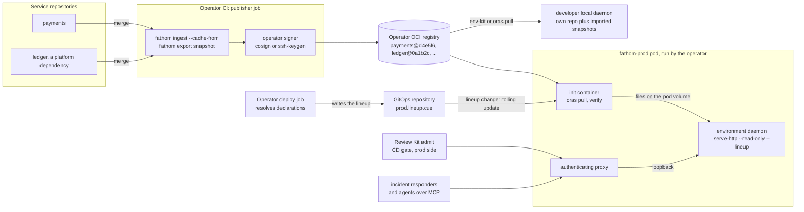
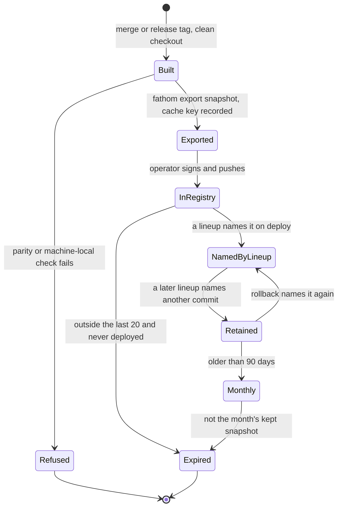
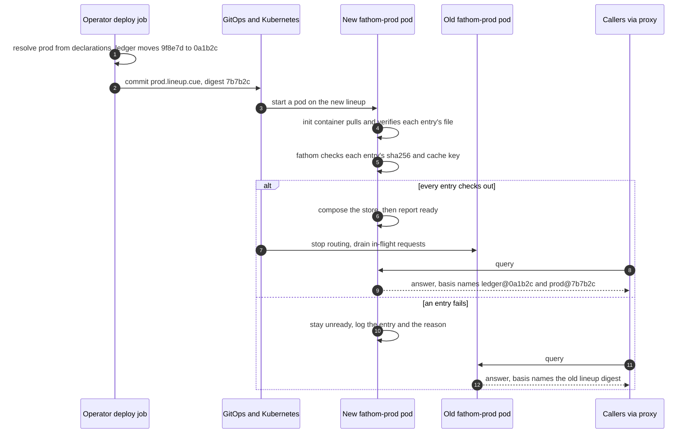
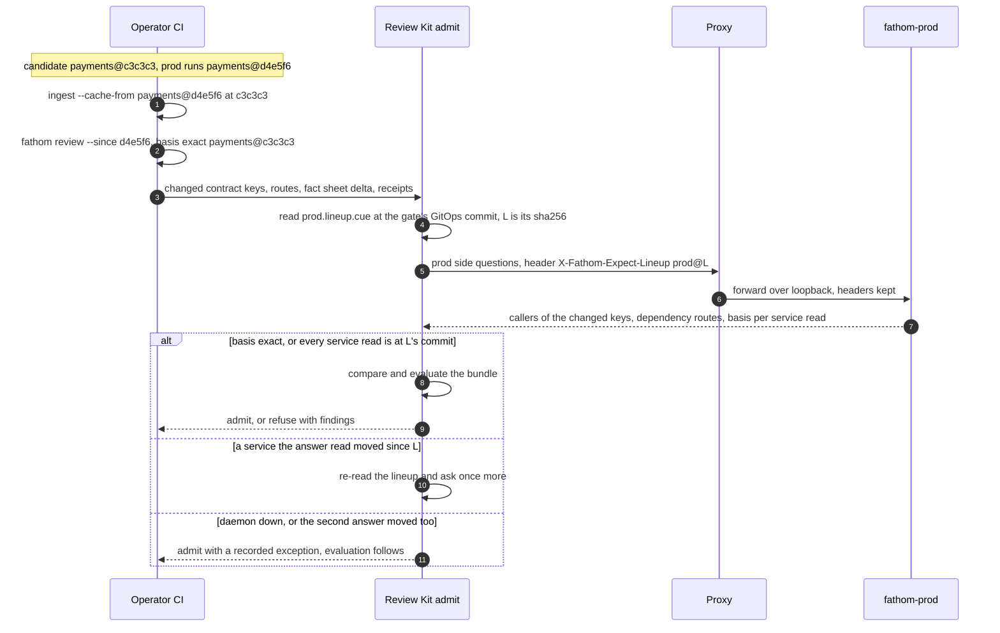
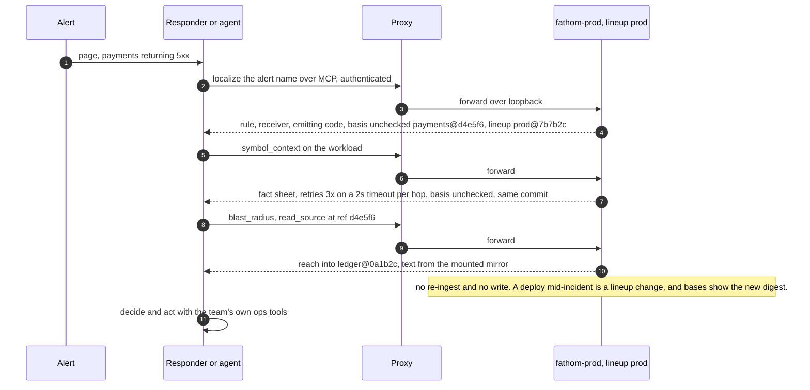
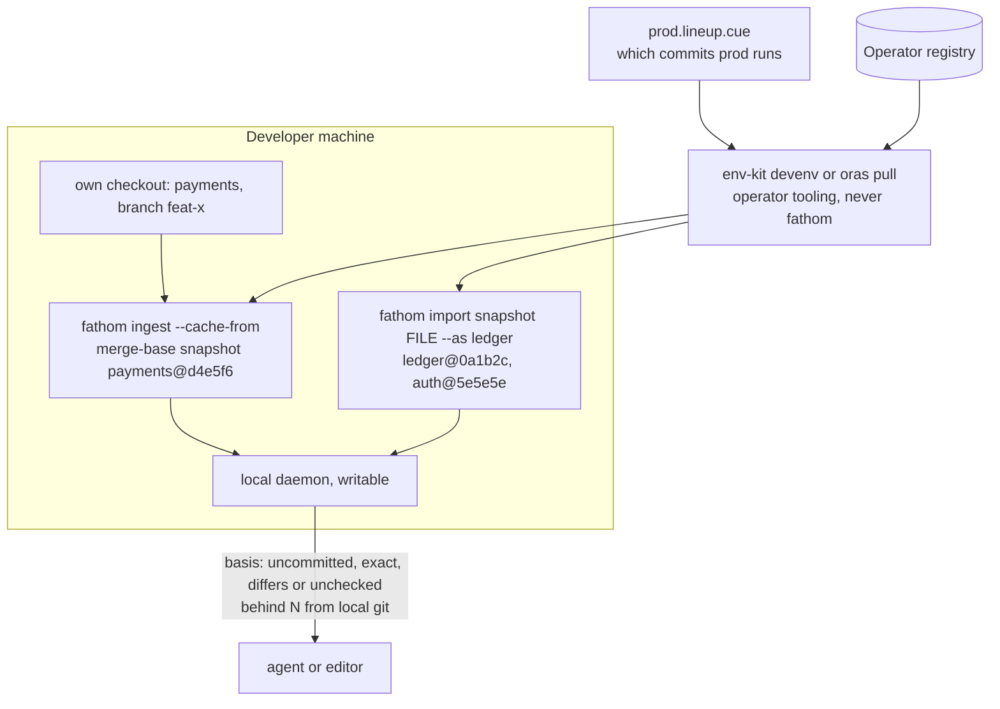
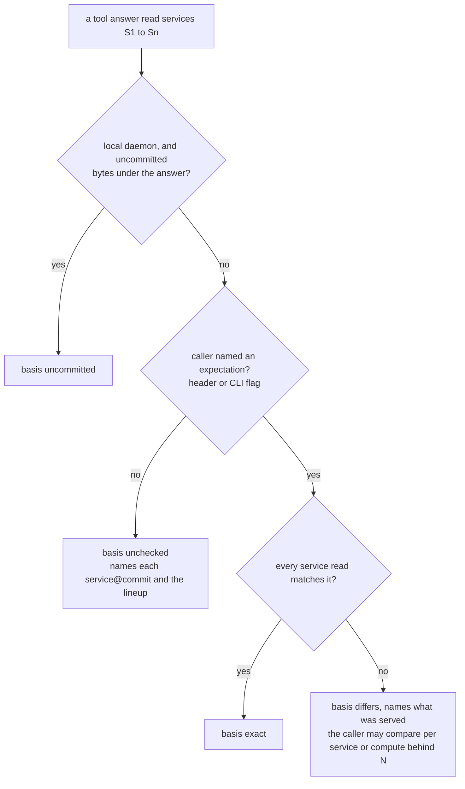
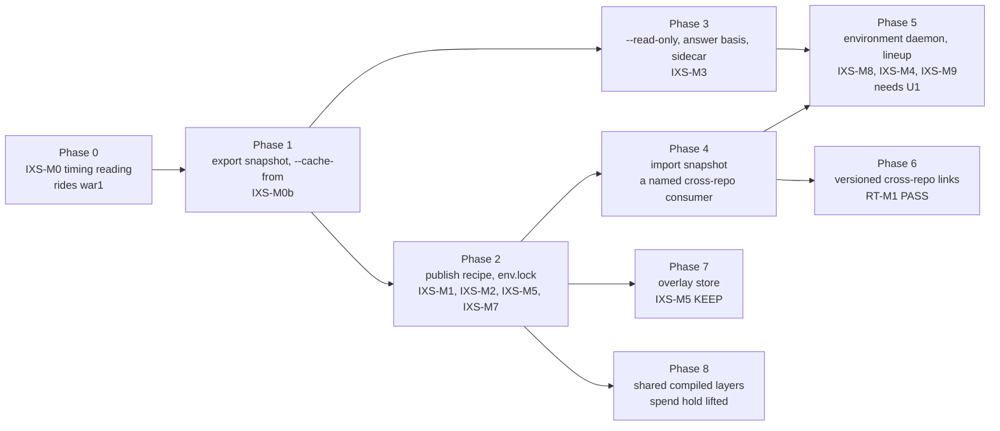

# Index snapshots: CI exports each service's index at a commit, and environment daemons serve what each environment runs, read-only

Status: accepted as a design, parked (2026-10-11). Proposed 2026-10-11 and accepted as a design by the
owner-architect the same day; nothing is scheduled. The owner prioritizes it when ready; the earliest start is after
war1 lands and RT-M1 reads (section 12). war1 is paused: its items are R1 in `docs/plans/resume-2026-10.md`.
Decision record: ADR-069 (its environment-daemon parts wait on the owner's U1 answer, section 16). Plan:
`docs/plans/index-snapshots.md` (IXS-). Roadmap: `docs/vision/38-proof-layer-roadmap.md` section 9.4. Futures: F74
(the environment daemon), F3 (amended triggers), F8, F27, F70, F72, F73. Assessment:
`docs/assessments/2026-10-11-index-snapshots.md`. Deployment options, ports and adapters, and costs:
`docs/design/index-snapshots-deployment.md`.

Owner direction of 2026-10-11, in substance: CI/CD keeps a fathom index fresh for each service and for the
platform services it depends on. A long-running, read-only fathom per environment (or service group) follows
what is deployed and holds the deployed versions of each service's dependencies. It serves the CD review gate's
"prod side" and live incident investigation, for humans and AI agents over MCP. Teams pull indexes others built
instead of re-indexing, and expert knowledge is networked across services. He called it "fathom workspaces" and
asked for names, a durable design, visuals, and a roadmap entry to prioritize later.

How to read this file. Paths are repository-relative at fathom `1639b37c`. `pe:` is platform-engineering at
`84f9d41`, and `rk:` is `pe:kits/review-kit/`. [J] marks a judgment. External facts carry a URL. Each diagram is
mermaid and has a numbered prose reading under it, so the design reads without a renderer. This is the first
mermaid in `docs/`: no `mermaid` fence exists at `1639b37c`. This file is the single glossary. The names rejected
on 2026-10-11, and why, are in Appendix A, so they are not proposed again.

## 1. Names, thesis and glossary

### 1.1 The owner's words, mapped

| The owner's word | Becomes | Why |
|---|---|---|
| "fathom workspaces" (the capability) | **index snapshots**, no brand | `workspace/` is fathom's build-scratch directory (AGENTS.md:10); "index snapshot" is already fathom's word for this exact thing (I56, docs/intent/invariants.md:85; F27, docs/intent/futures/f23-f32.md:55; vision 38, docs/vision/38-proof-layer-roadmap.md:165; ADR-068, ADR.md:4617) |
| a "workspace": a live instance per service | **no per-service daemon.** Each service has one index snapshot per commit: a file | a file at a commit never changes under a reader; a live per-service daemon is what F3's amended triggers would bring back (section 10.2) |
| a "workspace fleet": the networked set of those instances for one environment | **a lineup**, served by **one environment daemon**, deployed as `fathom-<env>` | one process holds every service the lineup names, so cross-service answers are joins in one process, not calls between daemons |
| the set of environment daemons (prod, staging, ...) | **no name** | no component acts on the set (section 1.3) |

Is an environment daemon's set of services its "fleet"? In fathom's sense, yes: a fleet is "every service the
shared daemon serves" (docs/intent/domain.md:44-45). But the `fleet` verbs (`report`, `reconcile`,
`realization`, `receipts`, `undo`, `remedy`; cmd/fathom/verbhelp.go:82) reconcile workstation wiring and do not
apply to an environment daemon [J]. Docs say "the lineup's services" so that no reader expects them to.

### 1.2 Thesis

CI exports one immutable fathom index per service at each merge and release commit, the operator publishes and
signs it, and anyone who needs that service's evidence imports or serves the file instead of re-indexing. An
environment daemon is a read-only fathom that serves one lineup (the `service@commit` entries an environment
runs). The CD gate's prod side and an incident responder get answers whose basis names the deployed commits. The
daemon reads its lineup once, at start; a deploy that changes the lineup starts a new daemon pod.

**Why not "fathom workspaces".** Inside fathom, `workspace/` is the gitignored build-scratch directory. Outside,
the word means something in Go (`go.work`), Terraform (per-environment state, the same prod and staging setting
as this feature, https://developer.hashicorp.com/terraform/cli/workspaces), npm, yarn, pnpm, Bazel and VS Code.
In each, a workspace is a mutable place where you work. This feature is the opposite: immutable files, served
read-only. Fathom exports and imports; the operator's CI publishes and signs (I56; ADR-068 decision 7,
ADR.md:4582-4586).

### 1.3 No name for the set of daemons

No component acts on the set: daemons never query each other until one of F3's amended triggers fires (section
10.2). A name for the set would invite a control plane, which the hosted non-goal refuses
(docs/intent/scope/non-goals.md:17-20). The snapshots live in "the operator's registry", and the plural of
environment daemon is "environment daemons".

### 1.4 An index snapshot is not an expert module and not a SCIP index

**Expert module.** Fathom already has a portable store: an expert module is "one conforming store
(`store-format-v0.md`) + one module manifest" (docs/spec/expert-module-v0.md section 1; domain.md:60), on the
compatibility surface (docs/intent/scope.md:61-62). Its manifest carries corpus selectors, a module version and
eval evidence (expert-module-v0.md section 3); `fathom module pack` assembles it (cmd/fathom/module_pack.go:3-7);
`module doctor` grades it draft, eval-passed, servable, published (cmd/fathom/module_doctor.go:3-5, 27-31).

An index snapshot is a conforming store but not a module [J]:
- It has no curated corpus, no module version and no eval evidence. It is exactly what an ingest at one commit
  produced, and it is used to start or serve an index, not to serve judged claims.
- So it carries no manifest. Its cache key lives inside the file, in an additive `export_meta` table, because a
  snapshot travels as one file through the operator's registry.
- It reuses the module path's copy discipline: `VACUUM INTO` a new file, then verify the conformance markers on the
  copy (module_pack.go:9-19, the Phase J critic finding that `wal_checkpoint(TRUNCATE)` can lose WAL frames
  silently).
- Nothing is foreclosed: expert-module-v0.md section 1 allows a manifest "generated on demand from
  `service_meta` + `compile_runs`", so a later `module pack` of a snapshot can generate one from `export_meta`.
- The word "published" stays off the artifact: it is the top rung of the module ladder.

**SCIP index.** In fathom, "import" plus "index" means SCIP: typed edges "arrive by import" through
`fathom ingest --scip` and an auto-detected `index.scip` (ADR-041 decision 5, ADR.md:2293-2295), and `init` "has
the daemon import its index as typed edges" (cmd/fathom/init.go:82). `fathom export scip` writes `index.scip`
(cmd/fathom/export.go:126-127). So the verbs here say `snapshot`, never `index`.

### 1.5 Glossary

| Term | Means | Does not mean |
|---|---|---|
| **index snapshots** | The capability (plan and roadmap title): CI exports an index snapshot per service per commit, the operator publishes and signs it, and developers, CI and environment daemons import or serve it read-only | A hosted service, or anything fathom operates. Not JetBrains-style downloaded IDE indexes. Not a brand |
| **index snapshot** (written `payments@d4e5f6`) | One service's fathom store at one commit, built from a clean checkout, copied with `VACUUM INTO`, machine-local fields cleared, its cache key recorded inside, signed by the operator. Immutable. A conforming store (docs/spec/store-format-v0.md). Always two words | A live or writable index. Not an expert module and not at any module readiness level (section 1.4). Not a SCIP index (`index.scip`, `ingest --scip`, `export scip`). Not a fleet report snapshot (cmd/fathom/console_operate.go:105) or the in-memory symbol snapshot (`memo.Snapshot`). Not a snapshot committed to a repository (K5, ADR-061). Not evidence (ADR-068, ADR.md:4617). Not git's index or an OCI image index |
| **store** (unchanged) | The file format and the daemon's database | The artifact's name in docs or CLI |
| **cache key** | The components that decide reuse: repo identity (root-commit id + subpath), commit, fathom version, ExtractorEpoch, TypedEdgeEpoch, format version (`PRAGMA user_version`), config digest, env.lock digest (section 4.1) | A symbol's "index key" (internal/testrun/candidates.go:35). Not the typed pass's per-package cache key (`packageContentHash`, internal/fusion/typedcalls.go:1567-1570) |
| **lineup** (`prod.lineup.cue`) | A committed CUE file of lineup entries for one environment or service group, each traced to the GitOps declaration that named it. The operator's deploy job writes it; fathom only reads it, once, at start. Its **digest** is the sha256 of its bytes | A deploy ledger fathom stores. Not a Kubernetes or OCI manifest. Not `gen-platform-manifest`'s output, which lists store paths with no commits (cmd/fathom/genmanifest.go:128) |
| **lineup entry** | One service in a lineup: `service@commit`, the snapshot's path, sha256 and cache key | A "pin": in fathom a pin is a test a governing source names (domain.md:74-78, ADR-057). Not agentic-kit's `Repin` of MCP tool-description hashes (third_party/agentic-kit/docs/practices.md:370-377) |
| **lineup change** (event) | The operator moves an environment daemon to a new lineup. By default a Kubernetes rolling update: a new pod starts on the new lineup, composes, reports ready, and the old pod drains | A fathom verb, a reload or a swap. Not a deploy record: fathom stores nothing about it |
| **environment daemon** (deployed as `fathom-<env>`, spoken "fathom-prod") | A long-running `serve-http --read-only --lineup <file>` holding every index snapshot its lineup names. Serves the CD gate's prod side and incident responders over MCP. Stateless: rebuilt from snapshots at each start | A writable or multi-tenant host. Not something fathom runs. Not one per service: one per lineup |
| **composed store** | The daemon-private store an environment daemon builds at start from its lineup's snapshots; the only file it writes; discarded with the pod | A published file. Not a module store |
| **read-only sidecar** | The same `--read-only --lineup` mode, run for one job (a review runner, an incident agent) over loopback | A long-lived shared daemon |
| **local daemon** (unchanged) | The developer's writable daemon over their own checkout, plus imported dependency snapshots | An index snapshot |
| **answer basis** (`basis:`) | On every tool answer: each `service@commit` the answer read, its cache key, the lineup and digest when one is served, and one state | A law 6 stamp, which is "a file recording that an activation step ran" (domain.md:61; P6). Not `as_of`, a validity-window instant (internal/mcp/asof.go:3-9) |
| basis **`exact`** | The caller named an expectation (section 4.3) and every service read matches it | `find_symbol`'s exact name-match tier |
| basis **`differs`** | The caller named an expectation and a service read is at another commit, or the daemon serves another lineup digest. The basis names what was served | An error |
| basis **`unchecked`** | The caller named no expectation. The basis still names every `service@commit` served. The usual state for an agent over MCP | Untrustworthy data: the answer is exactly what the basis names |
| basis **`uncommitted`** | A local daemon answered over bytes not yet committed. Same word as the anchor state (internal/receipt/anchor.go:42) | The binary's `dirty` build flag (cmd/fathom/version.go:85) |
| **`behind N`** (caller side only) | The caller's git counts commits from the basis commit to the caller's commit (`git rev-list --count`) | A daemon-computed state. The daemon has no checkout, and listing a registry is a fetch (I56) |
| **snapshot list** | An operator-named file listing the commits that have index snapshots. The caller uses it to pick the nearest one | A "catalog", which is taken twice (Review Kit's catalog; fathom's layer catalog, ADR.md:903) |
| **`--cache-from` ingest** | Start a branch or PR index from an index snapshot. Files whose fingerprints match skip extraction, so a wrong cache costs time, never correctness, once IXS-M0b proves parity. Docker BuildKit's meaning (https://docs.docker.com/reference/cli/docker/buildx/build/) | A warm ingest (the measured 76 s same-checkout case). A cache-from ingest misses the stat gate and re-hashes every file |
| **fact sheet** | Per service at one commit: its concern facts, stored as observations at ingest (WAE wave 2), plus joins computed at request time inside the one process that holds the snapshots (probe reaches DB, retry x timeout per hop, alert route, IAM reach), each with receipts and coverage. Nothing joined is stored. No grades | Precomputed joins (joins are computed at request time, ADR-058 decision 2). A risk score or a list of problems: Review Kit judges (ADR-055 decision 7); pe's `pdk/risk` owns tiers (pe:pdk/risk/model.go:10-15) |
| **registry** (the operator's) | The OCI registry or artifact store holding index snapshots | A fathom object. Not fathom's MCP tool registry (internal/mcp/server.go:121-122) |
| **fleet** (unchanged) | Every service one daemon serves (domain.md:44-45) | The set of environment daemons. The `fleet` verbs do not apply to an environment daemon (section 1.1) |
| **workspace** (unchanged) | Only the gitignored `workspace/` scratch convention | Anything in this feature |

Counted honestly. Reused fathom words: index snapshot, store, local daemon, fleet, workspace. Industry words
with their industry meaning: cache key (qualified above), `--cache-from`, registry, rolling update. New terms:
seven nouns (lineup, lineup entry, environment daemon, composed store, read-only sidecar, answer basis, snapshot
list, with fact sheet as an eighth if the owner keeps it, question 3) and one event (lineup change). Every new
term was checked against docs/intent/domain.md at `1639b37c`: no hits for lineup, basis, environment daemon,
composed store, snapshot list or fact sheet.

### 1.6 Verbs and output shapes (proposed)

```
fathom export snapshot --service <s> [--store PATH] [--env-lock F] [--no-docs] -o <file>
    # joins `export scip` in the export verb (help group "operate", cmd/fathom/export.go:126)
    # VACUUM INTO a new file, clears machine-local fields, verifies application_id and user_version,
    # records and prints the cache key; never uploads or signs
fathom import snapshot <file> [--as <service>] [--expect-cache-key <k>]
    # writable local daemon only; refused under --read-only (IXS-7, change 10)
fathom ingest --path <dir> --cache-from <file>
fathom serve-http --read-only --lineup <file.cue>
    # an environment daemon or a read-only sidecar; reads the lineup once, at start
fathom version --json
    # will add the fathom-side cache-key components (change 1);
    # today it prints version, revision, revision_time, dirty, tenancy_contract (cmd/fathom/version.go:82-86)
```

- `basis: exact payments@d4e5f6 (lineup prod@7b7b2c, cache key 9e41c2)`
- `basis: unchecked payments@d4e5f6 (lineup prod@7b7b2c)`
- The daemon's start log: `fathom-prod: serving lineup prod@7b7b2c (12 entries)`
- The deploy job's own line, not fathom's: `fathom-prod lineup change: ledger 9f8e7d -> 0a1b2c (prod@7b7b2c)`
- `#inc-142: fathom-prod says payments retries 3x on a 2s timeout per hop (basis unchecked payments@d4e5f6, lineup prod@7b7b2c)`
- `payments fact sheet @d4e5f6: +1 liveness -> db (this PR)`

There are no `publish`, `pull`, `push`, `sync`, `swap` or `reload` verbs. Transport and signing belong to the
operator (`oras push`/`oras pull`, cosign), per I56 and ADR-068 decision 7.

## 2. Scope and non-scope

| In scope: fathom builds | Source |
|---|---|
| `fathom export snapshot`: write an index snapshot from a store with `VACUUM INTO`, machine-local fields cleared, cache key recorded and printed | changes 11, 13 (section 9) |
| `fathom ingest --cache-from <file>`: start an index from a snapshot; parity with a cold ingest proven before any snapshot is published | change 5; IXS-M0b |
| `fathom import snapshot <file> [--as S]`: merge a snapshot's service into a writable store so every code tool answers it unchanged | change 10, gated |
| `serve-http --read-only`: a serving mode with no reachable write and no spend | change 4 |
| `serve-http --read-only --lineup <file>`: load a lineup at start, report ready only when every entry loads | change 14 |
| The answer basis on every tool answer, with an expectation channel callers can set; `behind N` on the caller's side | change 3 |
| `version --json` prints the cache key's fathom-side parts; `read_source` reads at a ref | changes 1, 2 |
| A per-service freshness column in the existing observatory | change 12 |
| The lineup schema (`schema/lineup/`), because fathom is the reader | change 15 [J] |

| Not in scope | Why | Source |
|---|---|---|
| Fathom operates anything (a service, a registry, a host) | bus factor of one, tenancy, SLA; the operator runs every daemon | vision 07 R1 (docs/vision/07-questions-and-risks.md:26); non-goal (docs/intent/scope/non-goals.md:17-20) |
| A write path on a served snapshot | law 9: a hosted surface "cannot write to a module store it did not create itself" | docs/vision/12-governed-knowledge-engine.md:103-113; P9 (docs/intent/principles.md:35-36) |
| A multi-tenant daemon | the non-goal stands even after U1 | docs/intent/scope/non-goals.md:17-20 |
| Query-time RPC between live daemons | ship files; joins run in one process; revisit only on F3's amended triggers | ADR-069; section 10.2 |
| A stored deploy record or event payload | deploy state is a declaration; attach stays refused (argued below) | ADR-058 decision 4 (ADR.md:3559-3562); IM-X2, IM-X4 (docs/plans/incident-maps.md:68, 70) |
| Fetching, pulling, syncing or listing a registry | fathom reads only a path the operator names in that invocation | I56 (docs/intent/invariants.md:85); F27 |
| Auth inside fathom, or a non-loopback bind | the bearer path was built and deleted for zero use; auth is the operator's proxy (law 9 as amended, U1) | GKE-MH-7 (docs/plans/gke-module-host.md:94); SR-17 (docs/plans/surface-reckoning.md:33) |
| Holding keys or verifying signatures | the operator's signer signs and verifies | ADR-068 decision 7 (ADR.md:4582-4586) |
| Index snapshots as evidence | a point-in-time claim leaves as a receipt re-derived at that commit | ADR-068 (ADR.md:4617); section 4.4 |
| A gate verb, a grade or a risk score | Review Kit admits; pdk/risk tiers | ADR-063 O2 (ADR.md:3976); ADR-055 decision 7 |
| `publish`, `pull`, `push`, `sync`, `swap` or `reload` verbs | they over-claim what fathom does, or already mean something (section 9.3) | naming decision, 2026-10-11 |
| A watch on the lineup file, a reload endpoint or a control socket | the dispatch non-goal: fathom "never watches, schedules, retries" | docs/intent/scope/non-goals.md:27 |
| A name, registry or control plane for the set of daemons | nothing acts on the set | section 1.3 |
| An incident view or a "workspace board" | the incident command center non-goal; only a freshness column | docs/intent/scope/non-goals.md:21; assessment 2 section 14 row 11 |
| An overlay store, or an index of every branch | measure the cheap path first | F70; IXS-M5 |

**Why a lineup change is not attach (owner decides).** IM-X2 refuses "external tools push deploy, flag or
alert events into fathom's store" and reopens "only by a new ADR" (docs/plans/incident-maps.md:68). IM-X4 refuses
"a deploy, flag and alert timeline" (:70). This design argues it stays clear of both [J]:
- Nothing is pushed into fathom. The deploy job writes the operator's own lineup file in GitOps; Kubernetes starts
  a new pod; that fathom reads an operator-named file at start, the same shape as `--deployed <sha>`, a
  "typed parameter" the caller fills "from their own deploy tool" (ADR-058 decision 4, ADR.md:3559-3562).
- Nothing about the deploy is stored. The composed store holds the snapshots' contents and the lineup's name and
  digest, and it dies with the pod. There is no table of past lineups.
- The start log line (`serving lineup prod@7b7b2c`) is an operational log, never a served timeline: no tool
  answers "what changed when" from it (IM-X4).
Because each deploy does change what fathom-prod answers, this is marked as an owner decision under ADR-069
decision 9, with IM-X2's reopen clause cited. If the owner rules it attach, phase 5 needs a new ADR first.

## 3. Architecture

### 3.1 The parts and who runs them

| Part | Where it runs | Who runs it | Fathom's part |
|---|---|---|---|
| Publisher job | the operator's CI, on merge to main and on release tags | operator | `ingest --cache-from`, `export snapshot` |
| Signer | the publisher job | operator | none (ADR-068 decision 7) |
| Registry | the operator's OCI registry; a snapshot can ride as an OCI referrer of the image digest (https://github.com/opencontainers/distribution-spec/blob/main/spec.md#listing-referrers) | operator | none |
| Deploy job | the operator's CD | operator | none: it resolves declarations and writes the lineup into GitOps |
| Lineup | the operator's GitOps repository, mounted into the pod (a ConfigMap) | written by the deploy job | reads and validates it at start |
| Delivery | an init container in each environment-daemon pod: `oras pull` plus signature verification (https://oras.land/) of every entry the mounted lineup names | operator | none |
| Environment daemon | a Kubernetes Deployment, one per lineup; each pod runs the authenticating proxy beside the daemon | operator | `serve-http --read-only --lineup` |
| Read-only sidecar | beside one job: a review runner or an incident agent | the job's owner | the same mode, loopback only |
| Local daemon | a developer's machine | the developer | writable; own repo plus imported dependency snapshots |
| CD gate | Review Kit `admit` (rk:README.md:57) | operator | answers with a basis, and receipts |

One delivery owner: the init container in the pod that will serve the files. The deploy job never reaches inside
a pod, and there is no control socket.

### 3.2 System overview



Reading:
1. Each merge runs the operator's publisher job. It ingests from the previous snapshot (`--cache-from`), exports
   an index snapshot, and the operator's signer signs it into the registry.
2. The deploy job resolves what an environment runs from GitOps declarations and writes the lineup into GitOps.
3. A changed lineup is a rolling update. The new pod's init container pulls and verifies the files the lineup
   names. Fathom never touches the registry.
4. The environment daemon reads the lineup once, composes, and serves read-only. Consumers reach it only through
   the operator's authenticating proxy, which talks to it over loopback.
5. Developers pull the same files with their own tooling and import them into their local daemon.

### 3.3 Lifecycle of one index snapshot



Reading:
1. A snapshot is built only from a clean checkout at a merge or tag commit. A PR's index is a scratch store in
   that CI run and is never published.
2. A failed parity or machine-local check refuses the export (IXS-M0b; IXS-0). Nothing is published.
3. Snapshots for main keep the last 20 per service. A snapshot a current lineup names never expires: every commit
   a current lineup names is a retention root [J].
4. A deployed snapshot is kept 90 days after a later lineup moved off it, then one per service per month (owner
   ruling D13, 2026-10-11). Retention is the registry's policy; fathom stores nothing about it. Its purpose is
   section 4.4.

### 3.4 A lineup change: a rolling update moves fathom-prod to the new lineup



Reading:
1. The operator's deploy job decides what prod runs. Fathom is never called; a new pod reads an operator-named
   file at start.
2. Delivery is the new pod's init container: files first, then fathom starts. Authenticity (the signature) is the
   init container's check.
3. Fathom checks integrity only: each file's sha256 and the cache key recorded inside it must match the lineup
   entry. A failure keeps the new pod unready, so the old pod keeps serving; Kubernetes marks the rollout failed
   after its progress deadline (https://kubernetes.io/docs/concepts/workloads/controllers/deployment/#failed-deployment).
   The operator retries; fathom never retries (docs/intent/scope/non-goals.md:27).
4. Lineup changes that arrive faster than a compose are coalesced by Kubernetes: a newer update replaces one in
   flight (https://kubernetes.io/docs/concepts/workloads/controllers/deployment/#rollover-aka-multiple-updates-in-flight).
   The daemon then lags prod by up to one compose time. IXS-M7 prices that (section 11); if compose is too slow
   for the deploy cadence, an in-place lineup change is the fallback (question 8).
5. The deploy job should not write an entry whose snapshot is missing. It keeps that service's previous entry and
   says so in its own log [J]; the freshness column shows the lag (change 12).

### 3.5 The CD gate: candidate built in CI, prod side from the environment daemon



Reading:
1. The candidate side is a scratch index in CI, started from the snapshot of the commit prod runs. The CLI names
   its own commit, so its answers carry `exact`.
2. The prod side is the environment daemon: who calls the candidate's changed routes and contract keys at their
   deployed commits, and whether the routes the candidate calls exist in the dependencies prod runs. These are
   cross-service answers, so they need every prod service in one store.
3. Review Kit learns L before it asks: it reads the lineup file at the GitOps commit the gate runs against and
   hashes its bytes. It sends `X-Fathom-Expect-Lineup: prod@L` (section 4.3).
4. If the daemon serves L, the basis is `exact`. If a lineup change happened mid-gate, the basis is `differs`, and
   Review Kit compares per service: every `service@commit` the answer read against L's entry. A lineup change to
   a service the answer did not read does not matter.
5. At the organization illustration (50 services, 4 deploys a day each), prod sees about 200 lineup changes a
   workday, about one every 2.4 minutes. A whole-lineup comparison would fail open often. The per-service
   comparison fails open only when a service the answer read moved twice within one gate [J]; WAE-M7 counts it
   against a bar (section 11).
6. Review Kit compares and judges. Fathom has no gate verb (ADR-063 O2). A rollback to an evaluated commit and a
   pdk/risk T3 break-glass admit too (pe:pdk/risk/model.go:14).

### 3.6 Incident investigation



Reading:
1. The responder or the agent asks fathom-prod, not their laptop. Answers describe the code prod runs, not main.
2. An agent over MCP cannot set `_meta` (the served protocol has no per-request `_meta`,
   internal/mcp/protocol.go:11-15; ADR-068, ADR.md:4620-4621) and usually sets no header, so its answers read
   `unchecked`. The basis still names the commit and the lineup digest, which is what a responder needs.
3. The index never changes under a pod: auto-refresh is off, and nothing re-ingests. If the incident spans a
   lineup change, the basis shows the new digest.
4. The fact sheet's concern facts (retry x timeout, alert routes) exist only after WAE wave 2 lands. Until then,
   incident answers are code-only (section 12, phase 5).
5. Fathom never executes, proposes or records a mitigation (IM-X3, IM-X9).

### 3.7 Developer flow



Reading:
1. The developer's own repository stays on the local daemon: it sees uncommitted bytes, meets the edit-hook
   latency budget and works offline.
2. A branch starts from the merge-base's snapshot (`--cache-from`), not a cold ingest.
3. Dependencies come in as files at the commits prod runs, imported under the lineup's service names.
4. The local daemon computes `behind N` itself, because it has the checkout.

## 4. Data model

### 4.1 Snapshot identity and the cache key

| Component | Value at `1639b37c` | Source | Printed today? |
|---|---|---|---|
| Repo identity | the root-commit id (the parentless commit; the smallest id if a repository has several [J]) plus a repo-relative subpath for monorepo services | host-free (ADR-011); ADR-068 decision 11 keeps repository identity optional in receipts (ADR.md:4598-4599) | no: change 13 |
| Commit | the watermark: git HEAD at ingest, stored as `service_meta.indexed_commit` | docs/spec/store-format-v0.md:155; ADR-017 decision 3 (ADR.md:413-418) | in the store |
| Fathom version | `Version` and `revision` | cmd/fathom/version.go:82-86 | yes |
| ExtractorEpoch | `"62"` | internal/fusion/extractor_epoch.go:693 | no: change 1 |
| TypedEdgeEpoch | `"5"` | internal/fusion/typedcalls.go:1565 | no: change 1 |
| Format version | `PRAGMA user_version`, `1` for store format v0 | docs/spec/store-format-v0.md:81 | no: change 1 |
| Config digest | sha256 over the repository's fathom configuration that changes extraction (`.fathom/` config and ignore files) [J] | | no: change 13 |
| env.lock digest | sha256 of `.envkit/env.lock`, which names the fathom release and the toolchain the typed pass uses | pe:kits/env-kit/README.md:150 | no: `export snapshot --env-lock <path>` [J] |

The cache key's value is the sha256 of the components as canonical JSON. Bases and logs show its first six hex
digits (`cache key 9e41c2`) [J].

Where the key is used:
- `export snapshot` records the key and its components inside the file, in an additive `export_meta` table
  (store format v0 stays additive, docs/intent/scope.md:58-59), and prints them (change 13) [J].
- `ingest --cache-from` never requires a match. A mismatch costs time only: every file whose epoch-salted
  fingerprint differs is re-extracted (internal/fusion/extractor_epoch.go:695-700). It prints which components
  differed. It refuses a file whose repo identity differs from the checkout's [J].
- An environment daemon refuses a lineup entry whose recorded key differs from the entry's `cache_key`.

How the file is made (change 13): `VACUUM INTO '<new file>'`, which reads a consistent snapshot of the source
including live WAL content and writes a new file with no `-wal` or `-shm` sidecar; then clear the machine-local
fields on the new file; then verify `application_id` and `user_version` on it. This is `module pack`'s method,
adopted because `PRAGMA wal_checkpoint(TRUNCATE)` "can lose WAL frames SILENTLY when busy=1"
(cmd/fathom/module_pack.go:9-19).

What an index snapshot holds [J]: what a cold ingest at that commit produces, plus compiled claims whose
`compiled_at_watermark` is that commit (phase 8 only). Run and session records stay out (review runs, compile
runs, imported external findings, ingest state). IXS-0 grounds the exact table list. It holds text, but no
source-code file text:
- document body text, in the FTS5 table `docs_fts` (its `body` column; "the body text that only ever lives in the
  docs_fts shadow tables", internal/store/docindex.go:45-46, 86-94), created in every store
  (internal/store/sqlite_services.go:88-90; KR-1);
- claim anchor text (`claim_links.anchor_text`, internal/store/sqlite_schema.go:160);
- summaries (`knowledge_cards.summary`, `doc_summaries.summary`, internal/store/sqlite_schema.go:92-106);
- commit authors and messages (`commits`, internal/store/sqlite_schema.go:116-125), the same exposure as the git
  history.

Decision [J]: `export snapshot` keeps `docs_fts` by default, so documentation search works across imported
services (section 10.1), and `--no-docs` drops `docs_fts`, `doc_units` and `doc_summaries`. `read_source` reads
the corpus root on disk (internal/mcp/readsource.go:170-176), so source text needs the mirror in section 6.5.

### 4.2 The lineup (CUE sketch)

```cue
// schema/lineup/lineup.cue (proposed; illustrative). Fathom reads and validates a lineup at start.
// It never writes one.
package lineup

#SHA:    =~"^([0-9a-f]{40}|[0-9a-f]{64})$" // SHA-1 or SHA-256 object ids
#Digest: =~"^[0-9a-f]{64}$"

#Lineup: {
	lineup: =~"^[a-z0-9][a-z0-9-]{0,62}$" // "prod", "staging", "payments-group"
	// The declarations this lineup was resolved from. Fathom only echoes it.
	resolved_from?: {repo: string, commit: #SHA}
	services: {[Name=string]: #Entry & {service: Name}}
}

#Entry: {
	service: =~"^[a-z0-9][a-z0-9._-]*$"
	repo: {
		root:    #SHA        // the repository's root-commit id
		subpath: string | *"" // repo-relative; "" for a whole repository
	}
	commit: #SHA
	index: {
		path:      string  // a local path the operator's delivery wrote (I56); relative to this file
		sha256:    #Digest // the file's digest; a mismatch refuses the entry
		cache_key: #Digest // must equal the key recorded inside the file
		ref?:      string  // the operator's registry reference; fathom never reads it
	}
	source?: {git: string} // a read-only git mirror path for read_source; absent means facts only
	from?:   string        // the declaration that named this commit, echoed in the answer basis
}
```

An instance, with ids shortened:

```cue
lineup: "prod"
resolved_from: {repo: "gitops", commit: "9c1f..."}
services: {
	payments: {
		repo: {root: "1a2b..."}
		commit: "d4e5f6..."
		index: {path: "snapshots/payments@d4e5f6.sqlite", sha256: "77c0...", cache_key: "9e41c2..."}
		from: "clusters/prod/payments/release.yaml"
	}
	ledger: {
		repo: {root: "5d6e...", subpath: "services/ledger"}
		commit: "0a1b2c..."
		index: {path: "snapshots/ledger@0a1b2c.sqlite", sha256: "b3a9...", cache_key: "4f10..."}
	}
}
```

Rules:
- The lineup is the operator's file. Fathom reads it once, at start, and writes nothing back.
- The lineup digest is the sha256 of the file's bytes as committed. Review Kit computes it from the GitOps commit
  it gates against; the daemon computes it from the mounted file. Both read the same bytes [J].
- Service names are the lineup's keys. They map repo identity to a local name, which fixes today's basename
  collisions across a fleet (cmd/fathom/serviceident.go:27-46).
- An invalid lineup, or an entry that fails its check, keeps the daemon unready.
- The schema lives in fathom with valid and invalid testdata pairs (schema/AGENTS.md), because fathom is its
  reader [J]. Assessment 2 had placed it outside fathom. `#Entry` is new under `schema/lineup/`; the existing
  `#Entry` in schema/support/schema.cue:98 is a different package.

### 4.3 The answer basis

Every tool answer carries a basis (change 3). A cross-service answer names every service it read; its state is
the weakest of them, in the order `uncommitted`, `differs`, `unchecked`, `exact` [J].

```json
"basis": {
  "state": "exact",
  "services": [
    {"service": "payments", "repo": {"root": "1a2b...", "subpath": ""}, "commit": "d4e5f6...",
     "cache_key": "9e41c2...", "from": "clusters/prod/payments/release.yaml"}
  ],
  "lineup": {"name": "prod", "digest": "7b7b2c..."},
  "expected": {"lineup": "prod@7b7b2c..."}
}
```

Text form: `basis: exact payments@d4e5f6 (lineup prod@7b7b2c, cache key 9e41c2)`.

**How a caller names an expectation.** Not through `params._meta`: the served protocol has "no per-request
`_meta`" (internal/mcp/protocol.go:11-15), and ADR-068 records that "agents cannot set `_meta`"
(ADR.md:4620-4621). Not through a tool parameter: ADR-068 rejects one on the same line, and P4 forbids tool
growth. Not through `as_of`, which names an instant for validity windows (internal/mcp/asof.go:3-9). Instead [J]:
- **HTTP headers**, following the existing `X-Fathom-Origin` header, which "carries the caller's channel identity
  to the daemon" (cmd/fathom/origin.go:12-14; read at cmd/fathom/servehttp.go:467; CHANGELOG.md:1585):
  `X-Fathom-Expect-Lineup: prod@<digest>` and `X-Fathom-Expect-Commit: payments@<commit>` (repeatable). Review
  Kit's adapter sets them per request. The proxy passes them through (section 6.2).
- **A CLI flag** for the CLI's own calls, `--expect-commit <service@commit>`, beside the existing
  `review --expect-index-watermark` (cmd/fathom/review.go:64).
- **Nothing**, for stdio MCP and for agents. Their answers read `unchecked`, with the basis naming what was
  served.



Reading:
1. `uncommitted` exists only on a local daemon (ADR-041 decision 4, ADR.md:2286-2293).
2. A lineup expectation matches when the daemon serves that digest. A commit expectation matches when the named
   service was read at that commit.
3. `differs` and `unchecked` still name every `service@commit`, so the reader always knows what it got.
4. Who accepts what: the CD gate accepts `exact`, or `differs` when its own per-service comparison against L
   passes (section 3.5). An incident responder reads any state with the commit named. Exploration accepts any.
5. `behind N` is computed where the checkout is: the caller's fathom CLI or local daemon, with the snapshot list
   the operator names. The environment daemon never computes it.

### 4.4 Retention

| Snapshot | Kept | Enforced by |
|---|---|---|
| Main, each merge | the last 20 per service | the operator's registry policy |
| Release tags | as deployed commits, below [J] | the operator's registry policy |
| Deployed commits | any commit a current lineup names, always; 90 days after a later lineup moved off it; then one per service per month | the operator's registry policy (owner ruling D13) |
| PR heads | never published; the CI run's scratch store | CI |
| Developer imports | the developer's cache, same rule as main | env-kit or the developer |

**What retention is for.** Two uses [J]:
- Rollback gates. A rollback names an older commit; its snapshot must exist for the gate's prod side and for the
  daemon's next start.
- Incident replay. Asking what the code at a past deployed commit did, without a cold ingest.

It is not evidence. ADR-068 rejects "exporting the store or an index snapshot as evidence" (ADR.md:4617; K5). A
compliance or point-in-time claim leaves fathom as an ADR-068 receipt re-derived at that commit, never as the
snapshot file. D13's retention came from assessment 2 section 8.1's "point-in-time evidence ... compliance"; this
design keeps the retention and drops that purpose. If the owner wants snapshots kept as evidence, that needs an
ADR-068 amendment (question 11).

## 5. Freshness and correctness

### 5.1 Parity: a `--cache-from` ingest equals a cold one

The design rests on one claim: an index started from a snapshot equals a cold ingest at the same commit. It is
intended to hold because `FingerprintHash` is salted with ExtractorEpoch, so a changed file or a changed
extractor re-extracts (internal/fusion/extractor_epoch.go:695-700). It is unproven because gated cross-file
passes, route references and typed edges may still carry results computed against the cached index's other files.
Typed edges are replaced per package (internal/store/sqlite_schema.go:206), and the typed-package cache is keyed
by repo-relative paths (internal/fusion/typedcalls.go:1567-1570).

A copied index misses the stat gate, because mtime and inode differ (internal/fusion/stream.go:126-129). So it
re-reads and hashes every file and skips extraction only where the fingerprint matches. It does strictly more work
than a warm ingest, which sets IXS-M1's bar against warm, not cold.

IXS-M0b proves parity: across 10 commits, a digest over the portable derived tables (symbols, edges,
observations, typed edges, `docs_fts`; machine-local and wall-clock columns excluded) equals the cold ingest's. One
mismatch blocks publishing until fixed.

### 5.2 What "not stale" means

| Level | Meaning | Check | Owner |
|---|---|---|---|
| exact | every service the answer read is at the commit the caller expected | the answer basis; `review --expect-index-watermark` (cmd/fathom/review.go:64) | fathom |
| complete | every fact kind a bundle requires is present at a version it accepts | `version --json` plus the fact-kind list in the snapshot (changes 1, 8) | fathom reports; Review Kit decides |
| evaluated | Review Kit recorded an evaluation at that commit | Review Kit | Review Kit |
| lineup-current | the daemon serves the lineup digest the caller named; otherwise the caller compares per service | the basis's lineup digest and per-service commits | fathom reports; the caller compares |
| dependency-fresh | each dependency's entry is the commit its declaration names | the deploy job resolves entries from declarations; the freshness column shows each entry's age and `resolved_from` (change 12) | the operator's deploy job [J] |

Fathom cannot see a missed deploy: it keeps no deploy record. A lineup that lags prod reads `exact` against the
lineup. Dependency freshness is the deploy job's contract, and the freshness column makes a lag visible.

### 5.3 Epoch churn and the release lock

- ExtractorEpoch is `"62"` (internal/fusion/extractor_epoch.go:693). It was 39 at v0.9.0 and 52 at v0.10.0.
  29 commits since 2026-09-11 changed it, 22 of them since 2026-10-01 (`git log -G 'const ExtractorEpoch'` at
  `1639b37c`). Every bump re-extracts every file.
- A cached snapshot helps only when producer and consumer run the same fathom release. env-kit's `env.lock` names
  that release for CI and developers (owner ruling D7). Without it, IXS-M2's hit rate is near zero [J].
- Fallback, only if IXS-M2 reads under 0.5 with the release locked: per-extractor epoch salts (F73).
- Upgrading fathom on an environment daemon: snapshots in one lineup may come from different fathom releases.
  Each answer's basis names its cache key, and Review Kit's `complete` check refuses a fact at a version it does
  not accept. The operator either re-exports every commit a lineup names on an `env.lock` bump (section 8 prices
  it) or serves mixed versions with bases naming them. Question 9.

## 6. Security

### 6.1 Read-only, defined in four parts (change 4)

1. **Open read-only.** Snapshot files are opened with `store.MountReadOnly` (internal/store/conformance.go:201).
   On an environment daemon with more than one entry, the start step builds a composed store from the lineup's
   files and serves it through a read-only handle. Law 9 refuses writes to "a module store it did not create
   itself" (docs/vision/12-governed-knowledge-engine.md:106-108). The composed store is the daemon's own, and the
   snapshot files are never written [J]. So "read-only" here means: never writes a snapshot or any operator file;
   writes only its own composed store, at start (U1, question 1).
2. **No refresh.** Auto-refresh is off and the refresh queue is nil. Today a drifted read queues a re-ingest
   (internal/mcp/autorefresh.go:31-35, wired at cmd/fathom/servehttp_store.go:166-174).
3. **No write and no spend.** Refused or not mounted under `--read-only`:
   - the `ingest` tool (it accepts any absolute path, internal/mcp/extra_tools.go:453-459), refresh-file,
     compile and claim writes;
   - `POST /reload`, a 200 stub "would reload a PlatformStore in production" on the serving mux
     (cmd/fathom/servehttp.go:267, 653-664): removed in this mode;
   - the observatory's wiring preview, apply and undo endpoints (cmd/fathom/observatory_apply.go:188-214);
   - the decision port: provider forced to `none`, so `POST /route` (cmd/fathom/servehttp.go:259-266) answers its
     none-shaped 200 and spends nothing.
4. **No bare `/rpc` bypass.** `strictSurfaces` gates only named surfaces; bare `/rpc` serves the full registry
   (internal/mcp/dispatch.go:376-381; internal/mcp/server.go:121). Read-only mode hard-gates or disables it.

There is no control channel. The daemon reads its lineup once, at start, and a lineup change is a new pod. Nothing
on the serving address changes what is served [J].

IXS-M3 sweeps every MCP tool, bare `/rpc`, every named surface, the auto-refresh path, the observatory routes and,
by name, `/reload`, `/route` and the wiring preview, apply and undo routes. The snapshot bytes must not change and
no provider is called.

### 6.2 The operator's authenticating proxy: contract and threat

- **Contract.** The proxy runs in the same pod and reaches the daemon over loopback. It rewrites `Host` to
  loopback and drops `Origin`, because `requireLoopbackHost` refuses a non-loopback `Host` or a foreign `Origin`
  (cmd/fathom/admission_http.go:141-156). It passes `X-Fathom-Expect-*` headers through. It authenticates every
  request. It mirrors the forge's read access per service: a caller who cannot read `ledger` on the forge cannot
  read `ledger` here [J].
- **Threat.** The `Host` rewrite removes fathom's DNS-rebinding defence for whatever can reach the proxy. So the
  proxy authenticates every request and binds only where the operator intends. Fathom itself keeps its loopback
  default (`127.0.0.1:7575`, cmd/fathom/servehttp_config.go:59). Defence in depth: the mutating and spending
  routes in section 6.1 item 3 are off in this mode, so a proxy that forwards everything still reaches no write.
- **Law 9.** Auth is a launch requirement for anything hosted (docs/vision/12-governed-knowledge-engine.md:109;
  G5 at :196). Under the proposed amendment (U1), the requirement is met at the proxy-plus-daemon pair and proven
  by IXS-M8: every unauthenticated request through every route is refused, with `/reload`, `/route` and the
  wiring apply and undo routes named in the sweep.

### 6.3 Signing

The operator's signer signs each snapshot (`cosign sign-blob`, `cosign attest-blob` or `ssh-keygen -Y sign`).
The pod's init container verifies the signature before the file lands at the path the lineup names. Fathom holds
no key and verifies no signature (ADR-068 decision 7, ADR.md:4582-4586). Fathom checks only the file's sha256
against the lineup entry and the recorded cache key: integrity of the hand-off, not authenticity.

### 6.4 Secrets

A secret-bearing field is never selected (ADR-065 decision 2, ADR.md:4137), so it is never in a store and never
in a snapshot. IXS-0's test extends the WAE-13 sentinel: a sentinel planted in a fixture's env value, arg value
and a document body appears nowhere in an exported file outside the document's own `docs_fts` row, and never in
claim anchor text or summaries [J]. A sentinel in a document is the document's text: `--no-docs` is the
operator's control.

### 6.5 Code as intellectual property

- An index snapshot holds structure (symbols, edges, facts, claims) and some text: indexed document bodies, claim
  anchor text, summaries, commit authors and messages (section 4.1). It holds no source-code file text.
- Whoever can read the registry can read code structure and indexed document text. The registry's read access
  must match the forge's [J].
- `read_source` on an environment daemon needs source text. The operator may mount a read-only git mirror per
  service (the entry's `source.git`), and `read_source ref=<commit>` reads blobs from it (change 2). Without a
  mirror, `read_source` answers "not served: no source for payments@d4e5f6 on this daemon", and every other tool
  still answers with anchors a responder can open on the forge [J]. Question 6.
- No multi-tenant daemon, ever: one organization's snapshots behind one organization's proxy.

### 6.6 State outside the store

Suppressions, call logs and ledgers live under `$HOME`, outside the store (internal/store/scoped.go:14-25). Before
any daemon serves a second team, they are keyed per lineup (change 7).

## 7. Failure modes and degraded behaviour

| Failure | What callers see | Behaviour | Who acts |
|---|---|---|---|
| Environment daemon down during a deploy gate | no prod-side answer | fail-open: admit with a recorded `evidence: unavailable`, evaluation follows. A rollback to an evaluated commit and a pdk/risk T3 break-glass admit | the operator restarts the pod; WAE-M7 counts fail-open admissions |
| A lineup change during a gate | basis `differs` | Review Kit compares per service; re-asks once if a service it read moved; fails open only if it moved again | Review Kit; WAE-M7 |
| Environment daemon down during an incident | MCP calls fail at the proxy | fall back to a read-only sidecar from the same lineup on any machine with the files (same answers, same basis), then a local daemon with imports, then the forge at the deployed commit. The daemon is stateless: a restart recomposes from files | operator |
| Stale dependency: the lineup lags prod | answers `exact` against a lagging lineup | the freshness column shows each entry's age and `resolved_from`; fathom cannot see a missed deploy | the operator's deploy job |
| A deployed commit has no snapshot | the deploy job keeps the previous entry for that service and logs it | the lineup lags for that service; the freshness column shows it | the operator republishes (a cold ingest at that commit) |
| An entry's file missing, or its sha256 or cache key mismatched | the new pod stays unready | the old pod keeps serving; the rollout fails at its progress deadline; the entry and reason are logged | the operator fixes and retries; fathom never retries |
| Invalid lineup | the new pod stays unready | as above; on a first deploy there is no old pod, so nothing serves until fixed | operator |
| Lineup changes faster than a compose | the daemon lags prod by up to one compose | Kubernetes replaces an in-flight update with the newest | IXS-M7 prices it; question 8's fallback |
| Wrong cache, other fathom release or config | slower CI | time only, after IXS-M0b: mismatched files re-extract; the differing key components are printed | none |
| Wrong cache, other repository | refused | `--cache-from` refuses a different repo identity | the operator fixes the job |
| Parity mismatch | publishing blocked | nothing is published until fixed (IXS-M0b) | fathom |
| Registry unreachable | the operator's delivery fails | CI falls back to a cold ingest (299.3 s on fathom); the running pod keeps serving, and a new pod stays unready; developers keep their imports. Fathom never waits on the registry, because it never fetches | operator |
| A new fathom release in `env.lock` | cache hits drop for one build per service | one cold-cost build per service, then hits return | the operator moves `env.lock` deliberately |
| Mixed fathom releases in one lineup | older snapshots lack newer fact kinds | bases name each cache key; Review Kit's `complete` check refuses an unaccepted version | the operator re-exports |
| A deploy during an incident | bases change lineup digest | the start log says `serving lineup prod@<digest>`; the operator may hold deploys (a freeze is the operator's) | operator |
| Disk full during a compose | the new pod fails | the old pod keeps serving | the operator sizes the pod volume at the lineup's snapshots plus the composed store [J] |
| Proxy misconfigured | exposure | IXS-M8 before launch; the mutating and spending routes are off in this mode | operator |

## 8. Cost model

Inputs are measured on fathom itself (about 45k symbols): cold ingest 299.3 s at 1.81 GB peak RSS, warm 76.1 s
at 2.09 GB, store 154.8 MB (docs/bench/readings/efficiency-wave/typed-cold-cost.md:149-156). Organization figures
are [J] illustrations at 50 services, 10 merges and 4 deploys per service per workday (20 deploys a week).
Smaller services cost less; that is unmeasured.

| Cost | Per service per event | Organization illustration (50 services) | Status |
|---|---|---|---|
| CI wall per merge | `--cache-from` at most 98.9 s (1.3 x 76.1 s, IXS-M1's bar); cold 299.3 s | at most 13.8 CI-hours per workday; 41.6 cold | IXS-M1 |
| CI runner memory | 1.81 GB cold, 2.09 GB warm peak | a runner class of at least 4 GiB | RT-M10 open (docs/plans/responsible-tenant.md:260) |
| Export (`VACUUM INTO`, clear, key) | **unmeasured** | **unmeasured** | IXS-M7 |
| Storage, main, last 20 per service | 154.8 MB per snapshot | 155 GB steady | compression and dedup **unmeasured** (IXS-M7) |
| Storage, deployed commits | 154.8 MB per deploy | 155 GB a week uncapped; the 90-day cap holds about 2.0 TB; then one per service per month, about 93 GB a year | owner ruling D13 |
| Environment daemon pod disk | the lineup's snapshots plus the composed store [J] | 20 fathom-sized services: 3.1 GB of snapshots, about 6.2 GB with the composed store; two pods during a rolling update | upper bound; IXS-M7 |
| Environment daemon memory | **unmeasured** | **unmeasured** | IXS-M7 (RSS with 1, 5 and 20 snapshots); F3 trigger (a) |
| Compose wall time per lineup change | **unmeasured**; a full compose in a new pod | against about 200 lineup changes per workday in prod, one every 2.4 minutes | IXS-M7; question 8 |
| Developer machine | one imported snapshot per dependency | same sizes | same retention as main |
| A fathom upgrade | one cold ingest per service per commit a lineup names | 50 services x 2 lineups x 299.3 s = 8.3 CI-hours per upgrade, upper bound [J] | `env.lock` bumps are deliberate |

## 9. What fathom must change, and what lives outside

### 9.1 Changes in fathom

Changes 1 to 12 are assessment 2 section 9, renamed. Changes 13 to 15 are new here.

| # | Change | Where | Size | Phase |
|---|---|---|---|---|
| 1 | `version --json` adds `extractor_epoch`, `typed_edge_epoch`, `format_version` (`user_version`) and the fact-kind versions | cmd/fathom/version.go:82-86 (today: version, revision, revision_time, dirty, tenancy_contract) | XS | war1 (WAE-2) |
| 2 | `read_source` takes `ref:` and reads the blob through git, never the working tree; on an environment daemon it reads the entry's mirror | internal/mcp/readsource.go:170-176 | S | war1 (WAE-3); mirror in phase 5 |
| 3 | The answer basis (`exact`, `differs`, `unchecked`, `uncommitted`), the `X-Fathom-Expect-Lineup` and `X-Fathom-Expect-Commit` headers read beside `X-Fathom-Origin`, and the CLI's `--expect-commit`; `behind N` on the caller's side | the MCP envelope; cmd/fathom/origin.go; cmd/fathom/servehttp.go:467 | S | 3 |
| 4 | `serve-http --read-only`, the four parts in section 6.1, including `/reload` removed, the wiring apply and undo endpoints off and the decision port at provider `none` | cmd/fathom serve-http; internal/mcp | M | 3 |
| 5 | `ingest --cache-from <file>`: copy the named snapshot, remap it to the root (`fathom remap`, cmd/fathom/remap.go:19), ingest; a parity test on fixtures | cmd/fathom ingest | S | 1 |
| 6 | The findings importer hashes at `SourceRevision` | internal/findings/external/importer.go:256; the disk read at pkg/client/findings.go:56-58 | S | war1 (WAE-1) |
| 7 | Suppressions, call logs and ledgers keyed per lineup | internal/store/scoped.go:14-25 | M | 5 |
| 8 | A fact-kind list in the store | observations, no table | S | 3 |
| 9 | An overlay store `(service, ref, merge-base)` | store format v0, additive | L | 7, gated on IXS-M5 |
| 10 | `fathom import snapshot <file> [--as S]`: merge a snapshot's service into a writable store under the lineup's name, so every code tool answers it unchanged. Today code tools read only the daemon's own store (`newFleetAdapter`, cmd/fathom/servehttp_store.go:183), mounted modules feed only `obligations` (internal/mcp/semantic_tools.go:602-608), and `OpenPlatform` has no product caller (internal/store/platform_store.go:41) | cmd/fathom; internal/store | L | 4, gated |
| 11 | Machine-local fields: the spec lists `ingest_state.path` (internal/store/ingeststate.go:49-52), `file_stats.mtime_ns` and `file_stats.ino` (internal/store/derived.go:165-171) beside `service_meta.path` (docs/spec/store-format-v0.md:160-163), and export clears them | internal/store; the spec | S | war1 (IXS-0) |
| 12 | A per-service freshness column in the observatory, wired from GKE-MH-6's staleness library (its tool was removed by SR-17) | internal/modulehost; the observatory | S | 5 |
| 13 | `fathom export snapshot --service S [--store P] [--env-lock F] [--no-docs] -o <file>`: an allow-listed table set copied with `VACUUM INTO` (the `module pack` method, cmd/fathom/module_pack.go:9-19), machine-local fields cleared on the copy, `application_id` and `user_version` verified, the cache key recorded in an additive `export_meta` table and printed; `docs_fts` kept unless `--no-docs` (section 4.1). Joins `export scip` in the `export` verb (cmd/fathom/export.go:23-34, 126) | cmd/fathom export; internal/store | S | 1 |
| 14 | `serve-http --read-only --lineup <file>`: validate the lineup at start, check each entry's sha256 and cache key, mount one entry directly or compose several (needs change 10), and report ready only when every entry loads (`/healthz` today is liveness only, cmd/fathom/servehttp.go:522-532) | cmd/fathom serve-http | M | one entry: 3; several: 5 |
| 15 | The lineup schema `schema/lineup/` with valid and invalid testdata pairs | schema/ | XS | 3 |

### 9.2 Outside fathom

| Piece | Owner | Notes |
|---|---|---|
| Publisher job: clean-checkout ingest with `--cache-from`, `export snapshot`, sign, push | the operator's CI; a plain GitHub Actions job first | not ci-kit: "a library and a set of ports", `cmd/ci` deliberately empty (pe:kits/ci-kit/README.md:3-6). A move into ci-kit needs a pe-side scope record |
| Registry, retention policy, referrers | the operator | OCI referrers recommended |
| Signing and signature verification | the operator's signer; the pod's init container verifies | ADR-068 decision 7 |
| Delivery into the pod and onto developer machines | the operator: the pod's init container; env-kit devenv for developers | `oras pull` and verify |
| The deploy job: resolve declarations, write the lineup into GitOps, keep a service's previous entry when its snapshot is missing | the operator | section 3.4 |
| The rolling update, readiness probe and progress deadline | the operator's Kubernetes Deployment | section 3.4 |
| Authenticating proxy | the operator | contract in section 6.2 |
| Review Kit `admit`, the expect headers, the per-service comparison, the `index_commit` check and the `fathom-facts` adapter | Review Kit | pe records drafted as Proposed |
| Image digest to commit | image-kit, bake path only; the apko path records no provenance (pe:docs/adr/0115-image-kit-ci-signs-keyless-or-by-key-without-a-public-log.md:51-56) | the lineup can come from GitOps declarations instead |
| The fathom release lock | env-kit `env.lock` (pe:kits/env-kit/README.md:150) | owner ruling D7 |
| Change-risk reasons | pe `pdk/risk` | fathom deltas become named reasons |
| A merge-ahead bot | the operator's CI, only on IXS-M6 KEEP | intersects `blast_radius` across open PRs; fathom stores nothing |
| CI Kit | later, only after a pe-side scope record | |

### 9.3 Facts found while writing this design

- "Stamp" is taken: a stamp is "a file recording that an activation step ran" (docs/intent/domain.md:61; law 6;
  P6, docs/intent/principles.md:25). The answer label is the **answer basis**; "stamped (law 6)" keeps its meaning.
- "Pin" is taken: a pin is "a test that a governing source names" (docs/intent/domain.md:74-78; ADR-057), and the
  vendored agentic-kit uses `Repin` for MCP tool-description hashes (third_party/agentic-kit/docs/practices.md:370-377).
  Lineups hold **entries**; the event is a **lineup change**.
- "Reload" is taken twice. `fathom daemon` manages the workstation's launchd service, where reload is launchctl
  bootout plus bootstrap (`reloadLines`, cmd/fathom/daemon_lifecycle.go:93-99; "reloaded <label>", :535). And
  serve-http already serves a `POST /reload` stub on the serving mux (cmd/fathom/servehttp.go:267, 653-664). No
  reload verb is added; `--read-only` removes the stub.
- SIGHUP is an exit signal today (cmd/fathom/servehttp_lifecycle.go:268; internal/tenancy/lifecycle.go:57). It
  keeps that meaning.
- The served MCP protocol has no per-request `_meta` (internal/mcp/protocol.go:11-15). A request header is the
  existing channel (`X-Fathom-Origin`, cmd/fathom/origin.go:14).
- A store does hold text: document bodies in `docs_fts`, claim anchor text, summaries, commit messages (section
  4.1). It holds no source-code file text, so `read_source` on a daemon without a checkout has nothing to read.
  Section 6.5 adds the optional mirror.
- "Index snapshot" is already fathom's word for this concept (I56, F27, ADR-061 K5, ADR-068, vision 38:165), and
  "published" is the top expert-module readiness level (cmd/fathom/module_doctor.go:31).
- Fathom has no CI runner: no `.github/workflows` at `1639b37c`, and docs/intent/scope/boundaries.md:39-40 says
  so. The first producer is a platform-engineering repository, which has workflows, unless fathom adds one.
  Question 5.
- Line drift since the drafts were read at `c39875f3`: `newFleetAdapter` is now at
  cmd/fathom/servehttp_store.go:183; the refresh queue at :166-174; RT-M1 at docs/plans/responsible-tenant.md:251;
  RT-M10 at :260. ExtractorEpoch changed in 22 commits since 2026-10-01, not 25.

## 10. Networked expertise across services, and when daemons would talk live

### 10.1 Networked expertise, mapped

The owner asked for "expert knowledge networked across services". It is five mechanisms, none of them a live
call between daemons:

| What a reader wants across services | Mechanism | Status |
|---|---|---|
| Code reads: who calls this route in ledger; does the route payments calls exist at ledger's deployed commit | `import snapshot` into one daemon; every code tool answers unchanged (change 10) | phase 4 for developers and CI; phase 5 on an environment daemon |
| Governing rules from other services' modules | federated obligations over mounted modules: `FederatedObligations` tags each rule with its owning module (internal/modulehost/federated.go:173; GKE-MH-3, docs/plans/gke-module-host.md:73) | shipped today, `obligations` only (internal/mcp/semantic_tools.go:602-608) |
| What each service does operationally | the per-service fact sheet: concern facts stored at ingest, joins computed at request time | WAE wave 2 facts, then phase 5 |
| Links across repositories at the versions deployed together | versioned cross-repo links (F72) | phase 6: RT-M1 PASS and SG-2 |
| Compiled knowledge (semantic-layer claims) carried with the code | compiled layers inside index snapshots | phase 8: the spend hold |
| Other services' documentation | `search kind=docs` over imported `docs_fts` rows [J] | rides phase 4 when snapshots keep docs |

Not built: query-time RPC between daemons (section 10.2); fathom calling another MCP server (IM-X3, refused,
docs/plans/incident-maps.md:69); a fathom-run registry or discovery service (I56; the hosted non-goal).

### 10.2 The decision (ADR-069): ship files, do not call

Instances connect by shipping immutable index snapshots at commits: exported on merge, named in a lineup on
deploy, and served by a daemon that a lineup change replaces. They do not connect by query-time RPC between live
daemons.

Why [J], from the owner-architect's answer of 2026-10-11:
- An incident is exactly when a dependency or its host is degraded. A daemon that must call another daemon fails
  then.
- A snapshot at a commit never changes. A live index can re-ingest in the middle of an incident.
- Cross-service joins run in one process, not over N network hops.
- Fewer servers to upgrade and authenticate. ExtractorEpoch moved 29 times in a month.
- Today's cross-service tools work only inside one store. Imported snapshots make every tool work unchanged.

**F3's amended triggers.** Query-time federation between live daemons is reconsidered when any one of these
fires:
- (a) a service's imported dependency closure exceeds one reader's measured budget: daemon RSS or disk, read by
  IXS-M7;
- (b) a dependency's owner refuses in writing to let its snapshot leave its boundary;
- (c) an answer class needs compute that one process holding the imported snapshots cannot run, and a reading
  shows it.

Do not build query-time RPC fan-out before one fires.

**What stays forbidden even when one fires:** a service fathom operates; a multi-tenant or writable daemon; auth
inside fathom or a non-loopback bind; fetching; a stored deploy record; a route that bypasses the operator's
proxy; a control plane over the set of daemons.

**What this keeps open at no cost.** The answer basis names repo identity, commit and cache key, so a future
federated answer could carry the same basis. The lineup names services by repo identity. Neither is built for
federation; neither forecloses it.

## 11. Measurements

Readings live in `docs/bench/readings/index-snapshots/`. Every reading is $0 in model spend. "A session recorded
with a law 6 stamp file" means a consumer session whose activation step wrote a stamp (domain.md:61).

| Id | What | KEEP bar | Kill (CUT) | Phase |
|---|---|---|---|---|
| IXS-M0 | In CI from a clean checkout, over 20 commits: wall time of cold, warm and cache-from (copy and remap of main's index, no code change) ingests; medians of cache-from over warm and over cold | cache-from median at most 0.6x cold | above 0.6x cold: F27 stays deferred, and phases 1 and 2 do not start | 0 |
| IXS-M0b | Across 10 commits, a digest over the portable derived tables of a `--cache-from` ingest equals a cold ingest at the same commit | 10 of 10 equal | a mismatch unfixed after two waves: `--cache-from` and `export snapshot` are deleted under a `gone:` row | 1 |
| IXS-M1 | `--cache-from` wall time over warm, median of 20 merges in the same CI environment, on fathom and one platform-engineering repository | at most 1.3x warm | above 0.6x cold: F27 stays unpromoted and the publish job stops | 2 |
| IXS-M2 | Same-release cache hit rate over 30 days with the release locked in `env.lock` | at least 0.5 | under 0.2: sharing stops. Between 0.2 and 0.5: F73 is considered | 2 |
| IXS-M3 | A hostile sweep of every MCP tool, bare `/rpc`, every named surface, the auto-refresh path, the observatory routes, and `/reload`, `/route` and the wiring apply and undo routes by name leaves the snapshot bytes unchanged and calls no provider; one consumer's read-only sidecar session is recorded with a law 6 stamp file | both | no such session within 60 days: `--read-only` and the recipe are deleted with a `gone:` row (the SR-17 precedent). A changed byte or a provider call is a defect that blocks | 3 |
| IXS-M4 | A second team uses an environment daemon for four weeks | four weeks of use | no second team named within 90 days of phase 5's exit | 5 |
| IXS-M5 | On 20 PRs, the share of tool answers for changed symbols that differ between base and head index, and a cache-from PR ingest over cold | at least 10% and over 20% | bar unmet: the overlay store stays deferred; F70 drops on two CUTs six months apart | 2 (needs only IXS-1) |
| IXS-M6 | Reverts per 100 PRs traced to concurrently open PRs with intersecting blast radius | at least 3: a merge-ahead bot outside fathom | under 3: no bot | runs once the owner names a repository with concurrent open PRs (outside fathom) |
| IXS-M7 | Compressed size and cross-commit dedup over 20 consecutive snapshots; export wall time; CI runner peak RSS; environment daemon RSS with 1, 5 and 20 snapshots under a fixed query mix; compose wall time per lineup change | p95 compose at most half the median interval between lineup changes in the owner's first environment [J] | over it: the in-place lineup change (question 8) is designed; RSS or disk over one reader's budget fires F3 trigger (a) | 2 onward |
| IXS-M8 | Every unauthenticated request through every route of the proxy-plus-daemon pair is refused, with `/reload`, `/route` and the wiring apply and undo routes named | all refused | any accepted: no launch | 5 |
| IXS-M9 (new) | An environment daemon serves a gate or incident session recorded with a law 6 stamp file within 60 days of its first deploy | one such session | none: F74 drops, and the lineup mode and the recipe are deleted with a `gone:` row | 5 |

**WAE-M7 amendment (owner-architect decides; written into `docs/plans/well-architected-evidence.md`) [J].** WAE-M7 counts fail-open admissions. It
gains a bar and a kill on their share: KEEP at most 2 percent of gate runs over 30 days fail open, with each
reason recorded; CUT above 10 percent, after which the prod side leaves the gate's required inputs and is shown as
advisory until a reading falls back under 2 percent.

## 12. Roadmap

**Priority rule.** Index snapshots are parked. The owner prioritizes them when ready. The earliest start is after
war1 lands and RT-M1 reads (its first amended window is 2026-10-12 00:00Z to 2026-10-19 00:00Z,
docs/plans/responsible-tenant.md:251). Waves follow vision 38 section 9.4: at most two at once, none started
during an RT-M1 window with under 15 GiB of swap free. Language excellence stays the main line.

**Already queued.** war1 (paused 2026-10-11; `docs/plans/resume-2026-10.md` R1) carries IXS-M0 (the timing
reading), IXS-0 (machine-local fields, a defect fix) and changes 1, 2 and 6 as WAE-2, WAE-3 and WAE-1. None of them
publishes anything.



Reading: phases 0 to 4 serve developers and CI and need no U1 answer. Phase 5 is the environment daemon the
owner described, and it needs U1. Phases 6 to 8 are gated on readings that are not about this design. Every kill
below can fire after its phase starts.

| Phase (was) | Build | START trigger (the owner prioritizes; plus) | Exit | Kill | U1? |
|---|---|---|---|---|---|
| 0 (H0) | IXS-M0 reading | started: rides war1 (owner rulings of 2026-10-11) | IXS-M0 recorded | cache-from median above 0.6x cold: F27 stays deferred, phases 1 and 2 do not start | no |
| 1 (H1) | changes 5 and 13; war1 already brings 1, 2, 6 and IXS-0 | the owner prioritizes; no earlier than war1 landed and RT-M1 read; IXS-M0 KEEP | IXS-M0b KEEP | a parity mismatch unfixed after two waves: `--cache-from` and `export snapshot` deleted under a `gone:` row | no |
| 2 (H2) | the publish recipe (a plain GitHub Actions job, guide section "## Publish an index snapshot from CI"); `env.lock` names the fathom release; IXS-M5 runs here | phase 1 exit; the owner names the first producing repositories (question 5) | IXS-M1, IXS-M2 and IXS-M5 read; IXS-M7's CI cells | `--cache-from` above 0.6x cold, or hit rate under 0.2: F27 stays unpromoted, the job stops | no |
| 3 (H3) | changes 3, 4, 8, 15, and 14 for a one-entry lineup | phase 1 exit; a named consumer for a read-only sidecar (a review runner or an incident agent) | IXS-M3 KEEP | no session recorded with a law 6 stamp file within 60 days: deleted with a `gone:` row | no (loopback only) |
| 4 (H4) | change 10, `import snapshot` | IXS-M1 KEEP and a named consumer of a cross-repo read | that consumer's session reads an imported service with its basis | no session recorded with a law 6 stamp file reading an imported service within 60 days of change 10 landing: `import snapshot` deleted under a `gone:` row | no |
| 5 (H5) | change 14 for several entries; changes 2 (mirror), 7, 12; the recipe (guide section "## Run an environment daemon") | U1 answered yes; IXS-M3 KEEP; phase 4 built; one named service with an on-call owner (F74's promote); the owner's ruling that a lineup change is not attach (section 2). Incident answers are code-only until WAE wave 2's facts land | IXS-M8 KEEP; IXS-M9 KEEP; IXS-M4 read | IXS-M8 fails, IXS-M9 CUT, or no second team within 90 days of exit: F74 drops | **yes** |
| 6 (H6) | versioned cross-repo links (F72) | RT-M1 PASS, SG-2 landed, phase 4 built, a lineup naming at least two services | at least one true-positive cross-repo finding on a real organization's services | no true-positive cross-repo finding within 90 days of SG-2 landing: F72 drops | no |
| 7 (H7) | change 9, the overlay store (F70) | IXS-M5 KEEP (read in phase 2) | an overlay-store ADR | the overlay's measured saving under IXS-M5's bar on 20 later PRs: the overlay is removed | no |
| 8 (H8) | shared compiled layers inside index snapshots | the spend hold (2026-09-29) lifted | precision per judged check; cost per true positive | a Wilson 95 percent lower bound under 0.90 against adjudicated labels (ADR-056 rule R3; I62, docs/intent/invariants.md:90), or cost per true positive over the owner's bar: removed | no |

Capacity [J], in agent worker-days on the ADR-068 decision 13 precedent and assessment 3 section 5: phase 1 about
3; phase 2 about 2 plus 1 owner hour; phase 3 about 4 plus 2 owner hours; phase 4 about 6; phase 5 about 8 plus
the U1 decision and 2 owner hours; phase 6 about 6. Phases 7 and 8 are not estimated.

## 13. Records this design changes

This section is the text the design drafts for `ADR.md` and `docs/intent/`. Where a record has landed there, the
landed text is the record and wins over this section. ADR-069 and F70 to F73 come from the records draft of the
evidence-plane assessments; F74 and the F3 amendment are new here.

**ADR-069, the index-snapshot decisions** (replacing the draft's decisions 7, 8, 9, 10 and 11, and adding 13 and
14):

```markdown
7. *Index snapshots, not a hosted store.* CI builds an index per service at a commit from a clean checkout, and
   `fathom export snapshot` copies it with `VACUUM INTO`, clears machine-local fields, and records and prints its
   cache key. An index snapshot is a conforming store, not an expert module. The operator publishes and signs
   it. Fathom ingests with `--cache-from` from a file the operator names in that invocation (I56), proves a
   cache-from ingest equals a cold one before any snapshot is published, and imports an operator-named snapshot
   for code reads (`import snapshot`, gated on IXS-M1 and a named consumer). Fathom operates no daemon, holds no
   key and fetches nothing.
8. *Refs are cache-from services until measured otherwise.* A PR or long-lived branch is ingested with
   `--cache-from` its merge-base's snapshot; a worktree stays its own service (I30 unchanged). An overlay store
   keyed by ref waits on IXS-M5.
9. *Deploy state is a declaration.* A per-call `--deployed/--previous`, a GitOps repository indexed as a
   service, an operator-named image provenance file (image-kit's bake path; the apko path records none), or a
   lineup the operator's deploy job writes, which an environment daemon reads once at start. A lineup change is
   a new daemon start (a rolling update), not an event pushed into fathom. Nothing about a deploy is stored; the
   start log is an operational log, never a served timeline (IM-X4). Attach stays refused (IM-X2). Whether a
   lineup change stays clear of IM-X2 is the owner's ruling; if not, phase 5 waits on a new ADR.
10. *Every answer carries a basis* (`exact`, `differs`, `unchecked` or `uncommitted`) naming each
    `service@commit` it read, with repository identity (root-commit id plus subpath) and cache key, and the
    lineup and digest when one is served. A caller names an expectation by the `X-Fathom-Expect-Lineup` or
    `X-Fathom-Expect-Commit` header, or the CLI's `--expect-commit`; never `_meta`, which the served protocol
    lacks, and never a tool parameter. A gate accepts `exact`, or `differs` when its own per-service comparison
    passes. `behind N` is computed on the caller's side from the caller's commit, its git and an operator-named
    snapshot list; a daemon never lists a registry.
11. *Serving.* `serve-http --read-only` opens snapshots with `store.MountReadOnly`, turns auto-refresh off with no
    refresh queue, refuses every write tool, removes `/reload`, turns off the wiring apply and undo endpoints,
    holds the decision port at provider `none`, and hard-gates or disables bare `/rpc`. An environment daemon
    (`--lineup`) composes its own store from the lineup's files at start and has no control channel. Fathom
    never binds a non-loopback address. Network reach is the operator's authenticating proxy in the same pod
    over loopback, which rewrites `Host` and drops `Origin`; that removes the DNS-rebinding defence for whatever
    reaches the proxy, so the proxy authenticates every request. Under the law 9 amendment, auth is proven at the
    proxy-plus-daemon pair (IXS-M8).
13. *Daemons connect by shipping snapshots, not by calling each other.* An environment daemon holds the
    snapshots its lineup names, and a lineup change replaces it. Query-time RPC between live daemons is not built
    until one of F3's amended triggers fires: (a) a service's imported dependency closure exceeds one reader's
    measured budget (IXS-M7); (b) a dependency's owner refuses in writing to let its snapshot leave its boundary;
    (c) an answer class needs compute that one process holding the imported snapshots cannot run, and a reading
    shows it.
14. *Retention serves rollback and replay, never evidence.* Deployed snapshots are retained (owner ruling D13)
    for rollback gates and incident replay. A compliance or point-in-time claim leaves as an ADR-068 receipt
    re-derived at that commit; keeping snapshots as evidence needs an ADR-068 amendment.
```

ADR-069 renames elsewhere: the title clause "a workspace is a set of published stores" becomes "index snapshots,
not a hosted store"; the rejected alternative "Cross-host queries between workspaces" becomes "Query-time RPC
between live daemons: files travel; daemons do not call each other (decision 13)"; the consequence "one new CLI
verb (`store import`), gated" becomes "two verb forms (`export snapshot`, `import snapshot`), one ingest flag
(`--cache-from`) and one serve mode (`--read-only --lineup`)"; every index-snapshot id is `IXS-`. Add to Revisit
when: "Any of F3's amended triggers fires: query-time federation between daemons is reconsidered (decision 13)."
The environment-daemon parts of decisions 9, 11 and 13 land only after U1.

**F74** (new, in a new member `docs/intent/futures/f74-f79.md` [J]; router row after F73):

```markdown
## F74. Environment daemon: a read-only fathom serving one lineup

- Confidence: likely (owner direction, 2026-10-11). Horizon: later.
- Motivation: the CD gate's prod side and a live incident need answers about what an environment runs, not about
  main. A long-running `serve-http --read-only --lineup <env>.lineup.cue` holds the index snapshot of every
  service the lineup names at its deployed commit, with each service's platform dependencies at theirs; a lineup
  change replaces the daemon with one on the new lineup. Evidence: ADR-069 decisions 9 and 13;
  `docs/design/index-snapshots.md`.
- Do not build: a service fathom operates; any write path on the daemon; a multi-tenant daemon; auth inside
  fathom or a non-loopback bind; query-time RPC between daemons before one of F3's triggers fires; a stored
  deploy record; a fetch; a control channel or a reload endpoint.
- Preserve: index snapshots are immutable files; the answer basis; I56; the lineup is the operator's file; one
  daemon per lineup.
- Promote when: U1 is answered yes, IXS-M3 reads KEEP, `import snapshot` (IXS-7) is built, one named service has
  an on-call owner who will use it, and the owner rules a lineup change is not attach (ADR-069 decision 9).
- Drop if: no gate or incident session recorded with a law 6 stamp file within 60 days of its first deploy
  (IXS-M9); then the lineup mode and the environment-daemon recipe are deleted with a `gone:` row (the SR-17
  precedent).
```

Router row: `| F74 | Environment daemon: a read-only fathom serving one lineup | \`futures/f74-f79.md\` |`

**F3** (docs/intent/futures/f01-f10.md:29-38; owner decides). Append after :38:

```markdown
- Amended 2026-10-1x (ADR-069 decision 13): importing an operator-named index snapshot into one daemon
  (`import snapshot`) is not federation, and daemons connect by shipping snapshots. Query-time federation between
  live daemons is also promoted when any one of these fires: (a) a service's imported dependency closure exceeds
  one reader's measured budget (`docs/plans/index-snapshots.md` IXS-M7: daemon RSS or disk); (b) a dependency's
  owner refuses in writing to let its snapshot leave its boundary; (c) an answer class needs compute that one
  process holding the imported snapshots cannot run, and a reading shows it. Do not build: query-time RPC
  fan-out before one fires; a fathom-operated, multi-tenant or writable federation even then.
```

**F27** (docs/intent/futures/f23-f32.md:50-66; owner decides). The name needs no change: F27 already says
"index snapshots" (:55).
- Do not build (:56-57), after: "a snapshot committed to any repository or under `.fathom/` (rejected, ADR-061);
  a sync, a store, a registry or a fetch operated by fathom. An index snapshot is read only from a path the
  operator names in that invocation (I56), and its transport is the operator's (a CI job, an OCI registry)."
- Preserve (:58-59), the last clause, after: "the watermark (git HEAD) is the cache key's commit component; the
  full cache key adds repository identity (root-commit id and subpath), fathom version, ExtractorEpoch,
  TypedEdgeEpoch, format version (`user_version`), config digest and env.lock digest (ADR-069). An index snapshot
  carries no machine-local field (IXS-0), is copied with `VACUUM INTO`, and a `--cache-from` ingest equals a
  cold one at the same commit (IXS-M0b) before any snapshot is published."
- Promote when (:60-63), append: "Or: the owner names a team consumer, which starts IXS-M1, and IXS-M1 reads KEEP
  (a `--cache-from` ingest at most 1.3x warm wall time in the same CI environment)."
- Drop if (:64-65), append: "(2026-10-1x: Q5 was answered qualified, keeping a second user and networked serving
  possible, so this has not fired; ADR-069.)" This note waits on U1.

**F8** (docs/intent/futures/f01-f10.md:94-102; owner decides; waits on U1).
- Preserve (:100), after: "`Server.strictSurfaces` for named surfaces, plus a hard gate on bare `/rpc` in
  `--read-only` mode (strictSurfaces alone does not gate it)."
- Promote when (:101), after: "`serve-http --read-only` is proven by IXS-M3 (a hostile sweep of every tool, bare
  `/rpc`, every named surface, the auto-refresh path, the observatory routes and `/reload`, `/route` and the
  wiring apply and undo routes leaves the snapshot bytes unchanged and calls no provider) and one consumer's
  read-only sidecar session is recorded with a law 6 stamp file. An environment daemon reachable over the network
  also needs law 9 as amended (ADR-069): the operator's authenticating proxy passes IXS-M8. Fathom itself never
  binds a non-loopback address. 'Read-only' means it never writes a snapshot or any operator file and writes only
  its own composed store at start. Its environment form is F74. (Replaces the auth row, which GKE-MH-7 refused
  under SR-17.)"
- Drop if (:102), after: "no consumer session is recorded with a law 6 stamp file within 60 days of IXS-3
  landing; then `--read-only` and the environment-daemon recipe are deleted with a `gone:` row (the SR-17
  precedent)."

**F70, F72, F73** (the records draft's text, in this design's names). F70 reads a branch or pull request as an
overlay over its merge-base index snapshot, and "cache-from" replaces "seeded". F72 is "across index snapshots",
preserves "the lineup's `service@commit` entries", and is promoted when, among its other conditions, "a lineup names
at least two services". F73's motivation reads "an index snapshot stops matching with each release". Every reading
id is `IXS-`.

**The plan.** `docs/plans/index-snapshots.md`, titled "Index snapshots: export, import, cache-from ingest and
environment daemons (IXS-)", grouped by the phases of section 12. Readings live under
`docs/bench/readings/index-snapshots/`. Symbols are provisional until grounded with `find_symbol`
(`cacheFromSnapshot`, `exportSnapshot`, `importSnapshot`, `cmdImportSnapshot`, `lineupScopedPath`, `loadLineup`,
`composeLineup`). Rows new in this design: IXS-9 (`export snapshot`), IXS-10 (a one-entry lineup), IXS-11 (a
composed lineup) and IXS-M9 (the environment daemon's use). Rows the deployment research added
(`docs/design/index-snapshots-deployment.md` section 2.4): IXS-12, an immutable read-only open, because
`sqliteReadOnlyDSN` sets only `mode=ro` (internal/store/conformance.go:182-188) and a WAL-mode store on read-only
media does not open without `immutable=1` or `journal_mode=DELETE`; and IXS-13, the `POST /reload` stub
(cmd/fathom/servehttp.go:653-665) refused under `--read-only` or removed. IXS-2's basis row reads `exact`,
`differs`, `unchecked` or `uncommitted` and names the expect headers and the CLI flag. Change 8's "fact-kind
manifest" is called a "fact-kind list", because "manifest" is the word the naming decision refused.

**G37 split** (owner-architect decides) [J]. As drafted, G37 bundled the WAE readings and the index-snapshot
readings under one 2027-01-31 kill. Parking index snapshots would make that kill fire on work nobody started.
Proposed: G37 keeps the WAE readings and IXS-M0 only; its kill drops WAE waves 3 to 4 and no IXS phase. A separate
goal lands when the owner starts phase 1 (section 13.1).

**Other names.** Vision 44's title ends "... and index snapshots". The guide will be
`docs/guides/index-snapshots.md`, with the sections "## Publish an index snapshot from CI" and "## Run an
environment daemon". I56, F27's name, vision 38 section 6 and ADR-068 need no rename: they already say "index
snapshot". The `[U]` "workspace notes" keep the word: that is the scratch-directory meaning.

### 13.1 The index-snapshot goal, held until phase 1 starts (not indexed while parked)

The id is provisional: use the next free goal id at phase 1 start, after grepping every branch and open records
draft for `**G<n>.` (parallel record writers collide on ids). G38 is free at `65e5acfa`, so the text below says
G38. It lands in `docs/intent/scope/goals-2.md` and is indexed in `docs/intent/scope.md` in the change that starts
phase 1, with `review` set to the start date plus 120 days.

```markdown
**G38. Index snapshots make a cold start cheap and answer for what an environment runs, or are cut (ADR-069).**
Done when: `docs/plans/index-snapshots.md` IXS-M0b, IXS-M1, IXS-M2 and IXS-M3 each read KEEP or CUT, and, once
U1 is answered yes, IXS-M8 and IXS-M9 too; a CUT removes what it killed in the same change. Kill: at the review
date, if IXS-M1 is unread or CUT, the publish recipe and `--cache-from` are deleted under a `gone:` row, F27 stays
deferred, and phases 3 to 8 do not start; an unread IXS-M8 or IXS-M9 at that date drops F74. Every reading is $0
in model spend.
{bet: index-snapshots, instrument: "fathom plans status", threshold: "IXS-M0b, IXS-M1, IXS-M2 and IXS-M3 each read KEEP or CUT (IXS-M8 and IXS-M9 too after U1), a CUT removing what it killed", review: <start date plus 120 days>}
```

Index line:

```markdown
**G38. Index snapshots make a cold start cheap and answer for what an environment runs, or are cut (ADR-069).** `scope/goals-2.md`\
```

## 14. Open questions for the owner

1. **U1, unchanged in scope.** A self-hosted, single-organization, read-only environment daemon: narrow the hosted
   non-goal, meet law 9 through the operator's proxy, reinterpret P9, override F8's drop trigger, answer Q5
   qualified. "Read-only" then means: never writes a snapshot or any operator file; writes only its own composed
   store, at start (section 6.1). It gates phase 5 and F74. Phases 0 to 4 do not need it.
2. **Decouple from G37?** Recommended: index snapshots get their own goal (provisionally G38) when started, so
   G37's 2027-01-31 kill does not fire on parked work.
3. **"Fact sheet" or "facts"?** The naming decision accepted "fact sheet" despite SAP LeanIX's "Fact Sheet", with
   "facts" as the fallback.
4. **Which environment first?** [J] Staging first proves lineup changes and the proxy with less at stake; prod is
   the owner's goal. Either way, one lineup first.
5. **First producing repositories for phase 2.** Fathom has no CI runner (docs/intent/scope/boundaries.md:39-40).
   Start with one platform-engineering repository, or add a GitHub Actions workflow to fathom first?
6. **`read_source` on an environment daemon.** Allow an operator-mounted read-only git mirror per service (full
   incident value, more exposure), or serve derived facts and anchors only?
7. **Lineup schema home.** In fathom's `schema/lineup/` (recommended: the reader owns the contract), or in
   platform-engineering?
8. **How a lineup change happens.** (a) A rolling update (recommended): no new verb, no socket, no endpoint; a full
   compose per change. (b) Only if IXS-M7's compose bar fails: an in-place change, the daemon composing the new
   lineup beside the old and switching; it needs a verb that is not `reload` (for example `fathom lineup apply`)
   and a channel the deploy job can reach without the serving address. (c) A watch on the lineup file: refused,
   it conflicts with the dispatch non-goal ("never watches", docs/intent/scope/non-goals.md:27). SIGHUP stays an
   exit signal.
9. **Fathom upgrades on environment daemons.** Re-export every commit a lineup names on each `env.lock` bump
   (about 8.3 CI-hours at the illustration), or serve mixed releases with bases naming them?
10. **Retention scope.** Does the 90-day-then-monthly cap apply to every environment's lineups, or to prod only?
11. **Snapshots as evidence?** Recommended no: retention serves rollback gates and incident replay (ADR-069
    decision 14). Yes needs an ADR-068 amendment.
12. **Is a lineup change attach?** Recommended no (section 2). Yes means phase 5 waits on a new ADR under IM-X2's
    reopen clause.

## 15. Jev, weighed

- **Typed questions it could answer.** None in phases 0 to 7. Export, the cache key, parity, the answer basis, the
  lineup checks and composition are computed, never judged, and a judgment never asserts a code fact (I62). The
  only judged content an index snapshot could carry is phase 8's shared compiled layers: semantic-layer claims
  compiled once and read by every importer.
- **Band policy (P24).** A compiled claim carried in a snapshot keeps the band it was compiled under: it serves only
  inside the calibrated band where its Wilson lower bound against adjudicated labels is at least 0.90 (ADR-056 rule
  R3), and is "not judged" outside it. Importing a snapshot never raises a claim's tier.
- **With provider none.** Everything in this design holds: phases 0 to 7 call no provider. An environment daemon and
  a read-only sidecar hold the decision port at provider `none` (section 6.1 item 3), so `POST /route` answers its
  none-shaped 200 and spends nothing.
- **Cost.** Model spend, and only in phase 8, which waits on the spend hold of 2026-09-29 lifting.
- **The measurement that proves or kills it.** Phase 8's own kill (section 12): a Wilson 95 percent lower bound
  under 0.90 against adjudicated labels, or a cost per true positive over the owner's bar, removes the shared
  layers. IXS-M3 also proves the other half: a read-only daemon calls no provider.

## 16. Awaiting the owner (U1)

These edits are drafted, not landed. Each waits on the owner's answer to U1 (question 1). Phases 0 to 4 do not need
them; phase 5 and F74 do. Names follow this design; ids follow `docs/plans/index-snapshots.md`.

1. **The hosted non-goal, narrowed** (docs/intent/scope/non-goals.md:17-20). After:

   ```markdown
   - **No hosted backend operated by fathom, and no multi-tenant or writable daemon.** Why: store
     rewrite, tenancy, SLA, data governance on a bus factor of one (`docs/vision/07` R1).
     In scope (ADR-069): index snapshots CI builds at a commit, published by the operator, read by a
     local daemon, a read-only sidecar, or an operator-run, single-organization, read-only environment
     daemon behind the operator's authenticating proxy (law 9 as amended); fathom never binds a
     non-loopback address and never fetches. Revisit when: a second organization asks in writing to
     share one daemon.
   ```

   Why: the old trigger (an external party's written ask) cannot fire from the owner's own teams, so the owner's
   2026-10-11 ask would stay refused forever; the narrowed text keeps every risk R1 names out.
2. **Vision 38 section 7** (docs/vision/38-proof-layer-roadmap.md, the "Hosted anything" bullet). After:

   ```markdown
   - Hosted anything operated by fathom, multi-tenant, or writable (the narrowed scope non-goal, ADR-069). An index
     snapshot read by the operator's own local daemon, read-only sidecar or single-organization environment daemon
     is the born-portable strategy, not hosting. "Read-only" means the daemon never writes a snapshot or any
     operator file and writes only its own composed store, at start.
   ```

   Until U1 is answered, section 7 stays as written, and phase 5 cannot start.
3. **Law 9** (docs/vision/12-governed-knowledge-engine.md:103-113). Append:

   ```markdown
   Amended (ADR-069): for an operator-run, single-organization, read-only environment daemon serving index
   snapshots, auth may be the operator's authenticating proxy in the same pod, reaching the daemon over
   loopback. The launch requirement is then proven at the proxy-plus-daemon pair: every unauthenticated
   request is refused (IXS-M8), and the daemon cannot write (IXS-M3). Fathom carries no auth of its own; its
   bearer-token path was built and deleted for zero use (SR-17, `docs/plans/gke-module-host.md` GKE-MH-7).
   ```

   G5 (:196), its third cell gains: "Amended (ADR-069): for an operator-run read-only environment daemon, proven by
   IXS-M3 and IXS-M8." Vision 13 (docs/vision/13-expert-suite.md:172) gains: "Superseded in part (ADR-069): the
   hosted modules surface was deleted (SR-17), and auth for a read-only environment daemon is the operator's proxy
   under law 9 as amended."
4. **P9, reinterpreted** (docs/intent/principles.md:35-36). P9 orders read-only before writable and names auth; it
   does not waive auth. Append: "Reinterpreted (ADR-069): auth may be proven at the operator's authenticating proxy
   in front of a read-only daemon (law 9 as amended; IXS-M8). A writable hosted surface stays refused."
5. **The F8 override** (docs/intent/futures/f01-f10.md:94-102): the Preserve, Promote when and Drop if text in
   section 13 above. R1's trigger has not fired (no external written request); the owner would override it by the
   2026-10-11 ask and record the override in F8. R1 stays rated as written for a fathom-operated multi-tenant
   backend.
6. **The Q5 answer** (docs/intent/questions.md Q5; docs/intent/domain/assumptions.md, the second assumption).
   Proposed: "Accepted for a loopback daemon on one workstation, while a second user or networked serving remains
   possible; when it comes, network reach goes through the operator's authenticating proxy in front of
   `serve-http --read-only` (law 9 as amended, ADR-069)." It is deliberately not an unqualified single-user
   acceptance, so F15, F27 and F30 do not drop; their Drop if notes (section 13, F27) land with this answer.

## Appendix A. Names rejected (2026-10-11)

The naming decision took the ops naming system, grafted two terms from the plain one, and replaced every word that
collided with a defined fathom term. Recorded so they are not proposed again:

- **"fathom workspaces"**: fathom's own `workspace/` scratch directory (AGENTS.md), `go.work`, Terraform workspaces,
  npm, yarn, pnpm, Bazel and VS Code. In each, a workspace is mutable; this feature is not.
- **"published index", "published indexes"**: "published" is the top expert-module readiness level
  (cmd/fathom/module_doctor.go:31), it suggests fathom publishes (the operator does), and fathom already has a
  word for the thing: "index snapshot".
- **`export index`, `import index`**: in fathom, "import" plus "index" means SCIP (`ingest --scip`, an
  auto-detected `index.scip`, `export scip`; ADR-041 decision 5). Chosen: `export snapshot`, `import snapshot`.
- **"stamp"** for the answer label: a stamp is "a file recording that an activation step ran" (domain.md:61; law
  6; P6). Chosen: answer basis. Not `as_of` either, an existing validity-window argument (internal/mcp/asof.go).
- **basis `unknown`** for both "nothing expected" and "expected something else": split into `unchecked` and
  `differs`, because an agent over MCP can never name an expectation, and its answers must not look like failures.
- **basis `dirty`**: the anchor state for the same condition is `uncommitted` (internal/receipt/anchor.go:42), and
  `dirty` is the binary's build flag (cmd/fathom/version.go:85).
- **"pin", `#Pin`, "pinned", "repin"**: a pin is "a test that a governing source names" (domain.md:74-78;
  ADR-057), and agentic-kit's `Repin` re-pins MCP tool-description hashes. Chosen: lineup entry (`#Entry`) and
  lineup change.
- **"rollout"** as fathom's word for the event: in fathom a rollout is Codex's transcript file.
- **`daemon reload`, SIGHUP**: `fathom daemon` manages the workstation's launchd service, where reload means
  launchctl bootout plus bootstrap (cmd/fathom/daemon_lifecycle.go); serve-http already serves a `POST /reload`
  stub; SIGHUP is an exit signal (cmd/fathom/servehttp_lifecycle.go:268). No reload verb or signal is added.
- **"published list"**: renamed snapshot list with the noun.
- **"concern sheet"**: reads as a list of problems; fathom states facts, and judging is Review Kit's job. Also
  rejected: "risk sheet", "scorecard", "hazards", "shoals" (each claims a grade). "Fact sheet" was accepted
  despite SAP LeanIX's "Fact Sheet", an enterprise-architecture product term; the fallback is "facts" (question 3).
- **"stations", "folio", "chartroom", "chart", "lightship"**: taken in the same domain or reads as Helm, which
  fathom extracts.
- **sounding, datum, survey, muster, lighthouse, roster**: taken by platform-engineering's kits and records.
- **harbor, atlas, tide, anchor, mirror, port**: CNCF Harbor, MongoDB Atlas, Prow Tide, fathom's receipt anchors,
  git mirrors, network ports and ports-and-adapters. Bare "snapshot" also stays rejected: always "index snapshot".
- **"deployed indexes", "deployed index"**: omits CI sharing and cache-from, shares a name with Vertex AI's
  `DeployedIndex`, and an index is a file while the instance is a server.
- **"shared indexes"**: a JetBrains feature, and fathom's brief already calls the local daemon "a shared index".
- **"prebuilt indexes", "environment indexes", "release indexes"**: each covers only half the feature, or clashes
  with env-kit or fathom's own releases.
- **"lockfile", `fathom.lock`**: env-kit's `env.lock` already names the fathom release, and a lockfile implies a
  resolver; fathom resolves nothing.
- **"manifest", "workspace manifest"**: Kubernetes and OCI manifests (which fathom indexes), fathom's platform
  manifest (cmd/fathom/genmanifest.go) and the expert-module manifest. Chosen: lineup.
- **"published store", `store export`, `store import`**: "store" is the file-format word, and no `store` verb group
  exists.
- **bare `fathom import <file>`**: unclear next to `findings import`.
- **`publish`, `pull`, `push`**: over-claim; fathom never uploads or fetches (I56; ADR-068 decision 7).
- **`swap`**: fathom's swap-volume metric and the owner's swap gate. **`sync`**: F27 refuses a sync, and Argo CD
  owns the word.
- **`--seed`, "seeded ingest", "seed key"**: "seed" already means incident-map seed files, `init
  --seed-user-ignore` and random seeds. Chosen: `--cache-from` (Docker BuildKit's meaning) and cache key.
- **"warm start", `--from`**: "warm" is fathom's measured same-checkout ingest (76 s, IXS-M1's comparison baseline).
- **`--base`**: taken by `ingest-diff --base <ref>`.
- **"index key"**: already a symbol's key (internal/testrun/candidates.go:35).
- **`charted`, `uncharted`**: hides the no-expectation case. **`ancestor+n`**: git says "behind".
- **"catalog"**: taken by Review Kit's catalog and fathom's layer catalog. Chosen: snapshot list.
- **"operator host", "loopback sidecar"**: chosen instead: environment daemon and read-only sidecar.
- **A name for the set of daemons**: there is no object to name (section 1.3).
- **"lineup"** was accepted: no fathom or platform-engineering hits and no dev-tool product found; the nearest is
  LineUp.js, a ranking visualization library in another domain.
