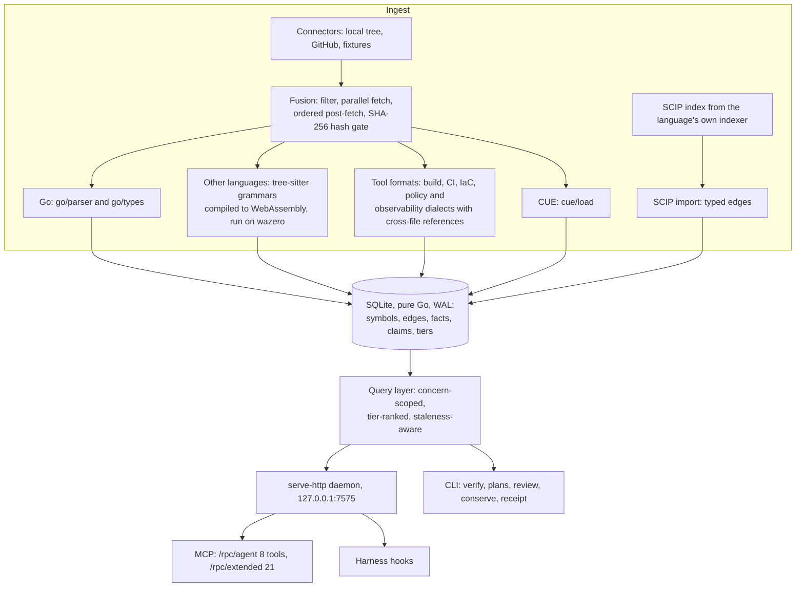

# fathom: the engineer's tour

This page is a 15-minute read for an engineer deciding whether fathom is worth a closer
look. It covers what fathom is, the evidence model, the pipeline, what a coding agent
sees, how quality is measured, the honest limits and where it is going. Every number here
comes from a committed reading or test, and is linked. Anything not built yet is marked as
planned. For install steps, see the [README quick start](../README.md#quick-start).

## 1. What fathom is

fathom is a local index of one or many repositories that a coding agent can query and that
a gate can check claims against. It extracts symbols, call edges, imports and references
from source, build files, infrastructure as code, policy and observability configs. It also
reads the repository's own plans, rules and decision records. Everything is stored in one
SQLite file, and each fact carries how it was found and at which commit.

Code search finds text. fathom tries to answer three questions with evidence:

- **What breaks?** `blast_radius` and `review_diff` walk the call and reference graph from
  a change.
- **What governs this file?** `obligations` returns the rules that apply to a path, and
  the edit hooks serve them at the moment an agent edits it.
- **Is it done?** `fathom verify` checks each claimed row of a plan against the index and
  exits non-zero when one is not proven.

## 2. The evidence model

Every observation in the store has a tier, ordered from strongest to weakest:

| Tier | Meaning | Example |
|---|---|---|
| `verified` | extracted from the source by a parser or type checker | a function definition |
| `pre-scan` | a deterministic heuristic or an external tool's output | a file-resolved call edge in Python with no SCIP index |
| `doc-claimed` | a document says so | a rule compiled from `AGENTS.md` or an ADR, with its citation |
| `sme-stated` | a person or a model said so, unchecked | a model reviewer's finding |
| `assumed` | nothing backs it | |

Three rules follow from the tiers.

1. **Answers carry their tier.** `symbol_context` on psf/requests returns
   `"resolution":{"typed":0,"heuristic":5}` beside the callers
   ([reading](bench/readings/reach/quickstart-2026-10-15.md)). The agent can see that
   every edge is a guess, and why: no `scip-python` index was imported.
2. **A heuristic edge never proves a plan row.** From v0.11.0, `reachable_from` and
   `wired` pass only through typed call edges. A row that rests on a guess fails and
   names the edge ([migration note](upgrades/0.11.0-typed-only-reach.md)).
3. **Answers are pinned to a commit.** Answers carry `index_commit`. With auto-refresh
   on (`--auto-refresh=true`, the managed daemon's default), fathom re-ingests a service
   when its git HEAD moves past the indexed commit.

## 3. The pipeline

- **Deterministic.** Parallel fetch is put back into input order before extraction.
  Outputs are sorted and clocks are injected. Tests pin byte-identical output
  (`TestBlastRadius_Determinism`, `TestIngestPassTimesZeroClockByteIdentical`).
- **Incremental.** Unchanged files are skipped by content hash, so a re-ingest costs only
  what changed.
- **One binary, no C.** The grammars run as WebAssembly inside the process. Linux builds
  with `CGO_ENABLED=0`, and `TestLinuxBuildIsCgoFree` fails the gate if a dependency
  brings C back. On macOS, cgo serves only the daemon's two memory readers.
- **A good guest.** The daemon runs under a memory budget: 512 MiB when unmanaged, set
  with `FATHOM_TENANCY_BUDGET`. When an ingest would exceed it, the ingest fails and says
  so instead of indexing less.
- **No model calls by default.** With the default `provider = "none"`, nothing on this
  page calls a model. Model use is opt-in. For example, compiling rules from prose
  (`fathom compile`) only estimates its cost unless you pass `--dry-run=false` with a
  configured provider.

Code layout: `internal/connector`, `internal/fusion`, `internal/extractor`,
`internal/store`, `internal/mcp`, `internal/verify`. The full design is in
[architecture.md](architecture.md).

## 4. What an agent sees

An agent meets fathom through four channels: the MCP surface, the hooks, the gate and
receipts. `fathom init` wires the hooks and the `AGENTS.md` stanza. It only adds files,
and `git status` lists them.

**The MCP surface.** `/rpc/agent` serves eight tools. The default stays small on purpose
(`TestDefaultSurfaceIsEight`). A tool joins a surface only when the call log justifies it.

| Tool | Answers |
|---|---|
| `find_symbol` | where a symbol is defined (exact, then case-insensitive, then substring) |
| `symbol_context` | definition, a capped caller and callee list, related tests, a snippet |
| `blast_radius` | what a change to files or a symbol reaches, by depth, typed and heuristic counted apart |
| `review_diff` | a composed verdict over a diff: impact, governing rules, test and spec coverage |
| `obligations` | the rules that govern a file, or the repository's root conventions |
| `verify_plan` | whether a plan's claimed rows are proven |
| `read_source` | the current text at a cited line range |
| `search` | grep with a receipt: each hit with the symbol it sits in |

`/rpc/extended` adds 13 more tools, including the full caller graph, `localize` (a stack
trace or log line mapped to the code that wrote it) and staleness reports. The reference
for all 25 is [mcp-tools.md](mcp-tools.md).

**The hooks.** For Claude Code (verified) and Codex (verified), init registers hook
entries. The ones that matter most:

| Event | What fathom does |
|---|---|
| Session start | one line naming the service, the index's freshness and how to route questions |
| Prompt submit | resolves the paths and symbols the prompt names, and injects the rules that govern them before the first edit |
| Before an edit | checks guards declared in `.fathom/guard.cue` |
| After an edit | injects the governing rules for the edited file. Measured on one machine over 28 days: median 131 tokens per edit, 95th percentile 329, n = 1,918 ([reading](measurements/2026-08-27-obligation-ceiling.md)) |
| Stop | flags any plan row claimed `[x]` this session that fails verification |

Rules come from the repository's instruction files (`AGENTS.md`, `CLAUDE.md`) and its
decision records. A model compiles them into cited claims. That step is opt-in and costed,
and a section not yet compiled can still be served as raw, cited text. You can also write
deterministic guards by hand in `.fathom/guard.cue`. On a fresh repository with nothing
compiled, `obligations` may serve nothing. On psf/requests, `fathom doctor` found zero
rules served.

**The gate.** `fathom verify --service S --plan P` exits 0 when every claimed row is
proven, 1 when one is not, and 2 when it cannot see (daemon down, empty index). Exit 2 is
fail-open, so it is never reported as a false failure. A row's contract can be:

- a symbol: it exists, a test reaches it, and for Go it is wired into an entry point
- a lexical oracle: a file matches a pattern
- an absence: `gone: import`, `gone: callers` or `gone: pattern`
- a live test certificate: `certified_by`

The gate also reads Spec Kit, OpenSpec, Kiro and Task Master task files in place. The
grammar is in [plans/README.md](plans/README.md).

**Receipts.** Every SARIF file fathom writes names the commit it was computed at and
fingerprints each cited excerpt. That covers verify refusals, obligations, review and
intent audit. `fathom receipt verify` re-derives a saved Go answer from a bare checkout,
using `go/packages` and git, with no store or daemon
([usage/receipt.md](usage/receipt.md)).

## 5. How extraction quality is measured

A language or tool format earns a **level** only when a committed reading proves it
against an independent oracle:

| Level | Languages | Pass mark (excellent / good) |
|---|---|---|
| L1 | symbols: recall, precision, kind, range, signature | e.g. symbol recall .95 / .85 |
| L2 | syntax call edges | call recall .90 / .75, precision .90 / .85 |
| L3 | imports and file-resolved edges | import resolution .95 / .85 |
| L4 | typed edges | definition mapping and typed recall .95 / .85 |

Tool formats are graded on entities (L1), intra-file references (L2) and cross-file
references (L3). For example, each Prometheus alerting rule is linked to the Alertmanager
receivers it pages, and that link agrees with amtool on all 140 cross-file pairs
([reading](bench/readings/lang/alertmanager.md)).

- **Oracle tiers.** Tier A is the language's own SCIP indexer, type checker or the tool's
  own evaluation (`helm template`, `kustomize build`, `make -pn`). Tier B is
  universal-ctags. Tier C is an independent parser library. A reading below tier A is
  capped at good. The harness computes the level from the metrics and tiers, and nobody
  types it.
- **Holdouts.** The subjects a level is claimed on are chosen and committed before any
  index runs, and measured once. The subjects used for tuning are kept apart.
- **Generated, and tested.** The [board](languages.md#excellence-board-generated) is
  generated from the readings. `TestLanguagesTrackerIsGenerated` fails if the page
  differs from the rendering, or if a row claims more than its reading.

**A worked row.** TypeScript reads L4 against scip-typescript 0.4.0 (tier A). The holdout
subjects were gcanti/fp-ts 2.16.9 and ReactiveX/rxjs 7.8.1. Definition mapping was .9722,
typed recall .9552, call precision .9669 and call recall .9941. L1 reads good, not
excellent, because symbol recall was .9358: rxjs's object-literal methods have no
definition in the dialect. Source:
[bench/readings/lang/typescript.json](bench/readings/lang/typescript.json), which records
subject SHAs, raw counts and every adjudicated case.

**What L4 means outside Go.** For TypeScript, JavaScript, Python, Java, C#, C, C++, PHP,
Rust and Dart, typed recall is the share of the SCIP index's reference edges that fathom's
import keeps as typed edges. So L4 applies when you run that language's own indexer:
scip-typescript, scip-python, scip-java, scip-dotnet, scip-clang, scip-php, rust-analyzer
or scip-dart. You then import its output with `fathom ingest --scip`, or place an
`index.scip` at the repository root. Without the index, edges are file-resolved
heuristics at tier `pre-scan`. On psf/requests, one of them points `merge_setting` at
`RequestsCookieJar.update` when the call is a plain `dict.update`. `fathom init` prints a
note when a repository's indexer is not on `PATH`. Go's typed edges come from `go/types`
with no extra tool, but Go reads L3, not L4: struct fields and interface methods are not
yet mapped, so definition mapping is .5891 against a .85 bar.

**The board today** (generated, v0.11.0):

| | Tracked | L4 | L3 | L2 | L1 | Measured, no level | Refused, tolerated or unsupported | At target |
|---|---|---|---|---|---|---|---|---|
| Languages | 37 | 10 | 10 | 5 | 1 | 1 | 10 | 19 |
| Tool formats | 63 | n/a | 33 | 16 | 1 | 1 | 12 | 45 |

The misses are published. Svelte meets no level (symbol precision .3816). Scala's file
edges read .0112 against a .25 bar. Angular templates and Swift are refused at the grammar
gate, because more than 5% of their calibration files fail to parse.

**Other measured readings.**

- `localize`: top-1 throw-site accuracy of 0.984 on a replay of Java, Node, PHP and
  Python traces, up from 0.259 before the shared frame parser
  ([changelog 0.11.0](changelog/0.11.0.md)).
- Stranger check: a clean copy of the tree builds, initializes and passes doctor against
  a throwaway daemon and a temporary HOME. On 2026-10-15 its first proven answer came at
  3 min 23 s, 175 s of it indexing fathom's own tree
  ([reading](bench/readings/reach/quickstart-2026-10-15.md#stranger-check)).
- The verify gate in use: on the author's machine between 2026-08-15 and 2026-09-02, it
  refused 171 of 3,426 recorded verify runs, over 317 plans in 21 repositories
  ([changelog 0.8.0](changelog/0.8.0.md)). This is one adopter's ledger, not an
  independent study.

## 6. Honest limits

- **No measured agent benefit.** The agent benches so far are small and mixed. On one
  scenario run the fathom arm lost to control on success, 2 of 15 against 3 of 15. On
  another it won on success, 10 of 16 against 4 of 10, at 3.3 times the tokens
  ([bench/scenario-runs.md](bench/scenario-runs.md)). fathom makes no claim that it saves
  tokens or time.
- **One adopter.** Every reading of daily use comes from the author's machine.
- **Typed edges outside Go need the language's SCIP indexer** (section 5). Without one,
  callers and blast radius are heuristic and labelled so. A non-Go plan row proves reach
  only with a test, never with `reachable_from`.
- **Rules at the edit need setup.** Either write guards by hand, or compile rules with a
  model at a cost you approve. Over 28 days on one machine, 47% of edit payloads ran over
  a 150-token ceiling, which is measured but not enforced
  ([reading](measurements/2026-08-27-obligation-ceiling.md)). That reading could not measure
  whether the rules served were the ones a session needed.
- **Install friction.** There are no prebuilt binaries. The managed macOS daemon needs a
  local code-signing identity, and Linux has no systemd unit yet. `pkg/client` cannot be
  fetched with `go get`, because two private dependencies are mirrored in
  `third_party/`. The full list is in [early-testers.md](early-testers.md#known-limits).

## 7. Design choices and non-goals

- **One store.** fathom uses SQLite and nothing else: no graph database, no vector
  database, no second store.
- **A model never decides done.** Models may propose. Only a contract the gate can
  evaluate proves.
- **Local only.** There is no hosted service, and no dependencies, advisories or docs are
  downloaded by default.
- **No embeddings-first retrieval** until a retrieval bench shows it helps.
- **No dispatch loop.** fathom never schedules or spawns work, and keeps no task tracker.
  Progress views only read the gate's verdicts.
- **Organization-agnostic.** Anything specific to an organization is configuration, never
  code.

The decisions behind each choice are in [ADR.md](../ADR.md), and the non-goals with their
revisit conditions are in [intent/scope/non-goals.md](intent/scope/non-goals.md).

## 8. Where it is going

All of the following is planned, not built. The roadmap through 2027-01
([vision/38-proof-layer-roadmap.md](vision/38-proof-layer-roadmap.md)) widens what fathom
can prove, rather than what it can search:

- a cross-service graph of routes, RPCs, topics, tables and config, under one link model
- dependency API indexes read from local caches
- test intelligence: risk-weighted coverage and certifying-first test selection
- full-text retrieval over docs and decisions, with doc drift as a staleness fact
- proof history and progress views computed from the verify ledger
- more languages on the same oracle discipline

Each item names the instrument that will show whether it worked. Goals and their kill
conditions are in [intent/scope.md](intent/scope.md).
