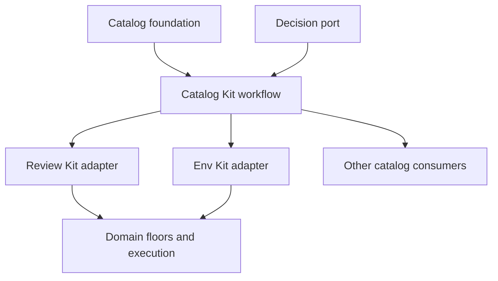

# Catalog Kit: assessment, research and implementation strategy

Date: 2026-10-20, America/Phoenix. Owner-directed assessment and implementation.

The accepted 2026-10-21 [specification](../designs/catalog-workflow.md) and
[current evidence](../evidence/catalog-kit/2026-10-21/verification.md) supersede
this assessment's candidate status and follow-up list.

## TLDR

Yes. Explicit catalogs are a strong foundation for agentic review and other agent
toolsets. They make the available criteria, tools, evidence recipes and decisions
addressable, reusable, testable and versioned. A catalog by itself does not improve
judgment accuracy or establish evidence completeness. Those benefits require an
integrated execution path and measurement against the current baseline.

Put shared Catalog Kit capability in **agentic-kit**. It already owns a substantial
catalog foundation and the provider-neutral decision port. Platform Engineering
should consume those primitives while keeping its domain schemas, semantic floors,
admission rules and source synchronization. Build on the existing work, rather than
creating a second catalog framework or a second decision port.

This change supplies an experimental offline composition workflow, CLI, CUE schemas,
decision-packet preparation, analytics/Parquet helpers, four focused agent skills and
a staged consolidation plan. It does not claim completed migrations, measured model
accuracy, production adoption, signed distribution or automated review closure.

## 1. Evidence inspected

Repository baselines:

- agentic-kit: `5d4c989ce18df24f91f479b7e11ab1e2b3b386de`.
- platform-repo: `fb57b1cf4055c8d91b859dd1f6bfa0242bcbf124`.

The recursive trees and the files below were inspected through the connected GitHub
plugin. Fathom MCP and its CLI were unavailable in this execution environment, so
source reads were the fallback. No Fathom plan-verification result is claimed.

| Existing surface | What is actually there | Consequence |
|---|---|---|
| `agentic-kit/foundations/knowledge/catalog` | Arbitrary-depth flat node set, stable keys, facets, layered Build, provenance, drift detection, BM25/ranker seam, renderers, computed views and MCP handler shapes | Reuse it. A new tree/search library would duplicate established work. |
| `agentic-kit/docs/designs/catalog-kit.md` | Accepted catalog design from July, including a deliberate v1 exclusion of cross-catalog federation | The current owner request supplies a concrete reason to extend composition, while preserving existing API behavior. |
| `agentic-kit/cmd/kit-catalog` | A real catalog consumer and a published/source drift gate | Existing adoption evidence; different from the new workflow's synthetic fixtures. |
| `agentic-kit/foundations/quality/check-catalog` | Check declarations reconciled against implementations in both directions; deterministic/model means; skipped checks | Reuse for implementation coverage. It is not a replacement for a generic hierarchy. |
| `agentic-kit/foundations/decision` | Predicate/choice/score port, validation, capabilities, calibration/replay/cache/composition helpers, TypeSafe and OpenAI adapters | Keep one port. Catalogs should prepare questions for it. |
| `agentic-kit/docs/designs/typed-judgment-review.md` and fast-judgment guides | Criterion/observation/outcome separation; bounded evidence packets; calibration and abstention guidance | Extend this design into an executable preparation path. |
| `platform-repo/kits/review-consumer/internal/standard/standard.go` | Catalog DAG loading/merging, definition provenance and domain semantic floors | Extract common mechanics gradually; retain the stricter domain law. |
| Review Kit `catalog_sync.go` | Explicit synchronization, pinned commits/digests, containment and file/byte bounds, active locks | Reuse as a distribution precedent. Keep network synchronization outside core resolution. |
| Review Kit `schema/judgment.cue` | Atomic criteria, source packets, typed answers, transport/budget records and advisory outcomes | There is already executable contract work here, beyond the older proposed design in agentic-kit. |
| `env-kit/internal/catalog/catalog.go` | Tool resolution; declaration rows unify with embedded CUE and contradictions refuse | Preserve unification semantics. This is not equivalent to a generic override merge. |
| Model catalog, portal catalog ports and PDK catalog | Different domain purposes and data contracts | Share identity/provenance/export conventions where useful; do not force all payloads into one schema. |
| Policy Kit | Named in the root kit inventory; no materialized `kits/policy-consumer/` files found in the inspected recursive tree | Treat its adoption as planned until a concrete implementation and entrypoint are available. |

Important difference: generic `catalog.Build` allows later non-zero scalar values to
replace earlier ones. Env Kit refuses contradictory CUE values. Review Kit permits
only domain-compatible tailoring and preserves floors. Consolidation must preserve
these different laws rather than accidentally importing the most permissive one.

## 2. Why catalogs help

The most useful role is an **executable inventory of obligations and options**. A review
agent can ask which rules apply, which observations are still missing, which check
implements a rule, and which exact source defined it. A tool router can choose among
declared capabilities. A planner can select a bounded workflow with known evidence
requirements. A deterministic runner can establish coverage before any model call.

The gains come from several separable mechanisms:

1. Stable IDs make observations, findings, exceptions and regression cases joinable.
2. Explicit applicability reduces irrelevant context while preserving required coverage.
3. CUE catches invalid shapes and incompatible constraints before a run.
4. Reconciled implementations expose catalog entries that have no working evaluator.
5. Versioned questions and evidence recipes make model observations comparable.
6. Resolved snapshots and provenance make inherited behavior inspectable and replayable.
7. Hierarchy supports navigation; facets support independent dimensions without a
   combinatorial tree explosion.

This is an engineering judgment based on the inspected architecture and primary
documentation, not a measured improvement on these repositories. A broad catalog can
still omit an entire defect class, contain poor questions or select incomplete context.
Keep an uncataloged-defect review lane and audit apparently clean outcomes.

## 3. Research and design implications

Primary sources were checked on 2026-10-20. Provider APIs are moving; pin adapters and
repeat contract checks when the relevant provider behavior changes. No vendor speed,
cost or calibration headline is treated as a measured result for this workload.

| Source | What it supports | Design implication |
|---|---|---|
| [CUE value semantics](https://cuelang.org/docs/concept/the-logic-of-cue/) and [defaults](https://cuelang.org/docs/howto/specify-a-default-value-for-a-field/) | Unification combines compatible constraints; defaults are not a general multi-layer override mechanism | Represent tailoring explicitly, then validate the final domain value. Never call last-writer-wins behavior CUE unification. |
| [OpenAI Decisions](https://developers.openai.com/api/docs/guides/decisions) | Bounded classification/scoring, independent questions, explicit refusal and application-specific threshold selection | Catalog atomic questions and option meanings. Keep dependent stages in code and calibrate each workload. |
| [TypeSafe state](https://docs.typesafe.ai/concepts/state) and [API](https://docs.typesafe.ai/api/system-one) | Named state and typed questions; independent questions over shared context | Assemble focused evidence packets and use the existing adapter boundary. |
| [TypeSafe documented model limitations](https://docs.typesafe.ai/model-jaggedness/jev-1.13) | Version-specific problems with irrelevant context, indirection, arithmetic, adversarial input and option ordering | Test those failure modes. Compute exact facts in code; never silently upgrade a model version's quality claim. |
| [TypeSafe confidence](https://docs.typesafe.ai/confidence) | Confidence summarizes an answer distribution and is distinct from probability | Retain distributions and adapter semantics. A single confidence threshold cannot be assumed portable. |
| [TypeSafe hierarchical classification](https://docs.typesafe.ai/cookbooks/hierarchical_classification) | A worked taxonomy traversal using bounded alternatives and multiple candidate paths | Useful inspiration for optional navigation. Do not infer that a pruned review branch is obligation-free. |
| [NIST OSCAL profile resolution](https://pages.nist.gov/OSCAL/learn/concepts/processing/profile-resolution/) | A catalog/profile distinction with import, merge and modification phases; the linked processing specification is marked draft | Separate authored catalogs, tailoring profiles and resolved results. Borrow the separation without claiming OSCAL conformance. |
| [OPA bundles](https://www.openpolicyagent.org/docs/management-bundles) | Bundle verification and activation are separate management concerns | Add distribution as an adapter later, with receiver-controlled trust and atomic activation. |
| [Apache Parquet](https://parquet.apache.org/docs/overview/) and [Arrow writer](https://arrow.apache.org/docs/python/generated/pyarrow.parquet.write_table.html) | Typed columnar storage with nested structures and schema metadata | Export analytical projections; retain CUE and full resolution bundles as the authoritative inputs/records. |

OpenAI's documented score is an expected position across authored levels, which can
fall between levels. It is not a probability that a review is correct. Both provider
integration and catalog policy need explicit mappings from raw observations to outcomes.

A further gap surfaced in the existing contracts: the current TypeSafe confidence
documentation describes type-specific summaries, while decision 0018 deliberately fixes
the kit's own confidence computation. Do not silently change that existing contract.
Record adapter/policy versions, preserve distributions and evaluate a separately
reviewed migration if provider-aligned summaries are desired.

For example, at a predicate probability of 0.5 the kit's documented `max(p, 1-p)`
summary is 0.5, while TypeSafe's currently suggested `abs(2*p-1)` summary is 0.
Both describe the same uncertain probability on different scales. Neither number is
an independent estimate of correctness; copying a threshold between them changes behavior.

## 4. Placement and boundaries

Use this dependency direction:

The foundation keeps node identity, traversal, facets, search and basic drift primitives.
Catalog Kit composes strict resolution, receipts, projections and request preparation.
Consumers own payload semantics, evidence collection, operational authority and final
domain validation. Provider adapters remain under the existing decision port.

An independent catalog-kit repository would add version coordination before the shared
workflow has production adoption. Platform Engineering would make a domain-neutral
capability depend on the platform kit release graph. Revisit a separate module only
when measured external adoption needs an independent release/dependency boundary.

## 5. Capability matrix

`Implemented candidate` means code and local tests exist in this change. Repository
and consumer integration status is recorded separately in the implementation plan.

| Capability | Present status | Acceptance evidence / next gate |
|---|---|---|
| Hierarchies, facets, stable keys, search, rendering and drift | Existing foundation | Preserve its contracts and current consumer gate. |
| Existing Go inventory projected through the new workflow | Implemented candidate, real-source integration | `scan-go` reuses the current collector; exact package-facet coverage and input permutation tests run against the live repository. This is not a platform-consumer migration. |
| Selected subcatalog dependency DAG | Implemented candidate | Cycle/missing dependency/duplicate tests; canonical precedence. |
| Explicit extension vs replacement | Implemented candidate | Conflicting scalar assertions refuse. |
| Field grants separated from imported data | Implemented candidate | Ungranted, unknown, duplicate and unused grants refuse. |
| Digest-checked, reasoned overrides | Implemented candidate | Stale patch test and before/after change record. |
| Explicit zero/false/empty patch values | Implemented candidate | Presentation reset and unhide tests. |
| Source pins, bundle identity and explain | Implemented candidate | Full bundle mutation tests and CLI provenance output. |
| Parser and traversal bounds | Implemented candidate | Duplicate keys, nulls, trailing JSON, node/depth/layer/byte caps. |
| Bounded decision preparation | Implemented candidate | Missing/extra/empty/corrupt witness refusals; request integrity. |
| Provider/model/definition-scoped cache key | Implemented candidate | Wording/version/evidence/model changes invalidate identity. |
| Multimodal criterion packets and new provider question types | Planned | The existing decision port has image capabilities; this preparation workflow is text-only. TypeSafe's experimental box primitive needs an explicit contract, not a forced mapping to a score. |
| JSON/NDJSON analytics and Parquet adapter | Implemented candidate | Typed row roundtrip, empty set and prior-output preservation. |
| Agent adoption/declaration/doctor/policy guidance | Implemented candidate, advisory | Skill validation and a read-only task trial; no enforcement claim. |
| Review Kit and Env Kit production migration | Planned | Compare actual effective catalogs and refusal behavior at pinned revisions. |
| Domain-specific final CUE/floor hooks | Existing in consumers; not migrated | Exercise each floor through the consuming entrypoint before replacing glue. |
| Expiring exceptions, revocation, approval records | Domain-owned; shared adapter planned | Wrong owner, changed target, expiry and revocation must block adoption. |
| Aliases, moves, tombstones and schema migrations | Planned | Stable identity survives reorganization; alias cycles/dangling references refuse. |
| Signed registry/OCI distribution and atomic activation | Planned | Trusted signer and content pin; invalid candidates never become active. |
| Cross-item references and typed relation graph | Planned | Distinguish parentage, depends-on, supersedes, conflicts and evidence relationships. |
| Applicability/coverage planning | Planned | Required obligations cannot disappear through relevance filtering or hidden metadata. |
| Atomic result algebra and parent aggregation | Domain integration planned | Required failure/unknown dominates; no compensating average. |
| Live model calibration and staged rollout | Planned | Independent holdout, missed-defect audits and measured cascade outcomes. |
| Performance/indexing work | Measurement-triggered | Record latency/memory at representative sizes before adding a storage/index engine. |

## 6. What an excellent catalog should represent

Keep a small common envelope and typed domain payloads. Common fields should describe
stable identity, kind/schema version, source revision, ownership, lifecycle, applicability,
relations and evidence requirements. Do not add one untyped `metadata` bag and call the
result universal. A Review Kit finding, an environment tool recipe and a model deployment
have different invariants and need different validators.

Recommended next design increments:

- **Identity and lifecycle:** namespace IDs, durable stable keys, explicit aliases,
  supersession and retirement. Preserve history without serving retired entries by
  default. A move is not a new rule with a disconnected evaluation history.
- **Profiles:** select catalogs and parameters separately from defining their content.
  Organization policy, team extension and project tailoring need named roles, not an
  undocumented ordering convention. Environment-specific choices belong in explicit
  profiles; environment variables must not silently redefine review policy.
- **Relations:** allow catalogs inside collections and groups inside catalogs, but model
  cross-links as typed graph edges. A concept may be related to several groups without
  duplicating its authority. Containment, execution dependency and evidence support are
  different relations and need different cycle rules.
- **Policy:** distinguish additive metadata, monotonic constraints, replaceable presentation
  and an approved exception. A replacement permission is insufficient for a non-weakenable
  domain rule. Exception expiry and revocation belong to the existing authorization system.
- **Receipts:** retain the resolved source set, schema/resolver versions, effective policy,
  exact output digest and per-change explanation. A digest detects changed bytes; a signer
  establishes producer identity; neither proves that an authored assertion is correct.
- **Testing:** schema positive/negative fixtures, deterministic permutations, refusal
  paths, producer/implementation reconciliation, consumer differential tests, format
  roundtrips and scale measurements. Add mutation tests for controls that must not be
  bypassable. Do not count a helper test as proof that the consumer actually invokes it.
- **Developer experience:** one resolve/explain/diff/query surface, generated reference
  views, a doctor with useful refusal categories and a scaffolder that makes missing
  stable IDs/evidence requirements conspicuous. Keep optional integrations discoverable
  without making global agent configuration a prerequisite.

## 7. Catalogs optimized for decision models

The catalog is the **program**, captured evidence is the **input**, the model supplies
bounded semantic observations, and deterministic code computes the policy result.
Keep the narrative rule, examples and remedy; supplement them with atomic evaluable
criteria rather than replacing all prose with booleans.

| Review operation | Preferred mechanism |
|---|---|
| Enumerate required rules, paths, owners and source versions | Deterministic resolver/planner. |
| Check schema, exact literal, digest, dates, counts and known call edges | Deterministic code. |
| Judge a supplied passage against a narrow semantic criterion | Typed choice or predicate, with unknown/escalation behavior. |
| Score a soft quality axis | Authored ordered levels; retain its distribution and avoid hard-rule compensation. |
| Discover unfamiliar defects, understand missing architecture or write a repair | Broader reasoning/generative review with tools. |
| Authorize an effect, certify compliance or close a required obligation | Existing authorization and evidence policy, not a model confidence number. |

Each model-ready criterion should have: stable criterion and parent IDs; definition
digest; deterministic applicability; evidence recipe and completeness limits; evaluation
method; exact question, polarity and option meanings; unknown semantics; positive,
lookalike and adversarial examples; authored feedback and remedy; closure test; approved
provider/model configuration; and a per-site evaluation reference.

Use independent questions together only when they share appropriate context. A question
that depends on an earlier answer belongs in a later stage. Keep original witness
locations in the collector; a model may select among supplied locators but must not
invent a file path or line number. Record what was sent after redaction, not merely
the unredacted source hash.

For large hierarchies, start with deterministic selectors and progressive disclosure.
Optional model ranking may improve navigation after an evaluation. Do not greedily
discard an entire required review branch after one relevance decision. Keep a receipt
of excluded candidates and audit its misses. A taxonomy path score is a ranking signal,
not a calibrated probability that the final review has covered all obligations.

For outcomes, retain satisfied, violated, unknown and justified not-applicable as
distinct values. Keep transport error, malformed answer, refusal and unrun work distinct
as well. An all-required parent is satisfied only when all required children are
established or explicitly justified N/A. A failed required criterion cannot be hidden
by high soft scores. Silence and a hidden catalog node do not discharge an obligation.

## 8. Deterministic aids worth building

The highest-value next tools are coverage reconciliation, schema compatibility checks,
source/implementation drift checks, applicability explanation, stale observation
invalidation and a deterministic replay harness. These remove work from models and
make remaining judgment failures easier to diagnose.

Useful evaluations include:

1. Permute layer input order while retaining declared dependencies; require the same
   effective resolution. Deliberately remove an edge and require ambiguity refusal.
2. Plant hidden/order/synopsis changes and require the new semantic diff to report them.
3. Change a question, evidence byte, resolved model or policy version; require cache
   invalidation. Replaying an observation never authorizes repeating an external effect.
4. Remove one required check or evidence producer; require an unknown/refusal result,
   not an empty list interpreted as success.
5. Exercise final domain floors through the consumer after tailoring, including a
   broadened applicability facet that might quietly shrink coverage.
6. Publish deliberately stale derived documentation and require the existing drift
   gate to find it. Keep counts and coverage views computed from the effective source set.

Parquet becomes especially useful for joins across catalog versions, rule-level misses,
unknown rates, source freshness and evaluation outcomes. Partition observations by
catalog/criterion/provider configuration where volume justifies it. Do not expect a
columnar file to improve model understanding; the request compiler still has to choose
focused evidence and readable criterion definitions.

## 9. Consolidation sequence and acceptance gates

1. **Land the offline candidate:** local and repository gates pass; record skipped
   consumers honestly. Keep existing Build, hashes and provider adapters compatible.
2. **Review Kit pilot:** adapt metadata for one actual local standard/pack set. Compare
   effective IDs, provenance and every existing semantic-floor refusal. Keep source
   synchronization and judgment authority in Review Kit. Measure duplicate glue removed.
3. **Env Kit pilot:** preserve CUE unification exactly. Share source identity/projection
   helpers first; do not substitute replacement semantics for contradictory constraints.
4. **Decision transport consolidation:** map Review Kit's advisory criterion packets to
   the existing decision port. Test native provider request/response goldens, refusal,
   unknown, budgets and opt-out. Match old outcomes on recorded cases before switching.
5. **Lifecycle and distribution:** add aliases/exception bindings/registry activation
   only against named consumers and existing trust mechanisms. Gate each with failure cases.
6. **Evaluate the model lane:** compare deterministic-only, structured generative review,
   native decision models and the current reviewer on independent changes. Keep development
   and holdout split by change, not by multiple criteria from the same change. Include
   missing context, ambiguous options, option permutations, adversarial evidence and
   uncataloged defects. Use human-adjudicated truth and audit clean/non-escalated samples.

Report per-rule miss rate, actionable precision, abstention, source localization,
calibration/reliability, coverage, latency, actual spend, escalation and human review
time. Include preparation and audit costs. Choose acceptable margins with the consumer's
baseline and stakes; this report deliberately invents no universal confidence cutoff or
minimum sample count. If the decision lane does not earn its cost/quality margin, retain
the deterministic and existing review paths.

The implementation work order is [catalog-kit-uplift](../plans/catalog-kit-uplift.md).
Its status distinguishes implemented behavior, integration, adoption and measurement.
