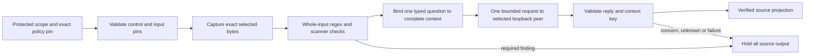

# Optional concern checks without losing the hard boundary

The experimental `loopback-concern/1` site adds one typed contextual judgment to
`command-guard inspect`. It accepts independently pinned **public or synthetic**
inputs only. It requires an explicit `command_classifier` build and selected controls.
The ordinary guard rejects those controls before source/scanner work. This profile does not qualify private-input
disclosure, a local model, semantic accuracy or absence of sensitive information.
Contract and acceptance: [0042/MC](designs/command-concern-classifier.md).



A model can add a hold. It cannot remove a deterministic hold, authorize an action,
or make a confidence number into evidence of safety. The context key catches an
accidentally replayed answer for different inputs/instructions; it does not make
the peer honest or establish that a model considered every fact.

## First run the synthetic client-boundary profile

Build into an owned scratch directory outside the module. Use absolute executable
paths, adding `.exe` on Windows. Obtain and independently select the guard byte pin:

```text
go build -tags command_classifier -o ABS/command-guard-classifier ./cmd/command-guard
go build -o ABS/command-qualify ./cmd/command-qualify
ABS/command-qualify run --profile files-loopback-fixture/1 --guard ABS/command-guard-classifier --guard-sha256 HASH --format json
```

Hash commands: macOS `shasum -a 256 FILE`, Linux `sha256sum FILE`, Windows
`(Get-FileHash -Algorithm SHA256 FILE).Hash.ToLowerInvariant()`. A hash identifies
bytes; select a trusted build/source independently.

The 30-case profile includes ordinary file checks and 12 model-client cases. Its
owned peer binds an ephemeral IPv4 loopback port, returns fixed fixture JSON, logs
no source and performs **no inference**. It needs no installed model, provider key,
download, global setup or caller-selected endpoint. Its receipt explicitly says
`syntheticPeerOnly: true`. Exit 0 means the fixed native profile passed, 1 an observed
contradiction, 2 missing/unknown prerequisites or incomplete reporting. Read its
case list and actual OS/architecture; do not treat it as a model-quality benchmark.
Run `ABS/command-guard-classifier help` to inspect its compiled capability. Keep this
artifact distinct from the lightweight ordinary guard. The experimental artifact
loads HTTP/model dependencies at startup even when unselected; an initial native
default-mode comparison measured 67.46% overhead. It has no general speed/cost claim.

## Configure an explicitly selected endpoint

Keep the existing required rule/layer/scanner controls. Add this object to a complete
policy only after choosing the contextual criterion and an eligible endpoint. The
strings below are placeholders, not a running service or qualified model:

```json
{
  "classifier": {
    "profile": "loopback-concern/1",
    "endpoint": "http://127.0.0.1:PORT/v1",
    "model": "YOUR_REQUEST_MODEL",
    "expectedResponseModel": "YOUR_EXPECTED_RESPONSE_MODEL",
    "criterion": "YOUR_CONTEXTUAL_REVIEW_CRITERION",
    "criterionSHA256": "EXACT_SHA256_OF_CRITERION_BYTES",
    "timeoutMillis": 10000,
    "maxInputBytes": 16384,
    "maxResponseBytes": 16384,
    "maxTokens": 512
  }
}
```

Scope independently requires `requiredClassifierIds: ["semantic-concern"]`, a
nonempty `permittedClassifierSHA256` array of selected public/synthetic input byte
hashes, and `classifierPolicySHA256`, the SHA-256 of the **final policy file bytes**.
Those extend the existing scope; they do not replace required rules or layers.

Prepare in this order:

1. Select the public/synthetic inputs and exact content hashes independently of
   the candidate. Each requested hash must appear in the protected permission set.
2. Choose criterion, endpoint, requested model and expected response model assertion.
   Compute the criterion hash without adding a newline or normalizing its text.
3. Write the complete policy, then hash that exact file, including its formatting
   and final newline. Put this file hash in protected scope.
4. Protect **both** scope and policy from candidate writes. The command hashes and
   decodes one policy snapshot and uses that value through dispatch. A self-hash
   beside criterion text cannot authorize it. The CLI does not authenticate issuers.
5. Use the normal `inspect --root ... --scope ... --policy ... --request ...` call.
   `json`, indented `text` and lossless `compact` preserve the classifier receipt.

A changed policy byte requires a new independently selected scope pin. Unpermitted
request hashes or policy drift hold before source reads or scanner/model work.
Captured source bytes must also match the request pins. No direct stdin, repository
discovery, API key, custom header, shell, model download or fallback is supported.
Selected classifier controls on `git-inspect` return unsupported before execution;
its separate judgment path remains unimplemented.

For a manual **fake peer** trial, build into owned scratch:

```text
go build -o ABS/fake-concern-peer ./cmd/command-guard/testdata/fake-concern-peer.go
ABS/fake-concern-peer no-concern
```

In one terminal the peer prints one ephemeral loopback endpoint. Copy that endpoint
into the policy below, then prepare controls and invoke the guard in another
terminal. The peer answers one request and exits normally after flushing it; start
a fresh peer and re-pin the policy for each invocation. `concern` and `unknown` select
the other fixed responses. With no request it expires after five minutes. Close an
unused trial peer explicitly. Use `fake-response` as its expected response model.
It is an HTTP protocol fixture, not an AI backend.

### Complete public toy controls

Create an owned source directory containing only `sample.txt`, with these exact
UTF-8 bytes, including a newline after each line:

```text
public first line
public second line
```

Create the following three control files outside that source directory. These are
complete shapes. Replace the uppercase endpoint/hash placeholders with actual
selected values. Use the hash commands above for files; hash criterion bytes without
an added newline. The toy rule detects only its literal marker and establishes no
general secret/PII coverage.

`policy.json`:

```json
{
  "version": "command-guard.policy/1",
  "layers": [{"id": "toy", "allowedOperations": ["read-range"], "limits": {"maxFileBytes": 4096, "maxTotalBytes": 8192, "maxOutputBytes": 16384, "maxResults": 32}, "deniedPathPrefixes": []}],
  "rules": [{"id": "toy-marker", "pattern": "SECRET"}],
  "classifier": {
    "profile": "loopback-concern/1",
    "endpoint": "PRINTED_FAKE_PEER_ENDPOINT",
    "model": "fixture-request",
    "expectedResponseModel": "fake-response",
    "criterion": "Review all selected text for a contextual concern.",
    "criterionSHA256": "EXACT_CRITERION_BYTES_SHA256",
    "timeoutMillis": 10000,
    "maxInputBytes": 16384,
    "maxResponseBytes": 16384,
    "maxTokens": 512
  }
}
```

Write the policy completely, then compute its file hash for `scope.json`:

```json
{
  "version": "command-guard.scope/1",
  "requiredLayerIds": ["toy"],
  "requiredRuleIds": ["toy-marker"],
  "requiredClassifierIds": ["semantic-concern"],
  "permittedClassifierSHA256": ["EXACT_SAMPLE_FILE_SHA256"],
  "classifierPolicySHA256": "EXACT_FINAL_POLICY_FILE_SHA256"
}
```

`request.json` uses the same selected sample hash:

```json
{
  "version": "command-guard.request/1",
  "kind": "read-range",
  "files": [{"path": "sample.txt", "sha256": "EXACT_SAMPLE_FILE_SHA256"}],
  "startLine": 1,
  "endLine": 2
}
```

Run from the repository root, replacing every `ABS` path with its owned absolute path:

```text
ABS/command-guard-classifier inspect --root ABS/source --scope ABS/scope.json --policy ABS/policy.json --request ABS/request.json --format json
```

Expected: exit 0, two source rows and `externalClassifier` complete/no_concern with
one attempt and one decision. Fresh concern/unknown peers produce exit 1/2 and zero
rows. Change one policy byte after scope pinning: exit 2/invalid before source reads
or a request. Merely restarting the peer changes its endpoint. Update that endpoint,
re-hash the final policy and update protected scope.
Do not copy these caller-writable toy controls as a production protection boundary.

## Read the result honestly

| Observation | Meaning and output |
|---|---|
| `complete / no_concern` | One timely typed answer added no hold; existing required checks still own their results. |
| `concern / concern` | Blocked; no source rows are disclosed. A concern is not a proven sensitive-data finding. |
| `unknown / unknown` | Incomplete; no source rows. One typed response completed, but it did not settle the question. |
| `incomplete` with fixed reason | Control/size/transport/model/format/budget prerequisite failed; no favorable classification. |
| `not-invoked` | A prior mandatory hold prevented model dispatch. Zero model calls is not a clean model result. |

Receipts contain fixed codes and bounded counts, not raw answers, probabilities,
endpoints, model names, source/context hashes, hidden reasoning or error bodies.
`requestBytes` is local encoded size, not acknowledged delivery. `selectedBytes`
does not prove server consumption. Token caps are requested limits, not verified
billing. Unknown/budget failures do not trigger retries or a stronger/hosted model.
An eligible stronger judge or human can investigate through a separately authorized
workflow; a favorable answer cannot waive a floor.

## Qualify a real runtime before expanding use

[Ollama's compatibility documentation](https://docs.ollama.com/api/openai-compatibility)
describes both a compatible API subset and cloud models accessed through a local
server. A loopback address therefore proves the client hop, not local inference.
[Structured-output support](https://docs.ollama.com/capabilities/structured-outputs)
also varies by deployment. Neither JSON validity nor a model-name assertion proves
semantic correctness, process identity or source confidentiality.

Before private-input use, select the actual runtime/model and verify its process,
artifact/model identity, resource fit, egress and logging. Review any
[cloud-disable configuration](https://docs.ollama.com/faq#how-do-i-disable-ollamas-cloud-features)
through the runtime owner; this workflow never changes or restarts it. Freeze the
criterion/model/prompt/cohort and false favorable/hold/abstention, cost and latency
bars before live qualification. Use [decision-lab](../cmd/decision-lab/README.md) for
independent labeled studies and [decision-site adoption](decision-sites.md) for the
broader process. Synthetic protocol peers cannot satisfy those quality gates.

This first wire profile emulates the existing typed decision port through Chat
Completions. It is not the native OpenAI Decisions or TypeSafe/Jev protocol. Preserve
those native adapters and select another explicitly qualified profile when needed;
do not silently translate away capabilities or introduce hosted fallback.
