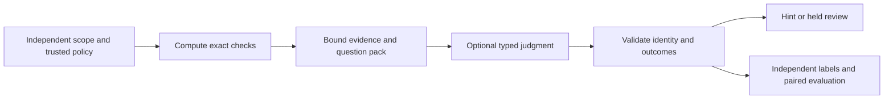

# Put a decision model at a useful, bounded site

Use this short path with OpenAI Decisions, TypeSafe/Jev, an emulating LLM, replay or
provider-none. The [project survey](assessments/2026-10-23-decision-sites.md) distinguishes
existing use, proposed pilots and deferred work. [The full method](fast-judgment.md)
and [site catalog](fast-judgment-catalog.md) retain deeper calibration guidance.

## Choose a role that can earn its cost

| Need | Typed question | Deterministic work first |
|---|---|---|
| Review triage | `concern / no-concern / unknown` for one criterion and captured span | Expected criterion set, executed checks, evidence identity and policy floors |
| Retrieval support | `supports / contradicts / insufficient` for one claim and excerpt | Eligible sources, source/version/access/freshness, exact retrieval scope |
| Human clarification | Choose among declared question families, plus unknown | Required fields, caller role, question IDs and escalation budget |
| Audience/prose review | `matches / mismatch / unknown`, or an explicit ordered rubric | Claim links, output version, dependencies and publication policy |
| Failure triage | `implementation / test / environment / insufficient` | Process exit, parsed diagnostics, changed symbols and permitted next probes |

Ask observable, atomic questions. A decision model selects/estimates; use a generation
model when you need new prose, an explanation or tool arguments. A favorable label is
neither source truth nor permission. Keep unanswered cases distinct from negative ones.

## Try the utilities offline

`decision-lab` prepares requests, checks captured decisions and summarizes labeled
studies. Build/run instructions and complete fixtures: [CLI guide](../cmd/decision-lab/README.md).
Its first scope is **text-only string-choice packs**. Predicate, score and image
requests remain available through the existing [decision port](../foundations/decision);
the lab explicitly rejects them rather than pretending one classification study
calibrates every kind. It never calls providers, reads keys or enables sites.

For an existing execution path at Git/Lefthook boundaries, adopt
[quality-gate](quality-boundaries.md): it already binds snapshots, preflights required
inputs and reserves a bounded invocation budget. Other applications retain their
own controlled execution paths; the lab checks captures and studies, not live effects.

1. Choose one existing workflow and name its deterministic baseline and wrong-answer
   costs. Copy a fixture pack, set its owner, fallback, policy epoch and kill criterion.
2. Declare bounded questions/options, including unknown, and favorable options for
   error diagnostics. Keep expected provider/resolved-model identity separate from
   a requested alias. One pack shares context; changing its cohort invalidates reuse.
3. Prepare exact captured input. Keep private prepared output private; default output
   is metadata, while explicit `--out -` emits supplied state. A digest detects byte
   changes; the caller still establishes source authenticity and permitted disclosure.
4. Invoke an existing `decision.Decider` only in the application's already-authorized
   path. Default to `decision.None`; reserve attempts/spend and enforce consent before
   reading credentials or dispatching. A configured key alone enables no site.
5. Capture the port's response and typed failure/attempt metadata. Validate identity,
   expected IDs, mutually exclusive outcomes and probabilities before reuse or effects.
   Raw provider JSON must first pass through its adapter. Partial failures stay visible.
6. Build expected cases/labels independently of responses. Keep held-out units separate
   from prompt tuning; report provenance and missing-context/adversarial cases. Run
   the study and inspect confusion, favorable errors, abstentions and per-class readings.
   Deduplicate identical exposed inputs before counting trials. Conflicting labels for
   the same exposure need adjudication or additional distinguishing context.
7. Shadow first. A consumer may promote only the exact site/provider/cohort and bands
   supported by independent evidence under its own risk policy. Record keep/revise/stop
   from quality, all attempts/cost and human effort; a report cannot authorize promotion.

## Compose with the existing port

| Existing utility | Use | Caller still owns |
|---|---|---|
| `catalogkit.PrepareDecision` | Exact criterion/evidence packet, sealed request | Domain validation, independent expected scope, source authority and disclosure |
| `decision.Validate`, `Capabilities` | Portable shape and declared provider support | Actual installed adapter, native exceptions and unsupported handling |
| `TemplateDigest`, `RequestKey` | Exact question/content identity | Policy/tenant/access/expiry/revocation scope beyond the intrinsic request |
| `None`, `Replay`, `Cached` | Useful offline path, recorded behavior, exact answer reuse | Inner decider conformance and cache trust; never treat a cache as permission |
| `NewReading`, `CalibratedBand` | Recomputed statistics and site-bound band checks | Independent labels, source validity, freshness and declared risk bars |
| `Cascade`, `Fallback` | Explicit bounded compositions | Pre-dispatch budget/authority and disclosed stop/escalation policy |

The core's `Record` is a projection, not a complete study manifest: retain question
version/cohort digest, input hash, subject and policy identities with each capture.
`Cached` assumes a conforming inner decider/store; it is not a hostile-response firewall.
Bind the full cohort and policy context in the caller's cache namespace/template version;
an intrinsic per-question cache key alone does not establish that authority.
The lab's strict capture checks are local reference code, not a new shared runtime.

## Keep economy and evidence honest

Batch independent questions only when they may share the same exposed context.
Separate dependent stages and disclosure scopes. Skip known-invalid/ineligible inputs
before dispatch. Use explicit call/time/spend bounds; `CostClass` and token counts are
not dollar caps. Failed attempts and human review count toward the comparison.
Lab attempt/usage totals are caller-declared capture diagnostics, not a billing ledger;
retain the application's complete attempt history and actual spend for that comparison.

Distinguish exact **answer-cache hits** from provider **prompt-prefix reuse**. The former
does not create a fresh calibration sample; the latter still computes an answer.
Record answer reuse per question because one batch can mix reused and fresh answers.
Stable input prefixes can help provider caching, but timestamps/nonces and unrelated
context can destroy reuse or change the question. Keep identity receipts separate from
unnecessary prompt churn while retaining every semantic policy/context binding.
Current native API capabilities and gaps are dated in the [survey](assessments/2026-10-23-decision-sites.md#current-official-api-review).

Do not average away false favorable answers with easy negative labels. Inspect the
predicted class that could allow the risky path, unknown coverage, and audited misses.
Retire a site that fails its declared floor or adds more cost/attention than its baseline.
Neither a synthetic fixture nor an attractive confidence number establishes benefit.
