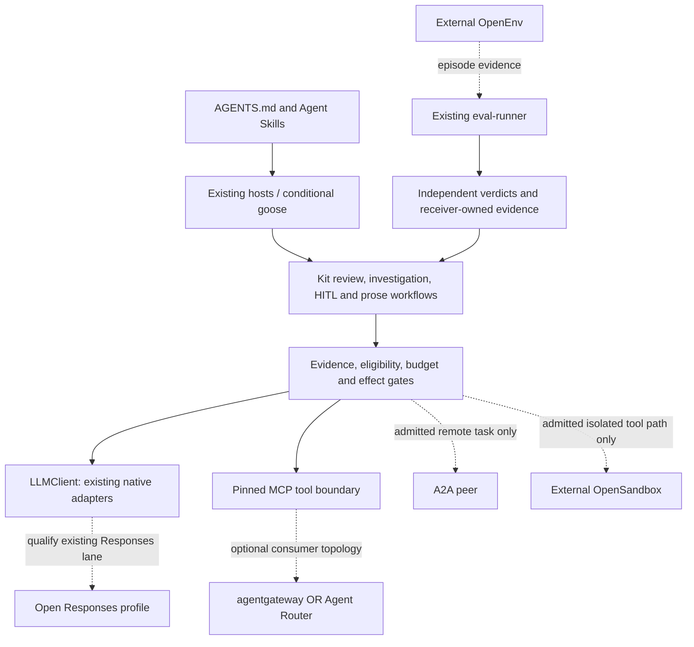

# Governed interoperability with the open agent ecosystem

Status: accepted design, 2026-10-23. Decision [0034](../intent/decisions/0034-open-ecosystem-interoperability.md).
Goal G15 cross-cuts G9-G14. [All ten projects and sources](../assessments/2026-10-23-aaif-alignment.md);
[queued work order](../plans/aaif-alignment.md). **The new qualifications and integrations
below are not implemented by this document.** Existing capabilities retain their scopes.

## Outcome and architecture

An engineer can adopt a small governed workflow through a relevant open interface,
retain evidence and native capability, see unsupported paths before dispatch, and
return a useful improvement to its owner. Our value is the evidence and control path
between components, not a replacement for upstream protocols or infrastructure.

This diagram maps intended boundaries, not deployed components or proven support.

Open Responses is a generation wire profile, not the typed Decisions API or the
`decision.Decider` port. MCP connects tools/context; A2A connects independent agents.
Skills package expertise; AGENTS.md supplies instructions. OpenEnv supplies episodes;
OpenSandbox supplies external execution infrastructure. Gateways manage selected
traffic. None becomes the application's source of domain facts or permission.

## Shared profile and evidence requirements

[AF-C01] Qualify an **exact profile**, not a brand. Record its owner, upstream spec
release/source pin, implementation/version and configuration digest; required and
provided capabilities; native extensions, explicit losses and unsupported cases;
execution surface; input/output identity; and the independent expected scenario set.
Include applicable disclosure, retention, expiry, identity and attempt/cost limits.
Do not add irrelevant fields just to make unlike protocols look uniform.

[AF-C02] Reuse Catalog Kit definition/evidence identities and the existing assurance
stages. A profile is caller-owned data/fixtures next to its adopting workflow, not a
new registry or policy service. CUE/Go shape contracts follow a demonstrated seam;
this design does not invent a shared type. A committed derived compatibility view
needs a named reader and deterministic `--check` under 0021. Unsupported, not tested,
not configured, failed and passed are separate results, with an explicit denominator.

[AF-C03] Protocol discovery, schema validity, model confidence and successful transport
never grant authority. The receiver establishes principal, purpose, target, policy epoch,
permitted disclosure and exact effect. Preserve stale-input refusal, bounded attempts,
cancellation, output completeness and uncertain-effect reconciliation at each controlled
boundary. A peer that cannot preserve a required law is ineligible, not silently degraded.

[AF-C04] Preserve native strengths through an explicitly selected, pinned adapter/profile.
Unknown native payloads may be retained opaquely when permitted, but are never portable
tool instructions or safe to forward automatically. Report required features that cannot
be mapped. Bind reuse to full exposed input, policy and implementation identity; cached
responses, replay and repeated seeded fixtures do not create independent observations.

## Four new projects

### Agent Skills with AGENTS.md [AF-C05]

Adopt the standard artifact shape and progressive disclosure, retaining one owned
semantic rule source. Keep host-specific discovery paths and hooks as thin bindings;
the `.agents/skills` link is packaging, not proof that every host loads it. Validate
frontmatter/folder names, metadata, bundled resources, dependency requirements and
license/provenance against a pinned format. Audit bundled scripts before installation.
Use an existing maintained validator outside the root Go dependency graph, or a bounded
stdlib validator for the exact supported subset; justify any divergence with fixtures.

Verify actual intended and negative activation prompts on each declared host/version,
including nested scope, restart/compaction and conflict cases. Observe required hook
execution separately from instruction loading. Experimental `allowed-tools` is neither
a portable permission contract nor a substitute for enforced host policy. Extend
`kit-new host` only when needed; do not duplicate global configuration or install skills
incidentally. This refines SH-03/AE-13, not a second host configuration framework.

### Open Responses [AF-C06]

Start with existing `foundations/llmclient/openai` `Config.UseResponses`, its explicit
storage posture, native-parameter ownership and conformance tests. Pin a profile to
the 2026-04-24 specification before measuring gaps. Keep `LLMClient`, the decision port
and native Anthropic/Google targets independent; OpenAI Responses support does not
establish Open Responses compliance or eliminate the Google adapter gap.

Map message/item order, tool call IDs and complete arguments, structured outputs,
usage, errors/refusals, and semantic SSE lifecycle. A completed/failed/incomplete terminal
event governs the outcome; optional `[DONE]` and transport EOF cannot manufacture
success. Interrupted or partial arguments are not executable tools. Preserve permitted
opaque provider items without executing them or claiming access to hidden reasoning.
Test ordering/duplication rules from the selected spec and disclose any representational
loss. Count all attempts; usage details must not be double-counted as additional totals.

Default to the existing stateless, explicit-storage posture. Stateful continuation,
WebSocket turns and compaction are independent optional capabilities with retention,
identity, reconnect and completeness tests. Do not implement them just for parity.
A multi-provider claim requires independently implemented actual peers and per-profile
proof, not two modes of one mock server. Provider quality/calibration needs separate data.

### OpenEnv [AF-C07]

Treat reset/step/state as an optional episode source for existing eval-runner and
scenario-bank evidence. An adapter owns protocol/session translation; the environment
owns its reward and termination. Keep domain acceptance independent. Do not build an
RL trainer, replace the evaluator or let high reward authorize an application action.

Retain environment/source/image digest, task/split and evaluator version, reset inputs,
seed, ordered action/observation references, step/episode IDs, declared attempts and
terminal/truncation/error causes. Keep sensitive observations behind consumer storage
and disclosure policy. Bound episode length, payloads, wall time and reset/step retries.
Define idempotency before retrying a step; uncertainty requires reconciliation, not
replaying a possibly applied action. Cross-runtime repeatability and independence need
observed proof; a shared seed or environment `done` flag supplies neither by itself.

### OpenSandbox [AF-C08]

Select an external sandbox only for a consumer-owned tool path that requires isolation.
Keep bounded-exec explicitly non-isolating. The adapter translates lifecycle/exec/file
and cancellation behavior without implementing Docker/Kubernetes or importing an SDK
into the root module. Keep authorization and HITL approval ahead of dispatch.

Require a finite consumer lifetime and total renewal ceiling, principal/run-bound handle,
least-privilege exec endpoint access, allowlisted mounts, secret references, bounded
output and an explicitly selected network policy. A profile requiring egress denial is
ineligible until actual allowed/denied network probes establish it; configured policy
alone is not proof. Reject unsupported capability paths, including unavailable isolated
diff/commit. Do not interpret debugging diagnostics as complete audit records.

Cancellation, lost responses, expired handles and cleanup failure produce typed held/
unknown outcomes and an actionable reconciliation record. Test the selected backend's
stated isolation properties against a declared threat model, plus secret handling,
interruption and terminal deletion in a controlled runtime trial. Pin runtime/platform/
security configuration, name exact probes and retain untested escape classes and
residual unknowns. These probes are not a security certification.
Hermetic API mocks prove translation only. No sandbox service is installed by this design.

## Existing projects and conditional boundaries

[AF-C09] **MCP and goose:** retain 0003's current protocol pin, retirement clock and
explicit HTTP auth/TLS responsibilities. Start a goose pilot with the smaller MCP recipe
surface, not a native host adapter. Exercise tools/list, tools/call, schema changes,
errors, changed definition pins, denied effects and cancellation. The claim covers the
registered controlled tool path, not all other capabilities of the goose process.
A newer MCP revision needs its own profile and 0003's trigger, never an implicit bump.

[AF-C10] **A2A:** require a named independently operated peer/workflow before admission.
An Agent Card is discovery, not authenticated permission or proof of capability.
Map peer identity, task/context IDs, artifacts, lifecycle, cancellation and bounded
delegation into the existing effect/reconciliation path. A timeout or remote "done"
does not prove an authorized effect. Prevent duplicate dispatch, recursive delegation,
wrong-tenant artifacts and stale approvals; no worker executor is added under I20.

[AF-C11] **agentgateway and Agent Router:** they are distinct optional external systems.
Choose the smallest consumer topology that has measured need; do not stack both as a
default. Prove identity/audience propagation, discovery and invocation policy, error and
usage mapping, retries, outage behavior and both local/proxy enforcement obligations.
Do not infer Responses/Decisions support, quota accuracy or effect approval from an
OpenAI-compatible endpoint. F7 still gates new health/cost-routing work. Platform
engineering owns any deployment; the kit supplies portable contracts/cases, not a gateway.

[AF-C12] **Upstream and cross-kit contributions:** prepare a minimized sanitized failure
case with source/spec pins, expected/observed behavior, owner boundary, license basis,
local test command, scope and rollback. Check existing upstream issues/tests first.
Offer general protocol/validator/docs fixes to their owners; retain application policy,
private evidence and domain criteria locally. Record accepted/revised/rejected/no-gap
dispositions, not a submission quota. Public posting or cross-repo changes follow their
existing authority; no submission, acceptance or project affiliation is implied here.
The assessment maps all ten projects to a first contribution hypothesis.

## Independent acceptance cases

Each applicable case runs on the advertised entrypoint and names the profile/peer,
configuration and test revision. Missing required evidence blocks a compatibility claim.

| Case | Required negative / positive evidence |
|---|---|
| AF-A01 | Malformed/name-mismatched skill, missing dependency and non-triggering intended prompt fail different checks; metadata validity never stands in for activation. |
| AF-A02 | Shared rules load under two declared host versions; nested/hidden instruction and missing-hook probes expose unsupported enforcement; existing adopter edits survive install/uninstall. |
| AF-A03 | Existing Responses path passes the pinned shared request/result/tool subset; unsupported native/Google features fail explicitly without dispatch. |
| AF-A04 | Premature EOF, invalid event order and incomplete tool arguments cannot become completed execution; optional `[DONE]` is not required for a valid terminal event. |
| AF-A05 | Unknown extension stays permitted opaque data or produces explicit unsupported; it cannot mutate policy or silently vanish from a lossless claim. Storage/continuation stays opt-in. |
| AF-A06 | OpenEnv wrong episode/step, repeated uncertain step, unseeded/nonrepeatable reset, truncated rollout and high-reward wrong-domain answer remain visible; domain oracle rejects false success. |
| AF-A07 | Sandbox missing credentials, wrong principal, infinite expiry, excess renewal, forbidden mount and unproven required egress all refuse; a real runtime blocks named cross-mount/egress probes under the recorded threat model. Unprobed escape classes remain unknown. |
| AF-A08 | Interrupted/lost exec and failed deletion cannot appear successful or disappear; real cancellation/expiry cleans up or retains an actionable unresolved resource receipt. |
| AF-A09 | Pinned MCP tools/list/call, malformed metadata, source-pin drift and denied effect work through an actual selected host; no assertion about unobserved host tools. |
| AF-A10 | A2A unauthorized card/task, wrong tenant/artifact, recursive delegation and stale/uncertain remote effects cannot gain authority or be dispatched twice. |
| AF-A11 | Each selected gateway denies unauthorized list and call, preserves principal and bounded retries, and reports unsupported endpoint shapes/outages instead of silent fallback. |
| AF-A12 | An independent expected-case set catches omission; replacing one required check with pass makes its planted negative fail the test. No aggregate score masks the missing case. |
| AF-A13 | Guide-only useful offline result within 15 minutes, bounded machine-readable errors, safe teardown and recorded operator effort; distinguish agent-assisted fixture timing from human usability. |
| AF-A14 | The same controlled task, input snapshot, policy floors and required interface profile run across two independent real implementations/hosts, with comparable outcomes/cost and loss disclosures. Different interfaces are not a paired proof; mocks, skipped probes and model confidence do not count. |
| AF-A15 | Upstream review records a receiver-reviewed reusable contribution or explicit reasoned no-upstream outcome, including no demonstrated shared gap. Do not manufacture a defect or submission to meet a quota; no private data, duplicate authority or claimed acceptance without a receipt. |

## Sequence, decisions and measurement

The [work order](../plans/aaif-alignment.md) queues AF-1..AF-10. It does not create a
third implementation slot or reorder W1-W4 prerequisites. Metadata repair to an existing
artifact can be maintenance; a new adapter/runtime pilot needs explicit bounded admission.
Each admitted unit names a receiver, maintainer, independent baseline/negative cases,
<=5 engineering days to offline proof, zero provider spend by default, <=64 MiB fixture
corpus and review by 2026-11-21 or next release. Larger/runtime/live studies require
their own measured resource/spend/disclosure bounds before dispatch.

Report exact supported/required case counts, failure/unknown/loss counts, hook/transport
coverage, all attempts and cost, setup/operator time, recovery and accepted outcomes.
Stop expansion when a required law is lost, an independent baseline cannot be established
within the bound, or the simpler existing path wins. Keep the ecosystem profile optional.

Decision models can propose semantic test categories, triage documentation differences
or classify ambiguous failure evidence under an owner-declared question pack. Compute
version/schema/permission/coverage checks first. Default to none/replay or human review;
unknown holds investigation, never an effect. Require a bound study and kill the site
when error/attention/cost fails its baseline. [0033's utilities](../decision-sites.md)
support authoring, not protocol or sandbox certification. No new decision runtime is needed.
