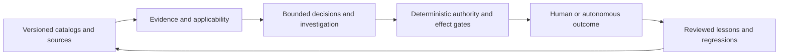
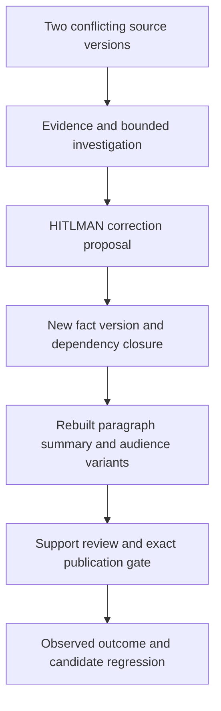

# Agentic engineering uplift

Owner direction: 2026-10-22. Decisions: [0025](../../intent/decisions/0025-agentic-engineering-uplift-composes-assured-workflows.md),
[0026](../../intent/decisions/0026-reject-model-only-authority-and-completeness.md),
[0027](../../intent/decisions/0027-human-workbench-and-prose-share-bound-transactions.md).
Status: accepted design. **The new compositions below are not implemented by this document.**
Second pass: [clause-by-clause coverage](request-coverage.md),
[review and corrections](../../assessments/2026-10-22-agentic-engineering-design-review.md),
[cross-kit contribution dispositions](contributions.md), [visual Pages](visual-pages.md),
and decision 0028.
Baseline and actual offline run: [assessment](../../assessments/2026-10-22-agentic-engineering-uplift.md).
External claims: [dated primary-source research](../../evidence/agentic-engineering/2026-10-22/research.md).

Cross-cutting G15: [AAIF alignment](../aaif-alignment.md), [ten-project assessment](../../assessments/2026-10-23-aaif-alignment.md),
decision 0034 and its [queued work](../../plans/aaif-alignment.md). This applies open
interfaces to the six outcomes below; it opens no new implementation incubation.

Explore the [workbench experience](workbench-experience.md) and its
[12-scenario backendless layout lab](../../../prototypes/governed-workbench/README.md).
Decision 0029 chooses one optional shell with independent HITL/prose semantics.
The interactive experiment does not close the runtime work order.

## Product decision

**Anchor experiences:** governed prose and HITLMAN. Shared catalog, inventory,
evidence and decision work should prove its value in their end-to-end tasks.
[Priority, sequencing and PX acceptance](prose-hitl-priority.md), decision 0038,
protect these outcomes and app-kit collaboration without opening another runtime slot.

Make good agentic engineering a short, inspectable adoption path: choose a workflow
profile, bind its practices and evidence, prepare decisions, enforce authority and
budgets at the actual effect boundary, then improve from observed outcomes.
The unit of excellence is an accepted outcome at known cost and residual risk.
Package count, number of agents, model confidence and checklists completed are
insufficient substitutes. Unknown required evidence holds the workflow.

[Deterministic working-method recipes](../deterministic-workflows.md) apply the same boundary contract to review, data/prose, app actions, host configuration and learning. Their design does not close this program's runtime or adoption work.

[Inventory/evidence contracts](../inventory-evidence-review.md) and [evidence-driven reviews](../evidence-driven-reviews.md), decision 0037, specify consumer-local profiles for investigations, code review, documentation correction and well-architected app/infra review. [IR work](../../plans/inventory-evidence-review.md) remains deferred; no new kit, store, score, incident predictor or incubation is admitted.

## Choose the smallest useful path

Read the outcome row first, then its owning contract. A consumer can stop at any
row whose guarantees meet its task; the full workbench is not an adoption prerequisite.

| Desired outcome | Start with | Add only when needed | Result to inspect |
|---|---|---|---|
| Review a repository or workflow offline | [Practice catalog](practice-catalog.md) | [Evidence lifecycle](evidence-learning.md) for reuse | Criteria, independent expected scope, findings and coverage gaps |
| Investigate uncertain evidence economically | [Decision and investigation](providers-decisions.md) | Eligible model adapters and calibrated judgment sites | Answer, counterevidence, unresolved questions, stop cause and total cost |
| Let a person or agent change application state | [Human workbench](human-workbench.md) | Forms, queues and remote delivery adapters | Exact proposal, trusted authority, commit or reconciliation receipt |
| Build explainable prose and audience variants | [Prose harness](prose-harness.md) | Hierarchical editor and selective rebuild | Immutable text, support, input lineage, diff and exact publication decision |
| Improve the next workflow from observed failures | [Learning loop](evidence-learning.md) | Read-only source adapters and receiver-owned promotion | Reproduced lesson, accepted consumer change, recurrence and cost evidence |

### Evidence is not authority

| Question | Owning record | What it cannot establish |
|---|---|---|
| Which exact bytes or source revision? | Snapshot, locator and digest | Whether the assertion is true |
| Does this evidence support this claim? | Criterion-bound judgment and uncertainty | Permission to act or disclose |
| May this actor perform this effect here? | Trusted purpose, policy, exact bound decision | Whether a remote effect actually happened |
| What happened and did it help? | Effect receipt, consumer outcome and baseline | General effectiveness beyond the observed scope |

### Composition map

## Ownership and composition

| Layer | Owns | Must not become |
|---|---|---|
| Foundations | Narrow contracts and deterministic behavior with CUE/Go parity | Application lifecycle or provider policy hidden in core |
| Catalog Kit | Verified identity, layers, tailoring, discovery and exact definition binding | Domain truth, universal thresholds or permission authority |
| Existing workflow kits | Investigation/review/prose/HITL/evaluation compositions | Mandatory framework controlling the consumer process |
| Platform Review Kit / Test Kit | Domain criteria and judgments / execution and results | A fork of common catalog identity or fabricated execution evidence |
| Fathom | Source relationships, obligations, static proof, optional evidence retrieval | Runtime or semantic-quality certification from static reachability |
| app-kit | Presentation primitives, accessible interactions, visual references and reusable recipes | Approval policy, domain facts or action authorization |
| Consumer | Identity, source authority, applicable floors, persistence, destinations, operating risk | Silent changes to kit contracts or inherited unsupported guarantees |

The graph is conceptual, not a new universal graph database. Reuse existing evidence,
journal, record-fingerprint, assessment, decision, HITL and prose contracts. Extract
a shared addition only after an actual seam or admitted reference demonstrates it.
An offline, local, no-Fathom path remains first-class. Optional integrations report
their capabilities and freshness rather than fabricating equivalent evidence.

### One correction through the system

Synthetic design walkthrough, not a measured run: a configuration source says the
retry limit is three while a runbook says two. Review keeps both versions and their
source families. A permitted investigator retrieves missing context; an authorized
domain reviewer adjudicates the conflict rather than simply accepting model confidence.

The correction invalidates dependent text and approvals. Reuse unaffected nodes
only when their exposed context and policy are current. Publication binds the
artifact, trusted purpose, destination and audience. A timeout holds delivery for
reconciliation; it does not authorize another send. A resulting lesson must be
reproduced and accepted by the receiving consumer before it changes practice.

## Specifications

| Goal | Owning specification | First vertical slice | Evidence of success |
|---|---|---|---|
| G9 | [Practice catalog](practice-catalog.md) | Source-backed practice pack and deterministic review of two synthetic repositories/workflows | Independent expected scope catches omission; false passes planted and refused |
| G10 | [Evidence and learning](evidence-learning.md) | Versioned evidence through a review and corrective action | Revoked/stale/conflicting inputs remain visible; reuse and deletion fail safely |
| G11 | [Providers, decisions and investigations](providers-decisions.md) | Same bounded review through none/replay and two existing adapters; Google gap closed before parity claim | Refusals, native-only requirements, cost accounting and escalation proven separately from quality |
| G12 | [Human workbench](human-workbench.md) | One app-owned evidence/form panel over bound proposals | Stale/wrong-actor/changed-target approval cannot commit; human task effort measured |
| G13 | [Prose harness](prose-harness.md) | Correct a fact, rebuild dependent nodes/variants, review and publish | Unsupported/stale/blocked outputs refuse; independent diff/lineage checks pass |
| G14 | [Evidence and learning](evidence-learning.md), [security and hosts](security-hosts.md) | Read-only issue intake and hook journal to reviewed regression | Duplicates, edits/deletes and drops accounted for; another consumer explicitly accepts lesson |

## Request coverage

These stable requirement IDs preserve the owner's broad request without turning
every idea into a new package. Each is accepted unless its disposition says otherwise.

| Requirement | Decision / owning acceptance |
|---|---|
| AE-R01. Recheck hanging contributions and prune safely | Dated assessment and contribution audit; no new candidate found |
| AE-R02. Update vision/goals before designs | VISION, scope G9-G14, 0025 |
| AE-R03. Contracts, guidance and deterministic enforcement | Practice catalog PC; controlled-path tests in every specification |
| AE-R04. Pattern and antipattern catalog with review methods | One paired criterion model, practice catalog PC |
| AE-R05. Data engineering and evidence quality reviews | Evidence-learning EL and practice catalog data criteria |
| AE-R06. Catalog project capabilities/goals and progress evidence | Derived views of TRACKING, scope goals, plan IDs and receipts; no duplicate authority |
| AE-R07. Research certifications and successful public workflows | Research S01-S31; use public guidance, no unverified professional syllabus or exam content |
| AE-R08. Compose primitives into larger independent kits | Ownership table, 0024/0025; extract only demonstrated shared seams |
| AE-R09. OpenAI/Anthropic/Google with native strengths | Providers PV; capability requirements/native extensions/typed unsupported |
| AE-R10. Jev and other typed decision engines | Providers PV; existing Decider, none, calibrated site definitions |
| AE-R11. Confidence thresholds and justified evidence | Practice criterion/threshold profiles, providers calibration; no universal probability |
| AE-R12. Ambiguity, contradiction and missing information | EL graph, PV escalation and HW clarification, never exhaustive-detection claim |
| AE-R13. Model availability, candidate/selected/evaluated ladders | Separate deployment inventory and application solution manifests, PV |
| AE-R14. Cost-effective review and investigation at scale | PV cascade, independent expected scope, bounded work/cache and stopping rules |
| AE-R15. Small capable models, including the Haiku class | Narrow measured routing roles, PV; model IDs and eligibility remain caller data |
| AE-R16. Caching, batching and avoiding repeated processing | EL exact reuse, PV latency-aware scheduling; F6 admission requires measurements |
| AE-R17. Fathom-enabled and independent workloads | Optional evidence-provider seams with explicit lower coverage, EL/PV |
| AE-R18. Security/prompt/model bouncers | PV assistance plus deterministic security-hosts guards; model-only authority rejected by 0026 |
| AE-R19. Security-scanning binaries and findings | Security-hosts scanner adapter proposal; current binaries and limits assessed |
| AE-R20. Governance, policy, RBAC, privacy and tokenization | HW roles/attributes/field disclosure; EL retention; tokenization is not authorization |
| AE-R21. Voice/tone/audience/technical-level catalogs | PH projection profiles, PC catalog family ownership |
| AE-R22. Source-linked generated document structure | PH fact/claim/node/projection versions and support edges |
| AE-R23. Corrections vs annotations and dynamic questions | HW question plans and PH input authority |
| AE-R24. Agent edits, suggestions, accepted or autonomous actions | HW common proposal protocol and deterministic execution mode |
| AE-R25. Policy blockers, warnings and scoped overrides | HW/PH server gate; absolute floors non-overrideable, status not color-only |
| AE-R26. Sentence/paragraph/section/document evidence inspection | PH node anchors and HW evidence panel |
| AE-R27. Simultaneous variants, selective rebuild and history | PH dependency closure and immutable versions; model cannot shrink closure |
| AE-R28. Regeneration percentage and conceptual drift | PH separate exact change metrics and heuristic concept review |
| AE-R29. Document-quality profiles and dashboard projections | PH required/optional criteria, same-version source-linked views |
| AE-R30. Human workbench simple and advanced modes | HW progressive adoption; app-kit owns reusable UI |
| AE-R31. DRY Claude/Codex/Antigravity configuration and hooks | Security-hosts source rules + versioned adapters, unsupported stays unsupported |
| AE-R32. Failure sampling, journals and learning | EL bounded stratified intake with loss/existence checks; critical events unsampled |
| AE-R33. GitHub issue flywheel and other source patterns | EL read-only adapter port, review and reproduction before promotion |
| AE-R34. Missing kit adoption and upstream contributions | PC adoption review and docs/app-kit.md pending packets; no invented adoption quota |
| AE-R35. Durable rejection of bad ideas | 0026 and alternatives in 0025/0027; named wins-if/revisit conditions |
| AE-R36. Higher effort only when it pays | PV typed escalation reasons, budgeted distinct evidence, measured marginal value |
| AE-R37. Three visual design Pages | Overall, HITLMAN and prose reader views with diagrams and source/status links; canonical contracts remain here |
| AE-R38. Align with all AAIF projects and the four October additions | G15, 0034, AF-C01..12 and AF-A01..15; maintain independent kits and receiver-admitted optional profiles |

## Sequence and admission

The [work order](../../plans/agentic-engineering-uplift.md) holds source-seam tasks;
TRACKING remains the build-status authority. No runtime task is checked by design.
At most two implementation incubations may be active under 0004. Start only with
a named maintainer (kit maintainer), subject/consumer, fixed acceptance fixtures,
time/spend/storage bounds, baseline and review date. Candidate consumers below
are design targets, not commitments made on their behalf.

| Wave | Work and dependencies | Admit / stop decision |
|---|---|---|
| W0, this change | Contribution audit, primary research, actual offline assessment, goals/specs/rejected alternatives | Complete when source claims/links/gate and independent design review pass. No paid/provider run. |
| W1, reference admitted by 0032..0036 | [Practice review](../uplift-2026-10-23.md), [decision lab](../decision-lab.md), [command qualification](../command-governance.md) and [assignment assessment](../assignment-kit.md), reusing Catalog Kit/AssessProfile; real self-audit/Review Kit exchange remains open | Same second slot, <=5 engineering days, zero provider spend, <=64 MiB corpus with per-tool input caps. Review 2026-11-21/next release; stop/revise if planted omissions pass. |
| W2, queued after W1 | Provider conformance/native extensions and economical investigation; extend existing Decider/LLMClient, do not create another router | <=5 days to offline proof and reproducible wire contracts. No live quality claim until a separately budgeted campaign. Google support remains a gap until conformance passes. |
| W3, queued after W1 | Human workbench + prose vertical slice, preferably consumer-c's constrained fact-to-document task before contested consumer-a evidence | Shared one implementation slot, <=10 days to synthetic complete path, then bounded attended pilot. Stop full-workbench expansion if simpler forms solve the task. |
| W4, queued after W1/W2 | Read-only GitHub/journal intake to a reviewed lesson; independent replay and consumer acceptance | <=5 days to offline fixture proof. No unattended publication or rule updates. Kill if deduplication/redaction/revocation cannot be demonstrated. |
| W5, conditional | Production migrations, more consumers, reusable app-kit recipes and optional async batch adapters | Only after measured consumer outcome and owner-approved destinations; F6/F7/F8/F14 triggers remain independent. |

Budgets are stop-and-review limits, not delivery estimates. Review admitted work
after 30 days or next release, whichever comes first. No new live campaign, tag,
release, package tier change or global agent configuration change is implied.
Deferred CK-11..CK-15 remain deferred; this program supplies design, not their closure.

## Measurement and rejection rules

Developer experience is an acceptance condition of every wave: a fresh consumer
must reach one useful offline outcome from the guide alone within the existing
15-minute assurance target. Include a complete working data/profile example,
required capability/prerequisite discovery, stable machine-readable results,
actionable error/exit semantics and a safe retry/recovery path. Agents get bounded
progressive discovery and exact IDs; humans get consequences, evidence and next
actions. Measure real setup and attended-task time; an agent-assisted synthetic
trial cannot stand in for human usability. No mandatory provider, central service
or full workbench is needed to adopt a small contract.

Report separate dimensions: required-control planted-failure detection; missing/unknown
evidence; adjudicated false blocks and missed defects; supported-claim rate; repeatability;
setup time; operator minutes; latency; all attempts/cost per accepted outcome; actual
cache reuse; recovery/reconciliation success; and transfer/recurrence reduction.
Keep trials independent and baselines comparable. No weighted overall percentage.

Every proposed decision site needs a deterministic fallback or held state, opt-out,
bounded failure behavior and a kill measurement. Remove a site if added cost/review
burden fails to beat the same workflow without it under the declared quality floor.
Model consensus is not independence, semantic certainty or policy authority.

The [clause audit](request-coverage.md) records accepted, bounded and rejected
dispositions and their acceptance references. Implementation/adoption/measurement
exits intentionally remain open. Design unknowns that need real evidence are recorded
in each pilot, not inferred from a topic appearing in this index.
