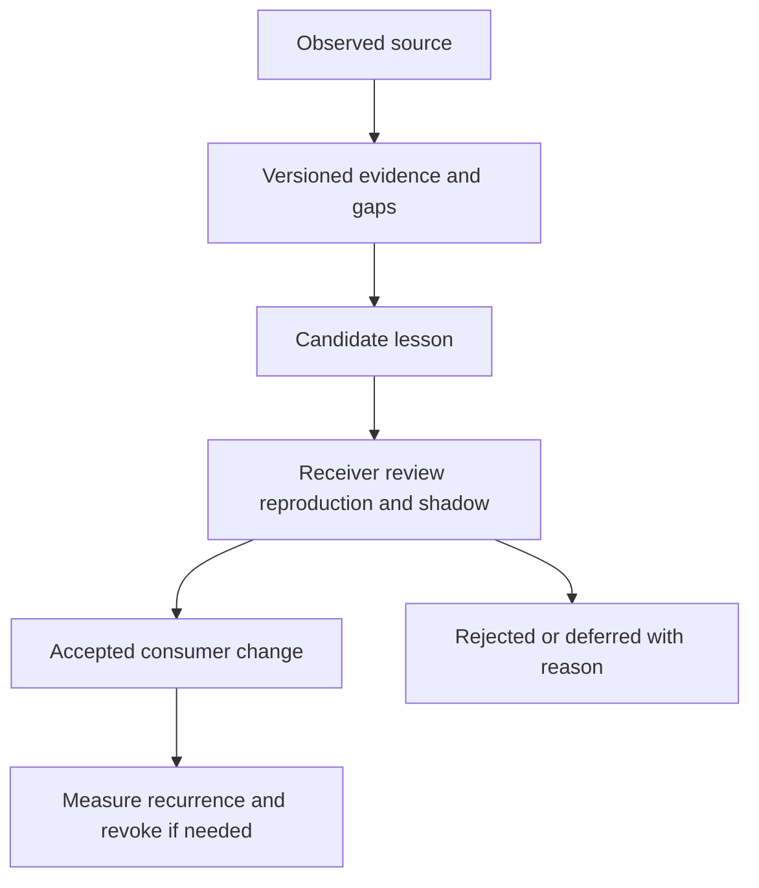

# Evidence and learning: bounded design specification

Status: accepted target design under 0025, 2026-10-22. The target is a reviewable path from observed source to accepted effect, without a global memory store, automatic rule changes, issue writes, or implied execution authority. Existing `evidence-span`, Catalog Kit, investigation journals, governed prose, HITL, and lesson transfer supply parts of the substrate; the graph and GitHub intake described here are targets, not shipped integration.

## Governing boundary

A source observation can start a lesson; it cannot update policy. Each transition
preserves source, scope and authority. Rejection is a durable outcome, and accepted
lessons can later be revoked. Exact reuse and privacy checks apply at every read.

[Vision](../../../VISION.md), [assurance](../../intent/assurance.md), [0006](../../intent/decisions/0006-evidence-and-lessons.md), [0009](../../intent/decisions/0009-bounded-lesson-transfer.md), [0024](../../intent/decisions/0024-independent-kits-share-identity-not-authority.md), and [0028](../../intent/decisions/0028-compositions-bind-snapshots-and-policy-epochs.md) apply. Invariants I19 (measurement existence), I20 (plan-only workers), and I21 (consumer checks) remain distinct from this design. The F2 consumer-owned-memory future is unpromoted; this spec must fit versioned files and consumer-owned stores. Fathom can index source proof, Review Kit retains exact typed domain judgment, Test Kit runs tests, and the receiver decides whether a lesson applies. No package, dependency, release tier, or policy service is proposed now.

## Versioned graph and authority

The graph has typed nodes `SourceSnapshot`, `Extract`, `Fact`, `Claim`, `Judgment`, `Approval`, `Artifact`, and `Effect`. Every edge has source ID/version/digest, actor or service, transform version, observation time, record time, locator, scope, and derivation type. A source snapshot is bytes or an access-controlled reference with checksum and retention class. An extract maps exact source spans to normalized content. A fact is an asserted observation; a claim is an interpretation or proposed statement. A judgment records criterion/version, evidence admitted, method, uncertainty, and domain authority. Approval binds principal, target digest, effect class, expiry, and revocation state. Artifact is what was actually exported; Effect records attempted/observed external consequence and reconciliation. Neither a valid hash nor a high model score confers source truth, permission, or effect success. Existing [governed prose](../governed-workflows.md) stays the claim-level publishing owner.

Valid time says when a source assertion applied; record time says when this system learned it. Preserve both. A correction appends a new node/edge and retracts affected judgments, approvals, and artifacts by dependency walk; it never rewrites past observations. Contradictory independent sources remain side by side with provenance and unresolved status. Copies, mirrors, syndications, and model paraphrases of one origin count as one evidentiary family; independence must be argued by separate origin or method. A missing source remains unknown. Unknown cannot become absent or false merely through retention deletion. Domain policy chooses adjudication and truth thresholds.

All reads and writes require trusted host context: authenticated/effective principal, controlling principal and attested delegation where relevant, tenant, purpose, resource, action, classification and retention authority. Caller or model payload is untrusted data, never a source of these attributes. The core validates context and denies unknown authority; it does not become an organization identity provider. Storage, indexes, cache, derived data and retrieval all enforce tenant and purpose policy. Bind reusable envelopes to the host's current authorization/policy epoch and source revocation epoch; these are required validity inputs, not a new universal identity platform.

Store least-necessary data: tokenize sensitive identities before logs, keep reidentification mappings in a scoped vault with separate purpose/resource policy, redact excerpts by purpose, set retention/deletion terms, record legal hold and deletion receipt, and invalidate dependent retrieval/cache on erasure. Do not leak associations through labels, cache keys, question hints or shared indexes. A tombstone can preserve non-sensitive provenance and denial reason without retaining deleted content. Audit access to source and tokens; opaque hashes of sensitive low-entropy values are not anonymization.

## Cache and evaluation boundaries

These lifecycle requirements apply to newly composed consumer stores and bounded
fixtures. They do not retrofit deletion into existing append-only journals,
event stores or cassettes, nor erase previously exported copies. Keep erasable
payloads in an explicitly deletion-capable consumer store/vault and journal only
permitted references/tombstones. A pilot needing raw sensitive records in an
append-only store must stop for a separate retention/compatibility decision.

Exact cache keys bind tenant, trusted principal/authority scope, purpose, input/source digests, query, definition/profile revisions, parser/transform version, model/provider identity, settings, policy version and current authorization/policy and source-revocation epochs. Semantic reuse adds a bounded candidate retrieval step; a candidate still passes current authorization, source freshness, exact scope, contradiction, and domain admission checks. Neither key lookup nor hit/miss metadata may disclose another tenant's or purpose's association. Never cache approval or action authority as a free-floating answer. Record creation, hits, misses, expiry, invalidation, and measured saved cost/latency; on revocation, correction, definition change, policy change, or deletion, dependent entries are unusable. Cached model output remains a proposal. A cache hit cannot create an independent trial or fresh evidence.

Use task-specific confidence bands, including `unknown`, whose thresholds are calibrated against labeled domain examples. Separate source reliability, extraction confidence, claim support, decision confidence, and permission. A cheap-first ladder may use deterministic extraction/checks, narrow model classification, then stronger model or human review on ambiguity, high impact, disagreement, or threshold proximity. The fallback on model failure is deterministic refusal/unknown or human review. The kill test compares accepted accuracy, false allows/refusals, latency, and total cost against the simpler baseline. Presentation shows sources, conflicts, uncertainty, and next verification; it does not collapse all dimensions into one score. Only the domain owner may set policy floors.

Evaluation has distinct capability and regression suites with frozen task definitions, source truth/ambiguity annotations, trajectory, grader version, scanner findings, model/provider/settings, and human adjudication. Split by source family, issue lineage, and time so near-duplicate tickets and copied documents do not leak across train/development/test. Keep untouched holdout and new prospective samples. Measure grader disagreement, false pass/refusal, abstention, source drift, model drift, and distribution shift. A replayed or cached observation is one trial; a changed grader rejudges preserved raw observations rather than manufacturing new evidence. [Anthropic eval guidance](https://www.anthropic.com/research/demystifying-evals-for-ai-agents) and [Inspect scoring/logs](https://inspect.aisi.org.uk/scoring.html) motivate the split, not universal thresholds.

## Journal with coverage of its own existence

A bounded append-only event envelope names schema version, event ID, run/workflow ID, tenant, correlation/causation IDs, actor, component/entrypoint, subject and definition digests, observed/recorded time, privacy class, source references, outcome (`pass`, `fail`, `unknown`, `not-applicable`), and prior event digest where applicable. Events include `source_seen`, `extract_made`, `fact_asserted`, `claim_proposed`, `contradiction_found`, `judgment_recorded`, `approval_granted/revoked`, `artifact_exported`, `effect_attempted/observed/unknown`, `hook_started/succeeded/failed/bypassed`, `coverage_expected/observed/unsupported`, `candidate_created/reproduced/accepted/revoked`, `cache_hit/miss/invalidated`, and `deletion_requested/completed`. No free-form secret payloads.

Sampling is deterministic by stable event/run ID and versioned rate, with counts of included, excluded, malformed, dropped, and delayed events. Security decisions, permission denials, mutations/effects, approval/revocation, hook failures/bypasses, deletion, and coverage-existence events are unsampled. Each measurement channel has an existence heartbeat or expected/observed counter. If its collector disappears, output is `unknown` plus an alertable gap; zero events alone never proves zero incidents. Budget and backpressure caps fail closed for required audit events and report gaps for sampled diagnostics. Event source existence, transport completeness, and result quality are separate claims.

## Read-only GitHub issue intake port

An optional hexagonal `IssueReadPort` reads a bounded allowlist of repositories, labels, fields, time window, and per-run page/byte/issue budget. It is read-only by contract and credential scope. The adapter treats title, body, comments, links, and labels as untrusted data, renders markup inert and does not fetch linked resources implicitly, records author/source/access scope, and never treats an issue instruction as a tool command or policy. It must not create/edit issues, comments, PRs, or merged content. GitHub issue data are candidate signals, not an accepted lesson or proof of defect.

Identity is `(source, repository immutable ID, issue ID, revision)` with an event key for edit, delete, reopen, close, and tombstone transitions. Preserve all observed original/latest states with observed and upstream update times; use a canonical content digest as revision identity when the source has no immutable revision ID. ETag/conditional fetch, pagination, rate-limit/retry-after handling, and bounded backoff are required. A cursor/high-water mark advances only after durable storage of the whole fetched page and its event dedupe state; a crash before commit replays safely. Same-timestamp edits need stable tie-breakers and overlap scans. A confirmed deletion or access loss becomes an appropriately scoped tombstone, not a silently vanished training example. Polling cannot recover every intermediate edit or establish deletion from a missing page item. Reconcile previously observed IDs against a complete bounded snapshot or explicit source event; distinguish deleted, inaccessible and unknown. Record observation gaps, including rate-limited or permission-limited history. Permission loss stops reading and invalidates cached sensitive content. Separate adapters serve other sources without widening this port into a universal crawler.

## Other read-only source adapters

Each adapter declares its observation method, identity/revision key, permission scope, deletion signal, gap semantics and durable cursor rule. An append log commits a cursor with deduped events; mutable polling commits a bounded snapshot with ETag/version and overlap; an at-least-once webhook dedupes event IDs and handles explicit tombstones; local files or Git bind path/revision to content digests; batch imports bind a stable manifest and row identity. All preserve observed coverage and access gaps. None claims complete history when the source cannot supply it, and none promotes a signal into authority or writes back automatically.

## Candidate lesson lifecycle and measured benefit

`candidate -> reviewed -> reproduced -> shadowed -> accepted -> revoked/superseded` is receiver-owned. Candidate contains failure reproduction, applicable context, source/provenance, privacy class, proposed remedy, negative counterexample, independent regression oracle, version, and revocation condition. Review rejects hostile/ambiguous material. Reproduction runs inside receiver boundaries. Shadow evaluation compares decisions without enforcement. Acceptance records domain approver, exact consumer revision, test/evidence snapshot, and expiry. A subsequent correction or harm revokes distribution and local applicability; receipt alone never changes rules or triggers an action. This follows existing [lesson transfer](../lesson-transfer.md) and [0009](../../intent/decisions/0009-bounded-lesson-transfer.md).

Flywheel outcomes compare accepted, independently reproduced fixes and recurrence/escape rates per eligible workload against a predeclared baseline, with observation window, denominator, severity, review time, false-positive cost, model/tool spend, and privacy incidents. Count issues, candidates, model judgments, or accepted rules only as throughput, not benefit. Report implementation, integration, adoption, and measured outcome separately. A negative or underpowered result leaves the candidate unproven. No automatic lesson promotion, issue sending, merge, or policy update is authorized.

Primary design sources: [W3C PROV-O](https://www.w3.org/TR/prov-o/), [Google ADK session state](https://adk.dev/sessions/state/), [Google ADK resume semantics](https://adk.dev/runtime/resume/), [LangGraph persistence](https://docs.langchain.com/oss/python/langgraph/persistence), [LangGraph interrupts](https://docs.langchain.com/oss/python/langgraph/interrupts), [Anthropic prompt caching](https://platform.claude.com/docs/en/build-with-claude/prompt-caching), [Anthropic trust boundaries](https://www.anthropic.com/research/trustworthy-agents), and [GitHub issue API](https://docs.github.com/en/rest/issues/issues). These are design references; their claims do not verify implementation here.

## Adversarial acceptance before implementation or adoption

- **EL-A01:** A copied article and its original count as one source family; a contradictory independent source remains visible and unresolved.
- **EL-A02:** A source correction retracts dependent approval and artifact readiness while retaining the historical observation.
- **EL-A03:** Valid-time and record-time queries give different, correct answers for a late correction.
- **EL-A04:** Deletion removes retrievable sensitive content and cache copies while preserving only authorized non-sensitive tombstone data.
- **EL-A05:** A second tenant, narrower principal, changed purpose, parser, model, profile, or policy gets no privileged cache hit.
- **EL-A06:** Semantic cache finds a similar answer but rejects it after source revocation or authority mismatch.
- **EL-A07:** Hook failure and missing heartbeat are recorded unsampled; the dashboard says unknown, never zero incidents.
- **EL-A08:** A sampled event drop increments a drop counter; a security denial is never sampled away.
- **EL-A09:** Crash after issue page fetch but before durable commit replays without loss or duplicate effect; cursor remains unchanged.
- **EL-A10:** Same-time issue edits, reopen, delete, and permission loss preserve ordered revision/tombstone state.
- **EL-A11:** Malicious issue text cannot become a command, criterion authority, auto-created issue, PR, or rule change.
- **EL-A12:** Near-duplicate issue families do not straddle train and holdout; a cached replay is not counted as a new trial.
- **EL-A13:** An accepted lesson without a receiver reproduction or with stale evidence cannot activate; revocation defeats cached acceptance.
- **EL-A14:** A higher candidate count with unchanged or worse recurrence/cost cannot be reported as measured benefit.
- **EL-A15:** Forged tenant, purpose or principal fields in a caller/model payload cannot change host-scoped read, write, cache or reidentification authority; labels and hit metadata do not reveal hidden associations.
- **EL-A16:** An authorization/policy or source-revocation epoch change defeats a previously valid envelope and all derived/cache reuse, including semantic retrieval.
- **EL-A17:** Append-log, polling, webhook, local-file/Git and batch fixtures survive replay and deletion/access loss, record observed coverage and gaps, and never claim unobserved intermediate history.

Acceptance requires fixtures, actual negative-path receipts, retention/permission review, and consumer-specific evaluation. This document contains no runtime or adoption proof.
