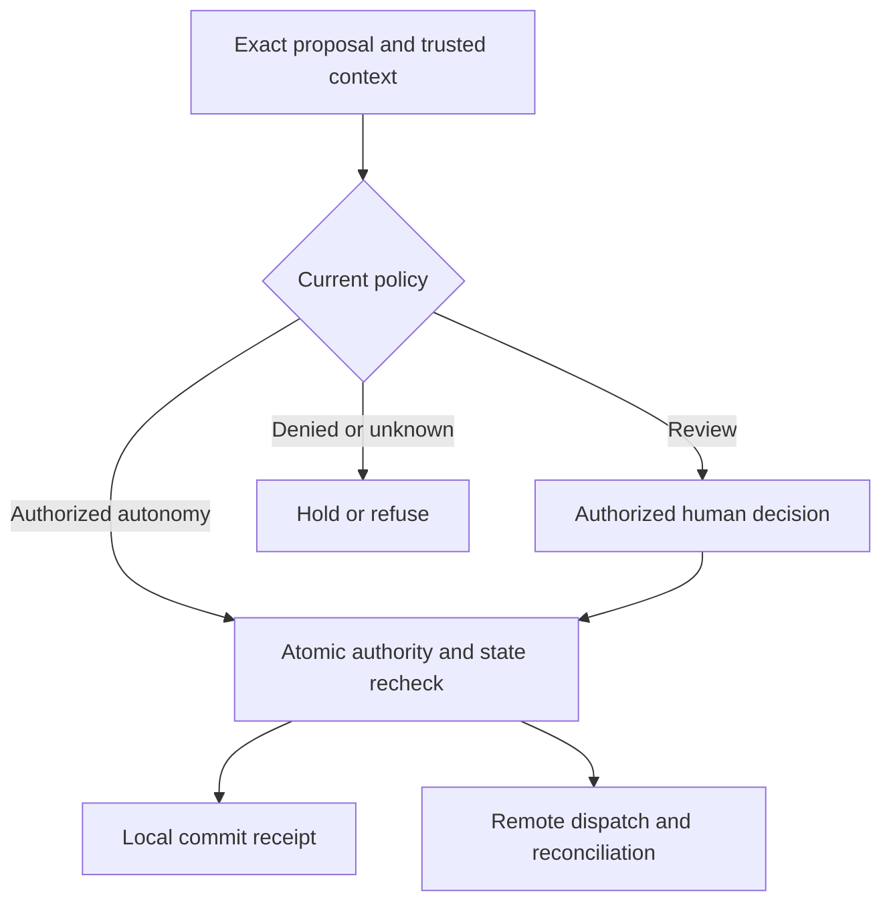

# Human and agent workbench

Status: accepted target design for [scope G12](../../intent/scope.md), not an implemented workbench. This is a specification for a consumer pilot; the consumer, revision, baseline and measured benefit remain to be selected. No new package, dependency, provider, or UI runtime is authorized by this document.

[Layout experiment](workbench-experience.md): one shared workbench family with
independent review/prose views, from inline assistance to full workspace (0029).
The synthetic browser demo illustrates interaction, not authorization or HW acceptance.

This is an [anchor experience](prose-hitl-priority.md) under 0038. PX cross-workflow
tasks supplement HW acceptance; a one-consumer app-kit pilot need not wait for
IR-10's independent adapter adoption. Existing runtime admission and AE-4 prerequisites remain.

## Authority and existing floor

[VISION](../../../VISION.md) asks for one authority path for people and agents. [Assurance](../../intent/assurance.md) separates designed, implemented, integrated, adopted and measured. [Decision 0008](../../intent/decisions/0008-bound-approval-transactions.md) binds durable approval in `kits/hitl`; [0006](../../intent/decisions/0006-evidence-and-lessons.md) keeps evidence and authority distinct; [0024](../../intent/decisions/0024-independent-kits-share-identity-not-authority.md) keeps kit owners independent; [0028](../../intent/decisions/0028-compositions-bind-snapshots-and-policy-epochs.md) binds composed effects to trusted snapshots. The dated incubation reviews are dispositioned in 0025; this design establishes no new promotion evidence. The current goal admits a specification, not parallel implementation incubations.

Existing code supplies [pure preview and guarded apply](../../../kits/hitl/engine.go), [trusted, exact approval binding and reconciliation errors](../../../kits/hitl/commit.go), [CUE form composition and validation](../../../surfaces/forms/cueform/types.go), and [vault role gating](../../../foundations/security/tokenization/policy.go). These are component contracts. They do not provide a complete workbench, application identity, resource policy, accessible interface, or consumer adoption. In particular, tokenization `RolePolicy` ignores purpose; a vault mapping is not authority over data elsewhere. The memory HITL store is a reconstruction reference, not durable production storage.

## Transaction model

Preview explains the effect; policy chooses the path; the trusted transaction
adapter enforces it. Human acceptance does not bypass the final recheck. Unknown
remote delivery is a recovery state, not an invitation to resend.

The same `Proposal` shape serves human and agent submitters. `IdentityPort` supplies a trusted actor context at each boundary: authenticated subject, effective principal, controlling principal, `on_behalf_of` principal and attested delegation chain where applicable. The model and caller payload may suggest an operation but cannot assert these identities, clearance, permission or approval. Suggested contract fields:

| Record | Required content |
|---|---|
| `Proposal` | ID, proposer, resource ID and expected version, typed operation and digest, evidence/config digests, requested purpose, exact destination/disclosure scope/publish mode, impact preview, sensitivity, created/expiry times, policy version, question-plan version, status |
| `ActorRef` | host-resolved authenticated subject, effective and controlling principals, `on_behalf_of` principal and attested delegation chain, role set, organization/tenant, clearance, authentication context; host resolves current attributes at each boundary |
| `Decision` | proposal and binding ID, actor, decision kind, exact operation/resource/version/evidence/config pins, trusted effective purpose, destination/disclosure scope/publish mode, scope, expiry, rationale, policy result, revocation/consumption |
| `Effect` | local commit receipt or prepared external delivery ID, destination, idempotency scope, result state, reconciliation evidence |
| `QuestionPlan` | required field set and ordered optional prompts, known facts, unresolved conflicts, question/time budget, model/policy versions |

`requested_purpose` is untrusted proposal data. A trusted host authority resolves
`effective_purpose` and its authority/version from the current authenticated task
context, subject to policy. Read, disclosure, cache, approval and effect checks use
that effective purpose. A request cannot broaden it by changing a label; mismatch
refuses or requires a separately authorized context change. Missing trusted purpose
is unknown and holds a purpose-restricted path.

The approved operation digest includes destination identity, tenant/account,
audience/disclosure class and publish mode, as well as exact content and purpose.
Private storage and public publication are different operations even for identical
bytes. Bind and show the resolved destination before approval; an alias, endpoint,
recipient or disclosure-scope change invalidates the prepared operation. Re-resolve
and compare at dispatch; a destination absent from the reviewed operation refuses.

Roles are only one input. The policy decision checks actor role **and** resource, operation, purpose, clearance, sensitivity, current state, separation of duties and tenant. Separation of duties compares controlling principals, not credential strings or service accounts; an exception requires explicit policy allowance and attested delegation. Permissions are separate verbs: `read`, `propose`, `approve`, `override`, `execute`, `reidentify`, `export`. Read never implies propose; approve never implies execute; override is an explicitly scoped, audited policy exception and cannot bypass hard floors. Reidentify and export each need distinct policy and disclosure checks. Least disclosure applies to queue rows, question hints, evidence retrieval and effects.

Policy evaluates each proposal as `autonomous`, `review`, or `refuse`, with reason, matched rule version and evidence. Autonomous still passes the same pre-effect checks and transaction boundary; it records its policy authority instead of inventing a human decision. Review requires an authenticated, allowed actor and exact binding. Refusal has no approval path until inputs or policy are legitimately changed. Unknown policy, identity, state or evidence fails closed for controlled effects.

State transitions are `draft -> proposed -> previewed -> autonomous-ready | review-pending | refused`; `review-pending -> approved | rejected | expired | revoked`; `approved/autonomous-ready -> committing -> committed` for local atomic effects, or `-> delivery-prepared -> sent | reconcile-required -> reconciled`. Invalid preview, changed version, altered operation/evidence/config, or expired approval returns to a fresh proposal/review. The local linearization point is one atomic compare-and-commit of target version, approval consumption, current authorization decision, policy epoch and evidence revocation epoch. Revocation committed first refuses the effect; revocation after commit cannot erase it. If host ports cannot provide this fence, local commit is `unsupported` and held. No best-effort check-then-write claim is allowed.

Remote delivery binds prepared state, destination and idempotency scope. Recheck current authorization, policy and evidence immediately before dispatch. Once dispatch starts, an unknown outcome enters `reconcile-required`; revocation does not undo a possible remote effect. Reconciliation does not renew consent: under 0008 one decision permits at most one send. Confirmed delivery records success without resending; confirmed non-delivery needs a fresh bound decision or fresh autonomous authorization and current checks before another send. Unknown stays held. A receipt records the observed result, not generic exactly-once delivery. Reuse an idempotency key only within a destination contract that actually supports it; it cannot substitute for fresh authority.

Epochs belong to the trusted authority/transaction adapter, never the request
payload or model. They represent the consumer's current authorized knowledge cut;
they cannot detect an upstream source change not yet observed. Declare source
freshness/observation lag separately. Dispatch admission consumes its authorization
fence atomically at the controlled handoff: revocation recorded before that point
refuses; later revocation cannot imply cancellation at a remote destination. When
separate stores cannot coordinate that boundary, expose the weaker guarantee as
unsupported for strict mode. No cross-provider global transaction is assumed.

`ProposalStore` and `PolicyEvaluator` are host ports. `TransactionStore` is the trusted decision/target-state coordinator for local commits; `DeliveryPort` supplies prepare/send/query/reconcile for external effects. `IdentityPort` authenticates and resolves current attributes; `EvidencePort` checks access and source versions; `VaultPort` enforces bounded reidentification. Time, cost, list size and retry limits are injected and explicit. An adapter must not silently substitute conversation state for any durable port.

## Human interaction

Questions are generated from a bounded plan, not an open-ended chat loop. Before display, validate answerer permission and disclosure for the question, its labels, hint and known-answer summary. Deduplicate against authorized known answers only after checking source freshness. A disputed premise stays marked disputed; the plan may answer `unknown`, defer, or challenge it. The domain schema owns required facts and validation; model ranking can choose among optional clarifications but cannot hide a required field or mark it answered. Explicit question and time budgets end in stop or human handoff.

The UI distinguishes: (1) clarification of missing meaning, (2) conflicting evidence needing adjudication, (3) factual correction that versions source/fact and invalidates dependents, and (4) presentation annotation that changes wording or layout only. Each human answer has trusted actor, provenance, time and effect on the proposal. It is fresh evidence subject to validation, not automatic truth. A correction can revoke approval; a cosmetic annotation cannot silently alter the approved operation.

The queue groups by actionability: `needs me`, `awaiting evidence`, `reconcile`, `completed`, `refused/expired`. Within a group, preserve engine priority order, count, and an honest empty state. Alerts are calibrated by measured false alarms and misses; batch low-risk attention, surface high-impact uncertainty promptly, and never use red/yellow alone as meaning. A proposal detail shows exact before/after operation, consequences, policy reason, evidence lineage, conflicts, source freshness, access limitations, actor permissions and expiry. Approval control names the effect and destination. The workbench must work at narrow widths, with keyboard-only navigation, visible focus, screen-reader labels and status announcements, and review without color cues. Test interruption, loading, inaccessible evidence and errors as first-class states.

The visual recipe belongs to app-kit; agentic-kit owns these transaction and evidence contracts; the domain app owns identities, storage, policy configuration, actual actions and publication. Current app-kit MCP metadata revision `1e5ce694e0cbbb1826dcc8f3513b045ec2ec97a0433b2e57f637efd107f47811` describes `work.approval` as a `go-web` L3b `ApprovalCard` for `pending`/`review` with app-owned authorization, execution and audit. Its proof is a package test, not workbench acceptance; no authored approval quality work was found in the returned all-scope inventory. Kit guidance reported its root unavailable, so adoption must recheck the app-kit intent and contribution loop at implementation time.

**App-kit contribution packet:** propose a reusable approval-workbench recipe covering grouped queues, status vocabulary beyond pending/review, exact change/consequence preview, evidence/conflict disclosure, narrow and keyboard/screen-reader/error states. Keep engine priority in a single-column ordered queue; do not wrap `ApprovalCard` in another bordered widget. Ask app-kit to own visual states and accessibility checks, with example data only and no agentic/domain policy or licensed reference assets copied into this repo. Supply anonymized fixtures for stale approval, conflict and reconciliation plus a browser/assistive-technology check matrix. Return visual defects and reusable tests through app-kit's contribution loop; this document does not claim acceptance or edit app-kit.

## Adoption and proof

Minimal adoption: one typed proposal, trusted identity, pure preview, review/refuse/autonomous policy, exact local commit, receipt, and a plain accessible review UI. Full adoption adds external reconciliation, adaptive questions, source corrections, grouped queues, calibrated alerts, bounded reidentification and export. Every stage declares which verbs, resources and evidence surfaces it actually enforces; absent ports are `unsupported`, never implied.

Adversarial acceptance fixtures are required before an implementation claim:

- **HW-01** Agent and human submit equivalent typed changes; both enter the same policy and binding path.
- **HW-02** A model-supplied `actor`, role or clearance is ignored; host identity controls access.
- **HW-03** A reader cannot approve, execute, export or reidentify merely because read succeeds.
- **HW-04** A role with the wrong resource, purpose, tenant or clearance is denied at proposal view and effect boundary.
- **HW-05** Autonomous policy still checks current version and records a policy receipt; review and refusal do not execute.
- **HW-06** Approval for operation A cannot authorize operation B, changed evidence/config, resource or state version.
- **HW-07** Expiry, revocation, consumption and a different authenticated actor each deny commit.
- **HW-08** Two reviewers race; at most one local commit wins with the target-state transaction.
- **HW-09** A remote timeout after send enters `reconcile-required`; retry cannot duplicate the effect before query/reconciliation.
- **HW-10** Missing required form input remains visible and invalid even if a model ranks it low or omits it.
- **HW-11** Conflicting facts show both lineages; correction invalidates dependent preview/approval; presentation annotation does not become fact.
- **HW-12** A vault role alone cannot authorize purpose, resource, export or data already copied outside the vault; shredded mapping cannot be represented as universal erasure.
- **HW-13** Narrow viewport, keyboard and screen reader can find queue status, inspect evidence, decline and approve with equivalent information.
- **HW-14** An alert calibration fixture reports false blocks and misses, while a hidden/denied evidence source is shown as unavailable rather than clean.
- **HW-15** Shared service credentials cannot let one controlling principal approve its own proposal; a permitted delegated exception requires a host-attested chain.
- **HW-16** Concurrent revocation, consumption, target update and policy/evidence epoch changes have one atomic winner; a host lacking that fence holds the effect as unsupported.
- **HW-17** Revocation before remote dispatch refuses delivery; revocation after dispatch starts leaves uncertain delivery for reconciliation, never an undo claim.
- **HW-18** A question hint, label or known-answer summary cannot disclose a source the answerer may not read; a stale answer is asked again or marked unknown.
- **HW-19** A disputed premise is not repeated as fact, and a model cannot suppress a required field by ranking or deduplication.
- **HW-20** Question/time limits stop or hand off; a human answer retains provenance and cannot by itself authorize an effect or settle a source conflict.
- **HW-21** A proposal requests a broader purpose than the host-attested task permits; source read, cache lookup, approval and commit refuse that substitution.
- **HW-22** Approval for private destination A cannot publish identical bytes to public destination B, another tenant/account, or a changed recipient alias.
- **HW-23** A timed-out send is later proven absent; its consumed decision cannot send again. A fresh decision or autonomous authorization must bind current policy, purpose, destination and evidence.

The consumer pilot must record supported host and revision, planted effect failures, baseline attended time, false alerts, missed issues and actual controlled effects. A passing library test is implementation evidence; only a deployed pilot can establish usability or saved human effort. Design input: [W3C PROV-O](https://www.w3.org/TR/prov-o/) for lineage vocabulary, [Google ADK confirmations](https://adk.dev/tools-custom/confirmation/) for action-specific confirmation, and [LangGraph interrupts](https://docs.langchain.com/oss/python/langgraph/interrupts) for replay risk; none proves this contract is implemented here.
