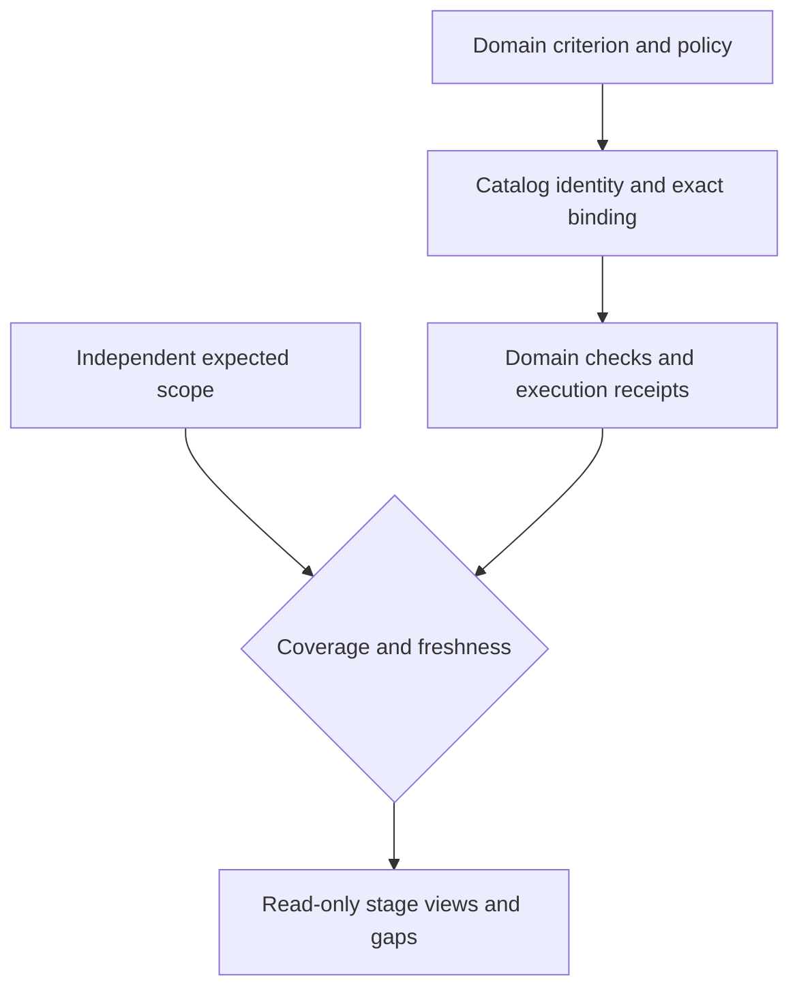

# Practice catalog: bounded design specification

Status: accepted target design under 0025, 2026-10-22. No new package, dependency, release-tier promotion, runtime enforcement, or consumer adoption is claimed. This document is a candidate data contract and acceptance target, not a catalog that is already loaded.

## Intent and ownership

Catalog Kit binds definitions; domain evaluators judge them. Expected scope is
authored separately from results so a missing criterion or capability stays visible.
Designed, implemented, integrated, adopted and measured remain separate columns.

The present need is to turn recurring engineering mistakes and beneficial practices into inspectable, reusable criteria without creating a central policy engine. [Vision](../../../VISION.md), [assurance](../../intent/assurance.md), [invariants](../../intent/invariants.md), and decisions [0006](../../intent/decisions/0006-evidence-and-lessons.md), [0009](../../intent/decisions/0009-bounded-lesson-transfer.md), and [0024](../../intent/decisions/0024-independent-kits-share-identity-not-authority.md) govern this design. F5 in [futures](../../intent/futures.md) remains unpromoted: a second workload self-audit is not evidenced. No new shared runtime follows from this spec. The passed 0009 review date calls for separate evidence review, not silent promotion here.

Compose the existing `foundations/knowledge/catalog` and [Catalog Kit](../../../kits/catalog-kit/README.md) for versioned identity, layering, lookup, selection, and detached decision binding. A criterion's domain owner supplies its rule and applicability. Review Kit retains its typed criterion, evidence-tier, finding, judgment, `Track`/`Mark`, and authorization law. Test Kit executes tests and reports results. Fathom can optionally supply source reachability and plan proof; source locations alone are not passing results. The adapter between these is a projection, not a universal kit adapter or new authority. `docs/practices.md` has 28 sections and is one initial, cited source of candidate content; it does not become a second policy authority.

`TRACKING.md` remains the sole build-status checklist. `docs/intent/` remains the project-goal and scope authority. A catalog may project links to their IDs and revisions but never overwrite either. Consumer adoption is explicit and separately evidenced under [assurance](../../intent/assurance.md).

### Read-only goal/capability projection

`GoalCapabilityProjection` is a derived, read-only view, never another status ledger. Its join manifest pins each source revision and artifact digest, required coverage, mapping author, and policy epoch. `GoalRef` is `(scope_id, source_commit)`; `CapabilityRef` is `(TRACKING.md, stable_local_key, source_commit)`; `PlanRowRef` is `(plan_path, stable_row_id, plan_revision)`; `EvidenceRef` is `(content_digest, producer, subject_scope, evidence_kind, verdict, observed_at, expires_at, static_or_runtime)`. Paths and line numbers locate records but cannot substitute for stable identity. Existing TRACKING rows without a stable local key require an authored mapping before they join; text similarity and line number guesses cannot create keys.

The independent expected-goal set comes from pinned intent scope. Expected capabilities come from a scope-owner-authored `CapabilityScopeManifest`, pinned independently of TRACKING and receipts. Its record has scope owner, revision/digest, stable expected capability keys, goal refs, inclusion/exclusion reasons and reviewed add/retire history. The first fixture is maintained beside the W1 scenario data; it defines expected coverage, never completion status. Projection code must not regenerate it by enumerating TRACKING rows or evidence keys. A scope change requires owner review and explicit mapping to goal and TRACKING changes; an unexplained missing or extra row is a reconciliation gap. Distinct consumer revisions join only when the join manifest pins their correspondence to the same artifact and carries evidence for it. Commits across repositories are never assumed equal. Missing, stale, ambiguous or conflicting references, uncovered required subjects, and expired evidence make the affected stage `unknown` and prevent `ready`.

For each goal/capability pair, project `designed`, `implemented`, `integrated`, `adopted`, and `measured` separately. Each stage has `pass`, `fail`, `unknown`, or `not-applicable` plus source, reason and freshness; `not-applicable` needs the scope owner's explicit reason. A checkbox is a build-status claim, not proof of integration, adoption or measured benefit. Static source reachability and Fathom plan verification are static evidence; runtime entrypoint, external consumer revision, and outcome baseline require their own receipts. Readiness is conjunction of required stage floors and coverage, never an average or a count of green cells. A goal removed from living scope after its documented Done when is met remains in historical views pinned to the old scope commit, with closure evidence; it does not become a newly missing current goal. Projection writes no status to intent, TRACKING or plans.

## Versioned criterion record

A candidate record has `stable_key`, `version`, `definition_digest`, `path_id`, `title`, `failure_mode`, `beneficial_pattern`, `applicability`, `source_authorities`, `expected_scope_ref`, `check`, `evidence_contract`, `negative_counterexample`, `remedy`, `adoption_owner`, and `status`. `stable_key` is immutable identity across path moves. `path_id` is mutable presentation/location. `definition_digest` binds exact canonical definition bytes. A path move preserves identity but never refreshes a prior exact definition/evidence/authorization binding. Changing meaning increments version; incompatible meaning receives a new key and supersession relation. No key is recycled.

`applicability` identifies workflow, host/version, data class, effect class, and explicit exclusion reasons. `source_authorities` cite primary source/version and the domain owner that may decide; a website claim or model output is evidence, not authority. `expected_scope_ref` points to a separately authored manifest of subjects, entrypoints, and required checks. The manifest cannot be generated solely by enumerating existing criterion rows, or omissions would be invisible. Manifest and criteria each carry revision/digest. Missing subject, stale manifest, or unknown host yields `unknown`, not `pass` or inferred `not-applicable`.

`check` declares `structural`, `deterministic`, `heuristic`, `advisory`, or `unsupported`, plus entrypoint, oracle, failure/timeout behavior, required configuration, and exact negative case. Structural refusal needs an observed pre-effect boundary. Heuristic checks require calibration set, false-allow and false-refusal accounting, abstention, and human adjudication. Advisory text never upgrades enforcement. A result is `pass`, `fail`, `unknown`, or `not-applicable` with a reason. Record implementation stage separately: designed, implemented, integrated, adopted, measured.

`evidence_contract` names method, source snapshot, subject revision, definition digest, observation time, expiry/refresh rule, execution receipt, independent oracle, and artifact digest. Hashes bind bytes, not truth or permission. The adoption owner must configure the check, test unsupported entrypoints, and review residual risk. A catalog item never grants an action capability. Consumer profiles may narrow applicability, select criteria, and raise floors; they cannot redefine a domain owner's typed law. Decision-model help, if any, is a typed predicate/choice/score with a deterministic fallback, opt-out, site-specific calibration and a per-site kill measurement. No universal score.

### Migration and profile composition

Catalog migration preserves the old exact `(stable_key, version, definition_digest)` binding for historical audit only. A domain-owned, reviewed `MigrationMap` binds old and new references and classifies each as `equivalent`, `stronger`, `partial`, or `unmapped`, with rationale and affected scope. Matching stable keys alone never rebind semantic meaning. Partial or unmapped entries hold active use pending explicit reassessment. Tightened mandatory floors invalidate active cached approvals and exceptions even if prior evidence remains retained historically. Compatible canonical-byte changes require a new definition digest and version with explicit migration; incompatible meaning requires a new key and supersession. The map records compatibility judgment, not a new runtime protocol.

Profile merge is typed, ordered CUE unification, not last-writer-wins: the root profile supplies mandatory floors; authorized base, domain, organization, application, template, variant and node scopes may add constraints within their grants. A child cannot lower or remove a mandatory floor. An optional warning can be disabled only by an explicitly granted scope with a reason bound to the composed profile revision; personal preference is no grant. Conflict or unknown grant holds composition. This is the shared profile contract for human workbench and prose harness and the composition snapshot/policy-epoch decision [0028](../../intent/decisions/0028-compositions-bind-snapshots-and-policy-epochs.md), not a second policy authority.

## Seed candidates

### Catalog families and their domain contracts

Use shared identity/composition for these families, with typed domain payloads:

| Family | Catalog data | Domain authority / deterministic use |
|---|---|---|
| Practices and failure modes | Paired good/bad pattern, applicability, sources, checks, remedies, counterexamples | Review profile selects applicable criteria; exact expected scope and evidence completeness are computed |
| Evidence/quality criteria | Source classes, admissible methods, freshness, support/contradiction, required confidence dimensions | Domain evidence admission and source authority; a model probability never upgrades source grade |
| Confidence/decision sites | Criterion/question/deployment/calibration refs, thresholds, false-allow/refusal loss, expiry, escalation | Per-site rule trace; uncalibrated or missing required evidence holds use |
| Model/deployment inventory | Available org deployments, region/data constraints, native capabilities, source/version/price evidence | Eligibility differs from app candidate/evaluated/selected state; see PV-02 |
| Escalation and model ladders | Role/site, eligible tiers, typed transition signals, authorized actions, stop/human route, cost/deadline | Bounded state transitions; no tier grants additional permission implicitly |
| Governance and security | Policy rules, absolute/overrideable floors, action/resource/purpose, exception scope/expiry | Consumer-owned authority checks at actual disclosure/effect boundary |
| Presentation | Voice, tone, audience, technical level, locale, terminology, accessible format and examples | Prose projection constraints; separate factual/policy requirements from advisory style review |
| Workflow recipes | Compositions, required capabilities/configuration, failure behavior and non-guarantees | Actual entrypoint coverage receipt; capability presence is not integration |
| Host configuration | Shared instruction refs, per-host/version bindings, probes, unsupported entrypoints | Drift/precedence validation and invocation proof, not file-existence certification |
| Project goals/capabilities | References to scope goal IDs, TRACKING rows, work-order IDs and immutable receipts | Read-only projection and freshness checks; never an independent progress truth |

Each family defines schema and semantic invariants before loading its payload;
opaque catalog facets cannot stand in for domain validation. Tailoring may tighten
floors only under the owner's grants. Optional criteria can be disabled with a
recorded applicability reason; mandatory floors cannot disappear through a profile.
Templates may use voice/audience settings for multiple simultaneous outputs, but
all variants retain the same source-policy obligations unless an authorized domain
rule explicitly differs. Organization values remain caller data, not kit constants.

### Initial paired practice definitions

These 30 rows are proposed source-backed candidates, not implemented checks or accepted observations. `D` deterministic, `H` heuristic, `A` advisory, `U` unsupported until a named adapter exists. Every row expands to the full record above before loading. An owner is the domain decision owner; a consumer still owns adoption. The counterexample is a required failing or abstaining fixture.

| ID | Failure -> beneficial pattern | Check and negative counterexample | Owner |
| --- | --- | --- | --- |
| PC-01 | Source table assumed complete -> independent expected-scope manifest | D: omitted source partition stays unknown | Data owner |
| PC-02 | Schema drift hidden -> versioned shape and compatibility check | D: added nullable field is not treated as destructive | Data owner |
| PC-03 | Late data called absent -> watermark and lateness budget | D: delayed event is unknown before deadline | Data owner |
| PC-04 | Null silently defaulted -> explicit missingness semantics | D: missing required field fails | Data owner |
| PC-05 | Duplicate record counted twice -> stable event identity and dedupe | D: replayed event has one effect | Data owner |
| PC-06 | Lineage used as truth -> source, transform, and validation separate | D: valid lineage alone leaves source truth unknown | Data owner |
| PC-07 | Quality gate averages away critical failure -> required floors | D: one critical fail cannot be offset by ten passes | Data owner |
| PC-08 | Unknown host declared compliant -> entrypoint-specific coverage | D: unsupported host returns unknown | Host owner |
| PC-09 | Agent skips workflow step -> explicit state and transition checks | D: direct final artifact without required review fails | Workflow owner |
| PC-10 | Replay duplicates effect -> idempotency plus reconciliation | D: resume after uncertain remote result stays unknown | Effect owner |
| PC-11 | Checkpoint called exactly-once -> at-least-once contract | D: pre-pause side effect replay is detected | Workflow owner |
| PC-12 | Unbounded agent search -> budget, stop, handoff | D: exhausted budget stops with partial receipt | Workflow owner |
| PC-13 | Model judge authorizes mutation -> independent action gate | D: high score without permission is refused | Security owner |
| PC-14 | Prompt injection treated as instruction -> data/authority boundary | H+D: hostile retrieved text cannot change tool grant | Security owner |
| PC-15 | Credentials in traces -> tokenize and redact before log | D: sensitive canary absent from persisted event | Security owner |
| PC-16 | Role name implies access -> role/resource/action decision | D: same role on wrong resource is denied | Consumer policy owner |
| PC-17 | Approval detached from effect -> target/version/principal/expiry binding | D: changed target invalidates approval | Effect owner |
| PC-18 | Advisory hook claimed as guard -> negative host probe | D: bypassed hook yields unsupported coverage | Host owner |
| PC-19 | Provider feature assumed portable -> native capability matrix | D: image/tool unsupported adapter refuses explicitly | Provider owner |
| PC-20 | Model name treated as proof -> exact provider/model receipt | D: fallback model is recorded as used | Provider owner |
| PC-21 | Prose bibliography masks unsupported claim -> claim-level map | D+H: one unsupported factual clause blocks export | Prose owner |
| PC-22 | Correction leaves publication valid -> dependency invalidation | D: retracted source invalidates approval | Prose owner |
| PC-23 | Cache crosses tenant or policy -> exact scoped cache key | D: second tenant misses first tenant's cache | Cache owner |
| PC-24 | Stale cache treated as evidence -> version and expiry check | D: revoked source invalidates hit | Cache owner |
| PC-25 | Cheap model always preferred -> task-specific cost/quality ladder | H: disagreement escalates or abstains | Decision owner |
| PC-26 | Cost counted after call -> reserve before paid attempt | D: exhausted budget prevents provider call | Spend owner |
| PC-27 | Repeated config diverges -> one canonical field and projections | D: conflicting projection is rejected | Config owner |
| PC-28 | Lesson auto-changes policy -> receiver reproduction and approval | D: imported candidate alone has no enforcement | Receiver owner |
| PC-29 | Issue volume called benefit -> recurrence and accepted-outcome baseline | H: more tickets without fewer escapes is no gain | Evaluation owner |
| PC-30 | Kit presence called adoption -> external consumer revision and receipt | D: unconfigured downstream is unknown | Kit/consumer owners |

Sources for hypotheses: [existing practices](../../practices.md), [assurance](../../intent/assurance.md), [Catalog Kit assessment](../../assessments/2026-10-20-catalog-kit.md), [decision port](../../fast-judgment.md), [Anthropic agent workflow guidance](https://www.anthropic.com/engineering/building-effective-agents), [Anthropic eval guidance](https://www.anthropic.com/research/demystifying-evals-for-ai-agents), [Google ADK resume semantics](https://adk.dev/runtime/resume/), [LangGraph interrupts](https://docs.langchain.com/oss/python/langgraph/interrupts), and [W3C PROV-O](https://www.w3.org/TR/prov-o/). These sources motivate candidates; none prove this catalog's effects.

## Adversarial acceptance before implementation or adoption

- **PC-A01:** Moving a criterion path preserves stable key and emits a move, while old exact definition/evidence binding remains stale.
- **PC-A02:** Changing canonical definition bytes under the same key/version is refused; semantic meaning changes also require domain review and explicit supersession where appropriate.
- **PC-A03:** A manifest with one extra expected subject prevents complete coverage despite every loaded criterion passing.
- **PC-A04:** A criterion cannot declare itself `not-applicable`; a consumer supplies a scoped reason checked against applicability.
- **PC-A05:** A source hash and Fathom location without executed independent check yield `unknown`.
- **PC-A06:** Heuristic false allow, false refusal, and abstention are reported separately; one green average cannot hide a critical miss.
- **PC-A07:** An advisory native hook cannot claim structural control when a direct path bypasses it.
- **PC-A08:** Review Kit rejects an invalid domain payload even if Catalog Kit resolves and binds it exactly.
- **PC-A09:** Test Kit missing result is `unknown`; a listed test is not execution proof.
- **PC-A10:** A changed `TRACKING.md` projection cannot mutate catalog authority, and a catalog check cannot mark a checkbox done.
- **PC-A11:** An offline pilot does not satisfy adopted or measured stages without consumer revision and outcome baseline.
- **PC-A12:** No seed criterion contains a company-specific policy, universal model threshold, or automatic action grant.
- **PC-A13:** An omitted expected goal or capability, a TRACKING row without an authored stable-key mapping, and a conflicting cross-revision join each prevent readiness even if all supplied receipts pass.
- **PC-A14:** A checked capability with only static reachability stays unknown for integrated/adopted/measured; one failed mandatory stage defeats any number of passing stages without averaging.
- **PC-A15:** A completed goal removed from current scope remains visible in its pinned historical projection; an unmapped catalog migration or tightened floor invalidates active approval reuse, while old exact bindings remain auditable.
- **PC-A16:** A node/profile variant cannot weaken a root mandatory floor; an optional warning disappears only with an explicit scope grant, reason and pinned composed revision.
- **PC-A17:** Delete an entire TRACKING capability row while preserving the independently authored CapabilityScopeManifest. The projection detects the missing row; regenerating output cannot shrink expected coverage. An approved retirement requires owner-reviewed scope history, not disappearance.

Acceptance needs versioned fixtures, exact command receipts, negative-case observations, and the applicable [gate](../../../AGENTS.md). This design supplies none of those receipts yet.
