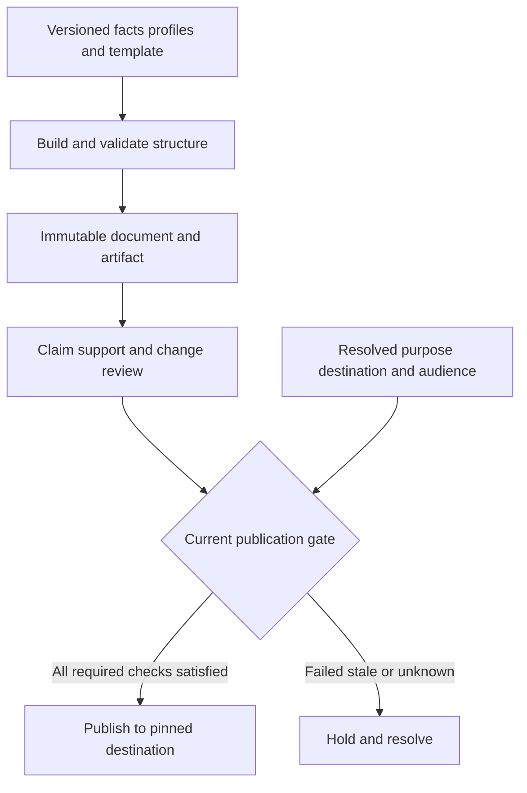

# Governed prose harness

Status: accepted target design for [scope G13](../../intent/scope.md), not an implemented document graph or editor. A consumer pilot, baseline and measured benefit remain open. This specification adds no package, dependency, provider adapter or stability claim.

[Layout experiment](workbench-experience.md): prose uses the shared workbench
selection/inspection shell while retaining document graph and rebuild ownership
(0029). Its synthetic browser demo is not PH runtime acceptance.

## Grounding and boundaries

This is an [anchor experience](prose-hitl-priority.md) under 0038. PX tasks supplement
PH acceptance and bind the prose/HITLMAN experience to app-kit's actual UI proof;
inventory/evidence work serves this task without implying a production editor exists.

[VISION](../../../VISION.md) treats prose as a versioned projection of facts, annotations, audience, policy and structure. [Decision 0006](../../intent/decisions/0006-evidence-and-lessons.md) requires exact claim support, distinct integrity/support/truth properties and invalidation after correction. [Decision 0008](../../intent/decisions/0008-bound-approval-transactions.md) binds publication to exact prepared bytes and durable approval. [0024](../../intent/decisions/0024-independent-kits-share-identity-not-authority.md) preserves separate domain ownership. The dated incubation reviews are dispositioned in 0025; this design establishes no new promotion evidence. [Assurance](../../intent/assurance.md) requires controlled failure proof, then consumer adoption and outcome measurement before stronger claims.

Existing [sourced prose](../../../kits/governed-prose-kit/sourced_types.go) has versioned source snapshots, exact byte locators, fact and claim records, bounded structured draft, independent support reviewer and separate receipt fields. [Generate/CheckDraft](../../../kits/governed-prose-kit/sourced_pipeline.go) re-resolves facts, rejects malformed output and checks support. [Export](../../../kits/governed-prose-kit/sourced_export.go) is a strict gate over its artifact and current sources. This is a small, single-artifact path. It does not ship an immutable hierarchical document graph, selective dependency rebuild, multiple variants, rich history, a dashboard/editor, or production provider parity. Valid citations establish reference integrity, an evaluator can assess support, and neither establishes source truth.

## Input and document model

Correct inputs and rebuild affected output; do not silently patch generated text.
Every selected sentence, paragraph or section resolves to the same immutable
artifact as its evidence inspector, dashboard and publication decision.

Inputs are separate immutable versions, never fields edited into generated prose: `SourceSnapshot` (canonical bytes, media extraction provenance, access, retention, acquired/observed time and source-valid time), `Fact` (assertion, exact locator, extraction method and author), `Annotation` (presentation guidance or a scoped reader note), `Correction` (proposed and adjudicated factual amendment with supersession), `CriterionSet` (catalog definition/evidence/version and policy floors), `VoiceProfile` (voice, tone, audience and technical level), and `ProjectionTemplate` (document/section structure, summary and aggregate dependencies). Source-valid time and system-known time are both retained: a late discovery about an old period must not masquerade as known at the earlier publication date. The consumer owns legal truth and source authority; the kit records what was provided and checked.

`DocumentVersion` is an immutable tree: document -> sections -> paragraphs -> sentences, each node with stable logical ID, version ID, content digest, parent/order, creation activity, input/dependency IDs and access classification. Every factual sentence has explicit `Claim` ranges and support/contradiction edges to exact fact/source versions. An `ArtifactVersion` binds one tree, all input/config/template/model versions, render/export bytes, checks and receipt. A variant is another immutable artifact derived from the same or different pinned inputs; variants coexist and are compared, not overwritten. Node and byte IDs are different: same semantic unit can change bytes, and equal bytes can carry different evidence or policy.

Selection accepts sentence, paragraph, section or document IDs and an expected artifact version. The edit command is typed: source correction, fact correction, annotation, criterion/voice/template update, or requested regeneration. A factual correction versions inputs and marks dependents stale; a presentation annotation changes projection input and does not rewrite source truth. The user may compare two variants or retain both. Selection of a paragraph does not confer authority to bypass dependencies elsewhere.

## Rebuild and review algorithm

### CUE structure and output families

CUE owns the input/plan shapes and constraints; Go owns traversal, validation,
transactions and rendering behavior. Extend the existing prose contracts instead
of introducing a parallel document language. The first structural vocabulary is
`document`, `section`, `heading`, `paragraph`, `sentence`, `list`, `list-item`,
`table`, `caption` and `executive-summary`. A heading is a typed structural node,
not an unsupported factual-content escape. An executive summary is a projection
with explicit dependencies on its contributing claims, and can be a section or a
separate artifact. Domain extensions declare schema, child/order constraints,
renderer and dependency behavior; unsupported kinds refuse rather than flatten.

Bind locators to immutable canonical UTF-8 bytes, extraction/version IDs and
half-open byte ranges. Do not normalize Unicode or re-extract media in place.
Rendered grapheme/UTF-16 selections map through a versioned source map to exact
node versions and byte ranges; ambiguous or stale mappings require reselection.
Splits/merges create explicit predecessor/successor mappings; a logical node ID
never transfers consent to changed bytes. PDF/image/audio anchors additionally
name media/extraction revision and page/region/time coordinates where supported.
An unsupported media locator cannot masquerade as a text offset.

Annotations and edit requests have authenticated author, trust classification,
scope and allowed intent (`presentation`, `question`, `correction-proposal`).
Retrieved text and model-suggested annotations remain data, even when they contain
imperative language. They cannot replace instructions, criteria, policy or facts.
Fact changes enter the correction/adjudication path. A human-authored artifact
fork remains possible, but cannot inherit generated-artifact approvals or checks.

### Shared snapshots and simultaneous variants

`ProjectionBatch` binds a common source/fact snapshot, catalog/policy versions,
intended change, selected variant definitions, publish mode and budget. Each
variant pins its audience/voice/template/quality profile, attempt IDs, status,
artifact digest and review/approval. Generation can run independently, but never
silently move a variant to a newer input cut. Partial streams are provisional;
interruption retains attempt evidence and cannot publish an unfinished node.

Default publication is independent per variant: a failed sibling stays held,
while a fully checked sibling may publish only if the batch declares independence
and no shared requirement was invalidated. Explicit `all-required` mode prepares
one manifest of exact approved artifacts; if any required variant fails or becomes
stale, the group cannot be released as complete. Multi-destination delivery is not
an atomic transaction: record each result and reconcile unknown deliveries, never
claim the whole group committed from one success. A source/policy correction during
generation holds affected variants for a new batch/review. Comparisons disclose
different input cuts and do not label them a like-for-like audience experiment.

Construct a directed, versioned dependency graph from input versions through facts, claims, generated nodes, summaries/aggregates and rendered artifacts. At a requested edit, compute deterministic transitive closure of affected nodes, including ancestors and any cross-section summary/aggregate that reads them. Cycles, dangling references, missing independently required edges and unresolved source versions fail closed. An independently authored template/input read-set manifest names required dependency families; controlled transforms record actual input reads, and the graph is checked against both witnesses. This checks declared structural coverage, not every semantic influence on a model. A wholly undeclared semantic dependency cannot be discovered deterministically from graph traversal; unknown coverage requires a bounded full-projection rebuild or held publication. A perturbation fixture with an independently specified dependent summary tests omission detection. The affected set is the minimum required by declared dependencies, not a promise to regenerate only the clicked section. A semantic judge may **widen** the set when it detects an undeclared coupling; it may never shrink the deterministic closure. Record its proposed expansion, method, version, cost and adjudication. On uncertainty, expand to the bounded document or hold for review.

Rebuild uses pinned inputs and explicit model/seed/config. Every material context block exposed to generation or support review is itself a dependency: instructions/templates, neighboring document text, retrieval results, tool responses, examples, catalog criteria and redaction transformations. Record a context manifest and assembler version. If fine-grained read tracking is unavailable, bind the entire exposed snapshot conservatively. Citation edges alone are insufficient because uncited prompt context can influence output. Deterministic graph traversal, digesting, eligibility and citation validation can be replayed. Model-generated words may differ across runs even with equal inputs; never claim semantic determinism. The receipt records generation attempts, stop reasons, spent tokens/cost, review decisions and the actual changed nodes. Unaffected immutable nodes are reused only if all exposed-context dependencies and policy remain current. A stale approval or changed source/config forces a fresh artifact and review.

For an old artifact `A` and new artifact `B`, show byte diff, token diff (named tokenizer/version), node diff and concept/claim diff as separate measurements. `Regeneration fraction = regenerated generated-node count / all generated-node count in A's selected projection`, with both numerator and denominator displayed; reused or added nodes are counted separately. A zero baseline reports not-applicable with counts, never a divided-by-zero percentage. Cross-variant totals name their projection and cannot double-count shared nodes. A byte or token ratio is never labeled semantic change. Concept change is an evaluated/reviewed annotation with confidence and unknown, not a deterministic metric. History preserves what changed, why, who/what initiated it, and which inputs and approvals became stale.

Concept review additionally binds the accepted `ChangeIntent`: target facts/nodes,
permitted transformations, invariants to preserve and exact criterion/input versions.
Report intended changes separately from unexplained claim additions/removals,
scope expansion and unknown impact. A corrected fact propagated into a dependent
summary is intended; an unrelated newly asserted fact is not. Required unexplained
changes hold publication pending adjudication. Never equate a small textual diff
with small meaning change, or a large intentional correction with quality loss.

### Default document quality profile

The first versioned base profile is a caller-configurable CUE data fixture, not
hard-coded organization policy. Each criterion has exact definition, method,
applicability, required inputs, findings and freshness. The target defaults are:

| Criterion | Default class | Check and consequence |
|---|---|---|
| PQ-01 Exact source/claim integrity | Non-overrideable floor | Deterministic references/locators/bytes; corruption or missing required source blocks |
| PQ-02 Disclosure and effect authority | Non-overrideable floor | Current resource/purpose/tenant/export permission and approval fence; unknown/denied blocks |
| PQ-03 Current policy and provenance | Non-overrideable floor | Exact profile, source, context and artifact bindings; stale/forged bindings block |
| PQ-04 Factual support | Required review | Independent semantic support with explicit uncertainty; unresolved required support holds |
| PQ-05 Known conflicts and uncertainty | Required review | Preserve conflicting evidence and qualification; known unresolved contradiction holds unless a reviewed qualified statement is permitted |
| PQ-06 Task and structure coverage | Required when applicable | Independent expected-section/fact manifest and CUE structure; omission cannot pass by enumerating existing output |
| PQ-07 Intended change preservation | Required for revisions | Structural scope checks plus claim/concept review against ChangeIntent; unexplained required change holds |
| PQ-08 Voice tone audience technical level | Advisory by default | Separate rubric findings per selected presentation profile; warnings do not waive a policy floor |
| PQ-09 Clarity concision terminology repetition | Advisory by default | Explain specific passages and alternatives; do not invent a universal prose score |
| PQ-10 Accessible structure and presentation | Required by chosen renderer/profile | Deterministic heading/label checks plus actual interaction review where applicable; source validation alone cannot certify a UI |

Profile resolution follows typed catalog grants: base -> domain/organization ->
application -> template -> variant -> node. CUE unification preserves mandatory
floors; precedence selects only values whose owner explicitly permits replacement.
Conflicts are errors, never generic last-writer-wins. Raising a warning to required
is allowed within authority. Disabling a discretionary warning records exact
criterion/version, scope, actor and reason and remains visible in review. It cannot
disable factual support, access or export gates. Waiving a configurable requirement
needs its explicit exception policy, authenticated authorized actor, bound artifact,
reason and expiry. Applicability N/A requires a separate justified decision.
Unknown required results hold. Supplemental criteria can extend the profile without
editing the base; optional quality findings never average away a required failure.

The export transaction uses the authorization/revocation epoch and dispatch
semantics in [0028](../../intent/decisions/0028-compositions-bind-snapshots-and-policy-epochs.md)
and the workbench contract. A sequence of separate best-effort reads is not an
atomic permission check. Already delivered artifacts cannot be retroactively erased
by updating a local policy or marking their source stale.

Publication approval additionally pins the trusted effective purpose, resolved
destination/account, disclosure audience/class and publish mode in the operation
digest. Approval for a private preview cannot release the same bytes publicly.
Reconciliation never replenishes a consumed decision: confirmed non-delivery
requires fresh authority and current checks; confirmed delivery never resends;
unknown remains held. These are the same workbench rules, not another export
authorization mechanism.

Review reports three independent fields per claim: reference integrity (exact IDs, locators, bytes and freshness), semantic support/entailment (independent reviewer status and evidence), and source truth/authority (domain adjudication or unknown). Contradictions and absent evidence stay visible. Unknown support, missing evidence, denied access and expired/retained-out sources block strict publication. Nonfactual classification is reviewed so assertions cannot escape by labeling them decoration. A judge's rationale is an inspectable criterion trace, never hidden model reasoning or automatic authority.

Policy separates nonoverridable hard floors (e.g. missing source, denied access, corrupt locator, changed bytes, unreviewed factual claim) from explicit scoped override candidates selected by domain policy. An override records authenticated actor, precise criterion and artifact version, rationale, expiry and scope; it cannot override hard floors. Warning states include `needs evidence`, `contradicted`, `inconclusive support`, `source stale`, `policy exception`, `ready for review`, `approved`, and `blocked`, each with text/icon and accessible announcement beyond color. A client view is advisory; the server export gate rechecks the exact immutable artifact, current source versions, policy, approval and prepared bytes immediately before publication. External delivery follows prepare/send/reconcile; unknown effect cannot be assumed failed and resent.

The evidence dashboard, inspector and exported document reference the **same immutable node IDs and versions**. A dashboard projection cannot silently summarize a newer source against an older approved document. Every sentence/paragraph/section/document selection offers matching evidence, criterion trace, contradictions, access limitation and diff at that scope. Concurrent edits use expected versions: a stale writer receives conflict; approval, revocation or correction racing export causes revalidation or refusal. Source deletion/retention propagates to dependent artifacts and future exports; immutable metadata may remain only under a named retention policy, and a cited source cannot be reconstructed after deletion. Tokenization or redaction cannot promise erasure of copies outside its bounded store.

Suggested ports: `SourceProvider` (authorized exact revision/current pointer), `FactStore` and `CorrectionLedger` (version and adjudication), `CatalogProvider` (pinned criteria), `ProjectionStore` (immutable graph/artifacts), `Generator` (bounded attempt and usage), `SupportReviewer` (independent semantic result), `PolicyGate` (hard floors/scoped exceptions), `ApprovalStore` (exact bytes/operation), and `Publisher` (prepare/send/query/reconcile). The domain app owns identity, source truth, storage, templates, destination and retention policy. Agentic-kit owns graph, integrity and transaction contracts. Any visual editor recipe belongs to app-kit. Ports may be omitted for a narrow offline scenario only when the corresponding capability is declared unsupported; omission cannot yield a pass.

## Progressive adoption and proof

Minimal adoption: one versioned source, exact facts/claim links, immutable artifact, independent support check, strict server export and an inspectable full-document diff. Full adoption adds hierarchical selection, multiple simultaneous variants, dependency-closure rebuild, bitemporal corrections, criterion traces, accessible dashboard and scoped overrides. Both need bounded fixtures and explicit failure results; neither requires a live provider for offline proof.

Adversarial acceptance fixtures:

- **PH-01** A factual sentence cites only an unrelated but valid source: integrity passes, support blocks.
- **PH-02** A supporting source is later disproved: source truth changes independently of prior reference integrity.
- **PH-03** A locator changes bytes or source version: strict export blocks despite a prior receipt.
- **PH-04** A model calls a factual sentence nonfactual: independent classification refuses the escape.
- **PH-05** Correction to a fact in section 1 rebuilds the dependent section 3 summary and document aggregate.
- **PH-06** A requested section-only rebuild cannot omit a dependency outside that section.
- **PH-07** A semantic judge requests extra nodes; closure widens; a request to shrink deterministic closure is rejected.
- **PH-08** A cycle or omitted independently required read-set edge yields a held artifact; a wholly unknown semantic dependency is not claimed detectable. Perturbing an independently declared fact/summary fixture catches removal of its graph edge.
- **PH-09** Two variants remain immutable and their byte/token/node/concept deltas are separately reported.
- **PH-10** The regeneration fraction exposes numerator and original projection denominator; added nodes have a separate count.
- **PH-11** Same pinned inputs with different model wording produce two versions without a false determinism claim.
- **PH-12** Correction, annotation, criterion change and voice change show different dependency effects and histories.
- **PH-13** An override attempt on corrupt evidence fails; a permitted soft exception is exact, audited and expires.
- **PH-14** A stale reviewer approval or revoked source during export forces recheck and refusal.
- **PH-15** Two editors race on one version; the loser receives conflict and cannot overwrite or export the winner.
- **PH-16** A source is deleted under retention: later strict export blocks, while retained metadata discloses the gap.
- **PH-17** Dashboard evidence and exported text resolve to identical artifact/node versions, including narrow keyboard and screen-reader inspection.
- **PH-18** Publication times out after send: the state requires destination reconciliation before any retry.
- **PH-19** Optional style warning is explicitly disabled while source/support/export requirements still hold; an unauthorized overlay or waiver cannot weaken floors.
- **PH-20** A common-snapshot batch has one successful and one failed variant; independent/all-required modes produce different honest readiness states and no false group success.
- **PH-21** A source or policy changes mid-batch; variants cannot silently compare or publish against mixed snapshots. Unknown multi-destination delivery requires reconciliation.
- **PH-22** Combining characters, emoji, re-extracted PDF content and split/merged nodes require an exact versioned coordinate mapping; stale/ambiguous selection cannot reuse citation or consent.
- **PH-23** An annotation or retrieved example instructs bypass of source review; it changes neither instruction authority nor policy nor source truth.
- **PH-24** A fact appears only in uncited neighboring prompt context; changing it invalidates dependent output/review reuse through the context manifest.
- **PH-25** A corrected fact changes its dependent summary as intended while an unrelated added claim remains unexplained and held under the same ChangeIntent.
- **PH-26** A required executive-summary dependency or heading/section is removed; independent template coverage catches the omission. A cancelled partial stream cannot publish a complete artifact.
- **PH-27** Identical approved bytes change destination, audience, account or effective purpose; prior approval refuses publication. Confirmed non-delivery cannot reuse the consumed decision for another send.

Record the consumer revision, supported host, fixture outcomes, unsupported cases, baseline correction effort, false blocks, missed unsupported claims, regeneration cost and publication results. Source design input: [W3C PROV-O](https://www.w3.org/TR/prov-o/) for entity/activity/agent lineage and [Anthropic eval guidance](https://www.anthropic.com/research/demystifying-evals-for-ai-agents) for grader uncertainty and calibration; these are not adoption or measured-benefit evidence for this kit.
