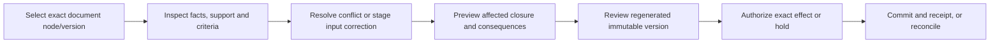

# Prose as code and HITLMAN: anchor workflows and UI acceptance

Status: accepted design priority, 2026-10-23, decision
[0038](../../intent/decisions/0038-prose-and-hitl-anchor-the-uplift.md).
This refines [PH](prose-harness.md), [HW](human-workbench.md) and
[WB](workbench-experience.md); it does not replace their contracts or claim a runtime.

## Priority and sequence

Governed prose and HITLMAN are the program's anchor experiences. Inventory, evidence,
catalog, decision and review work should demonstrate how it improves these tasks.
Do not complete a generic platform or every other review adapter before testing the
human experience. Protect source truth, user attention and the ability to understand
and safely correct generated material as first-class product outcomes.

The first candidate evidence dossier is a synthetic source correction affecting one
sentence and a dependent executive summary, with explicit conflict, missing support
and changed-version negatives. It prepares the same facts/proposal/basis that a later
HITLMAN/prose task will inspect. It is not a full editor, generation backend, publication
service or UI admission. The app/database incident example remains a secondary fixture.

W3's AE-8..11 follow their existing AE-4/authority prerequisites; they need not wait for
all W2 work or IR-10's independent adapter adoption. IR-11 may proceed with a separately
admitted W3 consumer. Two consumers remain required for permanent shared components,
not for an experimental one-consumer view. No new implementation slot is opened.

## One task model, progressive presentation

One optional workbench family provides inline, panel, split and full views. Shared
selection and evidence inspection do not merge prose graph authority with HITL effect
authority. Every view uses the same exact artifact/proposal versions, current access
and explicit outcome. Expansion must preserve the task rather than restart it.

## Cross-workflow acceptance

These future cases supplement PH/HW/WB. Passing a backendless mock or package test
cannot satisfy a runtime or attended-task case. Each admitted case records the actual
consumer, task, runtime/profile, revisions, independent oracle and retained failures.

| ID | Human task | Required proof |
|---|---|---|
| PX-01 | Select a sentence, paragraph, section or whole document. | Inspector, dashboard, diff and export refer to the same immutable node/artifact. Unicode/source-map ambiguity or stale selection requests reselection rather than rebinding consent. |
| PX-02 | Resolve a flagged ambiguity with little effort. | Required questions remain visible; bounded, deduplicated questions show the conflicting premises and authorized evidence. Unknown, defer and dispute are usable outcomes; answers retain actor/provenance. |
| PX-03 | Correct a fact or annotate its presentation. | Distinct commands version the correct source/input. Editing generated output stages a tracked proposal or explicit human-authored fork, never silent source drift. |
| PX-04 | Rebuild the affected content. | Independent dependency/context witnesses catch omitted summaries and variants. A semantic model may widen closure, never shrink the deterministic floor. Unknown closure holds publication or requires bounded wider review. |
| PX-05 | Compare revisions and audience variants. | Exact input cuts and profiles are visible. Text/structure diff, regenerated-node/byte fraction and assessed concept drift remain separate. Unexplained out-of-scope changes require review. |
| PX-06 | Review and approve a consequential proposal. | Show exact target, operation, purpose, destination, consequences and applicable criteria. Server policy/RBAC/attributes enforce the same path for human and agent; hidden controls do not establish security. |
| PX-07 | Continue after source, policy or approval changes. | Show stale state with a recoverable path. Changed inputs/context/purpose/destination cannot reuse old consent or freshen evidence timestamps. |
| PX-08 | Recover from interruption or an unknown delivery. | Preserve permitted draft/proposal state, distinguish unsaved from durable, and expose reconciliation. A timeout cannot authorize blind resend; local success cannot claim remote completion. |
| PX-09 | Inspect restricted or tokenized material. | Current disclosure policy applies to content, labels, counts and derived views. Redaction support loss is explicit; reidentification requires separate authority. No token or digest grants access. |
| PX-10 | Complete the task compactly or in the full workbench. | Selection, draft, focus and history survive expansion. Actual keyboard, narrow layout, light/dark, 200% browser zoom, screen-reader and relevant IME/clipboard tasks retain equivalent information and action meaning. |
| PX-11 | Understand and publish a document with findings. | Text/icon status distinguishes advisory voice/audience warnings from required holds. Only explicitly overrideable criteria offer bound authorized exceptions. Hard floors refuse at the server export path; inspector/dashboard/export agree on artifact and state. |
| PX-12 | Work efficiently on a representative document and queue. | Fixed pretrial corpus/device/runtime and budgets measure first useful inspection, input/selection latency, question burden, review time, memory and recovery. Bounded loading does not silently omit required evidence or lose drafts. Report misses/false holds alongside speed. |

App-owned metrics and thresholds are chosen before the trial and compared with the
existing workflow. Measure correctness and effort separately. Neither an invented
confidence badge nor attractive screenshots establish source support or usability.

## App-kit collaboration contract

Return reusable selection/inspector/diff, queue/clarification and state/recovery behavior
through existing AK-PROSE-01, AK-HITL-01 and AK-EVIDENCE-01 in [docs/app-kit](../../app-kit.md).
App-kit owns visual recipes, interaction/accessibility fixtures and suitable presentation
primitives. Agentic Kit owns portable evidence/prose/decision/transaction semantics;
apps own identity, persistence, destinations and actual effects. No new approval engine.

Start with a complete reference and a compatible runtime/layer selected for the app.
Preserve hierarchy, typography, spacing and interaction states. Existing prototype
references are design grounding, not production UI or licensing permission. A Go-web
ApprovalCard can present an app-owned decision; it is not a complete workbench. The
private React/Tiptap island is a bounded specimen, not a public editor API or save backend.
Do not force a Go rewrite or adopt either specimen by metadata alone.

The implementation handoff must include synthetic fixtures, exact capability/quality
revisions, selected reference/runtime, native browser tasks, accessibility failures,
CSS integration, lifecycle/disposal and originating-app retest. A no-script/error or
unsupported state must be truthful and recoverable. A useful one-app result can return
as an experimental recipe/specimen; permanent APIs retain app-kit's promotion bars.

Current discovery and unproven parts are in [the collaboration record](../../app-kit.md#prose-and-hitl-priority-refresh-2026-10-23).
This contract is a prepared contribution packet, not delivery into app-kit or browser
acceptance. Existing backendless demos remain labeled and separate from runtime proof.

## Completion boundary

Design priority is recorded. Runtime HW/PH/PX proof, native policy/effect enforcement,
app-kit recipe implementation, attended usability and consumer benefit remain open.
Do not close G12/G13 or AE-8..11 from this document, a mock or static reachability.
Review by 2026-11-21/next release, or immediately after an anchor task fails its bar.
