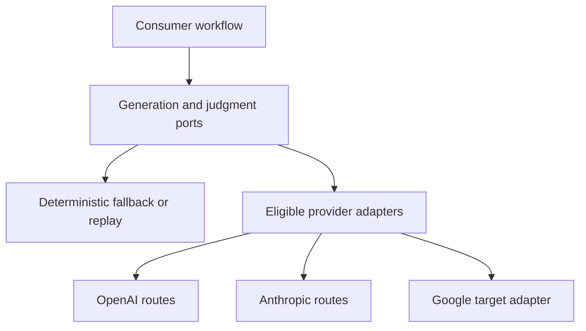

# Portable decisions, reviews and investigations

Status: accepted target design under 0025/0026. Goal G11. Existing code is the
starting point, not a claim of complete provider parity or model effectiveness.
Reuse [LLMClient](../../../foundations/llmclient/types.go),
[Decider](../../../foundations/decision/types.go),
[calibration guidance](../../fast-judgment.md),
[judgment sites](../../fast-judgment-catalog.md), the evaluator, model catalog,
budget/cost instrumentation and `kits/investigation`.

## Contract decisions [PV-01]

This is the target composition, not a parity claim. A workflow can use narrow
judgment without adopting a generation loop. Capability, authority, disclosure and
budget checks precede the provider call; native features keep their own semantics.

Separate ports by responsibility: generation/tool proposals (`LLMClient`), narrow
judgment (`Decider`), evidence retrieval, deterministic eligibility/authority,
tool execution and durable receipts. A generation provider is not automatically
a decision provider or a coding-host adapter. No second judgment port or mandatory
agent framework. Providers import core contracts; core never imports providers.

Target an additive capability negotiation beside the existing ports. Before a
call, resolve `RequiredCapabilities`, deployment eligibility, native requirements,
data class, spend reservation and current consent. Unsupported must be typed and
visible before execution. Preserve API/schema compatibility; a future incompatible
shape requires a migration, not a silent change to a stable contract.

| Concern | Portable contract | Native preservation / refusal |
|---|---|---|
| Messages and output | Explicit roles, bounded content blocks, complete/refused/partial/error distinctions | Preserve native blocks and IDs in typed adapter-owned continuations; do not flatten signed/opaque data into text |
| Tools | Schema, declared effects, call identity, bounded arguments/results | Native server tools require explicit capability, effect and data-location declaration; cannot bypass the consumer gate |
| Structured answers | Validated caller schema or typed decision kinds | Native constrained generation and local postvalidation have different guarantees; disclose emulation |
| Effort and reasoning | Workload intent plus declared supported controls | Reject unsupported required effort/continuation features; never promise equal effort semantics or expose hidden reasoning |
| Usage/cost | Provider-reported units, estimates and reconciled actual cost kept distinct | Cached/write/read/reasoning/tool units preserve provider names and price-version provenance |
| Context, images, audio | Required modalities, size/retention limits, safe references | Missing modality must not silently discard evidence; provider state stays tenant/route-bound |
| Caching, asynchronous batches | Optional scheduling adapters outside the simple completion port | Retain cache lifetime/retention, request identity, cancellation, partial-result and retry semantics |

Distinguish client-proposed tools from provider-hosted tools that execute during
the provider call. Hosted execution is eligible only when the adapter proves a
pre-effect interception/approval boundary, or policy supplies a bounded grant
before the outer call. The grant pins allowed tool/version, argument constraints,
destination/account, trusted purpose, data/disclosure classes, effect class,
expiry, budget and invocation limits. Reserve the budget before the call and deny
out-of-envelope invocations. If the provider cannot enforce those limits, the
required hosted-tool capability is `unsupported` before disclosure or dial.
Post-hoc tool traces are evidence, not interception. A read-only connector still
needs disclosure authority; opaque hosted actions cannot be advertised as guarded
merely because the local client has a tool executor. Native functionality stays
available only within a proven, explicitly declared authority boundary.

Provider status at the assessed source: Anthropic/Bedrock, OpenAI/Azure and
Claude/Codex CLI adapters exist; CLI adapters reject caller tools. Google is a
known gap. A new Google adapter needs official pinned wire contracts, `httptest`
fixtures, replay/refusal/streaming/usage/error conformance and downstream checks.
Hosted/API/native agent runtimes remain distinct from model transport adapters.

## Organization inventory and application decisions [PV-02]

Do not hard-code model IDs or a universal strongest-model order. Propose CUE data
extending existing model/solution manifests, with explicit owners and versions:

| Record | Required target fields |
|---|---|
| Deployment | Stable key, provider/route, requested and resolved model/version, region/endpoint class, capability claims plus probe evidence, context/modalities, retention/data classes, rate limits, prices/currency/source/as-of/expiry, org eligibility and revocation |
| Application solution | Workflow/task/role, required capabilities, candidate deployment refs, prompt/tool/retrieval/profile digests, constraints and authority, measured evaluations, selected deployment, alternatives/rejection reasons, reviewer, validity and revisit trigger |
| Ladder | Site/role, eligible ordered tiers, transition signals, max attempts/total cost/deadline, allowed actions by tier, human route, terminal states and no-provider behavior |
| Judgment site | Stable criterion/question key and exact definition digest, predicate/choice/score kind, input/evidence pins, applicability, consequences, provider opt-in, calibration ref, abstention/error/kill behavior and deterministic fallback |
| Calibration | Site/question/deployment/corpus/grader versions, label provenance, sample counts/splits, error rates and uncertainty, freshness, threshold selection/loss tradeoff, owner and drift triggers |

Available to an organization, eligible for this task, considered, evaluated and
selected are separate states. A catalog row, live credential probe or provider
advertisement establishes none of the other states. Return concise rule traces,
evidence links, alternatives and missing prerequisites, not fabricated causal
reasoning. Calibrated thresholds may restrict a route; they cannot grant authority.

## Bounded escalation [PV-03]

Choose the cheapest eligible method that meets the task's measured quality floor:

1. Compute exact properties, validate schemas/policy/source versions and retrieve
   bounded relevant evidence. Do not ask a model what a parser can establish.
2. Use narrow small-model extraction/classification, including the Haiku class,
   when independently labeled cases show it meets the site's bar. Structured
   output is shape validation, not correctness. Batch independent questions only.
3. Escalate on a typed signal: missing evidence, contradictory sources, ambiguous
   requirement, unsupported capability, measured low confidence, checker/model
   disagreement, high impact, novelty, or repeated unsuccessful investigation.
4. Obtain distinct evidence or a stronger eligible analysis, then independent
   review for the declared contested/high-impact class. More calls to the same
   source are not independent corroboration. Fanout stays bounded and deduplicated.
5. Route to human clarification/authorization, held, exhausted, revoked or
   unsupported when the appropriate next step cannot be established.

Missing permission -> refuse/seek authorized actor. Missing facts -> retrieve or
clarify. Provider outage -> disclosed eligible fallback. Unsupported native feature
-> refuse or use an explicitly reviewed alternative. Disagreement -> investigate.
Never answer all of these with "use a larger model". Escalation cannot broaden
permissions or bypass an unfavorable screen. Stop after the declared attempts,
deadline, cost or diminishing-new-evidence bound, with a resumable evidence packet.

Investigation target record: question/subject/snapshot, hypotheses, independent
expected coverage, searches/probes and omissions, source/claim graph, positive and
negative evidence, conflicts, decision-site records, remaining unknowns, next step
and stop cause. Preserve rejected hypotheses. A result is an answer with its
basis and limits, not a cause claim merely because retrieval found a nearby change.
Reuse the existing investigation FSM/journal; I20 plan-only coordination packages
do not become worker executors through this specification.

## Review pipeline and scale [PV-04]

Resolve applicable criteria against an independently prepared subject/scope
manifest. Partition by bounded ownership/evidence needs. Run deterministic checks
first; apply judgments only to unresolved semantic questions; join findings by
criterion and exact subject version. Audit missing subjects, failed/omitted
partitions, duplicate reviews, empty output and stale evidence before summary.
Required fail/unknown cannot be averaged away. A changed definition invalidates
reuse even if the criterion's stable key stayed the same.

With Fathom, retain source snapshot, query basis and actual supported coverage.
Without it, use explicit file/artifact manifests, lexical/structural tools and
consumer adapters. Unsupported call-graph/absence claims stay unknown. Neither
path labels caller assertions as independently observed evidence.

Cache immutable evidence/extraction/deterministic checks separately from model
judgments and current permission checks; follow [EL](evidence-learning.md).
Shape stable prefixes before volatile inputs, retain provider-reported cache use,
and compare total cost including writes, misses, retries, errors and operator time.
Prioritize by user deadlines/impact; async batch support requires measured value
under F6, with per-request identity and bounded retry/reconciliation. It is not a
batch abstraction forced into every `LLMClient` call.

## Decision models: sites, fallbacks and kill measurements

All sites opt in separately. `none` keeps deterministic checks and explicit held
states useful. Reuse [the existing catalog](../../fast-judgment-catalog.md) before
adding a site. Proposed refinements below are hypotheses, not enabled defaults.

| Site | Typed question | Deterministic/no-provider path | Keep or kill measurement |
|---|---|---|---|
| Prompt/security triage | Predicate for declared prohibited semantic content | Exact auth/data/tool floors first; uncertain screen holds required continuation | Missed violations, false holds, evasion and cost against labeled baseline; kill if safety floor fails |
| Evidence sufficiency | Choice: supported / contradictory / missing / not-applicable | Resolve required refs/coverage; unresolved support holds or human reviews | Audited unsupported accepts and unnecessary human effort, per source/task |
| Investigation next step | Choice among authorized probes/clarification/stop | Fixed declared probe order and bounded stop | Accepted answer gain per extra cost, omitted important hypotheses |
| Review prioritization | Score anchored to impact/evidence rubric | Deterministic required queue and aging; no hiding required criteria | Critical misses, starvation, time to useful finding |
| Prose semantic impact | Predicate/choice: possible additional affected claim | Always rebuild known dependency closure, retain unknown coverage | Missed dependent changes and needless regeneration; cannot shrink closure |
| Audience/style warning | Score/choice against exact presentation criteria | Deterministic structure/accessibility checks, warning/human review | Human-adjudicated mismatch and distraction rate; never waive policy |
| Human question proposal | Choice of relevant unresolved question | Required CUE fields and fixed bounded questionnaire | Resolution per operator minute and leading-question errors |
| Lesson duplicate/applicability suggestion | Choice among existing candidates/new/unknown | Exact source/revision dedup and receiver-owned acceptance | Harmful transfer, duplicates and reviewer time |

## Acceptance scenarios

| ID | Required independent proof before claiming completion |
|---|---|
| PV-05 | Provider-off performs zero key reads, execs or dials; configured provider enables no unrelated site. |
| PV-06 | Same fixture set tests portable requests on each claimed adapter; native-required unsupported capability refuses before any dial/effect. |
| PV-07 | Refusal, malformed response, timeout, partial stream and rate limit retain distinct typed causes; no refusal becomes false/zero. |
| PV-08 | Missing image/evidence, changed question/options and wrong route cannot reuse a decision. Opaque continuation from another provider/tenant is refused. |
| PV-09 | A permitted small-model result never lifts a denied effect; escalating a denied action to another backend still refuses. |
| PV-10 | Every attempted call, retry and delegated unit reserves/reconciles one shared budget; uncertain charge remains reserved and blocks overspend. |
| PV-11 | Missing/foreign/duplicate partition and omitted required criterion cannot yield a complete review. Independent scope witness detects deletion of a criterion. |
| PV-12 | Conflicting evidence routes to bounded investigation/human/held; planted ambiguity is not converted into a confident fact. Recall remains measured, not guaranteed. |
| PV-13 | Changed input/profile/model/calibration/eligibility/revocation defeats stale reuse. Soft success cannot compensate for failed required evidence. |
| PV-14 | Ladder exhaustion, deadline, human unavailability and provider outage terminate with evidence and stop cause, never an unbounded loop. |
| PV-15 | Cost/quality comparison uses distinct held-out trials and adjudicated outcomes, includes all failures and human effort, and reports uncertainty. Replay is one software test. |
| PV-16 | Actual consumer entrypoint proves both Fathom and no-Fathom modes; missing index coverage remains explicit. Static plan proof is reported separately. |
| PV-17 | A hosted connector attempts disclosure/effect inside the provider call before returning a client proposal. Without proved interception or an enforceable bounded preauthorization envelope, the outer call refuses before dial. Exceeding a tool, argument, destination, purpose or invocation bound cannot execute. |

Research basis: S03-S06/S18-S21 for workflows/evaluation, S23/S24/S27 for conditional
cache/batch economics, S26 for typed native decisions and local threshold evidence.
No specific model price, universal threshold, accuracy or savings claim is made.
