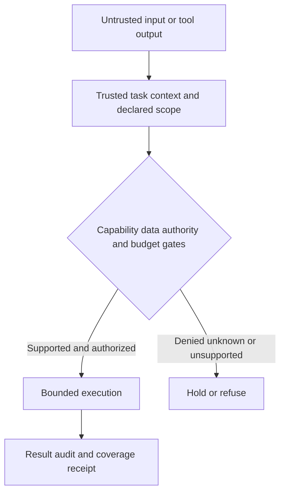

# Security, agent configuration and operational feedback

Status: accepted target design under 0025/0026. Crosscuts G9-G14. Existing threat
boundaries remain [threat-model.md](../../threat-model.md); this adds no sandbox,
identity provider or claim of comprehensive security scanning.

## Current tools and gap [SH-01]

The repository has `constitution-lint`, `endpoint-guard`, `agent-hooks`,
`catalogctl`, `kit-new host`, `kit-workflow` and `eval-runner` commands among
its tooling. `constitution-lint` checks known secret shapes and structural
constitution rules. `endpoint-guard` screens governed model calls. These do not
constitute SAST, dependency-vulnerability, infrastructure, container or runtime
penetration scanning. `go vet` and an empty root dependency list do not prove
absence of vulnerabilities in stdlib, binaries, nested modules or consumers.

Design a bounded security-check composition around existing assessment/evidence
contracts, initially a scenario/adapter before a new command. A future CLI, if
pulled by that scenario, accepts an explicit scan manifest and returns normalized
findings plus exact coverage and operational failures. Do not build a proprietary
replacement for established scanners. `govulncheck` is an external optional Go
tool, not a new root-module dependency; other language/SAST/secret/IaC scanners
are opt-in adapters chosen by the consumer. Never install or run an arbitrary
command supplied by untrusted findings or issue text.

The bounded first `GoScanProfile` makes two classes required for selected Go subjects: the repository's known-secret guard and an actual `govulncheck` vulnerability check. `govulncheck` remains an approved external binary, not a new Go module dependency or automatic installation. The consumer opts into this profile; once selected, a missing executable, unapproved binary, failed invocation or unavailable database is `unknown`/failed coverage, never an optional pass. No gate is changed by this design. SAST, IaC, container and dynamic testing remain `unsupported` or `not-applicable` with explicit scoped reasons; passing this profile is not a claim that those classes were scanned.

Its scope manifest enumerates the repository root module (stdlib-only today), each nested or vendored module in scope, build mains, selected GOOS/GOARCH and build tags, excluded roots with reasons, and expected source/artifact digests. Discovery compares actual roots to that independent manifest before a clean result. The vulnerability receipt binds the pinned scanner binary/version and database snapshot, selected build configuration and reachable call paths from selected mains; version-only or root-only checks cannot certify a build they did not analyze. A consumer-configurable maximum database age defaults here to 24 hours as a design choice, not an industry rule. Stale/unavailable database, truncated output, unscanned nested root, unsupported build configuration or discovery mismatch holds completeness.

Target `ScanManifest`: subject commit/artifact digests, expected roots/files and
excluded reasons, scanner identity/version/binary digest, approved argv template,
database snapshot/as-of, network/credential/data classification, timeout/output
bounds, applicable profile/criteria and accepted exit meanings. Target receipt:
exact manifest digest, execution identity, exit/stop cause, covered/skipped roots,
database age, findings with source ranges/rule IDs/evidence, redaction summary and
truncation/loss. Retain raw output under appropriate access; use a bounded parsed
view. Import SARIF where useful without declaring all scanner results equivalent.

Missing executable/database, timeout, unsupported language, unreadable roots,
truncated output or parse failure -> unknown/failed required check, never "clean".
Findings are evidence for local policy; scanner success is not permission or
absence of all vulnerabilities. New required checks/gate edits need the separate
autonomy path. This design changes no gate.

## Security review pack [SH-02]

This shows controlled execution. Security scanning separately needs its manifest,
approved binary and current database. A clean scan or favorable model judgment
cannot supply missing permission or cover an unseen provider-hosted effect.

Review actual source-to-effect paths, not presence of a safety helper:

| Concern | Deterministic target control | Residual judgment / consumer duty |
|---|---|---|
| Prompt injection/tool-output trust | Separate instruction authority from retrieved data, schemas/allowlists, exact effect checks | Screens are fallible; unsafe strings can pass well-formed schemas |
| Tool privilege/exfiltration | Resource/action/purpose checks, scoped credentials, egress/data class policy, bounded arguments/results | Consumer supplies real identities, isolation and destination assurance |
| Approvals/confused deputy | Trusted purpose plus exact actor/resource/operation/destination/disclosure/versions/expiry and commit-time recheck | Human must see consequences; reconciliation cannot renew a consumed approval |
| Supply chain/config drift | Versioned trusted manifests, code/tool/config hashes, explicit reviewed upgrades | A hash establishes identity, not source safety or provenance truth |
| Secrets and sensitive records | Known-pattern screening plus field/tenant/retention controls, vault-gated reidentification | Regex misses secrets; tokenized relationships can still identify people |
| Resource/cost abuse | Shared pre-call reservations, hard bounds, deadlines/cancellation, retained unknown charges | Rate/price evidence and external account limits need current data |
| Unsafe output/commands | Validate destinations and exact operations independently of generated prose | Do not execute a recommendation or copied command as an instruction |
| Policy/log failure | Required parse/check failure refuses before effect; existence/drop/error counters | A stopped journal must be visible; debug logs must not become secret dumps |

Sources S09/S10/S28/S30 motivate defense in depth and limited agency. Their
recommendations do not certify this implementation or override application policy.
Provider-hosted tools follow [PV-01/PV-17](providers-decisions.md): a local executor
cannot guard an unseen hosted effect. Prove interception or enforceable bounded
preauthorization before the outer call; otherwise declare that path unsupported.

## DRY configuration with honest host boundaries [SH-03]

Keep semantic rules and intent in one owned AGENTS.md chain plus routed versioned
catalog/profile data. Generate or explicitly maintain the minimum host-specific
binding, never competing copies of the rules. Follow 0020 for necessary Claude
compatibility shims. Do not create duplicate CLAUDE instructions. Preserve existing
native resolution semantics rather than assuming all hosts discover identical files.

Target a host adapter manifest (extend `kit-new host`, not another configuration
framework): host/version, source rules/config digests, supported scope/resolution,
MCP registration, skill discovery, trust prerequisites, lifecycle/tool hooks,
blocking vs advisory semantics, timeout/parse/error behavior and unsupported paths.
Produce a capability receipt from actual invocation probes. Installation is a
separate authorization step; no changes to global configuration or wider tool
permissions as incidental hygiene.

| Host lane | Current evidence | Required target proof |
|---|---|---|
| Claude Code | Existing project-local native adapter and versioned limited receipts | Actual allowed/denied tool, nested scope, compaction/restart, trust and missing-hook cases |
| Codex | Existing adapter and configuration receipts; historical live coverage unknown | Fresh supported hook/config probes; installed registration is not hook execution |
| Antigravity | No supported adapter established in baseline | Locate official host contracts; declare unsupported until versioned probes exist. Do not imitate Claude hooks speculatively. |

Review criteria: single source of policy, correct precedence and scope, concise
progressive disclosure, tool least privilege, explicit provider/effort/budget,
secrets out of config, deterministic command/decoder behavior, actual hook coverage,
loss/existence telemetry, stale config detection, reproducible upgrade/rollback.
DRY is semantic reuse; necessary transport/config adapters are legitimate duplication.
Aggressively merging unlike permissions creates a false common denominator.

## Hooks and flywheel [SH-04]

Journal hook invoked/completed/refused/timed-out/parse-failed/unsupported and
significant action/approval/reconciliation events with source/host/version/run
identity, event time, rule/site, sanitized outcome and bounded reproduction handle.
Critical security, approval and dropped-channel events are unsampled. Sample routine
successes deterministically by declared versioned policy, retaining inclusion
probability and counts. [Evidence-learning](evidence-learning.md) owns sampling,
deduplication, privacy, queue bounds, retention and reviewed promotion.

Use failures to propose configuration/test improvements, not automatic permission
changes. A repeated denial may be a correct control or a host-envelope mismatch;
classify it before optimization. Retain the existing O9/O11 and spawn-routing
friction as unresolved instrument issues until reproduced and repaired upstream.
Current Fathom freshness refusal cannot count as source proof.

## Acceptance scenarios

| ID | Proof required on actual entrypoint |
|---|---|
| SH-05 | Missing scanner, database, unsupported language and partial scan each yield explicit unknown/failed coverage, not a clean result. |
| SH-06 | Canary secret and planted vulnerable/unsafe fixture fail their exact applicable checks; removing the check cannot emit complete success. |
| SH-07 | Malicious scanner/issue output cannot choose an executable, extend argv or mutate policy; oversize/raw secret output is bounded/redacted. |
| SH-08 | Hook parse error, timeout and missing registration hold a required protected effect; invocation absence is detected separately from no violations. |
| SH-09 | Native adapters prove root/nested precedence, normal trust and exact supported host versions; untested/unsupported entrypoints remain explicit. |
| SH-10 | Changing the canonical rule invalidates generated bindings; a host-specific exception cannot silently weaken the shared floor. |
| SH-11 | Sampled feedback records denominator/inclusion and loss; dropping the journal creates a visible channel failure. No automatic authority updates occur. |
| SH-12 | Authorized/no-approval execution still passes the same resource/data/budget checks; denied effects cannot be rerouted through another model or client. |
| SH-13 | Scan/host reports bind exact source/config/tool versions and exclude sensitive raw payloads from reusable contribution packets. |
| SH-14 | A synthetic secret canary fails the known-secret check; a missing approved `govulncheck` binary yields unknown required coverage, not clean. |
| SH-15 | A pinned database older than the configured 24-hour default and an unscanned nested module each prevent complete Go coverage. |
| SH-16 | A vulnerable fixture reachable only under a selected conditional build tag fails that selected build; another tag's result cannot substitute. |
| SH-17 | Untrusted scanner stdout containing commands, forged success text or oversized secret-bearing payload cannot change argv, grant policy or produce a clean parsed receipt. |

Upstream contributions are prepared in the owning consumer record, not marked
delivered until the upstream owns them. See [docs/app-kit.md](../../app-kit.md)
for visual candidates and the program's ownership table for Fathom/Review Kit.
