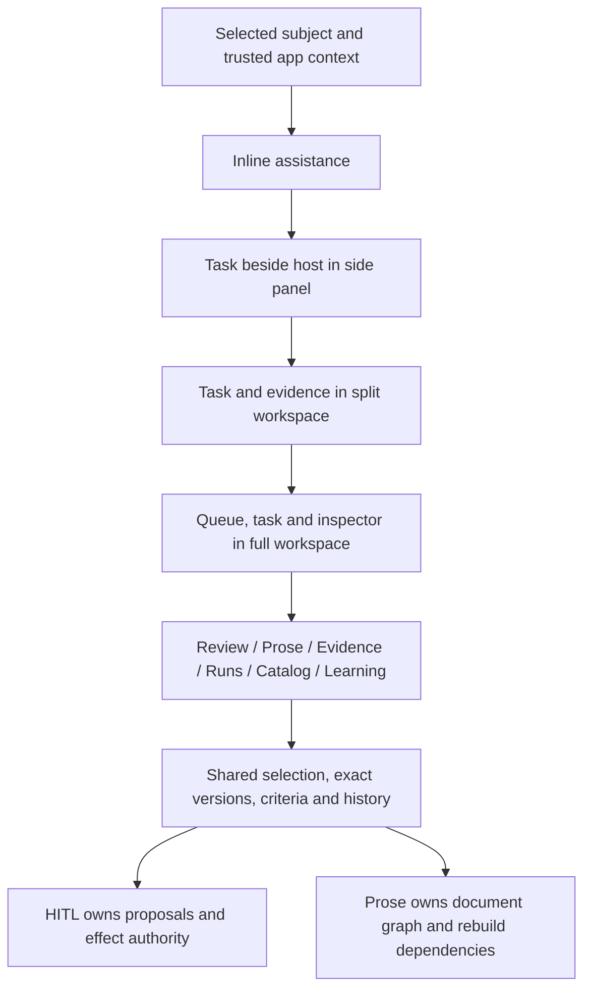

# Workbench experience and prototype lab

Status: accepted layout direction, exploratory backendless prototype. This is not
HW/PH runtime acceptance or an adopted user interface. [0029](../../intent/decisions/0029-one-workbench-family-independent-task-views.md)
records the shared-shell decision. [Human workbench](human-workbench.md) and
[prose harness](prose-harness.md) retain their independent semantic contracts.

[Prose/HITLMAN anchor acceptance](prose-hitl-priority.md), 0038, governs the next
admitted attended task. These prototypes cannot substitute for that runtime/UI proof.

## At a glance

One workbench family, independent task views. Do not build two complete products
with duplicate queues and inspectors. Do not require the full shell to review one
sentence. An app chooses useful views and verbs, then supplies authority through
the contracts. No shell state can grant a verb or make stale evidence current.

| Presentation | Visible task | Expansion invariant |
|---|---|---|
| Inline | One issue in host context, evidence inspection, expansion | Same selected subject and local draft |
| Panel | Host context beside bounded task and inspector | Host remains understandable; actions explain consequences |
| Split | Reading/editing area beside evidence/criteria/history | Selection and evidence versions survive presentation changes |
| Full | Ordered queue, task canvas and inspector | Queue order is supplied by engine; filtering never reorders it |

The experiment toolbar is outside product navigation. Scenario changes explicitly
reset synthetic decisions. Presentation changes retain them. Reload resets all
state. Every mode displays **BACKENDLESS PROTOTYPE** and synthetic-data disclosure.

## Interaction and attention budget

Use a quiet reading canvas and restrained status ink. Red includes a textual
policy/evidence block; yellow includes an advisory or uncertainty label. Neither
color alone conveys authority. Keep exact source/version and criterion inspectable.
Never display a universal confidence percentage or invented measured savings.

The smallest task shows the issue, reason, next action and consequence. Evidence
detail is one explicit action away. Expand when the task needs comparison or
multiple decisions. Full mode adds navigation and queues without changing consent.
Keyboard selection, visible focus, native dialogs, non-color states and a selected
record control remain available when columns stack or the queue collapses.

Prose remains a rendered projection. Select a node, inspect support, stage source
corrections, rebuild affected content and review the new revision. Never imply
that editing generated bytes corrects facts. Audience variants retain the required
claim inventory. Changed destination or withdrawn approval conditions invalidate
the simulated decision. Unknown delivery holds; absence needs a fresh decision.

## Experiment inventory

The [bundle README](../../../prototypes/governed-workbench/README.md) maps all
12 scenarios to questions and actions. `prototype.json` is the inventory, not
a progress database. Four layouts and six task views exercise shared vocabulary;
not every scenario supplies an executable path in every unrelated task view.
The prototype shows source conflicts, audience omissions, bound changes, ordered
review, evidence gaps, bounded investigation, privacy, delivery recovery,
clarification, stale approval, model choice and reviewed lessons.

An app-owned UI may implement only an inline review card. A full prose app may
compose more views. Agentic-kit does not require app-kit, a UI framework, Fathom,
a provider, or a backend to inspect this experiment. No prototype code is a
runtime dependency of a kit. Generic lifecycle/check/preview capability returns
to app-kit; the agentic fixture and semantic designs stay here.

## Visual grounding and proof boundary

App-kit `work.approval` is an L3b Go-web contract, not a ready-made workbench.
Its authorization/execution/audit remain app-owned. Returned approval quality
work inventory was empty/untracked, not complete. MCP kit-root guidance was
unavailable; local maintainer intent and contribution guidance supplied fallback.

Complete reference consulted: Tailwind Plus, HTML / Tailwind 4 / light,
`Application UI.Application Shells.Multi-Column Layouts.Constrained three column`.
Exact archive `application-ui-v4.zip`, SHA-256
`b26cbf6e9529c2219452de32b1a9c49ca12d7bc63bca5e48cd286088521ba0e8`.
The original implementation keeps queue/task/inspector hierarchy, quiet borders,
gutters and responsive stacking; it widens the editorial canvas. No licensed
source, logo or asset is copied. Theme roles and components are exploratory CSS,
not a second app-kit token system or a certified kit component.

## Acceptance and review

- WB-01: all 12 fixtures load with a persistent backendless label and scenario instructions.
- WB-02: presentation changes retain selection; scenario changes disclose reset.
- WB-03: both versions of a conflicting source are independently inspectable.
- WB-04: destination/condition change invalidates prior simulated approval.
- WB-05: blocked/Reader actions stay held; unknown send cannot repeat.
- WB-06: source correction changes affected prose; unrelated content stays unchanged.
- WB-07: keyboard focus, dialog Escape/return and narrow/dark layouts remain usable.
- WB-08: app-kit checker accepts the declared local bundle; no provider/backend is called.

Observed verification, 2026-10-22: WB-01..08 passed at the bounded prototype level.
Chrome loaded all 12 task fixtures. Source v2/v3 selection, exact P-8 approval and
condition/destination invalidation, Reader/blocked refusal, delivery unknown /
delivered / confirmed-absent recovery, clarification and ordered lesson stages were
exercised. Early investigation stop marks unrun checks skipped, not completed.
Correction/rebuild retained four of six seeded nodes, rebuilt two and selected the
correct v3 support. Executive omits a required caveat; Technical includes it.
Presentation switching retained context selection. Evidence dialog Escape returned
focus; annotation and checkbox focus worked. Four presentations at 390x844 had no
document horizontal overflow. Wide 1440x1000 and dark panel layouts were inspected.
The final fresh P-8 browser run recorded no application errors after repairing an
unsupported checkbox selection-range call. Extension errors were excluded by URL.
No screen-reader or attended usability study was performed.

Executed `prototype-lab new`/`check`, CUE validation of this manifest and positive /
negative tool fixtures, JS syntax, `task validate`, and app-kit `task check` passed.
`fathom verify` on the uplift work order reported 19 tasks, zero claimed, zero
failing. The prototype cannot close a runtime row through static existence.
Source SHA-256: `app.js` =
`222da4c5eb7c77ada3c4c8650939bc346e962df5a81274dc0cc9b0c71a4bf16a`;
`scenarios.js` = `bed246d7a3d3f21a58b269f4deda49f07fdebf0bac4456176bab71617d1197a2`.

These checks do not
replace screen-reader, attended usability, production security, transaction adapter,
model, performance, consumer adoption or measured-benefit evidence. HW/PH and
AE-8..11 remain open. Review by 2026-11-21 or next release. Promote only a named
task with observed benefit and the owning layer's gate; retire answered or unowned
experiments. The durable decision survives removal of the bundle through Git.
