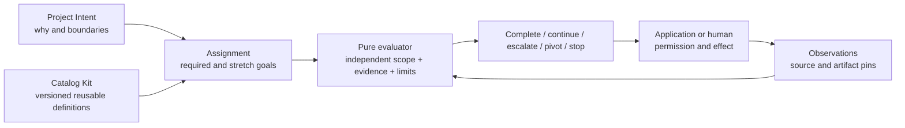

# Assignment Kit

Status: accepted implementation specification, 2026-10-23. Decision [0036](../intent/decisions/0036-assignments-compose-goals-evidence-and-stopping-rules.md).
Request: "should we have a requirements kit or a goals kit or intent kit or anything like that that is based on or similar to the catalog kit?" Follow-through: "whatever you decide on these kits fully spec out and implement to completion".

## Ownership and intended outcome

An assignment is a bounded agreement about an outcome and how its evidence will be
assessed. A task list describes work; an assignment describes success, limits, and
what to do when success cannot be established. Ship one **Assignment Kit**, rather
than separate requirements, goals and intent kits with competing status stores.

Project Intent owns durable project purpose, decisions and current goals. Catalog Kit
owns reusable definitions, stable identity and tailoring. Assignment Kit owns a
run-scoped contract and pure assessment. Existing `AssessProfile` owns criterion
evaluation. The application owns evidence collection, identity, permissions, storage,
execution and the actual stop. A report grants no permission and authenticates no
source. This honors I1/I2/I5/I13, decisions 0004/0012/0021/0024/0026 and assurance.
0021's record-kind rejection remains valid: there is no second repository intent file.
The owner sponsors this concrete composition in W1's existing reference slot, not a
third incubation. No production consumer or measured benefit is claimed.

## AS-1. Contract and bounded validation

New experimental package `kits/assignment-kit`, stdlib plus existing foundations.
Reuse the foundation's CUE profile/observation/assessment definitions as well as its
Go types, adding only assignment-specific composition and stricter envelope constraints.
No scheduler, runner, storage, network, subprocess, provider or new expression language.
Package concurrency contract: pure functions safe concurrently with caller-owned inputs
held immutable; returned data detached. Export `Validate`, `Fingerprint`, `Evaluate`
and typed input/result structs. All JSON tags mirror `schema.cue`. A strict decoder
is not required: library callers use typed values; validate before evaluation. CUE
fixtures and actual Go-exported JSON fixtures exercise both representations.

`Assignment`: version 1, ID, title, bounded intent references (ID plus exact revision
SHA-256), policy SHA-256, subject
SHA-256, goals, concerns, budgets, finite deadline and trigger rules. `Scope` supplied
independently names the exact assignment digest, policy digest and expected required
goal IDs. Expected coverage must not be generated by enumerating goals/results in an
adopter claiming omission detection. Scope is caller-declared, not authenticated policy.

At most 64 goals, 256 total criteria, 64 concerns, 16 budgets, 32 rules and 16 intent
references. IDs are bounded ASCII identifiers, text <=2048 UTF-8 bytes, digests are
lowercase SHA-256. Reject duplicates, unknown enum values, cycles, missing references,
nonfinite numeric values, invalid times and excess resources before evaluation. A
required goal cannot depend on a stretch goal. At least one required goal is mandatory.
Fingerprint canonicalizes unordered collections, includes all behavior/text/definition
and policy fields, and refuses invalid input. Never hash failed serialization as empty.

## AS-2. Goals, requirements and evidence

Each goal has ID, title, kind `required|stretch`, dependencies and a domain-owned
`fitnessfunctionregistry.Profile`. Every profile already requires at least one hard
criterion. Profile-scored criteria optimize locally; they cannot compensate for a
failed/unknown requirement. Goals are a dependency graph, not a second execution plan.
Stretch outcomes remain visible but cannot block required completion. Unknown/missing,
stale, future, foreign-subject, definition-mismatched and method-disallowed observations
remain unknown through the existing profile evaluator. Do not accept extra goal inputs
or duplicate observations. A required goal must have an applicable passing requirement;
an all-N/A profile cannot complete it. A failed dependency prevents satisfaction.

Evaluation input pins assignment and policy digests, and supplies per-goal observations.
An input for a goal may be absent: project its criteria as missing, not malformed.
Source truth, entailment, retention and observation authenticity remain collector duties.
Artifact digests are references, not verified content. Include these limits prominently
in reports and adoption instructions. Changed assignment/policy pins reject old input.

## AS-3. Confidence requirements without confidence theater

An optional per-criterion confidence bar contains `minimum` in (0,1], a calibration
basis digest and a site/context digest. A reading binds the exact observation digest,
basis and site plus finite value in [0,1]. The helper for an observation digest must
validate and canonicalize its fields/time/order before hashing. Missing, lower,
stale-context or mismatched readings make its confidence acceptance unknown. Preserve
the original profile assessment, trace and evidence digest unchanged; report confidence
acceptance as a separate overlay that gates goal satisfaction and accepted soft score.
They cannot
turn failure into pass or replace admissible evidence. Such a bar is valid only where
the criterion admits heuristic evidence; deterministic and human evidence use their
own criterion requirements, not invented model confidence. Require calibrated reading
only when the actual evidence method is heuristic. Unrequested/duplicate reading IDs
refuse. A malformed reading refuses the input rather than being silently skipped.

The caller must qualify and authenticate the basis externally. A model's raw confidence
is not measured reliability. The kit enforces exact declared bars and bindings, not
statistical validity. The example uses a synthetic calibration artifact and labels it.
No model is required or called. No automatic trust increase or permission follows.

## AS-4. Concerns and acceptance blockers

Authored concerns have ID, description and `blocking|advisory` severity. Inputs report
`open|resolved|unknown` with a reason, artifact pins and canonical observed/valid-until
times. Missing, expired and future resolutions stay unknown. Resolving a blocking
concern needs at least one retained artifact reference. Extra or duplicate concern IDs
refuse. Open/unknown blocking concerns hold completion; advisory concerns produce
visible warnings. Neither a high score nor a stretch win clears a concern.

## AS-5. Finite work, pivot and stop

Budgets use exact nonnegative integer units with an ID, unit and strictly positive
limit. Usage has exactly the expected budget IDs, no duplicates, nonnegative spent
values. Units are application-defined labels; no implicit conversion or float money.
Missing usage is unknown and holds completion; extra usage refuses. Equality exhausts
a budget. Deadline equality expires it. The evaluator receives `now time.Time`; no
ambient clock. It does not reserve shared spend or police concurrent workers. The
dispatcher must reserve before effects and aggregate delegated/failed/retried work.

Progress input has bounded nonnegative counters `attempts`, `no_progress`, `ambiguities`
and `conflicts`. Rules specify one counter, positive threshold, reason, action
`escalate|pivot|stop`, and a bounded route identifier. Rules are deterministic >=
comparisons, not free-form executable conditions. Missing progress holds readiness.
Domain-defined detection of ambiguity/no-progress is external evidence, not a claim
that the kit can infer semantic conflict. Rules recommend an action with matched IDs;
they do not change models, contact people, amend goals or execute a pivot.

Precedence: exceeded deadline/budget or matching stop -> `stopped`; matching pivot ->
`pivot-required`; matching escalation -> `needs-review`; unresolved blocking concerns
or unknown usage/progress -> `blocked`; all required goals satisfied -> `complete`;
otherwise `continue`. Retain **all** matched causes and every goal result, even when a
higher-precedence cause selects the next action. Required failures and unknowns remain
visible. A stop is a useful terminal report, never success. A completed report only
means declared acceptance met in this scoped snapshot, not universal task success.

## AS-6. Revisions, delegation and human use

Results record assignment/policy/scope/evidence pins, evaluation time, explicit
caller-declared trust, no-action-authority, goal/criterion traces, concern states,
usage and matched rules. Sort set-like output deterministically. Snapshot evaluation
is not a durable lifecycle machine. Changing a goal, bar, deadline, scope or budget
creates a new assignment digest and needs receiver approval before new work. Never
erase a failed attempt by changing the brief in place. Persist append-only receipts
in consumer-owned storage with its access and retention policy.

An assignment may reference a parent by immutable intent/artifact reference. This
version does not allocate child budgets or validate grants. A parent can ingest a
child result as evidence only after independent criterion and source checks. Child
completion cannot complete a missing parent criterion. HITL panels can render results
and ask for missing facts, while the domain app retains answerer RBAC and authorization.
Prose work can require factual support/policy checks and use tone as a soft criterion.

## AS-7. Catalog integration and creature comforts

No copy of Catalog Kit's resolver. Provide a runnable backendless example showing
`catalogkit.Resolve` and exact stable-key lookup, then binding node and complete
definition digests into assignment criteria. Moved/stale definitions require a newly
reviewed assignment. Template/example library: command-safety qualification and bounded
investigation, both executable in tests. Provide clear plain JSON result output and a
minimal valid Go usage example, no CLI framework or hidden configuration lookup.

Document the smallest useful assignment (one required goal, one criterion, finite
budget/deadline) before advanced confidence, stretch, concerns and pivot examples.
Include the adoption checklist, trust boundary, changed-assignment handling and
failure table. No template promises to know all of a project's requirements.

## AS-8. Acceptance and completion boundary

| ID | Required proof |
|---|---|
| AS-A01 | CUE and Go agree on valid data and boundary/invalid shapes; fixtures include marshaled Go values. |
| AS-A02 | Independent scope catches omitted required goals, duplicate/extra/foreign input and changed pins. |
| AS-A03 | Missing/stale/future/wrong-method/wrong-definition/subject evidence, all N/A and failed dependencies cannot complete. |
| AS-A04 | Stretch failures never block completion or compensate for required failure; scored criteria cannot bypass floors. |
| AS-A05 | Confidence boundaries, changed basis/site/observation and uncalibrated/missing readings cannot improve acceptance. |
| AS-A06 | Missing/expired/unsubstantiated blocking-concern resolution holds; advisory concerns stay visible. |
| AS-A07 | Exact budget/deadline boundary, missing usage/progress, rule collisions and precedence retain all causes. |
| AS-A08 | Fingerprints/output are permutation-stable, deterministic, detached and race-safe; malformed/oversize inputs refuse. |
| AS-A09 | Both reference workflows run without provider/storage/harness/Fathom/network; catalog changes invalidate old pins. |
| AS-A10 | Guide-only independent trial, fresh review, `task validate` and actual downstream-check coverage pass before done. |

This implementation is the complete scope AS-1..8, not a backlog masquerading as a
delivery claim. A future executor, durable lifecycle, budget leasing, UI, automatic
goal inference or authenticated multi-party delegation requires a new consumer-backed
design and admission. They are deliberately outside this contract, not half-built.
