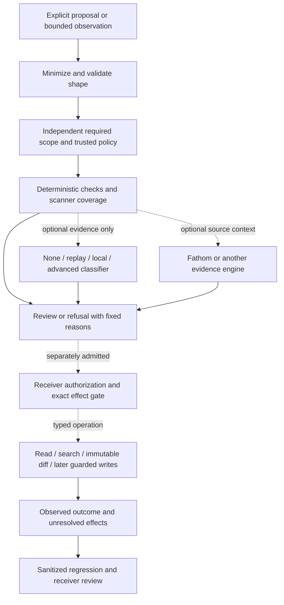

# Safer commands and governed coding harnesses

Status: implementation specification, 2026-10-23. Initial reference extends W1's
offline authoring/qualification scope; it does not install hooks or authorize commands.
The complete architecture and admission decision are recorded alongside this contract.
[0039's delivery extension](governed-command-tools.md) admits a separate controlled
exact-content file-inspection increment. It does not change command-lab's offline
contract or imply that CG-8..16 are fully delivered.

## Initial executable reference

CG-1. `cmd/command-lab` is stdlib-only and command-local, with `audit` and `assess`.
No subprocess, provider, credential lookup, network, hook/config mutation or arbitrary
command execution. It reads only explicit input files, emits sanitized text/JSON and
always states `noActionAuthority: true`. Package doc states concurrency. No new foundation.

CG-2. `audit --manifest PATH --format text|json` reads a strict versioned source manifest:
independent `expectedSourceIds` and `sources[{id,format,path}]`, unique safe IDs, exact
source set, formats `codex`, `claude`, `normalized`. No discovery, history globbing or
transcript-derived instructions. Hard caps: <=32 sources, <=4 MiB/source, <=64 MiB total,
<=1 MiB/line and <=50000 records. Never read more than the caps plus one overflow byte.
Record exact bytes/records/expected/loaded sources and fixed failure/unsupported counts.
Oversize, unreadable, malformed or unsupported coverage returns incomplete/exit 2;
preserve honest partial counts. No partial input can count as complete coverage.

CG-3. Audit never persists or prints commands, arguments, environment, arbitrary names,
filenames, source paths, source digests, errors or panic payloads. Retain only safe source
ordinals (not their supplied IDs) and a closed family vocabulary: `git`, `read`, `search`, `build`, `transform`,
`network`, `shell`, `other`. Closed Git operations may be counted separately. Parse
structured Codex/Claude tool-call input or normalized `{tool,command}` records. Treat
calls as proposals, not proof of process execution. For functions.exec-style JS wrappers,
only conservative double-quoted literal `cmd` candidates may be counted separately;
every JavaScript wrapper remains unsupported/incomplete, including all-literal cases,
because candidates cannot prove the absence of aliased or computed calls;
unsupported/dynamic wrappers remain visible. Never evaluate code or parse shell as
permission. Dynamic/interpreter payloads are opaque. Recognized candidates may be split
at literal newlines for *frequency hints*, labelled candidate counts; no completeness or
execution claim follows. Unknown first-token values map to `other`, never echo.

CG-4. `assess --scope PATH --policy PATH --request PATH [--capture PATH] --format ...`
checks a typed proposed operation, not a shell allowlist. Scope independently declares
required policy-layer IDs. Policy has versioned layers with safe ID, scope
`organization|team|global|project|personal`, allowed operation kinds and finite positive
byte/result limits. Require exactly the independent layer set. Compose allowed operations
by intersection and limits by minimum; lower layers cannot widen these constraints.
Layer order does not change the effective constraints. An optional classifier configuration
pins expected provider and resolved model in trusted policy. Model references preserve
bounded native separators (`/`, `:`, `@`, `+`) without normalization; provider and
request IDs retain their narrower syntax. No environment/cwd policy discovery.
Caller supplies trust; a scope string/hash is not authenticated organizational authority.

CG-5. Request fields: safe request ID, operation kind
`read-range|search-literal|git-status|git-diff|run-check|write-file|shell`, optional relative
path and optional command text, requested max bytes/results. Require positive bounds.
Recognize traversal/absolute/control-character paths and best-effort credential-shaped
text before any classifier projection. Findings produce fixed codes, never excerpts.
Shell, writes and run-check remain unsupported/held in this offline reference even if
policy includes them. Read/search/Git inspection may be eligible for *future typed review*
only; no file operation is executed. Missing/invalid scope/policy/request is exit 2;
deterministic blocked findings exit 1; eligible or semantic-unknown reports remain clearly
advisory. A configured model cannot remove deterministic blockers or grant permission.

CG-6. Reuse `decision.Decider` through a command-local classifier seam, default None.
Prepare one choice question (`concern|no-concern|unknown`) over a sanitized projection
of closed operation/bound/path/secret-signal categories, never raw command/path or source
text. Bind the full policy/scope and projection identity, while avoiding unsalted hashes
of raw command material in public output. CLI consumes only an optional captured port
response with exact request key and expected provider/resolved-model metadata. Reject
foreign/missing/overlapping outcomes, wrong identity/kind/options, bad probabilities or
contradictory confidence; unknown/refusal/error stays unknown. The classifier report is
advisory even when valid. Core None/Replay/fake-Decider tests prove the seam; no native
Ollama/OpenAI call or new general provider runtime is required for this reference.

CG-7. CUE owns input shapes; Go mirrors semantics and rejects duplicate/unknown fields,
noncanonical aliases, nulls, malformed UTF-8/trailing JSON and oversized data. Each
control input <=1 MiB, nesting <=24. Deterministic ordering, fixed reasons and output-error
exit 2. No arbitrary data interpolated into diagnostics. Test privacy with planted
sentinels in executable names, flags, paths, provider reasons and malformed records.
Test omission, duplicate sources/layers, widening attempts, order independence, limits,
late malformed input, interpreter/JS opacity and classifier failures. Ship complete
synthetic fixtures and a guide-only trial; no synthetic result is empirical security proof.

The remaining design covers typed read/search/Git execution, authority/delegation,
hook maintenance transactions, scanner/provider adapters, optional Fathom and harness
review catalogs. Those features remain specified follow-through rather than implied by
an offline audit or eligibility report.

## Intended architecture and authority

The diagram is a design map. CG-1..7 are the initial offline executable reference;
the later [GT work order](../plans/governed-command-tools.md) tracks controlled inspection
and remaining execution, scanner, host and hook-control qualifications separately.

**Policy, evidence and execution are separate ports.** A classifier returns an
observation, a policy evaluator returns a scoped disposition, the receiver authorizes,
and a destination adapter executes/reconciles. Do not add a general framework to make
these ports mandatory. Start with command-local adapters over existing `decision`,
Catalog Kit, assessment, evidence and HITL contracts; extract a shared addition only
after a demonstrated second consumer. No Fathom, model or service is required offline.

CG-8. **Typed replacements before arbitrary shell authorization.** Define an operation
descriptor with schema/version, owner, declared effects, source/sink classes, supported
roots/revisions, exact bounds, required controls and stop/error/recovery behavior.
Discovery is not permission. Never add an `argv` or shell escape hatch to a supposedly
safe operation. Unsupported shell remains held for a separate authorized workflow.
Shell is a broad authority surface; direct file/API/browser tools also need equivalent
source, disclosure and effect controls.

| Proposed operation | Replaces common pattern | Required execution-boundary proof |
|---|---|---|
| ReadRange / ListFiles | cat, sed, tail, nl, directory listing | Trusted root handle, bounded relative path/range, file identity and complete pre-disclosure checks; no ambient cwd or raw path echo |
| SearchLiteral | rg/grep for an exact term | Literal matching, explicit roots/exclusions, bounded results/bytes, no executable regex/plugin/ignore-file authority, secret-safe snippets |
| GitStatus / ImmutableDiff | git status/diff inspection | Trusted Git or verified object reader, exact objects, bounded output, disabled external diff/textconv/filter hooks and ambient config; raw diffs also need disclosure checks |
| RunCheck | common Go/CUE/test tasks | Owner-defined executable and argument recipe, trusted code identity, scrubbed env, resource/time/output limits and isolated workload where required; a build can execute arbitrary candidate code |
| ApplyPatch / QuarantinePath | shell writes/deletion | Exact source/target versions, root and protected-path controls, review preview, atomic destination fence, recovery/rollback and explicit destructive authority; no general rm wrapper |

CG-9. **Execution is separately admitted.** A proposal binds principal, purpose,
operation/version, exact target/arguments, input and policy epochs, expiry, resource
budget and destination-owned replay key. Revalidate at the actual boundary and reject
stale state. Root-relative APIs reduce traversal but do not prove data sensitivity or
solve every symlink/hardlink alias. Pin what is read through handles, check file identity
and ownership, qualify alias/race cases and refuse unsupported paths. Existing
bounded-exec remains resource confinement, never OS isolation. Refuse required safety
checks that cannot run; do not inherit agent-hooks' economic fail-open behavior.

An uncertain write/send/test result needs typed reconciliation. Do not execute it again
merely because the first response was lost. A read/search can disclose a secret or
untrusted instruction even without mutating a file. The source/destination owner sets
visibility before rendering, aggregation, caching, evidence enrichment or model dispatch.

CG-10. **Secret safety is minimization plus explicit coverage.** Prefer closed metadata
to collecting raw commands. Scan all bytes that could be returned before any fragment
is disclosed; do not scan just a requested excerpt or label a truncated scan clean.
Retain rule/version, source identity under permitted storage, completeness and fixed
finding categories, never match excerpts or arbitrary scanner error bodies. Sensitive
paths/secret-manager reads can be denied independently of content signatures. Token
references are not permission, and redaction does not establish absence of secrets.

Use pinned established scanners through external adapters when justified. Do not
download/install or perform live credential verification implicitly. Record available,
configured, invoked, complete, failed and unsupported independently. Best-effort DLP
signals can force a hold; absence of matches cannot waive required source/access policy.
Bound subprocess input/output, runtime, temporary retention and failure handling.

CG-11. **Classifiers earn a limited role.** Reuse `decision.Decider` for typed concern
labels. Deterministic structure, exact lookups, capability/coverage tests and policy
predicates run first. None/replay is default; optional local Ollama and advanced-provider
adapters are distinct deployment profiles, not a trusted-to-untrusted model hierarchy.
Use schema-constrained output where supported, validate the complete response and
retain abstention/refusal/unsupported/error as different observations.

Before live use bind endpoint/process identity, resolved model, prompt/cohort, sanitized
disclosure projection, data residency, clock/expiry and attempt/spend bounds. Localhost
can proxy or log elsewhere. Escalation needs an eligible profile, explicit consent,
budget reservation before each dispatch and a declared reason. It cannot widen tools,
data visibility, limits or authority. Cache full recipe/context/policy identities;
cached answers and retries are not independent calibration trials. Evaluate independently
adjudicated false clears/holds, abstentions, latency, total cost and operator effort.
Kill a site when it misses its declared floor or the deterministic/manual baseline wins.

The October 23 daily brief's local-model addendum adds concrete qualification profiles:
native Ollama `/v1/systemone` decisions (not merely chat structured output), optional
specialized command-risk classifiers, and external secret/PII scanners. Keep each wire
adapter behind its existing domain port; a specialized classifier may return review
instead of being forced into a spurious numeric confidence. Pin exact model/runtime/
license bytes and supported input length/question shapes. Unknown shell, partial text,
unavailable model and unsupported context remain unknown. A `local_required` policy
must prohibit hosted fallback and qualify cloud-off configuration, authenticated
endpoint, logging, network egress and residency at the actual process boundary.
Loopback is a network location, not a data-residency proof. Scanner active credential
verification is a separate external disclosure and is off in local-only profiles.
No native adapter, download, inference server or hook installation is included in CG-1..7.

CG-12. **Optional source intelligence.** An evidence port can supply Fathom or another
engine's exact source/revision, relevant obligations and freshness/coverage status.
Freeze that observation separately from policy. A stale/unavailable engine degrades to
explicit unknown or a declared no-engine path; it never grants permission or turns an
incomplete audit complete. Enrichment cannot emit private source text without the same
source/disclosure controls. Static reachability and a successful lookup do not attest
hook invocation, scanner execution, runtime isolation or semantic safety.

## Policy and harness review

CG-13. **Compose authority, not filenames.** Installation/operator, organization, team,
project and personal layers are separate authority domains. A scope name or local path
does not authenticate one. A receiving deployment verifies issuer/source pins, grants,
revocation/freshness and independently required layers before evaluation. Mandatory
constraints intersect; denials union; resource/disclosure budgets tighten. Missing,
conflicting or unverifiable floors hold the operation. Candidate-owned config, AGENTS.md
and hooks are subjects under review, never their own organizational trust root.

Preferences may override only within a trusted delegation: recipient, exact fields/
operations, context/target, permitted values, maximum risk, expiry and review conditions.
Exceptions retain reason, approver, ticket, bound subject/policy snapshot, expiry,
residual risk and revocation; an exception does not erase a finding. First-slice CG-4
implements only conservative constraint composition, not this authenticated delegation.
Policy Kit supplies constructive-policy concepts/native evaluation; do not fork Warden.

CG-14. **Hook arming and maintenance are transactions.** Separate two controls:
lockdown can narrow tool authority; advisory-maintenance can temporarily change named
tunable controls. A single approval may authorize a finite tuning window with declared
changes, not arbitrary future edits. Mandatory safety, protected configuration, secret
disclosure and publication floors stay active. Keep hooks installed; do not toggle a
host-wide disable flag, use LEFTHOOK=0 or bypass the repository's gate.

| State / transition | Required control and evidence |
|---|---|
| Armed -> proposed maintenance | Exact hook/config/host versions, suspendable control IDs, trusted approver, reason, permitted delta, prior snapshot, deadline and rollback target |
| Approved -> maintenance lease | Approval binds actor/project/machine scope, policy epoch, plan digest, lease ID and nonextendable maximum expiry; deny candidate/global scope expansion |
| Maintenance -> evaluation | Candidate diff stays inside the grant; deterministic syntax/negative/coverage probes plus declared shadow cases compare against prior trusted policy; evaluation uses an independent expected set |
| Evaluation -> armed | Receiver atomically promotes exact evaluated bytes and verifies invocation/existence on the intended host; report unsupported entrypoints instead of assuming all hooks fired |
| Expiry, crash, revocation, drift or failed evaluation | Resume prior mandatory enforcement at each protected boundary independently of the initiating agent; do not depend solely on a background wakeup or continued agent process |
| Ambiguous promotion/rollback | Hold affected operations and reconcile durable state; replayed approval/concurrent lease/clock rollback cannot extend suspension |

Persist an issuer-authenticated lease and transition journal outside candidate write
authority; the dispatcher reads trusted current state on every protected operation.
Clock anomalies shorten/hold a lease. Offline references cannot prove global arming,
process-crash recovery or a real host's interception. No controller/installer is shipped
by CG-1..7; admission needs its own controlled-path adversarial trial.

CG-15. **Catalog goals, patterns and failure modes for harness review.** Reuse the paired
practice criterion model and Catalog Kit identity/profile/tailoring. A definition carries
stable ID/version, sources, applicability, beneficial pattern, antipattern, detection
means, required configuration, positive/negative witnesses, remedy, evidence floor,
owner and revisit trigger. Do not turn an author's intent statement into an observed
fact, copy the goal ledger or produce one maturity/safety score.

Project profiles reference their existing intent goal IDs and source revisions. Map
local goals and audience/preferences to applicable criteria; retain org floors and
typed N/A justifications. Review configuration, observed invocation, enforcement,
adoption and measured benefit separately. Review Kit owns judgments; Test/native
producers own execution evidence; Fathom supplies source facts; app-kit presentation;
the receiver owns authority. Shared identity never transfers those responsibilities.

| Review lens | Examples of independently checkable criteria |
|---|---|
| Instruction architecture | One semantic rule source, actual nested precedence, concise routing, no contradictory copies, scoped source/provenance |
| Hook configuration | Declared purpose/risk class, economic vs safety fault policy, timeout/bounds, trust, intended events, actual invocation and existence/drop coverage |
| Tools and coding actions | Typed operations, source/output disclosure, protected paths, executable identity, least privilege and explicit unsupported surfaces |
| Policy and models | Non-lowerable floors, exact grants/expiry, deterministic checks first, unknown handling, opt-in model residency/calibration and all-attempt budgets |
| Developer experience | Actionable grouped failures, bounded feedback, false-block/recovery time, safe tuning window, reproducible upgrade/rollback and no denial-loop safety release |
| Project intent and learning | Goal-specific criteria, independent expected scope, planted regressions, sanitized recurrence and receiver-reviewed fixes |

The audit/fix skill prepares exact findings and minimal reviewable patches. It tests
the owning controlled path before claiming enforcement and does not install, disarm,
waive a floor or automatically adopt an external rule. A model can propose a missing
criterion; an owner establishes the independent required inventory and applicability.

CG-16. **Developer experience and safe roll-out.** Keep machine-readable stable statuses,
plain text with no terminal/source injection, fixed error codes and 0/1/2 exits. A
guide-only user reaches a useful offline result within 15 minutes. Default no-provider,
no-Fathom and explicit source selection must be useful. Observe/shadow, compare false
holds and accepted outcomes, then admit one typed consumer path with versioned host
coverage; install only under separate current authority. Advisory success is never an
allow receipt. Reuse app-kit's output contract through the existing stdlib divergence.

## Acceptance and follow-through

| Case | Proof required |
|---|---|
| CG-A01 | Missing/duplicate/foreign source or layer IDs cannot shrink expected coverage or improve eligibility. |
| CG-A02 | Every intake phase stays within source/byte/record limits; overflow and late malformed records retain counts but return incomplete. |
| CG-A03 | Sentinels in executable names, argv, env, paths, provider/error/panic payloads never reach output; only closed categories/numeric ordinals escape audit. |
| CG-A04 | Dynamic Bash/JS, substitutions, heredocs and encoded/interpreter payloads stay opaque/unknown; parsing success cannot grant permission. |
| CG-A05 | Reordering valid layers preserves constraints; adding a restrictive layer cannot widen capabilities, byte/results or disclosure scope. |
| CG-A06 | Candidate-owned/missing/stale policy and any deterministic blocker cannot be cleared by a favorable, cached, missing or failed classifier. |
| CG-A07 | Captured model wrong identity/key/options/outcome/probability/confidence is rejected; valid abstention/refusal remains distinct and never authorizes action. |
| CG-A08 | Raw source/commands/paths never enter the default classifier projection; optional richer disclosure requires independently validated authority. |
| CG-A09 | A fresh guide-only offline run succeeds and planted negative fails; no installer, network, credential lookup or hook mutation occurs. |
| CG-A10 | Actual typed-read/search adapters reject traversal, aliases, protected roots and changing targets; all returned bytes pass applicable pre-disclosure controls. |
| CG-A11 | Immutable Git inspection disables ambient executables/config effects; RunCheck cannot claim harmlessness from a task name or resource bounds alone. |
| CG-A12 | Missing/partial scanner, empty/unsupported coverage and interrupted evidence channels stay unknown; absence of findings never proves complete safety. |
| CG-A13 | Optional engine/model outage, stale context, endpoint drift and denied residency cannot widen eligibility or disclosure. |
| CG-A14 | Org floors survive lower layers; wrong issuer/grantee/field/target, expired exception and stale policy refuse before the effect. |
| CG-A15 | A single approved maintenance grant cannot affect mandatory controls, new scopes, unevaluated bytes or future unspecified changes. |
| CG-A16 | Clock rollback, expiry, crash, replay, concurrent lease, failed evaluation and lost promotion response restore prior enforcement or hold/reconcile; they never prolong suspension. |
| CG-A17 | Harness review catches omitted expected criteria and distinguishes configuration from actual invocation/enforcement; a trusted project goal cannot manufacture evidence. |
| CG-A18 | Controlled consumer pilot reports actual case coverage, false holds/misses, setup/operator effort, all-attempt cost and safe recovery against its baseline; no universal score or provider-parity claim. |

CG-A01..09 scope the first executable reference. CG-A10..18 are required before their
respective runtime/authority/host claims. The [work order](../plans/command-governance.md)
keeps these exits separate and records deferred admission conditions. No new sandbox,
shell interpreter, global daemon, provider framework or general policy evaluator is planned.
