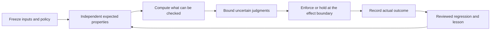

# Deterministic boundaries for everyday agentic work

Decision: [0031](../intent/decisions/0031-bind-working-methods-to-deterministic-boundaries.md).
This extends the [uplift program](agentic-engineering/README.md), not its implementation claims.
The new executable work is the [quality-boundary refinement](quality-boundaries.md#excellence-pass).

The opportunity is broader than Git hooks: make the **control of work** reproducible
even when its observations and semantic judgments vary. Determinism, correctness,
truth, authorization and reproducibility remain different properties. A perfectly
repeatable bad policy still produces bad decisions.

## The small contract every composition needs

DW-1. **Subject and trust.** Name exact inputs, source versions, trusted policy,
executable/provider capabilities, actor, target and clock assumptions. Reject unsupported
inputs rather than silently projecting away information. Hashes identify bytes; trusted
issuance establishes authority; neither establishes factual truth. Check the proposed
artifact rather than a nearby working copy or a validator built by the proposal itself.

DW-2. **Independent coverage.** An owner declares required IDs and applicability before
results arrive. Compute missing/duplicate/mismatched results by set comparison. Retain
`pass`, `fail`, `unknown`, `not-applicable` and the reason for exclusion. Discovery is
not the expected inventory. In quality-gate, required model receipts now get this check;
its unselected-path report is visibility, not proof that the policy catalog is complete.

DW-3. **Pure checks before judgment.** Use schemas, types, parsers, capability matching,
policy predicates and dependency graphs for computable properties. A model proposes
classifications, counterexamples, missing links and questions. Its favorable answer cannot
waive permissions, freshness, coverage, budget or required deterministic failures.

DW-4. **Finite uncertainty.** Declare eligible investigation steps, evidence needed,
call/time/spend limits, escalation causes, stop conditions and the human question to ask.
Distinguish ambiguity, conflict, absent evidence, refusal and unsupported capability.
Escalate within authority; a larger model never receives a prohibited tool or disclosure.

DW-5. **Bound effects.** Bind a proposal to actor, operation, exact arguments, target
version, purpose, policy epoch, expiry and budget. Changed state invalidates acceptance.
Use destination-owned idempotency and reconciliation for ambiguous outcomes. Replaying
a decision does not prove an external action happened once or authorize another send.

DW-6. **Reproduce and challenge.** Retain sanitized inputs/results and a negative
counterexample. Test invariants: removing required evidence cannot improve a decision;
changing policy invalidates reuse; stale approval cannot commit; missing configuration
cannot appear healthy. Use fixture replay for control behavior, independent held-out
observations for model quality, and observed destination state for effect claims.

DW-7. **Reuse within known scope.** Cache exact content/recipe/provider/model/policy
bindings with expiry and revocation semantics. Invalidate the declared dependency closure;
models may widen it, never remove required dependents. Reuse is an observation, not a
new independent trial. Compare accepted outcomes, total cost and human attention.

DW-8. **Learn through review.** Hook failures, issue intake and corrections produce
untrusted candidate lessons with source/deduplication/deletion records. A reviewer
redacts them; an independent regression demonstrates value; the receiving project owns
adoption. Journals and model-generated instructions do not silently change trusted rules.

## Apply the pattern using existing work

These are concrete composition designs. Existing building blocks are available;
the linked uplift work order retains unimplemented integration and adoption exits.

| Use case | Existing home | Deterministic floor and negative proof |
|---|---|---|
| Repository delivery | [Quality boundaries](../quality-boundaries.md), existing tests/scanners | Trusted policy and exact objects; omitted required site, poisoned Git PATH and bad push cannot pass |
| Review and investigation | [Practice catalog](agentic-engineering/practice-catalog.md), [decision design](agentic-engineering/providers-decisions.md), fitness registry, convergence oracle | Independent required criteria, evidence identities, finite ladder; missing criterion/budget cannot be bypassed by confidence |
| Data and generated prose | [Evidence lifecycle](agentic-engineering/evidence-learning.md), [prose harness](agentic-engineering/prose-harness.md), evidence-span/record-fingerprint, governed-prose-kit | Schema/freshness/lineage checks and exact publication target; one changed fact invalidates every declared dependent |
| Human or unattended app action | [Bound transactions](../intent/decisions/0008-bound-approval-transactions.md), [workbench](agentic-engineering/human-workbench.md), existing HITL | Exact proposal and destination authority; wrong actor, changed target, stale acceptance or ambiguous send cannot commit again |
| Coding-agent setup | [Security and hosts](agentic-engineering/security-hosts.md), agent-hooks, native host adapters | One authored policy with explicit host capability coverage; a missing hook invocation is unsupported, never inferred active from a file |
| Repeated learning | [Lesson transfer](lesson-transfer.md), existing journals and regression corpus | Receiver-owned acceptance and current revocation; duplicate, edited, deleted or untrusted issue content cannot self-promote |

The app owns domain authority and application lifecycle. Catalog Kit projects versioned
criteria and explicit tailoring, Review Kit evaluates them, Fathom supplies source/index
evidence when present, and app-kit presents evidence/questions/receipts. No-Fathom and
provider-none paths stay useful. None of these integrations requires installing the
whole kit or surrendering the application's process to an agent framework.

## The highest-value next capabilities

DW-9. Prioritize **coverage and conformance recipes**, not a new universal engine:
one small profile per workflow with its required IDs, exact inputs, enforcer, planted
failure and result receipt. Reuse existing Catalog Kit/fitness/agent-harness contracts.
The current [uplift work order](../plans/agentic-engineering-uplift.md) already owns this
integration; this document does not mark AE work complete or start another incubation.

Examples worth admitting through that work order: a review profile that refuses omitted
security/data criteria, an investigator that asks one evidence-reducing human question
after bounded escalation, a prose correction that rebuilds the known dependency closure,
and a host configuration profile that proves each configured hook actually fires.
Each needs a named adopter, baseline, bounded cost, maintainer and a failure witness.

Start in one project: name one recurrent failure, choose the smallest existing contract,
write the failing case, enforce it at the actual boundary, then measure review effort and
false holds. Keep uncertain classification in shadow until its site-specific study
justifies promotion. Record a keep/revise/retire decision when its declared bar is missed.

## Prior art and rejected shortcuts

Checked 2026-10-22. These sources inform the design; no dependency or adoption is implied.

| Source | Useful pattern | Limit retained here |
|---|---|---|
| [OPA policy tests](https://www.openpolicyagent.org/docs/policy-testing) | Executable positive/negative policy examples; fail on empty test discovery | A passing policy test does not prove enforcement at the effect boundary |
| [Temporal replay](https://docs.temporal.io/workflows) | Recorded observations let control flow replay; external I/O stays outside deterministic workflow logic | Replay does not replace destination idempotency or prove a fresh real-world fact |
| [SLSA artifact verification](https://slsa.dev/spec/v1.2/verifying-artifacts) | Verify artifact identity, issuer and independently formed expectations | Provenance without verification or trusted expectations grants no authority |
| [CEL](https://cel.dev/overview/cel-overview) | Compile an expression against a declared environment and evaluate it repeatedly | Use an established external engine when needed; do not invent an unrestricted `eval` or violate the kit's zero-dependency rule |

Reject model votes as proof, one universal confidence threshold, self-healing policy
without review, journals as instruction authority, copied calibration hashes without
new evidence, and replay counts as independent evaluation samples. Reject a claim that
all gaps are closed: assurance is always a declared scope, instrument and residual risk.
