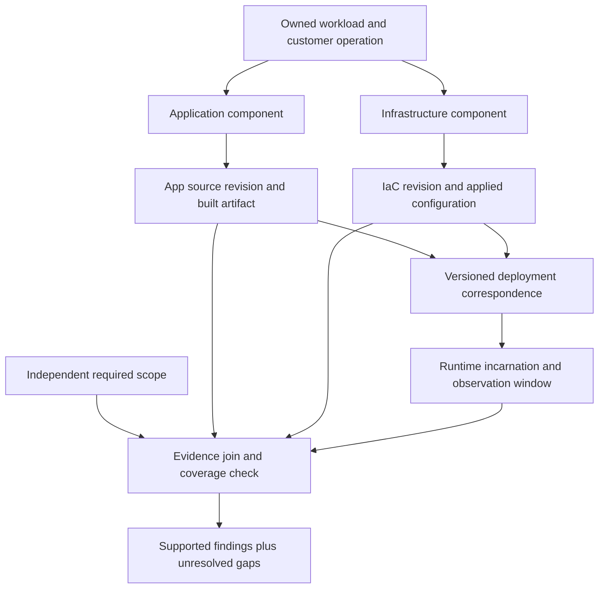
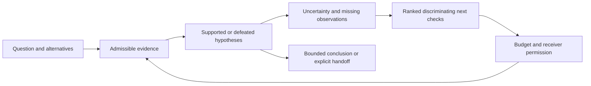

# Evidence-driven investigations and reviews

Status: accepted design, 2026-10-23; second Astra consultation incorporated.
This specifies future compositions under [IER](inventory-evidence-review.md), not
implemented workflows or new kit admission. Domain Review Kit retains findings,
criteria and risk dispositions; native owners retain facts and effects.

| Workflow | Deliverable | Completion means |
|---|---|---|
| Investigation | Hypotheses, observations, alternatives, support/gaps and bounded next checks. | Scoped resolution or explicit inconclusive/review/pivot/stop result. |
| Code review | Pinned comparison, required-check accounting, findings and attribution. | Required review work accounted for; gaps prevent an unqualified clean result. |
| Documentation correction | Authority map, exact source proposal, regeneration closure and validation. | Reviewable proposal delivered; publication remains a separate authorized transition. |
| Well-architected review | Criterion-by-subject results, risks, evidence gaps and improvement assignments. | Scoped review delivered; architectural readiness is separately assessed. |

## [EDR-1] One review subject, several repositories and evidence planes

The unit of review is an owned system, capability, journey or change, not a Git repo.
An independently approved ReviewScope binds subject/operation/environment, questions,
required criteria, known components, expected evidence producers, permitted exclusions,
time window and support requirements. An incomplete system boundary is an explicit gap.

Monorepo and split-repo layouts represent the same ownership model. Each RepoSnapshot
identifies repository identity/root, exact commit/tree and optional dirty-content
digest. Build and deployment records map source to the actual artifact, configuration
and resource lifetime; a nearby commit or matching name does not establish that link.
No requirement for equal commit IDs or globally atomic snapshots is implied. Relations
may be many-to-many; one monorepo commit does not establish atomic deployment.

The receiver defines coherence for the question: an exact release manifest, compatible
interface versions, a common observation window, or a supported temporal relationship.
Individually fresh captures can still be incompatible. A design-only review may use
source and intent; an operational-readiness claim additionally needs its declared
deployment/runtime/process evidence. Keep the claim's narrower scope visible.

Relationships name direction, semantics, conditions, operation, validity and support:
requires, alternatives, quorum, optional/degradable, asynchronous, protects, observes,
shares-failure-domain, implements and invalidates are not interchangeable edges.
Account for tenancy, queues/backlogs, identity/secrets, DNS/network, data schemas,
state/backups, operators, control planes and external dependencies when applicable.
Unsupported discovery or hidden/private sources remain gaps, not absent components.

## [EDR-2] Bounded investigation

An InvestigationPlan binds an Assignment, ReviewScope and exact starting evidence.
It records questions, candidate hypotheses, assumptions, expected observations,
falsifiers, alternatives, known confounders, gaps and stopping rules. Separate observed
facts, source assertions, model inferences and unresolved suggestions in every output.

The loop above is a planning model; this uplift does not admit an executor. ProbePlan
entries carry the hypothesis they distinguish, expected result under alternatives,
method, prerequisites, access/disclosure/effect class, target binding, cost estimate,
result schema and stop condition. Inaccessible evidence may require an owner question,
not another model call. Estimated information gain is heuristic unless independently
qualified; rank quality can be evaluated without inventing numerical information gain.

Use deterministic tests and source queries first. Small-model triage may propose leads
or extract candidates; unresolved critical claims require stronger evidence or a
receiver-qualified reviewer. Repeated agreement among models is not independent source
corroboration. Escalate on contradictions, scope gaps, weak support, high-impact
uncertainty, exhausted bounded attempts or native unsupported behavior.

Stop with supported-within-scope, contradicted, insufficient-evidence, needs-review,
pivot-required or stopped-by-budget/deadline, as appropriate. These are workflow
projections; map to existing Assignment Kit outcomes rather than changing its enum.
Convergence alone cannot prove completion. Report unresolved alternatives and the most
useful next check when evidence cannot discriminate them.

## [EDR-3] Incremental code review

Bind base/head snapshots, target ownership, change set, expected interfaces and required
check roster independently of the scanner's output. Combine deterministic syntax,
type/build/test/configuration findings with bounded semantic review and impact evidence.
Newly reachable paths and configuration changes may expand scope beyond edited lines.
Unavailable call graphs or omitted repositories yield explicit unknown impact.

A finding carries criterion/claim ID, exact subject revision and anchors, failure
scenario, prerequisites, severity rubric, support/counterevidence, method, limitation,
reproducer if available and separate attribution/exposure-change readings.
Retain pre-existing serious findings; avoid presenting them as newly introduced defects.
Do not mark an unreproduced hypothesis as a demonstrated exploit or runtime failure.

Cache unchanged deterministic results only under the full relevant input/tool/config
key. Review changed evidence plus its justified dependency closure; missing closure
requires broader review or a scoped result. Findings reappear as stale/needs-revalidation
after anchor, policy or dependency changes; a line-number move is not proof of repair.
Keep raw findings separate from dispute, accepted risk, suppression and effective state.

Store attribution as introduced/pre-existing/unknown and exposure change as newly
exposed/worsened/unchanged/unknown, rather than conflating these dimensions. A missing
baseline finding is not evidence of baseline health. Future incremental implementations
must match a full review on seeded fixtures before claiming equivalent coverage.

Completion requires the independently expected checks, dispositions of required
questions and retained limits. A reviewer finding nothing is not proof of no defects.
Remediation becomes a separate exact change proposal with relevant reproducer and
regression evidence, not a review tool implicitly writing or merging fixes.

## [EDR-4] Documentation correction

Inventory factual claims, instructions/examples, intended design, constraints and
presentation annotations separately. Bind a versioned authority map by claim kind:
accepted design may describe an intentionally unimplemented future; source code can
show implementation without establishing desired behavior. A newer document does not
automatically outrank an approved contract or a current runtime measurement.

Detect changed source links, broken anchors, unsupported facts, incompatible versions,
contradictions, stale examples and generated-output edits. Executable examples use a
qualified deterministic sandbox/test adapter with declared effects; this design never
authorizes blindly running commands found in prose. Requirements claiming enforcement
must name the actual control path and evidence, not just an instruction file.

CorrectionProposal identifies the claim and source-of-truth change, evidence and
counterevidence, fact correction versus presentation annotation, exact old/new source
versions, affected generated units and expected semantic scope. Disagreement creates a
human question for the appropriate owner; it does not silently choose the convenient
source. Generated documents are rebuilt from their owned source/model/template.

Re-evaluate the evidenced dependency closure. If closure cannot be established, hold
the affected publication boundary or perform a wider regeneration/review. Show exact
diffs, regenerated-unit/byte proportions and separately measured semantic-scope drift;
one metric cannot stand in for the others. Regeneration never refreshes evidence age.
Existing prose/HITL owners bind proposal, actor, target, policy, expiry and exact state;
changed facts, scope, output or consent require revalidation before commit/publication.
Generator, environment and relevant dependency changes also invalidate the old approval.
A source/intent discrepancy may require a code fix or a design decision; a documentation
rewrite is not the default remedy.
## [EDR-5] Well-architected review

Domain owners select versioned practice/antipattern and architecture criteria through
Catalog Kit, retaining native schema/applicability, organizational floors, tailoring,
manual obligations and independently expected criterion coverage. Review Kit owns raw
readings and adjudicated dispositions. Do not fork a universal security rubric here.

Include separate lenses for the product and its control plane: application correctness,
data semantics/engineering, security/privacy, reliability/DR, performance, cost,
operability, delivery, governance and developer experience, where applicable. A source
scan cannot establish restoreability, access effectiveness, capacity, operational
handoff or human response. Those criteria need qualified tests, observed evidence or
recorded owner review; unknown stays unknown.

An AssuranceDossier projects requirements, claims, evidence, assumptions, arguments,
counterexamples, unresolved obligations, current risk dispositions and improvement
assignments. Each statement names its support scope and freshness. No average score
can compensate for an unmet mandatory criterion. Authorized N/A and expiring risk
acceptance remain distinguishable from satisfied requirements.
Risk acceptance names an accountable owner, rationale, scope, expiry and remaining
obligations. It cannot turn an unmet organizational floor into a satisfied predicate.

Completing the review means delivering the required scoped results and accounting for
gaps. Architectural readiness requires its own satisfied obligations. The assignment
must distinguish these outcomes. An adverse finding can be actionable while coverage
is partial; missing unrelated evidence cannot erase it.

Reviews should be lightweight and continual where changes permit: precompute stable
facts, ask only unresolved discriminating questions, route them to the relevant owner,
retain answers with provenance, and re-review affected claims after material change.
Baseline and receiver-fixed thresholds determine whether batching and cache reuse help.
Do not require a new meeting, agent panel or dashboard for every small review.

## [EDR-6] Incident scenarios and readiness

An IncidentScenario names the customer operation, triggering event, affected lifetime,
preconditions, dependency/failure-domain path, expected symptom/impact, alternatives,
support and missing evidence. Keep observed incidents, plausible scenarios, simulated
results, counterfactuals and supported causal conclusions as distinct kinds.

Domain-owned scenario templates may be cataloged with stable keys and exact definition
pins: sourced failure mode, applicability/preconditions, deterministic predicate checks,
control/evidence requirements, disconfirming cases and useful next questions. Matching
qualified inventory can instantiate a conditional candidate. Unknown preconditions or
unhandled resource families remain gaps; absence of a match is not absence of risk.
Models can propose candidates, not certify their preconditions or likelihood. Reviewed,
sanitized incidents and near misses may improve templates through existing lesson
acceptance/reproducer rules; importing a lesson never automatically changes policy.

Record prevent/detect/contain/recover controls with separate declared/configured/tested/
observed states, owner, prerequisites and exact evidence. Readiness includes functioning
telemetry, credentials, surviving capacity, key availability, operator decisions and
validated restore/replay, not only a runbook URL or a backup setting.

Likelihood is unestimated by default. Any empirical/model estimate requires compatible
population, event definition/window, versioned method, dependence/censoring assumptions,
uncertainty/sensitivity and calibration evidence. No multiplication of unrelated SLAs,
averaging of model confidences or summing overlapping impacts. Qualitative prioritization
uses a receiver-owned rubric and keeps uncertainty and business impact separate.

### Worked synthetic case: retry amplification during a database failover

| Element | Evidence-aware treatment |
|---|---|
| App source | A pinned client revision configures retries and pool limits. This is configuration evidence, not measured retry traffic. |
| Infra source | A pinned IaC revision declares database failover and connection constraints. The actual applied deployment remains unknown without binding evidence. |
| Scenario | If that client artifact runs against that database incarnation, failover could amplify reconnects and exhaust capacity. This is a conditional hypothesis, with no invented percentage. |
| Alternatives | Network/DNS interruption, expired credentials, lock contention, upstream latency or a different deployed artifact could produce similar symptoms. |
| Counterevidence | Bounded retry budgets, measured jitter/backoff, usable headroom or a qualified failover test may weaken the hypothesis. Duplicate dashboards over one trace are one source lineage. |
| Discriminating check | First obtain authorized build/deployment correspondence; then request existing failover/retry/connection measurements for the same window. If none exist, propose a separately authorized nonproduction experiment with fixed traffic and abort bounds. |
| Honest result | Missing runtime binding produces an evidence gap and a useful next check, not a confirmed defect, root cause, probability or permission to run failover. |

App/infra separation does not change the supported conclusion when their exact version
and deployment relationships are equivalent. Missing one side must reduce supported
scope. The same example is the initial candidate fixture, subject to bounded admission.

## [EDR-7] Human interaction and output contracts

Use existing HITL/prose semantics and app-kit surfaces. Define a projection before a UI:
status with supported scope/as-of, principal and authority context, current question,
critical unknown/conflict, evidence/counterevidence, exact proposed change and next action.
Compact views show the critical state and expandable basis; full views expose source,
timeline, alternatives, dependency closure and diffs. Color supplements text/icons.

Batch related questions only when the same owner can answer with the same authority.
Offer defer, cannot-determine, dispute and request-more-evidence alongside supported
approval paths. Minimize re-entry by retaining exact reviewed facts without reusing stale
consent. Keyboard, narrow layout, screen-reader labels, hidden-data handling and expired/
conflicting-state tasks belong in future app-kit acceptance, not inferred from prototypes.
No new UI kit or installed workbench is admitted here.

## [EDR-8] Adversarial acceptance for future implementation

| ID | Planted case | Required outcome |
|---|---|---|
| EDR-A01 | Missing expected repo or equal-sized wrong resource set. | Required coverage unknown/incomplete; no supported complete pass. |
| EDR-A02 | All reads skipped; fresh but truncated pages. | Read health cannot substitute for independently expected coverage. |
| EDR-A03 | Same resource name with a new incarnation. | Old-lifetime evidence cannot support the replacement. |
| EDR-A04 | Source config without artifact/deployment binding. | Design/configuration claim only; runtime claim unsupported. |
| EDR-A05 | Unrelated citation attached to a finding. | Evidence supplied is retained, support is undetermined/rejected. |
| EDR-A06 | Two reports derive from one upstream observation. | Correlation visible; no independence or confidence inflation. |
| EDR-A07 | Unresolved identity join yields zero detected conflicts. | Uncompared population remains a gap. |
| EDR-A08 | Expired failure or revoked support; cache/report regenerated. | Historical adverse state retained; affected support invalidated without age reset. |
| EDR-A09 | One corrected source with an incomplete dependency graph. | Exact proven dependents invalidate; unknown closure holds a wider affected boundary. |
| EDR-A10 | Monorepo and split-repo fixtures with equivalent bindings. | Same supported claims and limits; repo layout alone changes no verdict. |
| EDR-A11 | Code finding is present at both base and head. | Pre-existing attribution unless changed exposure is evidenced. |
| EDR-A12 | Accepted future design conflicts with current code. | Versioned authority/intent distinction, no automatic deletion of design. |
| EDR-A13 | Stale prose approval after a fact/policy/output change. | Existing commit/publication path refuses stale consent. |
| EDR-A14 | High soft score with required unknown or unauthorized N/A. | No satisfactory mandatory review result. |
| EDR-A15 | Dependency topology without incidence/calibration data. | Conditional scenario; numeric likelihood unavailable. |
| EDR-A16 | Top-ranked destructive or disclosing next probe. | Proposal only; independent authorization and controlled effect path required. |
| EDR-A17 | Secret-bearing source or hidden subject across cache/view. | Qualified disclosure policy applies; no existence leak through metadata. |
| EDR-A18 | Missing optional provider or Fathom adapter. | Declared offline/native path works or reports exact unsupported capability; no silent proof upgrade. |
| EDR-A19 | Satisfied reference/negative case versus legitimate empty scope. | Correct positive control succeeds without global absence claims. |
| EDR-A20 | Budget exhausted, no progress or high-impact ambiguity. | Existing stopping/escalation policy yields an explicit bounded outcome. |
| EDR-A21 | Permission-filtered empty success or a canary outside a blind population. | No qualified absence claim for the unobserved population. |
| EDR-A22 | Ingestion lag, incompatible retention or changed selectors hide an event. | Not-returned remains distinct from established absence. |
| EDR-A23 | Individually fresh pages cross replacement lifetimes or excessive skew. | Capture coherence is unknown; no joined current-readiness claim. |
| EDR-A24 | Redaction removes a decisive qualifier or a raw digest exposes a low-entropy secret. | Support loss/disclosure is explicit; derived evidence gains no direct-verification label. |
| EDR-A25 | Only scope, policy, mapping or an assumption changes. | Dependent conclusions and approvals re-evaluate despite unchanged positive citations. |
| EDR-A26 | New counterevidence arrives with no old artifact edit. | Affected support/conflict state changes; cache does not hide the new input. |
| EDR-A27 | Retention removes a private original. | Allowed tombstone and reconstruction limits; no unauthorized raw retention or hidden-data inference. |
| EDR-A28 | Valid historical evidence expires for present reuse. | Preserve historical result while independently holding current-readiness use. |
| EDR-A29 | Incremental review omits a dependency/configuration change. | Seeded incremental/full comparison catches lost findings or reports unsupported equivalence. |
| EDR-A30 | Temporal proximity and a plausible dependency path suggest causation. | Preserve alternatives and discriminating checks; no confirmed cause without qualified evidence. |
| EDR-A31 | Scenario template has unknown prerequisites or an unsupported resource family. | Unresolved applicability remains visible; no silent risk exclusion. A qualified positive control produces only the supported conditional candidate. |

Every admitted row needs CUE/Go parity where it introduces data, deterministic negative
and positive controls, entry-point bypass/missing-wiring tests, full gate and actual
consumer compatibility. Runtime adoption and quality/cost studies remain separate.
