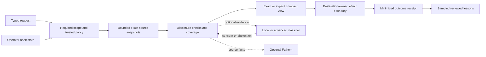

# Governed command tools and hook controls

Status: accepted delivery specification, not a completed platform.
Authority: [0039](../intent/decisions/0039-governed-command-tools-preserve-evidence-and-authority.md).
Builds on [CG-1..16](command-governance.md), not a competing policy engine.
Research: [primary sources and dispositions](../research/2026-10-23-governed-command-tools.md).
Delivery and remaining work: [GT work order](../plans/governed-command-tools.md).

## Product and boundaries

Give an agent a small vocabulary of useful operations whose effects, disclosure,
resource use and results can be checked. Give the operator one understandable view of
effective policy and hook health. Prefer an in-process operation over permission to
execute a general command. Preserve a separate, clearly unsupported path for arbitrary
shell work. This is progressive replacement, not proof that a shell string is safe.

The first consumer is the kit's synthetic source-review workflow. Later consumers
include code/doc investigations, controlled agent tool calls and HITLMAN's evidence
inspection. A source read can exfiltrate data to a model even if it changes no file.
The controlled path therefore checks disclosure as carefully as mutation.

In an inspection-only CLI, rendering is the disclosure effect. A future write/send
adapter additionally authorizes its exact destination and reconciles uncertain effects.
Neither the scanner nor the renderer grants organization-wide authority.

## GT-C1: typed operation catalog

| Operation family | Required behavior | Disallowed shortcut |
|---|---|---|
| Read range, literal search, selected inventory | Explicit rooted paths, finite scope, exact bytes, whole-selected-input scanning, ordinal source/line references | Shell interpolation, glob discovery, arbitrary regex execution, ambient cwd trust |
| Git status, object diff, history | Fixed recipes, pinned executable or object reader, exact repository/objects, bounded capture, disabled helper/config execution, qualified dirty-state behavior | Assume `git diff` is passive; pass arbitrary Git options |
| Build/test/check | Trusted recipe/code identity, explicit executable/environment, all-output checks, process-tree cancellation and host isolation where required | Treat `go test`, package scripts or compiler plugins as read-only |
| Patch/quarantine | Exact versions and preview, protected targets, independent authorization, destination atomicity, replay identity and recovery | Rename a general `rm`/write wrapper “safe” |
| Send/publish/network | Explicit origin and destination, redirect/DNS/proxy/TLS policy, payload/metadata disclosure, credentials outside candidate control, exact approval and reconciliation | A scanned body authorizes its recipient; authorize only the initial redirect |

[0040 and the GT6 read contract](command-git.md) admit status, object diff and history
through registered operator-protected metadata, fixed recipes and selected-data
disclosure checks. Live status remains non-atomic; mutation/publication stays in GT16.

Each versioned descriptor names supported hosts, effects, source/sink classes,
required controls, caps, stop states and positive/negative qualification cases.
Discovery metadata is not execution permission. Unsupported operations remain explicit.

## GT-C2: first controlled inspection

`command-guard inspect` accepts explicit root, scope, policy and request controls.
No policy discovery, subprocess, model, network, write or hook installation.
Scope independently supplies exact required layer/rule sets. Constraints intersect,
denials union and limits take the minimum. Caller-supplied names do not authenticate
their purported organization. The operator must protect the inputs outside candidate
write authority before using this as a controlled disclosure path.

Requests select <=32 printable-ASCII relative files, paths <=1024 bytes, and expected SHA-256 content identities.
Read <=4 MiB/file and <=64 MiB total, rejecting overflow with at most one probe byte.
Retain opened snapshots in bounded memory. Use `os.Root` for rooted access and validate
regular-file mode, exact bytes and text encoding. Do not print paths, query terms,
source digests, errors or findings. Denied prefixes are policy data, <=64 per layer,
and compare whole components ignoring ASCII case on all hosts. Duplicate path aliases
under that fold are refused. This can overblock case-distinct names; Unicode path aliases
remain unsupported. Open one directory component at a time, comparing pre-open Lstat
identity to the held child root, then the final file handle before reading. Root
confinement does not resolve hardlink/mount sensitivity, concurrent moves of the same
inode, malicious filesystems or every alias. A digest binds bytes, not confidentiality.

Compile <=64 supplied DLP rules of <=2048 bytes, requiring the exact independent
inventory. Scan all selected bytes before rendering any range or match, including
unrequested lines and later files. A finding or incomplete check suppresses the entire
content result. Reject non-text/NUL and terminal/bidi control content. No streaming
raw prefix before late findings. Do not retain excerpts in public receipts.

Read ranges and single-line literal search produce zero-based source ordinal,
one-based line and content rows. `bytesRead` includes a possible one-byte cap probe;
`bytesScanned` counts only bytes actually evaluated by configured rules.
The bounded view reports total candidate rows, returned/omitted counts and truncation.
JSON encoding escapes presentation controls. Count the serialized content envelope
against the output budget; fixed failure receipts can exceed an impossibly small
content budget. A view is not complete merely because input scanning was complete.
All input/disclosure checks finish before the first content write. A sink can accept
an already-checked prefix then fail; exit 2 cannot retract bytes already delivered.
No automatic retry or atomic sink-delivery guarantee follows.

Stable 0/1/2 exits distinguish no configured findings, a deterministic hold and an
incomplete check. Reports state `selected-files-only`, `configured-regex-only`,
`noActionAuthority: true` and `not-proof-of-secret-or-pii-absence`. These qualifiers are
part of the machine contract. Actual schema/fixtures live beside the command.

## GT-C3: scanners, ambiguity and escalation

Established external scanners are optional pinned adapters, not Go dependencies.
Pin executable/config/rules/version and fixed invocation recipe outside repo control.
Gitleaks stdin is a candidate for bounded content. Check the complete input, both
output channels and normalized report; exit status alone cannot distinguish every
finding from operational failure. Archive/decoding/size/ignore/allowlist scope must be
reported. No downloads, updates, repository-supplied plugins or active credential
verification as incidental scanning. PII is a separately selected criterion family.

Scan before compression, caching, optional evidence enrichment or model dispatch.
Content delivered to a scanner/model is itself a disclosure needing destination policy.
Missing required scanner, timeout, unsupported encoding, skip or report mismatch holds.
Optional missing checks remain visible; never rename “not checked” to “clean”.

Optional decision sites use existing typed decisions and model ladders. Deterministic
findings dominate. Pin local endpoint/runtime/model/prompt/cohort/thresholds/input bounds,
calibration and all-attempt budget. Local-only policy prohibits hosted fallback and
requires measured process residency/egress/logging, not merely a loopback URL. A stronger
judge or human may explain, investigate or apply a separately permitted exception.
It cannot prove exhaustive secret absence or erase a mandatory floor.

Default None/replay remains useful. Kill a site if false clears, false holds,
abstentions, latency, privacy or cost violate predeclared cohort bars. Confidence
thresholds belong to exact criteria and calibrated sites, not one global safety number.
Explanations expose evidence and rule traces, never purported hidden model reasoning.

Structured-PII review, 2026-10-24: reject a standalone Luhn detector as the next default
profile. Its check digit accepts about a tenth of uniformly distributed eligible
numeric runs; the proposed <=1/1,000 benign numeric false-hold bar is unrealistic.
No runtime detector is admitted by this review. A context-bound checksum criterion
needs an actual receiver, an independently declared context and forms (including
whether 12-digit values are covered), complete file/Git/metadata scanning, truthful
unsupported-form holds, no source on failure and a frozen benign/positive cohort.
Do not silently discard values or add issuer rules to manufacture a good benchmark.
[Presidio's primary entity reference](https://presidio.dataprivacystack.org/supported_entities/)
distinguishes pattern, checksum and context techniques;
[Google's detector guidance](https://docs.cloud.google.com/sensitive-data-protection/docs/concepts-infotypes)
requires explicit selection/testing and does not promise sensitive-data absence.
These are design references, not dependencies or measured results for this kit.

### GT-C3a: Gitleaks stdin qualification profile

Admission 2026-10-24: GT5a extends the existing W1 inspection receiver with optional
`gitleaks-stdin-8.30.1`, source tag commit `83d9cd684c87d95d656c1458ef04895a7f1cbd8e`.
No new slot, root dependency, installation, hook or live classifier. The operator
supplies protected policy/scope and a trusted absolute executable plus SHA-256.
Scope's optional `requiredScannerIds` is exactly empty/absent or `["gitleaks"]` and
must match the optional policy scanner. Configured means required for that invocation.

The scanner config fixes kind/profile, executable/hash, a positive scanner-wide
`timeoutMillis` <=30000 and `maxReportBytes` <=1048576. Default fixtures use no scanner.
Copy verified bounded executable bytes into a fresh private directory before use;
run only that copy. Validate exact version. The scan recipe uses stdin, stdout JSON,
100% redaction, no banner/color, info logging, findings exit 3, archive/decode depths 0
and internal timeout 0. Ignore inline `gitleaks:allow` comments on this controlled
path. The adapter owns one deadline for preparation/version/all
selected-file calls. No arbitrary argv, custom TOML, transitive config, baseline,
ignore file, diagnostics, active credential verification or environment config.
Rules are the binary's embedded defaults, including its native allowlists. Additional
org/PII requirements remain explicit guard regex criteria, not inferred Gitleaks scope.

Run from the private empty working directory with minimized environment and private
HOME/TMP paths. No report files. Bound stdout and stderr independently in memory,
reject excess/invalid/duplicate/trailing JSON, non-array reports, excessive findings,
unexpected log messages, error/partial-scan diagnostics and process/report mismatch.
After every selected-file regex check passes, send each exact captured snapshot;
count attempts, actually started/completed calls, submitted/observed bytes and findings
separately. Submitted bytes describe the attempt input, not proof of delivery; observed
bytes require the validated scanner receipt. Version probes are outside file-call counts.

The pinned human-log grammar is a version-specific receiver contract. Require one
normal info scanned-byte summary equal to the exact supplied length and one final
no-findings info or matching findings warning, consistent with the bounded JSON array
and exit 0/3. Unknown grammar holds. Source inspection showed byte accounting occurs
before rule evaluation and some fragment errors are only logged: byte equality alone
does not attest completion. Require all process/log/report/deadline checks together.
Cancellation, skipped bytes, unsupported MIME, stderr overflow or missing receipt
withholds all content with exit 2; findings withhold it with exit 1. Nothing clears a
guard regex blocker. A clean result describes only this qualified raw-text/default-rule
profile, not encoded/archive content, every rule's semantic correctness or secret absence.

Native Mac qualification already reproduced a text-only `%PDF-1.7` input yielding
exit 0/empty findings but zero scanned bytes. That is a mandatory negative case.
Acceptance also needs clean/empty/multifragment text, independent planted findings,
ambient config/ignore resistance, byte/report/version/hash mismatches, timeout and
both output-channel limits, fixed diagnostics and no output before all checks finish.
Tests use injected runners or the test executable, never downloaded tools/network.
Separate attended qualification may use a checksummed external binary in scratch.
No child filesystem/network sandbox, hard memory ceiling or other native host support
is implied. Only an operator-trusted scanner belongs on this subprocess path.
Existing `bounded-exec` was inspected before choosing this command-local transport:
it intentionally treats `exec.ErrWaitDelay` as a possibly incomplete success and has
no explicit process-start witness. This receiver requires both to remain distinguishable.
Its narrower fail-closed transport changes no shared runner API or consumer behavior.

## GT-C4: economical and faithful output

[CV-1..5](command-compact.md) admits GT13a's lossless selected-row tuple encoding and
independent baseline. Full observation-cache and production economics remain open.
[OR](command-observation-reuse.md) separately admits GT13b's optional, bounded
invocation-local scanner observation reuse and repairs missing start witnesses first.
It does not close the broader cache or accepted-task economics requirements.

Use structural projection, deterministic grouping, bounded duplicate suppression and
progress removal only where the operation's semantics permit them. Preserve exit
status, required diagnostics and coverage. Label exact/compact/held/incomplete distinctly.
Return counts and retrieval coordinates for omitted authorized data. A subsequent
detail request passes the same disclosure and freshness checks. Do not offer a raw
output bypass. Repository-local reducers are untrusted until the operator approves
exact bytes and scope. No automatic RTK code or license adoption.

Report input/output bytes, selected view and omitted rows. Token counts are explicit
estimates unless a pinned tokenizer measured them. Measure total accepted-task cost,
retries, missed diagnostics and human effort against an unreduced baseline. Less output
alone is not an economic win. Cache bounded content observations only with exact input,
scanner/rule/runtime identity and disclosure scope; recheck policy, freshness and
recipient at reuse. No stale allow receipt or sensitive public digest cache.

## GT-C5: one operator control surface, several authorities

[0041 and HC-1..4](harness-control.md) admit the command-local `harnessctl` signed
configuration profile. HC-5 records GT9/10's required native approval and recovery
boundary; neither the config checker nor its signature verification installs hooks.

Discover conventional system/user/project paths only in a separately admitted
controller. Explain every required, loaded, absent, unverifiable and delegated layer.
Machine installation/operator, organization, team, project and personal sources retain
their own issuers and ownership. Candidate-owned AGENTS.md is a reviewed subject.
Merge immutable mandatory constraints by intersection/minimum, deny by union. Missing
required sources, conflicting floors or evaluator diagnostic errors hold. Preferences
override only within exact signed delegation fields, values, targets and expiry.

Controls declare purpose, event bindings, owner, mandatory/advisory class, fault behavior,
sample unit/rate, bounded work and receipts. Admission verifies actual Claude/Codex/other
host interception; installed config does not prove an event fired. Existing `agent-hooks`
stays economic guidance and fail-open on its own faults. Never inherit its denial-loop
release for security. Reuse its routing/report interfaces without silently changing them.

| Operator action | Semantics |
|---|---|
| Status/explain/doctor | Show effective constraints, provenance, supported event paths, invocation gaps and stale state without raw command history |
| Lockdown | Immediately narrow controlled authority; never interpreted as permission to disable safety |
| Tune/sample | Adjust explicitly delegated advisory controls; preserve mandatory scans, authorization, protected config and publication gates |
| Maintenance | Exact named advisory controls/delta, authenticated approver, host/project/principal, policy/config hashes, nonce, reason, deadline and rollback |
| Rearm | Independently evaluate exact candidate bytes, negative probes and expected events; atomically promote only that evaluated state |
| Expire/revoke/recover | Enforce prior trusted floors at every boundary; ambiguous state holds; crash and clock rollback cannot extend a lease |

Use native authentication adapters: macOS LocalAuthentication/Authorization Services,
Windows consent/Hello, Linux a deployment-selected polkit/PAM authority. Device-user
presence is not the policy grant. Never collect/store passwords in the kit or fake a
successful biometric path. Unsupported authentication holds changes requiring it.
Protect signing/trust roots and transition storage outside agent write access. A
same-user process able to replace the dispatcher remains outside this threat boundary.
No global bypass environment variable and no modification of this repo's gate.

## GT-C6: learning without surveillance

Sample advisory observations using a deterministic keyed unit per session/event/site,
not retry-until-selected randomness. Failures and dropped-event/existence counts have
independent accounting. A sample cannot support a whole-history statement. Require a
privacy budget, caps, retention, deletion owner and rate before collection. Default no
private transcript or shell-history discovery. Raw commands, secrets, paths and model
payloads do not enter the flywheel. Store closed categories and necessary bound receipts.

Catalog rules and paired failure cases through existing Catalog Kit, review goal
applicability through existing intent/Assignment Kit and assessments. Candidate lessons
are sanitized proposals with provenance and regression tests. Human/receiver review
promotes them; journals, popularity or model recommendations cannot update policy.

## GT-C7: platforms, performance and acceptance

Go is the present implementation language. Separate host adapters, fixed command
recipes and optional dependencies. Report each capability as built, tested-on-host,
enforced-on-path, unsupported or unknown. macOS/Linux/Windows native tests must exercise
path/device/alias behavior, cancellation, output channels, authentication and hook events
before the corresponding support claim. Cross-builds are useful compilation checks.
`os.Root` does not confine a subprocess or prevent every special filesystem access.

Declare pre-run workload/device/runtime and p50/p95/max latency, peak memory, cold/warm
cost and fidelity bars. Benchmark fast no-model reads separately from external scanning
and inference. Avoid daemon dependencies on the common path. Filesystem I/O may stall
on hostile remote filesystems; do not advertise a hard wall-time guarantee without a
qualified host execution boundary. At every cap, return explicit held/incomplete state.

Adversarial cases include omitted/duplicate layers and rules, policy errors, path escape,
late secrets outside the view, changed bytes, symlink/FIFO/device inputs, malformed
Unicode/JSON, output failure, hidden diagnostics, scanner timeout/skip, local-model
failure, stale cache, consent replay, expiry/revocation/clock rollback, concurrent
maintenance, crash recovery, unobserved hook paths and malicious learned proposals.
The work order assigns executable proof and keeps platform/installation claims separate.
