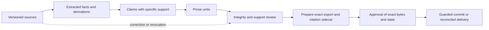

# Governed workflows: the next product layer

Status: accepted direction with implemented profiles, providers, sourced prose,
HITL, CLI, lesson transfer and native-host adapters; delivery evidence is tracked in the
[executable work order](../plans/2026-09-governed-workflows.md). Owner-sponsored 2026-09-12.
Authority: intent decisions [0004](../intent/decisions/0004-bounded-incubation.md),
[0005](../intent/decisions/0005-workflow-assurance.md), and
[0006](../intent/decisions/0006-evidence-and-lessons.md).
Baseline findings: [assessment](../assessments/2026-09-12-agentic-kit.md).

The kit has enough ingredients to offer a much easier product: choose a workflow,
connect the necessary capabilities, and receive an inspectable result with evidence
of the controls that actually ran. The next investment is in composition, adoption,
and verification. Exact APIs live in the [prose contract](sourced-prose.md),
[approval contract](approval-commit.md), [native-host contract](native-hosts.md) and
[lesson contract](lesson-transfer.md); the discussion below is architectural context.

## 1. Shared contract, three entry points

| Entry point | Consumer experience | Ownership |
|---|---|---|
| Go workload | typed profile construction around existing kits and injected adapters | kit owns validation; consumer owns process, credentials, persistence |
| Claude Code / Codex | native skill and hook bundle, scoped instructions, explicit capability receipt | host owns its loop and native permissions; kit translates and tests its policy surface |
| Other languages/tools | local prose and lesson checks through a CLI JSON envelope | no requirement to adopt Go internally; actual wire fixtures pin semantics; no new MCP/HTTP workflow endpoint |

Extend `cmd/kit-new` and the existing MCP/tool surfaces where practical. Avoid a new
general workflow DSL, dependency injection container, or universal agent runtime.
Keep small profiles for governed engineering, sourced prose, and approved changes.
A profile selects controls; callers still supply domain policy and credentials.

The delivered profiles have distinct typed contracts, not a universal workflow DSL.
`EngineeringProfileConfig` fixes exact registered tools, effect/injection policy and
attempt bounds; its versioned `CoverageReceipt` records observed controls and accounting.
Native host policy/plan/receipts separately bind installed configuration, binary, version
and observed/unsupported entrypoints. Prose/HITL and lessons have their own evidence and
authority bindings. Shared valid/invalid and actual marshaled fixtures check CUE/Go
agreement. Callers persist only the evidence their decision needs, with redaction.

Configuration is inspectable and reversible: show a diff, preserve user-owned entries,
track generated-file ownership, detect drift, and support removal of only generated
content. Local installation requires the receiving workload's authorization.

### Host integration

Provider clients and coding-host adapters solve different problems. `claudecli` and
`codexcli` currently reject caller-supplied tools and flatten text conversations.
They are completion providers. Keep them; do not claim they govern the host's tools.

Claude Code and Codex adapters should map common policy intent to supported native
skills, hooks, MCP servers, permissions, and run receipts. Probe the installed host,
including feature flags and trust approval, rather than assuming parity from filenames.
Never broaden permissions to make an unsupported profile appear installed.

The conformance matrix enumerates startup/resume, nested instructions, tool calls,
edits, shell and long-running stdin paths, compaction, stop, and configuration drift.
For each event, test a positive case and a blocked case, then malformed input/output,
timeout, missing executable, disabled hook and unsupported tool path. Offline fixtures
and live observations are separate; [recorded native evidence](../evidence/native-hosts/2026-09-13/README.md)
explicitly leaves unobserved behavior unknown. A permission
boundary must live outside model-writable instructions. Reuse native sandboxing and
service-side authority instead of calling a hook or `bounded-exec` a sandbox.

Current official documentation supports hooks on both hosts but documents incomplete
tool coverage and failure cases that allow execution. This is why G5 produces a
versioned coverage receipt; see the assessment's platform sources. A missing guard may
be acceptable for advisory assistance, but cannot certify a required control.

Provider conformance separately records tool support, structured output, refusal,
truncation, streaming, cancellation, provider/family identity, usage and retry behavior.
Prioritize a Responses API lane for modern OpenAI workflows while preserving the
Chat Completions adapter. Unknown provider family cannot count as an independent judge.

## 2. Flagship: evidence-backed prose

Compose the existing evidence, prose, review and provenance foundations into
`kits/governed-prose-kit`. The first fixture is a synthetic facts-to-document workflow
shaped like resume_as_code; the next adds throughline-style conflicting evidence.
Neither consumer is claimed to have adopted the new pipeline yet.

### Minimal data model

| Object | Required identity and evidence |
|---|---|
| Source snapshot | source ID, content digest, version, media type, acquisition provenance and access/retention policy |
| Evidence span | existing canonical span and grade; v1 uses inclusive UTF-8 source-byte ranges, while claim ranges have exclusive ends; PDF/page/cell extraction must first preserve provenance into an authorized text snapshot |
| Fact / derived fact | asserted value and units, supporting spans, author; derivation inputs and deterministic transform/version when computed |
| Claim | explicit assertion, support edges, contradicting evidence, status and reviewer/evaluator provenance |
| Prose unit | stable unit ID within document revision, text, claim IDs and text ranges; explicit non-factual classification where justified |
| Artifact receipt | document/evidence/prompt/model/config digests, check results, approval and export revision |

Prefer extending existing types and composing an evidence-provider interface before
introducing new foundations. Do not silently migrate the legacy evidence-graph Span.
Choose locator conventions and canonical hashing in the first contract fixture.

### Generation and checking

1. Resolve authorized source snapshots and evidence before generation. Missing or
   inaccessible evidence is a typed incomplete input, never an empty successful search.
2. Supply actual approved facts and spans, not only their IDs. Request structured units
   with claim/support references. Store the request and returned mapping's provenance.
3. Deterministically validate IDs, uniqueness, source hashes, ranges, exact excerpts,
   units/calculations, coverage and current status. Reject unknown, empty, dangling,
   withdrawn and stale references. Validate every factual claim, not merely one citation
   somewhere in the document.
4. Assess whether the cited evidence supports the wording, detects contradiction, and
   permits the claim's strength. Use independently labelled fixtures, a calibrated
   evaluator and human review where needed. Keep `unsupported` and `inconclusive`.
   Factual text is the strict default; labelling it decorative requires validation.
5. Publish only the checked artifact revision under the selected policy. A score on
   unrelated quality checks cannot override missing required support or authorization.
6. Render readable prose plus a machine-readable source map. A reader can select a
   sentence or paragraph and inspect its claims, exact excerpts, versions and reviewers.
   Presentation formats may hide visual citation clutter while retaining the sidecar.

For example, a source fact containing 12, an older source containing 10, and a generated
claim of 14 must not pass merely because the output cites both sources. The fixture's
independent expected result rejects 14; a supported comparison of 10 to 12 records
both versions and its arithmetic. This catches blanket citations and temporal mistakes.

Structural lineage records what was provided and declared to support the output; it
cannot reveal which fact causally influenced the model's private reasoning. Valid source
bytes do not prove source truth. State these limits in both API and user-facing receipts.

### Correction and retention

Maintain reverse dependencies so a source change identifies affected facts, claims,
prose units and approval. Invalidate first; regeneration and review produce a new
revision. Preserve unaffected units and the prior artifact's provenance. A cosmetic
re-render must not accidentally inherit approval for changed claims.

Keep private source content access controlled. A redacted export must not leak through
its citation sidecar. If retention or revocation removes the source, retain an honest
unavailable/revoked status; do not promise indefinite replay of deleted plaintext.

## 3. Human approval that survives time and interruption

The additive `hitl.Committer` builds on the pure `hitl.Engine`; existing synchronous
`Approver` callers keep their behavior. The new transaction boundary binds stored
decisions and versions; the consumer supplies durability and destination authority.
The harness's preview describes a call; it cannot measure a remote effect.

For prose, prepare/check exact export bytes without consuming approval first. The
effect workflow is proposal → validated preview → authorized decision → guarded commit
→ receipt. The approval identifies authenticated actor, permitted action/resource,
canonical operation digest, target version, relevant evidence version, expiry and
revocation state. Model-authored rationale is separately marked as untrusted context.

At commit, atomically verify the expected version and consume the decision before
applying the local deterministic operation under the caller's transaction/lock.
Changed inputs or state require a fresh preview. Reuse existing authorization when its
scope still covers the exact action; do not ask repeatedly as a substitute for checking it.

External effects need an idempotency key and a durable attempt/receipt record. Use the
destination's deduplication or an outbox when available. On timeout after send, record
an unknown outcome and reconcile before retry. No generic exactly-once guarantee across
arbitrary external services; checkpointing a conversation alone cannot provide one.

Acceptance cases include denied/missing/errored approver, wrong actor, changed args,
stale target, expired decision, duplicate submission, restart before send, restart after
send-before-receipt, and cancellation. Assert resulting state and effect counts.

## 4. Cross-workload lessons

Start with versioned files and existing Git/Fathom distribution. A new central memory
service would add deployment and authority problems without proving transfer value.

The lesson bundle contains an ID/version, originating incident and snapshot, a redacted
minimal reproducer, independently specified expected outcome, applicability and excluded
contexts, remedy and proof, reviewer, sensitivity/license constraints, and supersession
or revocation. External sources remain attributed; a model summary is not primary evidence.

Payload lifecycle is candidate → reviewed, with superseded/revoked terminal states;
reproduction, adoption and measurement belong to independent receiver records. The receiving repo checks relevance
and runs the reproducer before applying the remedy. Distribute recommendations and
tests; local policy changes remain local decisions. Never sync raw private transcripts
or grant execution authority through a retrieved memory.

The first transfer uses the kit's unobserved-control coverage defect and
resume_as_code's unknown-provider-family boundary (0009). Input is public synthetic;
origin/remedy bind actual public code snapshots. This is retrospective extraction,
not a claim that sharing caused existing repairs or measured production improvement.

## 5. Evaluation and operational feedback

Reuse `eval-runner`, scenario-bank, replay, reliability-stats and the existing journals.
Keep deterministic control regression separate from live model-quality measurement.
Evaluate final state as well as transcripts; tolerate equivalent correct trajectories.
Repeated replay is useful for code stability but does not increase the live sample size.

Use a held-out consumer scenario set, failure cases, multiple independent trials,
calibrated model/human graders, and paired comparisons where appropriate. Report success,
false blocks, unsupported claims, precision/recall for retrieval, repeated-run reliability,
latency, usage, operator time, and confidence intervals. Never gate security by averaging
it with softer quality scores. A test or oracle the producer can rewrite is not independent.

Measure budgets at the paid-attempt boundary: reserve a conservative bound or report an
estimate, account for retries and child calls, then reconcile actual usage. Keep unknown
pricing visible. Storage quotas, lease expiry, cancellation and partial results belong
in the same operational receipt. Live trials are a separate explicitly authorized lane.

## 6. Delivery sequence and acceptance

The [work order](../plans/2026-09-governed-workflows.md) carries completion and exact
test-reachability contracts; test execution and consumer disposition are separate.

| Order | Deliverable | Exit evidence |
|---|---|---|
| M0 | repair I12/I13; address documented consumer friction; precise assurance wording | focused red/green regression evidence plus full validation; inspect changed consumer paths |
| M1 / G5 | one engineering profile, manifest and two native host adapters | clean-install walkthrough, bounded context overhead, actual host capability/failure matrix; missing check cannot pass |
| M2 / G6+G8 | prose contract, generation/review/export scenario and bound approval | exact support map, independent semantic fixtures, correction invalidation, stale-approval and interruption tests |
| M3 / G7 | one lesson transferred across two workloads | redacted bundle, independent seeded negatives, recipient adoption and revocation checks; repeated-failure reduction requires later real observations |
| M4 | harden successful pilots and choose stable surfaces | actual adoption, compatibility checks at pinned revisions, documented performance/quality tradeoffs and migration path |

G5/G6/G7/G8's bounded exits passed on 2026-09-13; the [delivery record](../assessments/2026-09-13-governed-workflows.md)
distinguishes implemented, adopted and observed scopes. No production prose or general
semantic-quality claim follows. Reviews remain 2026-10-12 or next release.
M0 maintenance retains priority. Establish
baseline adoption and runtime cost before fixing numerical quality thresholds. Passing
M4 informs a separate public/1.0 decision; it does not authorize release itself.

Preserved options: provider independence, consumer-owned storage, non-Go front doors,
additional document formats and worker execution later. Do not implement a swarm
executor, distributed approval service, broad plugin marketplace, or general memory
database for these pilots. Existing foundations and typed composition are sufficient
to test the product hypothesis first.
