# Protected harness configuration and operator control

Status: GT8 implementation specification, 2026-10-24. Authority: 0039/0041.
GT9/10 native approval and transition behavior below remain required later work.
The command is built and qualified without installing hooks or changing global files.

## HC-1: selected architecture

`cmd/harnessctl` is one stdlib-only operator CLI. Its first executable commands are
`config check` and `config explain`. They verify an operator-protected registration
and its exact signed layer snapshots, then compose a bounded hook configuration.
They do not run hooks, authorize effects, sign data, enroll keys or collect credentials.
Existing agent-hooks remains economic guidance. GT11 owns its explicit integration.

```mermaid
flowchart LR
  R[Protected registration and source roster] --> S[Exact signed layer snapshots]
  S --> V[Issuer / target / revision / time / shape checks]
  V --> C[Intersect mandatory constraints]
  C --> P[Apply only delegated advisory preferences]
  P --> E[Explain exact effective snapshot]
  E -. GT9/10 .-> A[Native presence plus exact maintenance grant]
  A -. GT11 .-> B[Recheck at actual protected boundary]
```

This is a fixed config profile, not PKI, TUF, a policy language, a Warden fork or an
installer. Use established DSSE framing and stdlib Ed25519, not JSON canonicalization
as a signature scheme. The existing evidence-signature package describes lexical
evidence concerns; its name does not make it a cryptographic verifier.

## HC-2: wire and authority

CLI: `harnessctl config check|explain --registration ABS --project ABS --format json|text`.
No time override, environment bypass, model, remote fetch or implicit source discovery.
One central registration can name independent organization/team/project/personal sources
for up to 256 projects, sharing one control catalog and reusable signed sources.
The operator supplies its protected location; its filename,
ownership mode or a local signature cannot bootstrap organization authority.

The registration must remain outside candidate write authority, including resolution
chains and replacement of the dispatcher. The receiver validates consistency, not OS
ownership or current user's identity. Canonical absolute selected project root must
equal one registered project. Reject symlinked control paths, non-regular files and
observed identity changes. Snapshot bounded bytes. Before success, recheck registration
and every selected envelope's byte identity and file identity, then validity time.
Any observed change holds. These checks cannot prove atomic capture or detect ABA.
Signed layer snapshots may reside inside a candidate repository, including checked-in
org/team caches and project extensions. Only the independently protected registration
selects their exact key, target, revision, digest and coverage. No filename/location
authenticates a layer. Candidate edits or removal can deny availability; they cannot
make changed bytes authoritative. Keep every snapshot/signature/final-reread check.

`harnessctl.registration/1` fields, all required unless marked optional:

| Record | Fields and bounds |
|---|---|
| Registration | `version`, `epoch` (1..2147483647), `issuedAt`, `expiresAt`, `hostId`, `keys` (1..512), `controls` (1..256), `projects` (1..256) |
| Key | `id`, `publicKey` (canonical padded base64, 32 Ed25519 bytes), `revoked` (bool) |
| Project | `id`, `root` (canonical absolute), `organizationId?`, `teamIds` (0..16), `principalId`, `controlIds` (1..64 catalog IDs), `layers` (1..32) |
| Control | `id`, `event` (`before-tool|after-tool|session-start|session-stop|pre-commit|pre-push`), `class` (`mandatory|advisory`), `minSamplePPM`, `maxSamplePPM`, `defaultSamplePPM` (0..1000000), `maxWorkMillis` (1..30000), `onFault` (`hold|warn`), `allowMaintenance` (bool), `tunableBy` (0..32 project-local layer IDs) |
| Layer reference | `id`, `kind` (`installation|organization|team|project|personal`), `targetId`, `path` (canonical absolute), `keyId`, `revision` (1..2147483647), `payloadSHA256` (64 lowercase hex), `maxAgeSeconds` (1..2592000), `priority` (0..31, unique within project), `controlIds` (1..64) |

All IDs use `[A-Za-z0-9][A-Za-z0-9._-]{0,63}`; arrays of IDs are unique. Key, project
and catalog control IDs are registry-global; layer IDs and priorities are project-local.
Duplicate IDs in their namespace or alias project roots hold. Layer targets must
match registered host/organization/team/project/principal context for their kind.
Each selected project requires exactly one installation layer. A declared organization
requires an organization layer, and each declared team requires a matching team layer.
Project/personal layers are optional, but must match context when declared. Required
source coverage is the exact registered roster; the union of its control coverage must
equal the selected project's control IDs. Shared installation/org/team/personal source
files may be referenced across projects when their signed target and coverage match.
Unknown source/control/tuner IDs hold. A catalog tuner need only exist for projects
selecting that control. A shared catalog tuner ID refers to that project's local
registered layer/key/target; its signed constraints must narrow the set when project
delegation differs. Priority controls only
advisory preference precedence, never authority or mandatory constraint composition.

Each layer file is a closed DSSE envelope: `payloadType`, `payload`, `signatures`.
Payload type is exactly `application/vnd.agentic-kit.harness-layer.v1+json`;
decoded payload is <=32768 bytes. Exactly one signature record has `sig` (64 decoded
bytes) and optional `keyid` (printable ASCII <=128 bytes, only an ignored hint).
Accept canonical standard or URL-safe base64, with or without padding. Verify the expected enrolled key,
non-revocation, expected raw payload SHA-256 and Ed25519 over standard DSSE PAE:
`DSSEv1 <decimal type-byte-length> <type> <decimal payload-byte-length> <payload>`.
No algorithm selection, certificate discovery, signature threshold or key download.
This intentionally restricted envelope profile is not a full general-purpose DSSE
verifier: multisig/unknown envelope fields hold. A hint can never select the trusted key.

After authentication, decode the payload strictly:
`harnessctl.layer/1`: `version`, `id`, `kind`, `targetId`, `revision`, `issuedAt`,
`expiresAt`, `controls`, `preferences` (0..64). Header identity/target/revision must
match the independent reference. Controls exactly match its `controlIds`; each has
`id`, `minSamplePPM`, `maxSamplePPM`, `maxWorkMillis`, `onFault`, `allowMaintenance`,
`tunableBy`. Preferences contain only `controlId` and `samplePPM`, unique per control.

Strict input rejects unknown/case-aliased/duplicate keys, null, malformed Unicode,
trailing values and depth >24 before semantic use. Registration <=2 MiB; layer envelope
<=64 KiB, all selected envelopes <=2 MiB. Bounds apply before allocation-heavy decoding.
The command accepts no arbitrary settings, executable paths in payloads or free-form code.

Timestamps are exact UTC RFC3339 seconds. Registration lifetime <=366 days and
`issuedAt <= now < expiresAt`. Every selected layer requires the same interval and
`0 <= now-issuedAt < maxAgeSeconds`. Check at start and immediately before successful
output; a backward jump within the check holds. Exact
registered digest/revision is the selected freshness floor; no live revocation lookup
is promised. Wall clock comes through an injected seam, never a caller CLI timestamp.
A protected current registration is a prerequisite. GT10 must add persistent epoch/time
high-watermarks and reboot handling before claiming rollback-safe dispatch/leases.

## HC-3: restrictive composition and delegated preference

For each control, intersect root and every applicable layer sample range, take minimum
work limit, hold-on-fault if any source requires it, and AND maintenance permission.
Intersect `tunableBy` across root and applicable constraints. Empty numeric intersection
holds. Floors are independent of source array order. Registered priority must be unique.

Mandatory controls require min/max/default =1000000, `hold`, no maintenance and empty
`tunableBy`; every applicable constraint must preserve those values. Any mandatory
preference or weakening declaration blocks. Advisory preferences are accepted only from
an authenticated layer present in the effective tuner set, for a covered control and a
value inside all constraints. Validate every preference, including ones that would lose
precedence. Highest registered priority wins among valid proposals. With no preference,
the root default must fit; do not silently clamp it. No other field is delegated in v1.

These settings describe policy. They do not prove a hook was installed, sampled, fired
or enforced. GT11 must implement keyed deterministic sample selection and event proof;
mandatory controls can never be sampled away. Missing checks cannot become healthy.

## HC-4: output, proof and delivery

Versioned JSON is primary; text is escaped indented JSON. Exit 0 means authenticated
selected config under this registration/time, 1 a deterministic policy contradiction,
2 invalid/incomplete source, signature, clock, resource or output evidence. Every report
states `noActionAuthority:true`, selected-project-only coverage and unobserved installation.
Failure output contains fixed categories/counts, never paths, raw errors, payloads,
keys, signatures, selected IDs, hashes or effective controls. Bound output <=1 MiB.
Failure `code` is a closed diagnosis: `input_invalid`, `registration_invalid`,
`project_unregistered`, `clock_invalid`, `source_unavailable`, `source_changed`,
`envelope_invalid`, `signature_invalid`, `binding_mismatch`, `policy_conflict` or
`preference_denied`. Report truthful `expectedLayers`, `loadedLayers` and
`authenticatedLayers` (0..32, authenticated<=loaded<=expected). Optional
`sourceOrdinal` indexes the selected registration's `layers` array, never a source
name or path; omit it for non-layer-specific failures. No constant count masquerades
as observed coverage. A late failure retains counts but none of the successful prefix.
These numeric diagnostics are selected-configuration metadata for an authorized
operator, not automatically public telemetry. Omitting names does not establish
confidentiality of source order, availability or progress counts.
A sink failure may leave a prefix of an already-verified successful report; exit 2
cannot retract it and does not authorize blind retry. Validation failures write no
successful prefix. All metadata is buffered and checked before output begins.

Successful check reports counts, registration epoch/hash, exact composed snapshot digest
and time bounds. Explain additionally shows selected safe IDs, source priority/revision,
effective control values and constraining/tuning source IDs. Digest binds exact registered
bytes and authenticated payload identities in a domain-separated deterministic encoding;
it is evidence identity, not a reusable allow token. Freeze its SHA-256 preimage:
ASCII `agentic-kit/harnessctl/snapshot/1` + NUL, 32 raw registration-SHA256 bytes,
u32 big-endian project-ID byte length + ASCII project ID, u32 big-endian selected-layer
count, then layer tuples sorted by bytewise ID: u32 big-endian ID length + ID + 32 raw
payload-SHA256 bytes. No clock/output-format fields. A future grammar gets a new version.
No passwords/private keys are read.

Acceptance: independently signed positive fixture; wrong key/signature/type/hash/target/
revision/role; missing/duplicate/foreign sources; expiry/revocation/clock cases; null/case/
Unicode/depth/byte bounds; unauthorized or hidden losing preference; mandatory weakening;
order invariance, conflict/default-outside-range; file mutation/symlink; output errors;
guide-only adoption; actual report/CUE parity; full gate and strict plan proof. Signature
validation is mandatory, not optional because a verifier/key happened to be configured.

Use toy fixture generation outside normal tests, never committed private keys. Native
file behavior is qualified by host; other-host cross-builds remain compilation evidence.
Source authenticity is not attestation of OS protection, actual actor identity, complete
org policy, host hook coverage, source truth or effective engineering quality.

## HC-5: required native maintenance and recovery (GT9/10, not shipped by GT8)

An enrolled issuer must bind a receiver nonce, exact plan/candidate/config/policy hashes,
epoch, approver role/key, host/project/principal, finite permitted delta, reason, expiry
and rollback target. Native presence is one conjunct. Prefer protected signing over
Boolean prompt success; never collect a password or fake biometric proof.

Qualify macOS protected key/LocalAuthentication, Windows Hello desktop key/identity,
and Linux deployment-owned polkit/PAM separately. Missing/unqualified adapters hold.
Consume the nonce atomically with protected journal transitions; refuse concurrent or
replayed leases. Recheck current roots, epoch, revocation and deadline at every boundary.
Mandatory controls remain armed. Expiry/crash/clock anomaly resumes prior floors or
holds; ambiguity requires reconciliation. No timer-only revocation or blind resend.

The [primary-source research](../research/2026-10-24-harness-control.md) specifies
native limits. Installing/registering this on a real host remains separate authorization.
