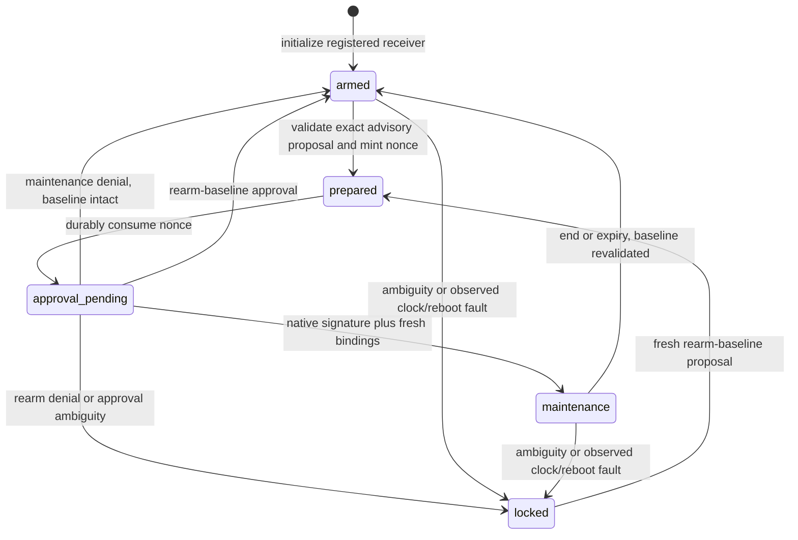

# Exact advisory maintenance for a protected receiver

HMT / GT9A+GT10A, 2026-10-24. Authority: [0043](../intent/decisions/0043-maintenance-grants-bind-native-approval-to-receiver-state.md), extending 0039/0041 in W1's existing budget.
Implementation and qualification work order: [GT](../plans/governed-command-tools.md).
I1/I5/I6/I11/I12/I13/I18 apply. No new foundation, dependency or global installation.
No production exploit or native-approval success is asserted by this admission.

## HMT-1: actual receiver and scope

Build `harnessctl` with `-tags harness_maintenance` for these commands:

```text
harnessctl maintenance init|prepare|enter|check|end|recover --controller ABS --controller-sha256 HASH --project ABS --format json|text
harnessctl maintenance prepare --controller ABS --controller-sha256 HASH --project ABS --candidate ABS --format json|text
```

`candidate` is required only for prepare. No stdin approval, detached proof, CLI clock,
caller-selected state directory, shell, provider, private key or environment bypass.
Ordinary builds return incomplete/unsupported before reading controller or state.
Existing `config check|explain` behavior and wire stay unchanged in both builds.

The controller path/byte pin is independently selected by the operator, never
computed from the candidate as its own authority. An eventual installed dispatcher
must protect those arguments, executable, state root and recipient. The CLI cannot
authenticate that bootstrap. State pins its initial controller bytes/epoch; a foreign
controller cannot modify that receiver. Controller rollover is not implemented by
this first profile: changed roots hold, rather than silently trust new keys/state.

The protected controller selects the project's state directory, native helper and
approvers. `init` creates an armed receiver. `prepare` records an exact proposal;
`enter` requests native review and signs that proposal; `check` revalidates the
current boundary and computes effective control values; `end` restores the unchanged
signed baseline. `recover` can only create locked state from ambiguous storage.
Locked receivers require a fresh native `rearm-baseline` proposal before becoming
armed. Neither check nor maintenance executes or installs a hook.

First profile changes only exact advisory sample-rate data. It does not edit hook
code, replace a dispatcher, enroll keys, change source-policy keys or promote unknown
candidate code. These remain GT7/9/10/11/16 obligations, not fulfilled by this unit.



## HMT-2: independent protected inputs

All fields below are required unless `?`. New CUE fields use presence constraints;
Go must independently reject missing zero/false fields. Strict JSON rejects null,
duplicates, case aliases, unknown fields, invalid Unicode, depth>24 and trailing data.
Use existing HC8 strict decoding, file snapshots, signed source verification and
restrictive composition. Do not fork their meaning.

`harnessctl.controller/1`, <=2 MiB:

| Record | Fields and bounds |
|---|---|
| Controller | `version`, `epoch` 1..2147483647, `issuedAt`, `expiresAt`, `hostId`, `native`, `approvers` 1..64, `projects` 1..256 |
| Native selection | `profile`=`darwin-protected-key/1`, `executable` canonical absolute, `sha256` exact lowercase SHA-256, `preparationRoot` canonical absolute operator-protected private directory, `timeoutMillis` 1..120000 |
| Approver | `id`, `principalId`, `osUserId` canonical decimal string, `keyTag` safe ID, `publicKey` canonical padded base64 of 65-byte uncompressed SEC1 P-256 public point, `enrollmentProfile`=`secure-enclave-user-presence/1`, `revoked`, `roles` nonempty unique subset of `maintenance|rearm-baseline`, `controlIds` 1..64, `maxDurationSeconds` 1..3600 |
| Project | `id`, `root` canonical absolute, `principalId`, `registration` canonical absolute HC8 file, `stateRoot` canonical absolute protected local directory |

IDs follow HC8's 1..64 ASCII grammar. Controller/key/project IDs and roots must be
unique. Host/project/principal must match the selected HC8 registration/project.
Controller and HC8 registration lifetime/validity use HC8's UTC-second rules.
Approver authority comes only from this independent protected roster; policy-layer
keys confer none. Revocation/controller bytes and all HC8 sources are rechecked at
every boundary. A file mode or path name cannot establish OS protection.

`harnessctl.advisory-candidate/1`, <=8192 bytes:
`version`, `purpose` (`maintenance|rearm-baseline`), `approverId`, `durationSeconds`,
`reason` nonblank valid display text <=512 UTF-8 bytes, `controls` 0..8 unique pairs
`{id,samplePPM}` sorted by ID for the plan. For maintenance, require 1..8 controls and
positive duration <=3600 and the approver's cap. Each control must be selected,
advisory, maintenance-permitted and in the approver's roster. Each requested rate
must remain inside every composed min/max floor. Do not clamp. For rearm-baseline,
duration=0 and controls is empty; only restoration of the current signed baseline
is authorized. Bind the exact raw candidate SHA-256, including formatting.

No global model-confidence number or decision-model site belongs in source,
signature, scope, replay, time or state validation. Those questions are deterministic.

## HMT-3: clocks, proposal and cryptographic binding

The native port returns `harnessctl.host-stamp/1`:
`version`, `os`=`darwin`, `osUserId`, `bootId` (nonempty bounded ASCII <=128),
`utcMicros` positive int64, `continuousNanos` nonnegative int64. Keep boot/time
metadata private. The SDK obtains wall time and continuous uptime from native APIs.
Go time conversions and random bytes have injectable seams; tests never sleep or
use real authentication. Production nonces use crypto/rand, 32 bytes.

Persist observed wall/continuous floors, a same-boot clock anchor and boot identity.
Backward values, a changed boot or cumulative wall/continuous elapsed disagreement
>1 second from that anchor lock an existing receiver. Do not reset the anchor at
every check and thereby hide cumulative drift. A locked rearm may stage a fresh
anchor, but remains locked until native approval; it never resumes an old lease.
This detects observed anomalies, not a hostile administrator or all clock attacks.
Initialization relies on the operator's trusted host time. Lease expiry is checked
against both UTC and continuous deadlines on every check, never only a timer.

The closed plan `harnessctl.maintenance-plan/1` contains `version`, `purpose`,
`instanceId` (64 lowercase random hex), `authorizationEpoch`, `nonce` (64 lowercase
hex), `controllerEpoch`, `controllerSHA256`, `registrationEpoch`,
`registrationSHA256`, `snapshotSHA256`, `rollbackSnapshotSHA256`, `hostId`,
`projectId`, `principalId`, `approverId`, `approverPrincipalId`, `keyTag`,
`candidateSHA256`, `bootId`, `preparedUtcMicros`, `preparedContinuousNanos`, `issuedAt`, `approvalExpiresAt`, `leaseExpiresAt`,
`deadlineContinuousNanos`, `durationSeconds`, `reason`, `controls`.
Controls contain exact `{id,oldSamplePPM,samplePPM}` values. At prepare, freeze
leaseExpiresAt=min(now+duration,controller/config validity) and the corresponding
same-boot continuous deadline. ApprovalExpiresAt=min(now+300s,leaseExpiresAt).
Approval delay consumes the signed window; it never extends it. Rearm-baseline has
no lease, zero duration/deadline and a <=300s approval deadline bounded by validity.
IssuedAt is the UTC-second floor of preparedUtcMicros. Compute the exact continuous
deadline as preparedContinuousNanos + (leaseExpiresAt.UnixMicro - preparedUtcMicros)*1000,
with positive-duration and integer-overflow checks. Freeze both controller and HC8
validity caps. A stored lease's approvedAt must be within the plan's approval window.
Later active checks use lease deadlines, not the already-finished approval window.

The Go receiver constructs one canonical plan encoding: json.Marshal of the fixed
struct field order, sorted control array, no extra newline. Native signing bytes
are standard DSSE PAE with payload type
`application/vnd.agentic-kit.harness-maintenance-plan.v1+json` and those exact bytes.
Do not reserialize before signature verification or trust an unauthenticated key hint.
The native helper returns a closed `harnessctl.native-approval/1` containing
`version`, `status` (`signed|denied|unavailable|canceled|invalid`), `signature` (empty
unless signed; canonical base64 ASN.1 ECDSA), and `publicKey` (empty unless signed).
Verify P-256/SHA-256 signature and enrolled public-point equality. No Boolean result,
caller proof file or test signer is a production authority path.

Storage sequence and authorization epoch are separate: every durable write advances
sequence, while only permission/proposal transitions advance authorizationEpoch.
Clock-only writes do not invalidate an unchanged pending plan. Pending plan/nonce,
instance, authorization epoch and every root/config binding must still match at use.
Old consumed nonces cannot become valid after bounded history is discarded.
Init starts both counters at 1. Prepare increments authorizationEpoch and puts that
exact value in the plan. Begin-approval consumes the nonce by changing phase and
storage sequence only; it keeps the signed authorizationEpoch. Finish requires
that exact epoch, then increments it whether granting or returning to origin.
A live lease requires `lease.plan.authorizationEpoch + 1 == state.authorizationEpoch`.
End, expiry and lock transitions advance authorizationEpoch; clock-only checks do
not. Overflow holds. Recovery uses a fresh random instance, never an old grant.

## HMT-4: state and durable transaction

`harnessctl.maintenance-state/1`, <=65536 bytes, contains `version`, `instanceId`,
`sequence`, `authorizationEpoch`, `phase` (`armed|prepared|approval-pending|maintenance|locked`),
`controllerEpoch`, `controllerSHA256`, `registrationEpoch`, `registrationSHA256`,
`snapshotSHA256`, `hostId`, `projectId`, `principalId`, `stamp`, `clockAnchor`, `plan?`,
`pendingOrigin?` (`armed|locked`), `candidatePayload?` (canonical padded base64 of the
exact <=8192-byte candidate snapshot), `lease?`.
Prepared/approval-pending states require a plan. A maintenance lease contains exact
`plan`, `approvedAt`, `expiresAt`, `deadlineContinuousNanos`, `proofSHA256`,
`approvalPayload` (canonical padded base64 of <=1024 bytes of the parsed native
approval re-encoded by json.Marshal without newline).
Other phases forbid those authority-bearing optional fields. No transcript history.
ProofSHA256 identifies those exact canonical approval bytes. Retain and reverify the
signature over the stored canonical plan against the current enrolled approver on
every active boundary; a plausible digest alone is not evidence. Preserve source
policy/signature verification separately from this native proof.
CandidatePayload is required with a plan/lease. Re-hash/decode that same stored
snapshot and compare its complete typed content to the plan before approval/use.
The original candidate path is not authoritative after prepare; native review shows
the frozen prepared copy, not later file edits. Never silently substitute new bytes.
Pending states require origin: maintenance originates armed, rearm-baseline locked.
Check exposes no effective values while a locked-origin rearm is pending. Denied or
failed rearm returns locked; only its verified native signature can restore armed.

The first store profile uses an existing protected local POSIX directory and fixed
names `LOCK`, `BINDING`, `CURRENT`, `PENDING`, `state-a.json`, `state-b.json`, plus owned temp
replacements and one bounded `recovery.json` evidence record. No generic paths,
glob deletion or unbounded journal. Kernel advisory
locking must serialize cooperating receiver processes and release on process death.
Do not infer lock ownership from a stale PID file or automatically delete an active
lock. Unsupported native locking/atomicity holds before state writes.

Init is virgin-only under the lock: refuse CURRENT, PENDING, either slot or any
partial/ambiguous owned artifact. Repeating init from any phase cannot reset state,
nonce history or a locked receiver. Interrupted initialization requires locked
recovery. Use fixed-leaf no-symlink opens and stable directory/lock-file identities;
directory locking is not proof against an actor permitted to replace those objects.
Both slots must match the immutable binding and active receiver instance. A valid
lower-sequence foreign state is contradictory evidence, not acceptable old history.

Virgin init durably creates immutable `BINDING` before any state authority: closed
`harnessctl.receiver-binding/1` with `version`, `controllerSHA256`, `controllerEpoch`,
`registrationSHA256`, `registrationEpoch`, `hostId`, `projectId`, `principalId`,
`stateRoot` (exact canonical directory), <=4096 bytes. Verify this binding before
every commit/recovery; recovery cannot adopt a caller's alternate controller/keys.
Never overwrite BINDING. A surviving complete BINDING.tmp can be validated/promoted
as the same pending bootstrap; missing/corrupt/contradictory binding after other
artifacts exist holds for protected manual disposition. Locked recovery is not an
authority-bootstrap bypass. Test foreign-controller recovery, not merely check/init.

Under the lock: validate bounded current pointer and exact slot digest; write/fsync
an intent naming exact old/new pointer; write/fsync the unused slot; atomically replace
CURRENT and sync the directory; clear intent and sync again. Keep at most two state
slots and one intent. Fault-inject every write/sync/rename/removal boundary. A pending
intent or invalid slot never yields effective maintenance values. After an uncertain
effect, inspect/recover; never blindly re-enter or resend approval.

`recover` may replace ambiguity with fresh locked receiver identity only, retaining
bounded old intent/state evidence. It cannot restore armed or maintenance authority.
Rearm then needs a fresh exact native proposal and valid current roots. No administrator
rollback defense, hostile/NFS filesystem guarantee or cross-platform atomicity claim.
Retain the exact proposed locked replacement in recovery evidence. Interrupted
recovery may resume only that same replacement when surviving artifacts match the
recorded originals or exact recorded output. A valid completed CURRENT rejects a new
recovery. Missing trust binding cannot be supplied by an arbitrary new controller.

## HMT-5: transitions and actual boundary behavior

Init writes armed state only after valid controller/HC8 config/native clock checks.
Prepare validates the exact candidate, creates a new nonce and stores its plan. Check
may retain baseline only for an armed-origin maintenance proposal; rearm remains
held. Expired proposals return their origin and invalidate the nonce/authorization epoch.
Enter durably marks approval-pending/consumed before invoking the native helper.
Hold the per-project kernel lock across that bounded native interaction. Concurrent
boundaries return transition_busy rather than observe partial authority.

After native response, re-read controller, HC8 registration/sources and native clock.
Verify current approver role/revocation and all plan/clock bindings. Only a valid
signature can enter maintenance or rearm baseline. Maintenance denial/failure returns
baseline only when independently valid; rearm denial/failure remains locked. A crash during
approval cannot make its nonce usable by a later approval attempt.

Check requires fresh controller/config/clock and no ambiguous intent. Apply only the
lease's exact advisory sample-rate deltas; every mandatory value and all other fields
remain unchanged. Expiry/end restores the unchanged, freshly validated baseline.
Changed roots/sources, reboot, time anomaly or missing native evidence hold. A locked
result supplies no effective controls. No hook-code reevaluation or installation is
claimed: GT10/11 must later bind actual dispatcher/candidate bytes and event probes.

## HMT-6: native process and human review

Default native runtime verifies and snapshots the selected helper bytes (<=64 MiB),
runs only fixed `stamp` or `approve` recipes from private preparation space, without
shell/credentials/environment discovery. Cap stdout/stderr independently at 64 KiB;
strictly validate replies and fixed statuses, never echo raw diagnostics. One approval
attempt, no automatic retries or weaker fallback. Clean up preparation; ambiguous
cleanup/output means incomplete, not a second attempt.
Create private preparation beneath the independently pinned preparationRoot, never
ambient TMPDIR. The operator must exclude candidate writes to that parent, directory
and executable through launch; 0700 alone does not prevent a parent's writer from
replacing a child. Reject group/other-writable preparation ancestors and directory
owners outside root/the current UID; pin the complete ancestor identity chain.
Verify stable root/directory/file identities and bounded helper
bytes before execution. Same-user/administrator replacement outside this protected
boundary is not prevented by hashing or claimed as a sandbox.

Approve input uses four-byte big-endian payload length plus <=64 KiB plan bytes.
Keep the input pipe open as a parent-liveness channel; unexpected bytes/EOF before
completion cancel the helper. Parent death must not leave an orphaned approval dialog.
The native helper independently validates the plan and displays that same payload's
purpose, project/principal, exact old/new rates, duration/expiry and baseline retention.
Use no default approval button; Escape/Cancel cancels. Show all changes accessibly,
without hash-only consent.
External cancellation must end the alert's modal session as well as close its window.
Dispatch in AppKit's modal/default run-loop modes and guard cancellation before modal
entry. Check approval expiry after review, after authentication and before signing;
an expired review must not start a needless authentication attempt.
Only then request a fresh native protected-key operation. Return a signature over the
same DSSE bytes. Never collect a password, export a private key, silently enroll,
overwrite an existing key or treat availability as authentication.

macOS uses a separately enrolled Secure Enclave P-256 key with user-presence access
control and fresh LocalAuthentication context. The separate trusted enrollment must
establish the user-presence ACL; a public key/signature cannot prove its flags. The
helper checks accessible Secure Enclave/key attributes and independently requires
fresh LocalAuthentication before signing; do not use private SDK introspection APIs
or call an opaque ACL object proof of its constraints. Match enrolled OS user/key; missing
hardware/key/policy/UI is unavailable. SDK build/read-only stamp and clearly labeled
synthetic preview are permitted development observations. Enrollment and live prompt
qualification remain separate. Preserve Windows Hello's native signature/key semantics
and Linux deployment-owned polkit/PAM issuer in future profiles; do not emulate them
with a macOS key or a consent Boolean.

app-kit owns reusable interaction/accessibility patterns; this SDK-specific exact
authorization and Go domain semantics remain here. Existing CLI AK-CLI-02 divergence
applies. Select/review the complete native approval reference before UI implementation,
retain synthetic preview evidence separately and return reusable findings through
app-kit's contribution loop. No public shared component promotion follows.

## HMT-7: receipts and acceptance

Reports use `harnessctl.maintenance-report/1`, escaped JSON/indented text, <=1 MiB,
`noHostActionAuthority:true`, `installation:unobserved`, `coverage:selected-project-only`.
Public stdout contains only fixed operation/status/code/phase and counters, never
plans, effective values, paths, IDs, hashes, reason text, signatures or clock metadata.
Pass the plan directly from protected state to the pinned native review helper;
stdout is not an authenticated recipient. The internal current-boundary decision
stays within the trusted receiver, not a reusable public allow token. Installed
dispatcher integration and its protected recipient remain GT11 qualifications.
Failure emits no successful prefix. Required counters are `stateWritesAttempted`,
`stateWritesCommitted`, `nativeStampAttempts`, `nativeStampInvoked`,
`nativeStampCompleted`, `nativeApprovalAttempts`, `nativeApprovalInvoked`,
`nativeApprovalCompleted`, `nativeSignatureVerified`, `storedSignatureVerified` (bools). Attempts, actual starts,
valid complete wire replies, verified signatures and completed durable writes are
distinct observations; denied/unavailable replies do not verify a signature.
All counters are nonnegative; invoked<=attempted, completed<=invoked, verified
requires one completed approval. Stamp attempts are bounded by a command's finite
stages; approval attempts<=1. StateWritesCommitted<=StateWritesAttempted. Failure
does not invent rollback or successful completion after an uncertain write.
NativeSignatureVerified describes this command's live helper reply. StoredSignatureVerified
describes revalidation of retained evidence and may be true with zero new approval
processes. Neither flag is a native enrollment/assurance qualification claim.

Closed report `status` is `complete|hold`, `operation` is the requested known command
or `unknown`; optional `phase` appears only on a completed operation. Fixed `code`:
`ok`, `unsupported`, `input_invalid`, `controller_invalid`, `controller_changed`,
`project_unregistered`, `config_incomplete`, `policy_conflict`, `candidate_invalid`,
`candidate_denied`, `state_unavailable`, `state_invalid`, `state_busy`,
`state_ambiguous`, `state_exists`, `clock_invalid`, `rearm_required`,
`proposal_expired`, `proposal_missing`, `native_unavailable`, `native_denied`,
`native_canceled`, `native_incomplete`, `signature_invalid`, `binding_mismatch`,
`nonce_replayed`, `storage_incomplete`, `output_incomplete`, `entropy_unavailable`.
Never echo provider/OS/decoder errors as a code. A native reply may have completed
while its signature or later state commit did not; report these separately.
0=completed requested receiver operation; 1=policy/native denial; 2=incomplete or
unsupported. A writer failure cannot retract an already verified prefix or justify retry.

HMT-A1: independent scope/role/floor/delta/time/candidate negatives; mandatory weakening
always holds. HMT-A2: canonical plan/DSSE and separate approver key; wrong nonce,
instance, epoch, key, purpose, role, candidate and stale/revoked proof never apply.
HMT-A3: init/prepare/enter/check/end/rearm/recover transitions with injected clock,
entropy, native, storage and output faults; replay/concurrency/inflight crash negatives.
Include locked-origin prepare/check/denial/timeouts, repeat init from every phase,
interrupted init, foreign controller against an existing receiver, and slow approval
that cannot extend the fixed signed deadline.
HMT-A4: actual owned-file store locking/intent/double-slot crash matrix; no widening
after every ambiguity; unsupported hosts write nothing. HMT-A5: bounded native process
fixture, parent loss, caps/timeout, missing/forged response and no diagnostic leak.
HMT-A6: actual reports/controls positive/negative on CUE0.16/0.17, both build contexts,
required-field omissions and held-data injections. HMT-A7: native SDK compile/read-only
stamp/preview with source/tool/binary pins; no native-approval claim without enrollment
and real prompt/key trial. HMT-A8: guide-only toy receiver, independent security/UI
review, full gate, strict matching-build Fathom proof and normal push gates.

Predeclare nine alternating ordinary-build HC8 pairs on the same toy config/host:
all old config output bytes must match and median overhead <=25%, or tune/park.
Report new boundary p50/p95/max and SDK/process/IO counts separately; no production
cost or installed interception claim. Stop on any false grant, floor weakening,
replay, lost audit existence, persistent source leak or unbounded native operation.

Primary native/UI basis checked 2026-10-24: [Apple protected-key restrictions](https://developer.apple.com/documentation/security/protecting-keys-with-the-secure-enclave),
[signature API](https://developer.apple.com/documentation/security/seckeycreatesignature%28_%3A_%3A_%3A_%3A%29),
[native alert reference](https://developer.apple.com/design/human-interface-guidelines/alerts),
[Windows challenge-response/signing](https://learn.microsoft.com/en-us/windows/apps/develop/security/windows-hello).
Apple's hardware profile uses P-256; Windows' documented key/signature path differs.
These are design inputs, not completed native qualification. The app-kit approval
lookup returned a go-web primitive, not a native SDK adapter; its authored quality
inventory is untracked. No compatible native asset was returned by the bounded
approval query. Use the complete platform alert reference with exact-plan details,
explicit approval, no automatic default and cancellation; do not copy web styling
into an authentication SDK or treat reference retrieval as visual proof.
