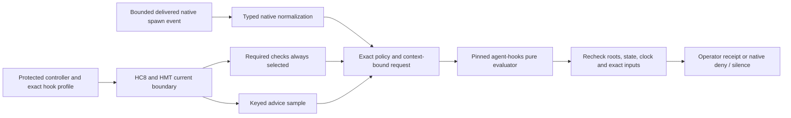

# Governed spawn economics

HSE / GT11A, 2026-10-24. Authority: [0044](../intent/decisions/0044-governed-spawn-checks-preserve-required-controls.md).
Extends 0022, 0039, [HC8](harness-control.md) and [HMT](harness-maintenance.md)
inside the existing W1 incubation. No new foundation, daemon, dependency or slot.

## HSE-1: outcome and boundary

Connect signed controls and protected maintenance state to the existing spawn
economics evaluator. Required spawn decisions run on every applicable event.
Only advice-match observations are sampled. Neither an unselected sample nor a
maintenance lease can waive a model, effort, tier or fork denial.

Legacy `agent-hooks hook` keeps its existing fallback, failure and denial-loop
behavior. New `agent-hooks evaluate-spawn` is a pure, strict peer protocol with
no policy fallback, home/definition/history discovery, ledger or denial-loop release.
`harnessctl hooks evaluate|run`, in the explicit `harness_maintenance` build,
consumes that protocol after validating HC8/HMT. Ordinary builds hold unsupported
before input, controller, state or subprocess access. No installed wiring changes.



Native silence means no hook decision. It never means permission to execute.
These are economic guardrails on delivered events, not an organizational
authorization root or a complete coding-host security boundary. Actual native
interception, crash behavior and consent remain separate GT9..11 qualification.

## HSE-2: protected selection

Add optional `hooks` to `harnessctl.controller/1`: a nonempty list of at most 512
closed `{projectId,host,path,sha256}` references. `host` is `claude|codex`; pairs
are unique and project IDs resolve in that controller. Paths are canonical absolute
and pins are lowercase SHA-256. Existing controllers without hooks stay valid.
No controller rollover is added: an existing receiver still pins its original root.

The selected reference identifies a <=65536-byte closed
`harnessctl.spawn-profile/1` record. All fields required:

| Field | Meaning / bound |
|---|---|
| `version`, `profile` | `harnessctl.spawn-profile/1`, `spawn-economics/1` |
| `issuedAt`, `expiresAt` | HC8 UTC-second rules; checked at every boundary |
| `host`, `hostId`, `projectId`, `principalId` | Match protected host selection and HC8/HMT target |
| `requiredControlId` | Existing composed mandatory control, event `before-tool`, full sampling, hold on fault, no maintenance |
| `advisoryControlId` | Different existing advisory control, event `before-tool`, hold on fault; only this rate can affect advice work |
| `samplingKey` | 64 lowercase hex, private operator-selected key; never output or derived from candidate input |
| `evaluator` | Closed `{profile,executable,sha256,timeoutMillis}`; profile `agent-hooks/spawn-eval/1`, canonical absolute trusted executable, exact raw hash, timeout 1..1000 ms |
| `policy` | Closed `{path,sha256}`; exact <=256 KiB existing agent-hooks policy bytes |
| `maxBoundaryMillis` | 1..5000, whole invocation context budget |

IDs use HC8's grammar. The controller/pin and native hook argv are independently
operator-selected and protected outside candidate writes. Paths and hashes do not
authenticate that bootstrap or certify an arbitrary executable as safe.
HMT's immutable controller binding also binds this hook-profile reference, which
in turn pins policy and evaluator. A caller cannot choose another profile or model
ladder. Signed HC8 sources still constrain rate, fault mode and work budget.
Source-policy keys remain distinct from native approver keys. Both controls use
HC8's existing before-tool event; the spawn site is bound by this profile and the
two control IDs, not by extending HC8's event vocabulary.

Policy data remains consumer-owned. The strict spawn profile requires
`require_model:true`, a Codex effort requirement when selecting Codex, a populated
selected-host model mapping, and fork mode `marker|deny`. Tier names and models are
data. No built-in model ID, automatic alias selection or provider call is added.
Claude forks preserve native model inheritance. Codex context forks still name a
model and effort; the configured fork marker/deny rule also covers context inheritance
in this strict profile. The Codex context-fork check is additive: after the usual
model/effort/tier checks, append fork_unmarked for a missing marker or fork_denied
for deny mode, dropping allowed if adding a denial. Aggregate all failed requirements.
Legacy semantics do not change.

## HSE-3: private evaluator protocol

`internal/hookeval` owns only the shared CUE/Go wire and validation, with two real
command consumers. It has no evaluator, time, storage, process, authority or provider
engine. Keep it private; no shared foundation promotion follows.

`agent-hooks evaluate-spawn` reads one <=512 KiB JSON request on stdin, takes no
policy/path/environment flags and writes one <=8192-byte result. Help is input-free.
No stdout prefix precedes a complete validated result. Malformed request or output
failure returns 2 with at most a fixed diagnostic; never raw decoder/panic text.

All wire fields are required. Strict decoding rejects null, duplicates, case aliases,
unknown keys, invalid Unicode, depth>24, integer overflow and trailing values.
String bounds count UTF-8 bytes. CUE must cover required zero/false fields and
result relationships, not just lexical types.

Request `agent-hooks.spawn-request/1`:
`version`, `requestId`, `contextSHA256`, `policySHA256`, `policyPayload`, `subject`,
`advisorySelected`. Digests are lowercase SHA-256. `policyPayload` is canonical
padded base64 of the exact <=256 KiB policy. Subject is closed:
`{host,operation,model,effort,agentType,fork,contextFork,brief}`.
Host is `claude|codex`; operation is `spawn|resume`; model<=256, effort<=64,
agentType<=128 and brief<=65536 bytes. Empty model/effort are data to deny,
not silently inherited defaults. Fork is Claude-only, contextFork Codex-only.
Resume is Claude-only, has no fork flags and does not start a new model selection.

Construct requestId as SHA-256 of json.Marshal of the fixed request struct with
requestId empty. This binds exact payload, normalized subject, context and advice
selection. It is integrity/context binding, not an authenticated approval token.
The receiver's context digest additionally binds controller/profile/policy/evaluator
identities, project/principal/host, receiver instance and authorization epoch,
pre-evaluation storage sequence, selected rates and exact raw native event hash.
These digests stay on the private peer channel, never in public hook receipts.

Result `agent-hooks.spawn-result/1`:
`version`, `requestId`, `contextSHA256`, `policySHA256`, `noActionAuthority:true`,
`requiredDecision` (`pass|deny|unknown|not-applicable`), `codes`, `class`,
`classSource`, `advisoryEvaluated`, `adviceMatches`.
Codes are unique closed values: `allowed`, `no_model`, `unknown_model`,
`tier_ceiling`, `no_effort`, `fork_unmarked`, `fork_denied`, `policy_invalid`,
`profile_invalid`, `resume_not_spawn`. Class is `worker|critic|unknown|not-applicable`;
classSource is `worker_marker|critic_marker|critic_pattern|default|unknown|not-applicable`.
No custom reason, model, brief, policy body, advice text or IDs are returned.
Pass has only `allowed`; deny has one or more denial codes and a resolved class.
Unknown has only policy_invalid/profile_invalid and unknown class/source.
Here profile_invalid means the policy violates the fixed minimums defined by this
request version (model/effort/mapping/fork requirements), not validation of an opaque
receiver registration. Receiver profile identity/lifetime errors stay receiver-only.
Resume yields not-applicable/resume_not_spawn only after valid policy/profile.
Advice work runs only for a passed spawn with advisorySelected true; otherwise
advisoryEvaluated=false and adviceMatches=0. Matches are 0..32, not a grade.
0=pass or scoped N/A, 1=required denial, 2=unknown/incomplete.

Reuse parsePolicy and decideSpawn, with advice compiled state disabled in the
required-only copy. Run matchAdvice separately only when selected. Extract a class
explanation helper if needed while preserving classify's existing behavior. No
forked rule engine. Marker/classification is declared/heuristic task metadata, not
proof that the assignment is actually a review. No model judges these questions.

## HSE-4: native input and stable sampling

Selected native profile consumes only PreToolUse spawn events. Require typed,
nonempty bounded session_id, tool_use_id and cwd. Cwd must exactly equal the
protected selected canonical project root. Never discover a project from it.
Known Claude tools are Agent/Task; Codex spawn_agent/collaborationspawn_agent.
Unknown tools/used field types hold. Do not guess a changed host's schema.

Native envelopes are forward-compatible subsets: validate whole JSON syntax,
duplicates, Unicode, depth and size, but allow unused fields and unused nulls
(including transcript_path). Require/validate used fields separately. Never read
transcripts, environment, files or agent definitions named by native input.
Normalize the existing host-specific prompt/message/items text and fork fields;
bound the total brief instead of truncating it. Claude's nonempty resume field
selects scoped resume, not a new spawn. Reject contradictory fork fields or types.
Native raw data stays in memory; it is not logged or echoed.

Derive the advice bucket from HMAC-SHA256 with samplingKey over a fixed canonical
unit `{version,host,projectId,controlId,instanceId,sessionId,toolUseId}`. Do not
include prompt, model, rate, clock, policy revision or retry randomness: the same
delivered event/site keeps its draw. Map the first uint64 to 0..999999 using the
high word of multiplication by 1000000; selected iff bucket<effective samplePPM.
0 and 1000000 are explicit endpoints. This is deterministic bucketing, not proof
of population representativeness or protection from a hostile host forging IDs.
Required evaluation always runs. Only advice-match observations are skipped.
There is no replayed allow cache, passive collection, history claim or new journal.

## HSE-5: controlled receiver

CLI, explicit maintenance build:

```text
harnessctl hooks evaluate --controller ABS --controller-sha256 HASH --project ABS --host claude|codex --input ABS --format json|text
harnessctl hooks run --controller ABS --controller-sha256 HASH --project ABS --host claude|codex
```

Evaluate reads an explicitly selected <=1 MiB file. Run reads <=1 MiB stdin and
has no input/format/extra flags. One current-boundary implementation serves both.
Do not change the legacy agent-hooks hook or its installer.

1. Validate pinned controller and selected hook reference, obtain native stamp,
   validate current HC8/profile/policy snapshots, then open the protected HMT store.
2. Under its cooperative kernel lock, obtain fresh stamp and revalidate. Load exact
   state, execute HMT check and durably commit observed clock/expiry transitions.
   Locked, ambiguous, expired/revoked or missing authority cannot yield controls.
3. Validate required/advisory bindings. Snapshot/hash the trusted evaluator under
   the already protected native preparationRoot, with full ancestor/file identity
   checks and <=64 MiB cap. Fixed argv `evaluate-spawn`, explicit bounded environment,
   private cwd/HOME/TMPDIR, no shell or PATH lookup. Hashes are not trust enrollment.
4. Normalize input, derive advice selection and a context-bound request. Invoke at
   most one evaluator. Its work deadline is the minimum remaining whole budget,
   evaluator timeout, required MaxWorkMillis, and advisory MaxWorkMillis if selected.
   Cap stdout8192/stderr4096 independently; any stderr/invalid/trailing output,
   mismatch, wrong exit/status, timeout or unknown result holds. Do not echo it.
   The peer frame is exactly one JSON object followed by one LF, with no leading
   or trailing whitespace. Reserve a 1 ms pipe-drain window inside the selected
   child deadline; a budget too small for that reserve holds before invocation.
5. Before rendering, reload state and require the exact pre-evaluation state,
   reread every controller/registration/source/profile/policy snapshot and evaluator
   identity, obtain fresh stamp and run/commit another HMT check. Compare authority
   bindings, phase, authorization epoch and selected rates. Clock sequence updates
   alone are allowed. Expiry, drift or changed selection holds with no retry.
6. Close/clean private resources before output. Ambiguous cleanup/output holds;
   never rerun a child because a result or output is uncertain.

Use existing seams and source authentication rather than reproducing HC8 meaning.
Keep HMT entrypoint behavior unchanged; factor a private boundary loader if useful.
Never consume maintenance CLI stdout as an allow token. An observed-clock update
changes storage sequence only, not the authorization epoch of an unchanged grant.
No signature check, role, source floor or clock decision belongs to a model.

## HSE-6: output and scope

Operator report `harnessctl.spawn-report/1`, <=16 KiB, escaped JSON/indented text:
status complete|hold|not-applicable, fixed code, requiredDecision, codes, class,
classSource, advisorySelected, advisoryEvaluated, adviceMatches, noActionAuthority=true,
coverage=selected-project-spawn-events-only, installation=unobserved, plus truthful
native stamp/state-write/evaluator attempted/invoked/completed counts. No paths,
IDs, hashes, model/brief, sampling key, effective values or native proof. On hold,
clear decision/class/advice values while retaining actual process/write counters.
Expose no successful prefix. Evaluate exit 0=passed/scoped N/A, 1=denied, 2=incomplete.

Evaluator completed counts an observed process return, including a malformed
reply or nonzero exit, separately from a usable result. Timed-out processes do
not count completed. Native stamp completed retains HMT's validated-stamp meaning.
Counts are invocation-local, at most three stamp attempts, two state-write attempts
and one evaluator attempt. Complete decisions require all three valid stamps and
one completed evaluator, but a clock observation identical to stored state need
not produce a state write.

The closed report codes are `ok`, `spawn_denied`, `resume_not_spawn`,
`unsupported`, `input_invalid`, `controller_invalid`, `controller_changed`,
`project_unregistered`, `hook_unregistered`, `profile_invalid`, `policy_invalid`,
`config_incomplete`, `policy_conflict`, `state_unavailable`, `state_invalid`,
`state_busy`, `state_ambiguous`, `clock_invalid`, `rearm_required`,
`native_unavailable`, `native_incomplete`, `signature_invalid`, `binding_mismatch`,
`storage_incomplete`, `evaluator_unavailable`, `evaluator_incomplete`,
`boundary_expired` and `output_incomplete`. Map other private boundary failures
to `config_incomplete`; do not expose arbitrary engine error text. Complete pass
uses ok, complete denial spawn_denied, and scoped N/A resume_not_spawn.

Native run returns exit0 with empty stdout/stderr for pass or scoped resume.
For deny or any fault, keep stdout empty, write a fixed sanitized stderr reason
and return exit2. Both selected official host references document that blocking path;
its actual native effect still needs qualification. Never return allow, ask,
updatedInput, continue, stopReason, suppressOutput or arbitrary child text. An output
failure cannot retract bytes or prove the coding host blocked anything.
The native renderer is not a new approval authority or a hook installation receipt.

Advice observations affect only operator evaluate receipts in this unit. Native run
forces advisorySelected=false and does no advice regex work: it has no observation
recipient yet. GT15 must supply an admitted privacy/retention/existence contract
before sampling advice on the native path. No invisible work or native advice-delivery
claim follows. No new per-spawn
nudge or unsafely repeated advice is introduced; 0022's once-per-session delivery
and its rejection of ineffective reminders remain. Retained journals/flywheels are GT15.

Primary host inputs checked 2026-10-24: [OpenAI hooks](https://learn.chatgpt.com/docs/hooks),
[Claude hooks](https://code.claude.com/docs/en/hooks). Both document denial/exit2;
Codex also describes uncovered paths. Claude documents onFailure:block from 2.1.295.
No equivalent Codex setting was established by this lookup. Future installation
must protect argv/roots, qualify selected versions/events and fail/crash/missing-hook
behavior. Config source or a synthetic driver alone cannot prove interception.

## HSE-7: acceptance and stopping rules

HSE-A1: strict CUE/Go request/result/report/controller/profile parity, required-field
omissions, null/duplicate/case/Unicode/byte/overflow/contradictory-result negatives.
HSE-A2: native normalization preserves Claude fork/resume and Codex model/effort/context
fork distinctions; marker text survives normalization; malformed used fields hold.
HSE-A3: every structural denial persists at advice rates0/partial/full, in a valid
maintenance lease and after repeated attempts. No denial-loop release or fallback.
HSE-A4: actual pinned child witnesses, exact input/result binding, policy/executable
mutation, unknown/malformed/forged result, caps, timeout/cancel and output faults.
HSE-A5: HMT locked/prepared/rearm/active/expiry/reboot/rollback states, changed roots,
revocation, clock-only sequence, post-child drift and write ambiguity. No stale advice
selection or cached authorization. Actual owned binary driver suppresses its synthetic
effect on native denial/fault; that proves the driver, not a coding host.
HSE-A6: actual native-clock/child CLI positives and independent negative cases,
real report dual-CUE checks, legacy bytes/behavior regression, default unsupported
before I/O, Windows/Linux cross-builds distinguished from native execution.
HSE-A7: independent guide/security review, full gate, strict matching-build plan proof,
source/binary pins, retained failures, normal publication and owned-worktree cleanup.

Predeclare nine alternating legacy hook pairs: output bytes unchanged and median
overhead<=25%. Pure evaluator p95<=25ms; selected protected receiver p95<=500ms and
max<=1500ms on an explicitly identified owned synthetic Mac workload. Report cold/
warm, process/write counts and both successes and holds. These are scoped usability
bars, not production economics or hard wall-time guarantees on hostile filesystems.
Misses require tuning or parking, never silently raising bars after the run.
Stop on a mandatory skip/false pass, drift accepted, raw data leak, unbounded work,
or new host/global mutation. Hosted, attended and live-key evidence remain unqualified
until actually observed; those missing proofs do not close the full goal.
