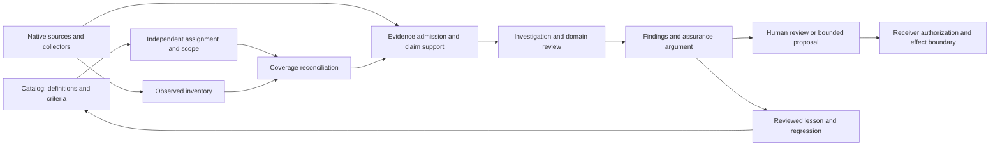

# Inventory, evidence and review uplift

Status: accepted design, 2026-10-23; two Astra consultations dispositioned in
[research and handoff](../research/2026-10-23-inventory-evidence-review.md).
Design only. No new package, collector, proof format, runtime or implementation slot
is admitted. Governing decisions: 0004, 0006, 0012, 0024, 0025 and 0036.
Scope: G9..G14, including G12 human interaction and G13 documentation/prose correction;
[workflow specifications](evidence-driven-reviews.md).

## [IER-1] The product model

Build evidence-driven work: define the question and its scope, observe what is available,
assess whether particular evidence supports a particular claim, investigate gaps,
and produce reviewable conclusions that can be corrected. A kit count is not a goal.

Arrows describe data flow, not permission. Inventory, evidence and assessments are
useful independently; Catalog Kit, Assignment Kit, an agent harness and Fathom are
optional integrations. Equivalent explicit scope, evidence and completion semantics
remain required when a named kit is omitted. Native owners retain meaning, trust and effects.

| Capability | Decision and smallest useful home | What would justify extraction |
|---|---|---|
| Catalog | Existing Catalog Kit owns reusable definitions, stable identities, layers and pins. | Existing 0023/0024 release and adoption rules. |
| Observed inventory | A consumer-local Observed Inventory profile; collectors and native inventory owners retain their schemas. A catalog can index descriptors and snapshot references. | Two independently owned consumers demonstrate the same collection/coherence/diff contract and delete duplicated glue; then consider a sibling Inventory Kit. |
| Evidence assessment | A consumer-local Evidence Assessment profile, composing existing evidence primitives and assessment criteria. | Two native-owner adapters prove shared admission/support/invalidation semantics; then consider a sibling Evidence Assessment Kit. |
| Investigation | Extend the existing Investigation Kit composition, with explicit hypotheses, falsifiers, missing evidence and bounded next checks. | A missing shared primitive must be demonstrated before adding a foundation. |
| Review and assurance | Domain Review Kit owns applicability, findings, dispositions and the argument. Agentic Kit supplies reusable workflow mechanics and examples. | Extract a shared review composition only after distinct domains prove the same seam. |
| Assignments, human decisions, prose and learning | Reuse Assignment Kit, HITL, governed prose and lesson-transfer. | Their existing admission and compatibility decisions apply. |

Reject Inventory as a Catalog sub-kit for observed state: definitions do not establish
instance existence. Reject separate facts, confidence, requirements, risk, incident
prediction and universal assurance kits without demonstrated shared behavior.
An assurance case is a structured argument, not another store or a numeric grade.
Existing `catalogctl scan-go` remains a valid source projection of package definitions;
it does not certify fleet/deployment coverage. Catalog-backed inventory views remain useful.

## [IER-2] Observed inventory contract

The names below describe prospective consumer-local records, not new public Go types.
CUE owns their shape when implemented; pure Go owns cross-record checks.

| Record | Required semantics |
|---|---|
| ScopeSpec | Independent owner/revision/digest; subject population or pinned enumerator contract; environments, accounts/regions or repository roots; required predicates; time window; approved exclusions; exhaustive/sampled/unknown basis. |
| SubjectRef | Native namespace and stable identity; exact revision; environment; incarnation/lifetime where replacement matters. Repository, service, workload and resource identities remain distinct. |
| InventoryObservation | Subject, predicate, typed native value/reference, plane, observed interval, captured-at, producer/version/configuration, source/artifact digest and limitations. Presence is present/absent/unknown; declared intent is not a runtime observation. |
| CaptureReceipt | Scope and selector pins; expected, attempted, observed, failed, skipped and unsupported sets; native permissions; pagination termination; watermark/skew/coherence; byte/item/time bounds; partial reasons. Counts derive from sets. |
| CoverageAssessment | Reconcile the independent scope against receipts. Report missing/foreign/duplicate identities and predicates, justified exclusions, sampling limitations and supported scope. Completeness and read health are separate. |
| InventoryDelta | Compare compatible populations, predicates, planes and lifetimes; distinguish added/removed/changed from not observed. Unknown or missing capture is not deletion. |

Keep declared design, source/configuration, built artifact, deployed configuration and
observed runtime behavior as separate planes. Links between planes need explicit,
evidenced correspondence. Same names across repos or resource replacements do not join
automatically. Repository dirty state requires a worktree/content digest beside HEAD.

An independently established empty universe is allowed with its basis. A collector's
empty output cannot establish that universe. Sampled evidence may satisfy a declared
sampling criterion; it cannot satisfy exhaustive coverage by renaming its denominator.
Equal counts are insufficient: compare exact sets or a qualified enumeration proof.

Negative evidence requires a bounded detection argument: population, predicate, time,
detector sensitivity, ingestion lag, retention window, selector semantics, permission
filtering, successful completion and applicable canary. A canary proves only its exercised
path. Distinguish not-returned, absent-within-qualified-scope and absence-unresolved.
Partial pages, denied access, skipped reads or incapable detectors yield unknown. No
claim of global absence exists. Read-manifest remains a considered-read health instrument.

## [IER-3] Evidence admission and support

Start by composing evidence-span/resolver/source-registry/source-linker,
record-fingerprint, authenticity, evidence-producer/signature, assertion/conflict,
read-manifest and fitness-function-registry. Case-file and evidence-graph may retain
relations; their aggregate scores or zero conflicts cannot certify a conclusion.

Evidence references bind exact native bytes/version/locator, producer and collection
method, subject/revision/incarnation, capture scope/interval and permitted use. Preserve
native Test/Policy/Review/Fathom envelopes with explicit adapters; no universal
attestation replaces them. Digests prove byte identity, not source truth.

| Proposed record | Required semantics |
|---|---|
| Claim | Stable ID and exact proposition revision; subject/predicate/context/window; claim kind; required premises/qualifications; assumptions; owner; required support policy. |
| EvidenceUseAssessment | Claim/criterion, exact evidence references, purpose and policy pins; admissibility admitted/rejected/unknown; separate supports/contradicts/context/undetermined relation; method, assessor, basis and limitations. |
| EvidenceChange | Exact evidence version, corrected/superseded/revoked, authorized issuer, effective/recorded times, reason and replacement if any. |
| InvalidationProjection | Changed inputs and affected claims, findings, generated sections, assessments and consent dependencies; unchanged conclusions retained only with demonstrated independence; recomputation required or unsupported closure explicit. |
| AssessmentInputs | Exact subject/profile/catalog/policy/input/scope pins; coverage; admitted claim-specific uses; conflicts, assumptions and evaluation time. Project into existing AssessProfile while retaining its original trace and caller-declared trust label. |

Evaluate identity/integrity, authenticity/issuer, relevance, scope/coherence, freshness,
permitted method, disclosure and semantic support separately. Valid but contradictory
evidence remains admissible counterevidence. Missing authentication is unknown or a
policy rejection, never a stronger trust label manufactured by a wrapper.

Record evidence supplied to a model separately from evidence assessed as supporting
each resulting claim. Citation existence, span overlap and a bibliography do not prove
entailment. Deterministic source assertions use qualified checks; semantic support uses
a calibrated optional judgment site or an explicitly recorded human assessment.
Check all required premises, not just individually credible citations. Human review
is attributable assessment, not automatic verification. Ambiguous support remains
unresolved. No hidden chain-of-thought is required or stored.

Preserve raw readings, interpretations, disputes and effective dispositions separately.
Unresolved conflicts cannot disappear through last-write-wins, averaging or ranking.
Repeated copies and common upstream derivations are correlated support, not independent
corroboration. Unresolved entity joins and zero joined comparisons remain visible.

Freshness attaches to the observed source/use, not report generation or cache access.
Expired negative or adverse evidence remains historically visible; support state changes
without becoming a clean pass. Revocation queries carry their own as-of/freshness basis.
Offline evidence can establish only the supplied snapshot's revocation state. Distinguish
validity during the claimed interval, availability when assessed and eligibility for
present reuse. Current expiry does not retroactively erase a valid historical conclusion.
Correction, withdrawal, revocation and deletion retain distinct consequences.

Corrections invalidate dependent conclusions using exact dependency versions. Dependencies
include scope, selectors, policy, mappings, assumptions and negative premises. Newly
arriving counterevidence may defeat a claim without changing any old citation. Cycles,
unknown edges or incomplete dependency capture hold the affected publication scope or
require a wider re-evaluation. Do not promise minimal regeneration without proving
closure. Retention and deletion policy may require raw removal; retain only permitted
tombstones and state when reconstruction is no longer possible.

## [IER-4] Confidence and assurance

Every conclusion exposes independently:

- Coverage and supported population, including unknown remainder.
- Evidence admissibility, relevance and counterevidence disposition.
- Inference method and confidence basis, calibrated scope or explicitly uncalibrated.
- Operational validation and deployment/observation context.

Required failures and unknowns never become a pass through soft scores. An ordinal
priority is a domain decision with a pinned rubric; it is not incident probability.
Assurance arguments preserve claims, context, assumptions, inference/warrant, supporting
and defeating evidence, unresolved obligations and accountable owner. An attractive
graph, tool success or approved risk exception cannot certify operational readiness.

## [IER-5] Deterministic controls and optional decisions

Use deterministic checks for set reconciliation, exact bindings, bounds, chronology,
source changes, expiry, required criteria, dependency invalidation and authorization
preconditions. Model candidates address semantic support, ambiguous identity proposals,
contradiction candidates, query selection and wording. Models never merge identities,
clear coverage, approve an effect or set truth by themselves.

Each judgment site declares a typed question/output, eligible backend/profile,
confidence basis, abstain/escalate path, deterministic fallback, resource budget,
source disclosure and cache key. Existing decision ports support optional provider
adapters. Backend-specific capabilities are explicit; unsupported remains unsupported.
Fallback for semantic uncertainty is unresolved/human review, not a fabricated answer.
Measure missed contradictions, unsupported accepted claims and false holds on held-out
cases. Disable a site when it misses its receiver's predeclared quality/cost bars.

Cache exact reusable work by source/subject/scope/profile/policy/evaluator/backend
identity, disclosure context, transformation version and relevant time/revocation state.
Recheck current authorization at use. Preserve original observed-at and actual
attempt costs. No cross-tenant cache, silent raw disclosure or confidence boost for
cache hits. Incomplete or stale source-intelligence output remains unknown.

## [IER-6] Security, bounds and operation

Retrieved evidence is untrusted data, never executable instruction. Reads, projections,
judgments and output disclosure each retain receiver authorization. Restricted views
must not reveal hidden subjects through counts, IDs, graph edges, cache hits or priority
changes. Redaction/tokenization is not proof of anonymity or permission to transmit.
Treat it as an authorized transformation with output digest, retained semantics and
lost support. A limited trusted-owner assertion is not direct source verification.
Raw hashes of low-entropy secrets can disclose them; do not emit sensitive hashes as
an existence workaround. Preserve confidentiality without silently upgrading support.

Provisional fixture ceilings, not safety/capacity guarantees: 16 repos, 256 sources, 100,000
observations, 10,000 claims, 50,000 links, traversal depth 64, 16 MiB per artifact and
64 MiB total source corpus. The receiver may tighten them. Overflow returns bounded
partial/unsupported data and holds affected completeness claims; it never silently
discards inputs. Organization-scale adapters need qualified partitions and coherent
watermarks; no unbounded fetch loop or universal in-memory graph is implied.

Inject time and nondeterminism; canonical order and detached results are required.
No network, model calls or sleeps in tests. Paid calls, retries, delegation, storage
and human work have separate estimated/measured budgets and terminal behavior. Admission
also qualifies encoded/decoded bytes, fan-out, retries, cancellation and interruption.
Initial references are offline, synthetic, zero paid calls and have no effect authority.
Actual dispatch, CAS/transactional commit, revocation and reconciliation remain with
existing HITL/effect/native owners; a proposed probe never runs merely because it ranks first.

## [IER-7] Admission, sequence and proof

No implemented scope is claimed by this design. After receiver admission and a free
0004 slot, select one small closed-world review question, one native artifact adapter,
one independent scope oracle and one planted false-pass scenario. Start in its owning
scenario/adapter; do not evade incubation limits by calling implementation a profile.
First qualify Review Kit's real receiving route. Existing `review-cli inventory` and
`review-cli sound` are producers; their existence does not prove a new third-party ingress.
Never import another module's `internal/core` types as a shared public API.

| Stage | Deliverable | Gate before advancing |
|---|---|---|
| S1 | Consumer-local scope, inventory and evidence-use profile. | Missing item, equal-sized wrong set, all-skipped reads, truncated pages, unauthorized N/A and unrelated citation cannot yield a supported pass; legitimate absence/empty scope controls succeed. |
| S2 | Bounded investigation, review and correction composition. | Wrong revision/incarnation, copied corroboration, conflict, stale adverse support and evidence correction preserve honest results and invalidate the correct closure. |
| S3 | Independent app/infra and domain adapters. | Equivalent monorepo/split-repo fixtures retain the same supported claims; incompatible snapshots and unknown native semantics remain explicit gaps. Two wrappers around one producer are not independent adoption. |
| S4 | Extraction and measured optimization. | Two owners accept the shared seam, delete duplicated glue, qualify standalone use and report end-to-end effort/cost against the existing workflow. Only then consider public sibling kits. |

Review owner: kit maintainer with each named receiver. Review this design by
2026-11-21 or the next release. No new receiver/evidence means keep the design queued,
revise it or retire its implementation hypothesis. F17/F19/F20 retain their separate
promotion criteria. No autonomous incident response or incident-probability engine.

Record unsupported accepted-claim rate, missed/false findings, time to first useful
evidence, human resolution effort, cost per accepted finding/correction, invalidation
precision/recall, adjudicated missed defects, baseline review effort and setup time
separately. Admission fixes thresholds
before running comparison; report misses and incomplete cases rather than optimizing
only for a green dashboard. Package counts and synthetic repeat runs are not benefits.
