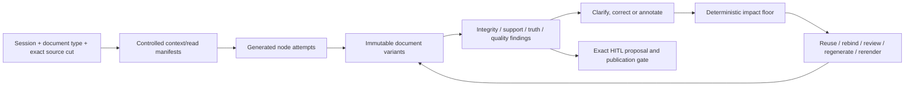

# Session-governed prose: headless implementation and live proof

HP, 2026-10-24. Authority: [0045](../intent/decisions/0045-prove-session-governed-prose-headlessly-before-ui.md).
Refines [PH](agentic-engineering/prose-harness.md), [HW](agentic-engineering/human-workbench.md)
and [PX](agentic-engineering/prose-hitl-priority.md); it does not replace them.
The first consumer is a repository-owned headless document lab, with synthetic
sources and real Anthropic generation plus optional OpenRouter/Jev judgments.

## HP-1: outcome and ownership

Build a usable, source-linked document engine before the UI. It must support a
small freeform brief and a structured long document through the same contracts.
Goals, structure and voice vary; evidence, provenance and effect laws do not.

| Owner | Responsibility |
|---|---|
| Agentic-kit prose domain | Immutable sessions/documents, dependency/context laws, strict checking, change/quality receipts |
| Existing Catalog Kit | Definitions, stable keys, exact pins, layer grants and tailoring |
| Existing Assignment Kit | Declared required/stretch goals, budgets, concerns and stop/pivot assessment |
| Existing HITL | Exact proposals, decisions, commit/revoke and delivery reconciliation |
| Headless lab | Source authority fixtures, actor/role policy, providers, spend reservation, independent oracles and actual experiments |
| app-kit, later | Reusable selection/inspector/clarification/diff views and interaction/accessibility proof |

Core prose remains independent of a particular catalog backend, UI, model vendor,
identity provider or persistence system. Compose the kits in the scenario/lab;
do not make the prose kit require another kit's runtime or a new shared engine.
Keep existing strict sourced APIs working. Legacy traceable-node rewriting cannot
be represented as qualified selective model regeneration.

## HP-2: immutable session intent and document types

`DocumentSession` is a versioned, digested input, not conversation history. It pins:
purpose, requested document type/profile, audience/voice/technical level, required
goals and criteria, optional stretch goals, expected coverage, constraints, source
cut, intended change, budget/deadline, escalation/clarification and stop conditions.
The app supplies trusted actor, policy epoch and allowed effects separately.

Each goal has stable identity, required/advisory class, eligible evidence method,
scope and acceptance. Caller-owned expected goal IDs are independent of the
authored goal list. Missing goals/evidence/usage cannot be satisfied by enumerating
what the generator happened to produce. Raw model confidence is not acceptance.
Use Assignment Kit's canonical assessment/budget concepts in the lab, avoiding a
second assignment evaluator inside prose.

A `DocumentTypeProfile` supplies structure, expected sections and fact families,
review criteria, default audience/voice, permitted variation, and dependency rules.
The example catalog includes incident executive summary, architecture decision,
technical design, draft agreement, operational runbook and generic freeform brief.
These are CUE/config data, not organization taxonomies hard-coded into Go.
Short/medium/long and executive/technical variants are independent profile data.

Profile provenance distinguishes supplied data from a genuinely resolved catalog
definition. Catalog use binds stable key, complete definition digest and resolved
layer/grant evidence, not a filename or claimed catalog ID. A freeform session can
use the same strict base with no catalog server; it must still declare expected
coverage, goals and evidence rules. Unknown structure is held or explicitly outside
the selected capability, never silently flattened.

Compose base -> domain/application -> document type -> session -> variant -> node
under explicit grants. Add/tighten is permitted by the owning policy; discretionary
changes need exact scope and provenance. Required source/support/access/effect
floors cannot be relaxed by session text, model output or a task-local extension.
Missing purpose/audience/required facts become explicit clarification or hold.
Permitted defaults retain their originating profile and are distinguishable from
the user's supplied choices. A goal/profile change creates a new session revision
and invalidates affected generation/review/consent even if output bytes are equal.

Normative proposals, assumptions, observed facts, inferred conclusions and supplied
definitions retain distinct status. A draft agreement cannot invent an existing
agreement or turn a proposed term into an established fact. Generic text is not
exempt from support/classification. Justifications expose criterion, relevant
evidence and a concise rationale, never hidden model reasoning or a universal grade.

## HP-3: document graph and reuse

Keep structural parent/order edges separate from semantic/context dependencies.
The minimum kinds are document, section, heading, paragraph/sentence, summary,
list/list-item, table and caption, with bounded extension rules. Stable logical IDs
and immutable version/content IDs serve different purposes. A new artifact binds
the tree, input/session/profile versions, attempts, reviews and rendered bytes.
Splits/merges have explicit predecessor mappings; selection pins expected versions.

Every factual node binds exact claim/fact/source versions and byte locators.
For new model wire formats, ask for ordered typed text segments and fact links;
derive claim identities and UTF-8 byte ranges deterministically in Go. A model
should not compute offsets, hashes, arithmetic or trusted status. Keep the existing
strict sourced wire compatible, with checked refusal on invalid model offsets.
The headless document engine's initial offset-bearing wire is not the final
usability proof; its replacement must retain independent classification/support
checks and Unicode/adversarial fixtures before the live document cohort.
Generation and review each record the actual exposed context, including templates,
goals, neighboring text, retrieved material, examples and redaction. Cite-only
dependency graphs are insufficient. When fine-grained exposure is not proved,
bind the entire exposed input cut conservatively.

The impact plan has distinct sets: regenerate, rerender, rebind-evidence,
review-again, reuse, and held/unknown. A parent container may need deterministic
rerendering while its independent children retain exact generated bytes. A summary
must declare its contributing semantic inputs. Cycles, missing nodes, unsupported
read-set coverage and omitted independently expected edges refuse strict reuse.
Optional semantic judgment can widen the floor or request broader review. It cannot
remove nodes. Unknown impact expands to a bounded full projection or holds.

Small factual correction: regenerate its dependent generated nodes and summary;
preserve unrelated nodes exactly. Global semantic change: regenerate/review every
affected section and variant, even if that costs more. Changes to exposed goals,
policy or neighboring context invalidate the corresponding reuse. Source revision
alone must not be called an unchanged source: evidence rebinding is explicit and
requires exact permitted equivalence plus fresh current-source/support checks.
Reused words never inherit fresh provenance, reviews or consent automatically.

Avoid exposing the whole document to every leaf generator and then claiming local
independence. The context assembler controls each bounded node input. Review can
use a wider fact set to catch contradictions; its wider read set invalidates review
reuse independently of generation reuse. Absence of a wholly undeclared semantic
dependency is not deterministically knowable. Required unknowns remain visible.

Corrections version factual inputs. Annotations version presentation guidance.
Criteria/voice changes have their own inputs and impact. Generated text is immutable;
manual editing stages a proposal or a separately attributed human-authored fork.
Streaming output is provisional until its complete bound response passes checking.

## HP-4: human loop and honest readiness

Use one headless propose/preview/authorize/commit/reconcile protocol for human and
agent clients. Trusted roles/attributes and exact target/purpose/destination/account
control effects. Suggestions and model-generated rationales confer no authority.
Bind artifact, evidence, session/profile, policy epoch, operation and expiry.
Changed inputs, revocation, concurrent edits or changed destination refuse old consent.
Unknown remote delivery cannot be blindly resent; reconciliation cannot renew consent.

Conflicts and ambiguity produce bounded, deduplicated clarification tasks with
evidence, scope and required/advisory status. Resolve, correct, annotate, defer,
dispute and unknown are distinct results with actor/provenance. A capped queue cannot
silently drop required questions or claim readiness. Human answers are input revisions,
not automatic factual truth. Disclosure applies to labels/counts/derived views too.
Restricted or tokenized cases need explicit qualified ports; unsupported disclosure
paths hold before model calls. Token possession is not reidentification authority.

Expose separate integrity, semantic-support, source-authority/truth, goal coverage,
clarity/style and effect-readiness findings. Findings name criteria, exact scope,
evidence and unknowns. Do not average a failed floor into a passing score. Style
warnings can be discretionary; required quality/coverage remains governed data.
No model-only self-review closes a required factual concern.

The headless pilot uses synthetic trusted actors/sources and owned effects. That
qualifies its selected path, not a production identity provider or delivery service.
All unsupported media, identity, retention or delivery profiles remain explicit.

## HP-5: independent acceptance and paid experiments

The owner fixes expected facts, contradictions, section/goal coverage, dependency
closures and effect outcomes before generation. The implementation lane cannot
rewrite the oracle to pass. Seed deliberate failures independently of model output.
Keep semantic expert review separate from deterministic shape/reference checks.

| Case | Required observation |
|---|---|
| HP-A01 Session/profile binding | Goal/profile/extension change invalidates exact affected reuse and consent; absent/foreign pins hold |
| HP-A02 Catalog + freeform | Six configured types and generic task-local goals resolve with provenance; missing expected sections/goals cannot pass |
| HP-A03 Factual floors | Wrong-but-valid citation, invented actor/number/date, unnumbered causal claim, conflict and missing support hold; factual headings/list items/table cells/captions cannot escape classification. Exact supporting bytes from a subsequently disproved or unauthorized source hold independently of semantic support |
| HP-A04 Local correction | Independent expected closure includes dependent summary; unrelated generated bytes stay exact; containers rerender separately |
| HP-A05 Broad change | Cross-section/global input change rebuilds enough; attempted model shrink and missing declared dependency refuse |
| HP-A06 Full context | Uncited prompt/neighbor/example/profile change invalidates appropriate generation/review reuse; unknown exposure cannot claim locality |
| HP-A07 Revisions/metrics | Immutable variants/history; text/node/byte/concept deltas distinct, fractions show numerator/denominator and added/rebound nodes |
| HP-A08 HITL | Correct/annotate/defer/dispute/unknown retain provenance; bounded clarification never hides required unresolved work |
| HP-A09 Authority | Shared human/agent RBAC/attributes, shared-credential principal separation, stale actor/policy/approval, changed purpose/destination, concurrent writers and replay negatives; independent/all-required variant groups and mid-batch epoch changes preserve exact common-snapshot readiness |
| HP-A10 Recovery | Partial/canceled generation holds; interrupted commit/send/reconcile cannot create a false success or automatic resend |
| HP-A11 Disclosure | Denied/restricted/retained-out source and unauthorized reidentification hold without private model disclosure |
| HP-A12 Wire/limits | Go/CUE required-field/Unicode/byte/overflow parity, bounded copies/context/graphs and injected clocks; no hidden fallbacks |
| HP-A13 Real generation | Real Anthropic responses across six document types, two audience variants and three repeats, with actual model/usage/stop metadata |
| HP-A14 Independent quality | Fixed 36 valid cells, at least 30 accepted on the first attempt and all 36 accepted within one predeclared bounded repair each; each type/audience has all three accepted. Record every false hold and reviewer effort. Required facts/goals are independently checked; zero critical false-publish cases across all planted negatives. Holding everything fails |
| HP-A15 Decision comparison | Paired baseline vs Jev-assisted cases, same immutable inputs/scope, all failures and actual usage retained; no deterministic floor shrinks |
| HP-A16 Economics | Calls/retries/cache reuse/tokens/cost per accepted result and latency reported; missing usage is unknown, never zero |
| HP-A17 Reproducible proof | Offline replay/adversarial suites, full gate, actual affected-consumer checks, strict plan proof and source-bound receipts |
| HP-A18 UI entry | Owner independently accepts all applicable headless cases and records remaining limits before opening the app-kit implementation lane |

Live corpus: incident executive summary, architecture decision, technical design,
draft agreement, runbook and freeform brief. Include short, medium and long outputs,
executive/technical audiences, local corrections, global changes, contradictions
and task-local goals. Three repeats test variability, not statistical population
accuracy. PH/HW headless cases supplement this matrix; visual/attended cases remain
future UI acceptance and cannot be marked complete from the lab.

Freeze the exact cell manifest, expected required facts/goals/sections, negative
seeds and adjudication rubric by digest before dispatch. The denominator includes
every planned cell, invalid/truncated/refused/failed response and repair, not only
successful artifacts. Missing cells fail cohort completeness. Independently review
all accepted outputs for factual fidelity, required coverage, unsupported causality,
clarity and audience suitability; record per-criterion findings and evaluator role.
Model self-review cannot close factual acceptance. A manual semantic judgment is
not a deterministic check. Report actual review effort where observed and unknown
otherwise. Cost per accepted result is undefined when the accepted count is zero.

The fixed PH/HW applicability roster for this reference is:

| Existing cases | Headless applicability and remaining limit |
|---|---|
| PH-01..16, PH-18..21, PH-23..27 | Applicable, including source truth, variants/group release, context, ChangeIntent, authority and recovery; fixture receipts must name each outcome |
| PH-17 | Artifact/node/export parity applies; dashboard/browser/keyboard/screen-reader inspection waits for the UI gate |
| PH-22 | Exact UTF-8 logical/version/selection and split/merge mapping applies; PDF re-extraction is unsupported in this text-only pilot and must hold if requested, never imply qualified PDF coordinates |
| HW-01..12, HW-14..23 | Applicable to the synthetic trusted actor/source/effect ports, including shared-credential separation, atomic fences, purpose/disclosure and fresh authorization after non-delivery |
| HW-13 | Deferred to UI: no viewport, focus or assistive-technology proof follows from headless JSON |

Applicability and unsupported outcomes are not passes. HP-A18 requires all selected
headless cases, positive usable outputs and exact unsupported refusals; widening the
profile requires a new roster/review, not silently removing failing cases.

First stage: <=$25 total, split $15 coding/$10 direct experiments. The initial
read-only Claude Code inventory consumed reported $0.335897. Subsequent coding
invocations use CLI spend limits plus independently recorded receipts. In the
observed CLI version, `total_cost_usd` is cumulative across resumes; track the
latest total per session and the difference per invocation, never sum restored
totals. The initial two implementation resumes reached $5.6358424 cumulatively;
the second invocation's delta was $2.9014667, below its $5 limit. The CLI estimate
is not an invoice or a hard billing fence. Leave per-turn headroom and do not use
an exhausted limit as permission for another paid invocation.
The lab reserves aggregate worst-case spend
before each provider request. Retries, failed and uncertain calls count. Use only
public synthetic inputs. No provider calls from Go tests. Preserve private raw
responses/usage separately from sanitized repository receipts, never credentials.

Freeze live provider/model/pricing configuration outside production Go constants.
Choose a cheap generation lane and an explicitly stronger review/escalation lane;
no undisclosed provider fallback. Jev uses the existing decision port/adapter.
Its useful candidate sites are ambiguity/conflict triage, conservative impact
widening and review/escalation routing. Answers/probabilities are heuristic evidence,
not source truth or calibrated safety. Justifications come from criterion/evidence
traces, not invented Jev reasoning text.

Predeclare paired task bars: no additional critical false accepts or missed required
closure; aim for >=20% lower cost per accepted result, or additional planted-gap
detection within <=10% extra cost. Retain misses. If the site does not meet its bar,
reject default adoption and record the result/revisit condition. A failed experiment
is useful evidence, not a reason to remove a required criterion. Budget equality,
unknown spend, disclosure risk or a critical false acceptance stops that live attempt.
Continue deterministic repairs within remaining authority, not unlimited paid retries.

## HP-5a: prospective length policy after the retained failed cell

[0046](../intent/decisions/0046-separate-document-sufficiency-from-length-targets.md)
records the fired0045 revisit trigger. The frozen v1 cohort stays failed; it cannot
be repaired by relabeling its86-word result or retrying the exhausted cell.

The next command-local corpus version adds `length_goal` with stable criterion ID,
`class: required|advisory`, integer minimum/maximum targets, and a nonblank reason
for a required range. Replace the unqualified v1 min/max gate only in that explicitly
versioned intake. Bind class, reason, criterion and independently expected scope to
profile/session goals, study/prepared digests and assessments. Existing required
profile floors cannot be downgraded by a session, generator or evaluator.

Report exact word count, target/range, criterion identity and deviation. Advisory
length produces a finding, not a whole-document hold. Required deviations hold.
Independently verify factual completeness, decision usefulness, clarity and audience
for either class. Hard token/byte/storage/budget bounds stay separate and enforced.

Keep at least one predeclared required long-artifact profile in the36-cell matrix
or its separately pinned capability roster; it must actually exercise the promised
long-document path. No removal, shortening, replay or denominator substitution can
close that evidence. New and original studies have separate results plus a common
stage spend total. Record every pilot, failed attempt, missing cell and repair.
Regrading captured bytes is an explicitly named reassessment, not new generation
or a new independent repeat. HP-A14/A18 remain unmet until their actual new proof.

Acceptance for HP-10: Go/CUE required/advisory parity; missing reason/criterion,
forged downgrade and changed pin refuse;86 words remains a recorded v1 failure;
new advisory policy reports a warning plus unassessed independent quality; an explicit
required minimum still holds; a missing/shortened long case refuses completeness.
No provider call is required to qualify these deterministic policy behaviors.

### HP-10 selected intake and assessment contract

This is a command-local v2 intake, not a new universal goals engine. The immutable
v1 corpus, protocol2 study, failed cell and receipts keep their original semantics.
The v2 fixture explicitly declares `version: prose-lab.fixture/2` and replaces
`min_words`/`max_words` with a closed `length_goal`: `criterion_id`, `class`,
`min_words`, `max_words`, `reason`. Required ranges need a nonblank reason.
IDs must not collide with semantic goals. Reasons are bounded at4096 UTF-8 bytes;
required reasons containing only Unicode whitespace refuse. Shape,
null/missing/unknown-field rules and bounds are mirrored in CUE and Go.

Both v2 prepare and capture require a separately owner-authored `--goal-scope PATH`
and an explicit `--goal-scope-digest SHA256`. No automatic pin is supplied. Read
the scope once through the bounded, regular-file, non-symlink intake and evaluate
the same bytes whose raw hash was pinned. Its closed contract records version,
scope ID, exact corpus digest, the six document expectations (document ID, required
semantic goal IDs, length criterion ID, class, range, reason digest), and a required
`long_artifact` witness (document ID, criterion ID, minimum >=1200). Reject omitted,
duplicate, foreign or mismatched expectations before creating artifact/journal
directories or clients. The long witness must be in the full36-cell grid, retain
the long band and a required floor at least as high as the pinned witness. Editing
both fixture and manifest cannot silently weaken the independently pinned scope.
The scope is a caller-reviewed assertion, not authenticated policy authority.
V1 rejects new scope flags rather than silently ignoring caller pins.

Bind both corpus and raw scope digests into v2 study and preparation identities
under `prose-lab.document-runner/3`. Bind length class, criterion, reason and range
into profile/session goals. Prepare emits fixed metadata for all six length goals
and the witness; raw reasons and document text remain in approved inputs/private
artifacts. Changed definitions require a new preparation and study. V1 digest,
protocol and receipt bytes retain their existing encoding.

Use the existing `fitnessfunctionregistry.AssessProfile` primitive per goal, also
used by Assignment Kit. Each goal has its own one-criterion, unscored profile.
Length has deterministic evidence; semantic goals admit human evidence but receive
no observation here, so remain unknown. Advisory interpretation belongs to the
outer goal class, never to weighted scoring. Do not invent assignment deadlines,
budgets, progress or a whole-assignment completion result to assess word count.
Retain canonical profiles/results privately; public output contains only bounded
criterion metadata, digests/counts and `semantic_quality: unassessed`.

`markdown-whitespace-fields/v1` measures `len(strings.Fields(Rendered.Markdown))`
over the full canonical Markdown, including headings and citation markers. It is
a reproducible whitespace-field count, not a linguistic count for all languages.
Re-render the verified version and require the supplied artifact to match. Bind
subject/version digest, Markdown digest, count-rule ID, length definition and scope
to the observation. Length assessment alone establishes neither source freshness
nor independent quality. V2 receipt2 reports pass/warning/hold plus exact deviation;
publication, independent acceptance and evaluated-negative-case flags remain false.

Offline qualification must cover v1 compatibility, the86-word retained failure,
advisory warning versus required hold, unknown semantic goals, independently pinned
downgrade/long-witness refusal, malformed/duplicate/null scope and fixture fields,
Unicode whitespace and artifact substitution. No paid calls or old-cell retries
belong to HP-10. A future cohort must be separately frozen and honestly report all
36 cells, repairs, missing cells, negative probes and cumulative stage spend.

## HP-5b: configured support-review proof

The [HP-11/12 support-review proof](prose-review-proof.md) first qualifies the
configured review site against all43 negative assertions and24 positive controls.
It cannot substitute for this document cohort, semantic goals, structural fault
coverage or actual authority proof. Always holding is an explicit failed result.

## HP-6: UI handoff after headless acceptance

Use a new app-kit Herdr session only after HP-A18. Reuse AK-PROSE-01,
AK-HITL-01 and AK-EVIDENCE-01 for one optional workbench family with independent
task views: inline, panel, split and full. The UI must retain exact selection,
draft/history/focus, evidence/criteria inspection, conflicts, intent/profile editing,
change previews, comparisons and honest readiness. Apps retain identity/persistence/
destinations. Browser, keyboard, narrow/theme/zoom, screen-reader/IME/clipboard,
error/recovery and measured human effort remain separate gates. No current UI
implementation or production-readiness claim follows from a headless pass.

Research: [Claude Code headless](https://code.claude.com/docs/en/headless),
[API-key billing](https://support.claude.com/en/articles/11145838-use-claude-code-with-your-pro-or-max-plan),
[Anthropic pricing](https://platform.claude.com/docs/en/about-claude/pricing),
[Jev typed decisions](https://openrouter.ai/docs/guides/community/jev).
Cost scopes: [Claude session accounting](https://code.claude.com/docs/en/agent-sdk/cost-tracking#accumulate-costs-across-multiple-calls)
and [CLI limits](https://code.claude.com/docs/en/cli-reference).
These establish documented interfaces/pricing, not workload performance.

## HP-5c: bound document review intake

[HP-13/14](prose-document-adjudication.md) specifies offline review packets and
caller-declared canonical goal replay before a separately frozen one-cell long pilot.
Unknown human semantic judgments remain unknown; no publication or UI gate is closed.
