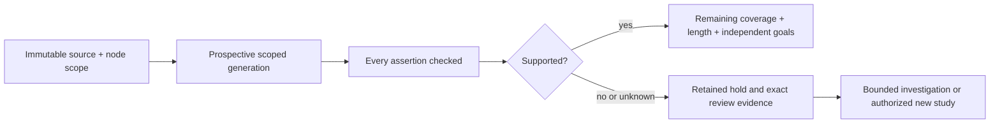

# Scope-aware prose generation and support calibration

HP-15. Selected design; HP-16 offline source is implemented and locally qualified. The [HP-17 live trial](../evidence/prose-headless/2026-10-25-paired-live/README.md) failed
qualification at108/140. [0047](../intent/decisions/0047-qualify-oracle-semantics-before-prompt-tuning.md)
requires [oracle qualification](prose-oracle-qualification.md) before further tuning.
Generation guidance remains unimplemented; no candidate adoption follows. This is the next work unit
inside 0045's existing prose incubation. It adds no third slot or UI work.
The [retained long pilot](../evidence/prose-headless/2026-10-25-long-pilot/README.md)
failed before a document existed.0045's headless-failure and DA's first-pilot-result
revisit triggers fired.0046's required long witness and all source/authority floors
remain binding. The failed v1 cell and failed new pilot retain their identities.

## Failure and decision

The native support reviewer rejected a sentence calling the defined restart goal
narrow. An independent blind agent and owner source review support that framing.
The next, unreviewed sentence claimed that nothing in the document describes enacted
behavior, despite its description of the observed current receiver. It exceeds its
cited proposal's scope. The native site did not reach that sentence. This is one
observed disagreement and one agent-identified draft defect, not measured population
accuracy or authenticated human truth.

**SC-1:** Preserve the original hold. Improve generation scope and reviewer semantic
discrimination together. Never promote a disputed model hold into acceptance.
**SC-2:** Add a prospective command-local protocol, leaving every frozen v1/v2
preparation, template identity, receipt and replay path unchanged.
**SC-3:** Keep all facts available for contradiction review. Do not save tokens by
silently restricting the authoritative context to cited facts.
**SC-4:** Qualify a revised support prompt against the full old roster and new
contrasting regressions before another document-generation experiment.

## Command-local protocol

Use a separately pinned support-review protocol and scope version. Keep old
support-review/1 and review-scope/1 exact 67-case behavior intact. New scope/2
retains the entire old 24-positive/43-negative manifest and adds exactly three
explicit regression rows. Each extension carries a bounded unique ID, document ID,
assertion, cited IDs, expected status and label provenance. Control IDs, expected labels and label provenance
never enter the provider payload; cited fact IDs remain available. All cases reference the unchanged pinned corpus
and goal scope. No caller-supplied fact text replaces the corpus ledger.

The new 70-case manifest is25 positive and45 negative:

| Addition | Reference expectation | Reason |
|---|---|---|
| Observed narrow restart-goal sentence | Supported | Nonmaterial framing of the supplied defined goal |
| Observed nothing-in-document-enacted sentence | Hold | Local proposal does not establish document-wide absence; current receiver is described |
| Authored claim that narrow scope excludes validation and duplicate handling | Hold | Material scope removal conflicts with the fixed pilot requirements |

The first two are development regressions derived after observing the pilot, not
held-out samples. The third is an authored contrast. Preserve this distinction in
reports. No wording-only shortcut may ignore all appearances of narrow or therefore.

The revised support template distinguishes connective/scoping phrasing from a
material new causal, authority, temporal, actor, numerical or content-coverage claim.
A source fact that describes a proposal cannot establish properties of the whole
generated document. Ambiguous material scope stays inconclusive/held. The result
remains supported/unsupported/inconclusive and cannot authenticate source truth.

A future generation protocol adds command-local, versioned guidance before native
request binding: write only this node; scope qualifications to the described pilot,
proposal or source; never infer the absence or status of other generated content
from local facts. Use a lab-owned wrapper before attemptRunner, not a silent core
prompt change. The wrapper version and exact guidance bytes must enter preparation, native
request, journal and replay bindings. Tests must prove that old-protocol selection
leaves old requests unchanged. It cannot alter supplied facts, clear review holds or change authority.
No generation adoption or library contribution follows before measured proof.

The [paired command contract](prose-review-pair-contract.md) fixes the current
input/identity/privacy/state interfaces before source acceptance.

## Pair identity and common budget

Use one bounded paired-study contract, not independent journals with unrelated
caps. Its common journal binding includes both named protocol variants, exact
model/settings/prices, corpus/scopes and the 70 logical controls. Derive exactly 140
unique execution IDs from variant plus logical case. Preparation, marker, reservation and report bind both identities, the common study
and exact native request/response hashes. Execution/control identities stay in
metadata, outside the provider payload.
Changing only a selected variant must not change the common journal header or allow
response/marker reuse. The legacy v1 study and marker identities stay unchanged.

No shared generic experiment framework is admitted. The two named variants and
exact ordered 140-entry execution manifest are this command-local experiment's
contract. Request collection uses real encoders; protocol selection changes only
its intended versioned prompt, never facts, model settings or expected labels.

## Paired qualification and stop rules

First implement offline real-encoder preparation/capture/replay for both prompt
versions against the same exact 70 cases. Compare serialized requests and replay
results for every old 67 case under the old protocol/scope against the pinned
[HP-12 wire digests](../evidence/prose-headless/2026-10-25-support-live/preparations.json);
a passing new roster alone does not prove old compatibility. Reject a changed/omitted/duplicate roster,
case, scope, model, native request, response, usage or label binding. Reuse existing
locked journal and native replay owners. Required unknown/invalid/missing counts
must be present; an omitted trial never becomes a pass. Keep default metadata
output free of prose, labels, reviewer identity and rationale.

Only after that source passes its full gate and independent review, freeze a new
paired live experiment: 70 immutable cases by two prompt versions, 140 actual planned
calls, the same model/settings/prices/facts, interleaved by case with predeclared
order, one reservation ledger, <=$5 additional journal cap and the cumulative
$10 direct-stage limit. Dispatch sequentially and fully reconcile the last
reservation before the next dispatch. Check both caps before each call; a pending
reservation stops the whole pair, not only its variant. Overlapping full-context
reservations would exceed the intended cap despite lower settled usage. Existing costs and failed attempts remain charged. This
proposal is not a dispatch freeze and authorizes no automatic run. Stop on a native/protocol/accounting failure in either version or the first
candidate mismatch. A baseline semantic mismatch is an observation, not a reason
to omit its paired candidate; the known baseline rhetorical hold must be observable.
Retain the planned position and outcome for all 140 executions, including every
unexecuted position after a stop. Keep variant reports separate. A baseline semantic
mismatch still runs its paired candidate; native/accounting failure stops before
dependent calls. No retries, provider
fallback, dropped controls, retrospective labels or sampling upgrade.

Keep the new site only if every required case completes with known usage, all
positives are supported, all negatives held, and the observed rhetorical false hold
is removed without a new critical false-support case. Missing/inconclusive results
fail qualification. A matching response is cohort-scoped, not calibrated accuracy.
If the old site also improves, report that rather than attributing a difference to
the new prompt. Record calls/tokens/cache/cost/latency and disagreements by version.

Only a qualifying review site permits a separately frozen new document study.
The next generation study must retain the failed pilot and required long witness,
measure all section purposes and unsupported document-wide claims, and keep actual
human goals unknown until supplied. It cannot retry this pilot's journal or marker.

## Acceptance and rejected approaches

- **SC-A01:** Old67-case wire and replay compatibility remain proven offline.
- **SC-A02:** New70-case manifest is exact, corpus-bound and independent of outputs.
- **SC-A03:** Real provider request preparation binds protocol/settings and keeps
  oracle labels out; capture/report reject changed bytes and incomplete accounting.
- **SC-A04:** Planted artifact-scope and material narrow-scope negatives cannot be
  dropped when the benign framing case is added.
- **SC-A05:** Baseline/candidate observations remain separate and fail closed.
- **SC-A06:** Full local gate and strict structural proof precede source completion;
  real paired qualification is a separate unclaimed receipt until actually run.
- **SC-A07:** No actual human, source/publication authority, full document or UI claim.
- **SC-A08:** Generation changes are prospective and separately qualified, with
  complete failures and long-artifact/whole-document requirements retained.

Rejected: remove the support gate, strip disputed words after generation, convert
model disagreement to human approval, label unreviewed assertion9 a native miss,
add trusted scope labels that a generator can self-assert, shrink required context,
run the full document matrix now, silently change frozen prompts, or build a generic
semantic/policy engine. None solves the observed pair honestly.

Revisit on a new critical false support, persistent harmless-framing hold, missing
scope dependency, attempt/accounting mismatch, required-floor change or 0045 budget
review. The broader command, HITL, UI and full HP-A14/18 goals remain open.
