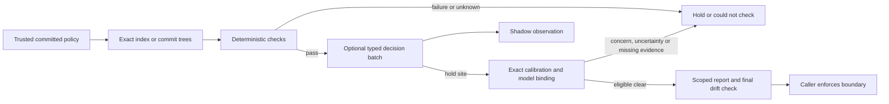

# Quality boundaries over exact Git snapshots

Owner decision: [0030](../intent/decisions/0030-quality-boundaries-compose-hard-rules-and-calibrated-holds.md).
Adoption: [guide](../quality-boundaries.md). Contract: `cmd/quality-gate/schema.cue`.
This is an experimental command-local composition, not a new quality framework.

## Contract

QB-1. Enforcement loads policy from a committed regular Git blob, default `HEAD` locally.
CI supplies its independently trusted base. Local files are for validation/bootstrap
observation only. Version/IDs/bounds/fields are strict; duplicate keys, nulls, unknown
fields, invalid selectors and trailing input are rejected. Runtime validation also checks
collection presence that the tested `cue vet -c` alone does not reject. No fallback on invalid policy.

QB-2. A staged check reads the index tree and its HEAD base, never worktree content.
An explicit alternate index is supported; ambient Git redirection is cleared. Committed
checks bind base/proposed trees and resolved commit. Git filters, hooks, external diffs
and fsmonitor are disabled in plumbing. The tool runs no repository application code.
Final rechecks detect changes during evaluation, not mutations after a hook returns.

QB-3. Pre-push consumes Git's four-field stdin for every advertised update, at most 32.
New refs compare against an empty tree; deleted refs have no proposed tree. Missing
objects fail closed without fetching. Each snapshot has file/byte bounds; the entire
invocation has a deadline. This evaluates final trees, not all intermediate history.

QB-4. Rules are independent hard checks: conflict markers, forbidden path, maximum
bytes, JSON syntax, and required changed surviving companion. Prefixes are OR, suffixes
are OR, the two groups are AND. Prefix `""` means all paths. These are literal selectors,
not globs. A companion proves presence only and is required for selected deletions too. Content rules cannot silently clear binary,
symlink or gitlink input. Deleting a forbidden file can repair a policy violation.

QB-5. Sites select changed before/after bytes and ask `clear | concern | insufficient`.
Input contains exact policy/tree/blob identity and is bounded without silent truncation.
No remote call without `--allow-remote`; provider `none` is useful offline. Credentials
and model pins come from named environment variables. Exact returned model is required.
One provider batch per snapshot at most, no retry/fallback, bounded time/input.
A shared invocation budget defaults to one dispatch across all refs; no dollar-cap claim.
Hard failure skips model dispatch. Model decisions never remove hard findings.

QB-6. A hold clear needs confidence plus valid calibration. Binding is
`policy-id/boundary/site-id`, site digest, provider and resolved model. Digest includes
the effective fixed question/options, state/confidence recipe and all configured site
questions/versions/selectors/boundaries/thresholds; it excludes mode/calibration.
Sites in one policy share context, which their cohort binding makes explicit.
Labels have unique case IDs, expected/actual classes, confidence and human/computed
provenance. Minimum expected-class coverage and observed answer-band sample/accuracy/
Wilson lower-bound bars are explicit. The existing decision foundation recomputes the
reading. Expired, mismatched or insufficient evidence cannot clear. Labels are trusted
owner inputs, not independently authenticated truth; synthetic tests are not live accuracy.

QB-7. Exact shadow caching is optional, TTL-bound, private and atomic. Any active hold
disables cache authorization. Cache hits are observations, never new independent labels.
Reports contain hashes, paths, outcomes and fixed reasons, without raw source/errors/keys.

QB-8. Exit 0 is pass or explicit observation, 1 is a policy hold, 2 is invalid/unknown.
Observation is labeled `observed`, never `pass`. JSON is stable structured output, plain
text serves humans. A missing required input cannot become a successful required check.

## Acceptance and boundaries

| Case | Required result |
|---|---|
| Staged bad JSON, unstaged repaired JSON/policy | Hold on staged bytes using committed policy |
| Changed index, proposed moving ref or policy ref during evaluation | Unknown, nonzero |
| Multi-ref push with one bad tree | Reject entire invocation |
| New ref with bad full-tree file, missing remote base | Hold, unknown respectively |
| Binary/symlink/gitlink selected by content rule | Unknown, never silent pass |
| Duplicate/unknown/null policy, bad bounds | Invalid before provider dispatch |
| Remote permission absent, timeout/refusal/identity mismatch | No unauthorized call; required site held |
| Missing/stale/wrong-site calibration, inadequate classes | Required site cannot clear |
| Tampered or stale shadow cache; any active hold | No cached authorization |
| Existing Lefthook jobs plus fragment | Existing jobs remain; actual negative commit/push rejected |
| Same input without provider/Fathom | Offline rules run normally |

No generic security scan, complete standards judgment, test adequacy proof, promise
ledger, waiver UI, automatic policy edits, or fleet-wide installation. Named project
recipes are guidance, not adoption receipts. Required CI/branch protection is the real
integration boundary; do not build its trusted binary from incoming proposed code.

## Research and limits

Checked 2026-10-22: [Git hooks](https://git-scm.com/docs/githooks),
[Lefthook stdin](https://lefthook.dev/configuration/use_stdin/),
[extends](https://lefthook.dev/configuration/extends/),
[OpenAI Decisions](https://developers.openai.com/api/docs/guides/decisions),
[TypeSafe primitives](https://docs.typesafe.ai/introduction),
[GitHub protected branches](https://docs.github.com/en/repositories/configuring-branches-and-merges-in-your-repository/managing-protected-branches/about-protected-branches).
Typed outputs/probabilities help composition, not semantic determinism. Historical
synthetic missing-information false clears remain a reason to require independent labels.
Live provider quality, savings, real-project CI adoption and false-hold burden are unmeasured.

## Excellence pass

Decision [0031](../intent/decisions/0031-bind-working-methods-to-deterministic-boundaries.md)
adds the following required checks, implemented in the existing command.

QB-9. Git resolves to a canonical executable outside the candidate tree before any Git
command. CI should supply a trusted absolute `--git-bin`; its workflow, runtime and
OS remain trusted inputs. Matching raw commit-OID push sources are valid Git inputs.
This is not a sandbox or authentication of the host installation.

QB-10. Calibration binds the entire effective recipe and configured site cohort. Request
questions are canonically ordered, matching the recipe. A cohort change invalidates old
calibration. Cross-site context is intentionally shared; separate policies/invocations
provide disclosure separation. Renew calibration from genuine evidence, not hash edits.
Provider distributions may round within 0.01 of one; confidence never exceeds the chosen
reported probability and is scaled down for overfull sums. The recipe binds this law.

QB-11. All HTTP response bodies, including errors and redirects, have the same 1 MiB
cap. A trusted `model.max_batches` (1..32, omitted means 1) bounds dispatches across the
whole invocation. Reserve at dispatch, charge failed attempts, and do not charge exact
shadow-cache hits. Reports expose actual attempt, ordinal and limit, without dollar claims.

QB-12. A push captures and preflights all proposed refs, including required model source
representability and request bounds, before any provider dispatch.
Any hard-rule failure, missing snapshot or required-model-input unknown skips all
provider evaluation in that push. Unknown shadow inputs remain advisory; valid other
refs may collect bounded shadow observations. Explicit shadow-only observation collects judgments without claiming
enforcement. Deletions have no proposed content but still require boundary configuration.

QB-13. The combiner independently enumerates applicable required model sites from
trusted policy. Omitted/duplicate/wrong-mode receipts, silenced holds and clear without
current calibration/pins cannot pass. No required boundary policy means unknown;
shadow-only checks require observation. Report unselected changed paths and exclusion
reasons, without treating the observed file list as a complete requirements catalog.

QB-14. Source validation and question ordering are deterministic. Regression witnesses
exercise candidate Git shims, raw-OID pushes, changing cohort/recipe, rounded confidence,
oversized error bodies, dispatch fanout, later-ref hard failure, empty enforcement,
omitted/forged required receipts, per-ref observed outcomes and unselected-path visibility. Broader workflow
blueprints are in [deterministic working methods](deterministic-workflows.md).
