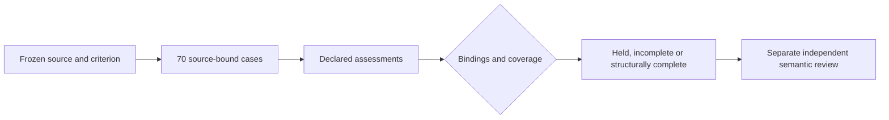

# Offline source-bound oracle qualification

Scope: HP-19 and [OQ-A01..07](../../../designs/prose-oracle-qualification.md).
The [receipt](receipt.json) binds 60 command, test, criterion and input files to
clean source `98a04308490563dc0efa260542913d429b8079f7`. The compiled binary records
that revision and `vcs.modified=false`. No new direct provider calls occurred.
HP-20 semantic adjudication remains open. A declared assessment is not truth,
authenticated human review, permission to publish or admission to a new study.

## Executed proof

| Instrument | Actual result |
|---|---|
| Full local gate | `task validate` passed, including command-package race tests in 200.134 seconds |
| Canonical identity tests | Independently reconstruct packet and case hashes and resolve source pointers for all70 cases |
| Privacy and boundary tests | No content by default; wrong identities, source references, duplicate IDs, byte bounds, effect flags and output failures refuse |
| CUE/Go parity | Actual packet, content packet, held/empty/synthetic report and held-assessment shapes pass; 72 interpretation/reason combinations checked |
| Clean compiled prepare | [Metadata packet](packet.json), exit0, exact70 controls and embedded criterion; metadata/content packet identities agree |
| Clean compiled held report | [One ambiguity and69 unreviewed](held-report.json), exit1; existing held example includes proposed references without clearing the hold |
| Clean compiled incomplete report | [No assessments and70 unreviewed](empty-report.json), exit2 |
| Synthetic all-declared rehearsal | All70 structurally affirmed, exit0, all six authority flags false; fabricated declarations are not semantic adjudication |
| Trace-only reuse | Changed study model, prices and budget preserve semantic packet/case identities and accept the same held assessment; trace study digest changes |
| Invalid case binding | Exit2 with empty stdout |
| Historical paired replay | Previously failed HP-17 report reproduces byte-for-byte, exit1, with zero new calls or samples |
| Linux/Windows amd64 | CGO-disabled cross-builds pass; no native runtime qualification |

The native children had only PATH, LANG and TZ, used absolute input paths and a
private working directory without a source criterion file. Read-only assessments
remained mode0400. No key, journal or provider was needed. The embedded criterion
SHA256 is `bb12ed77442b05cc9912247881fce489a35d5de4749fb1efe364c5c2011acaac`.
The packet digest is `f5fc178e7fea3042e3e5ff8f70aa8b00046891b8f13f9961703a03908d198e65`.

## Retained failures and limits

Independent checks first exposed duplicate-ready-report admission, mismatched
content/state bindings, inconsistent cited/context fact records and six affirmed
ambiguity-reason combinations admitted by CUE. The repaired relations have
negative checks. Counter references and proposed references on ambiguous rows
remain allowed by the contract; neither clears ambiguity or asserts authority.

The source graph initially rebuilt during handoff. The CLI's indexed-service probe
and a ten-second status probe timed out; MCP returned partial with no verified
row. A later [source verification](fathom-source.json) at111c12c passed: the symbol,
verified source tier, 28 statically reaching tests, absence of contradictions and
product-entrypoint wiring all verify. Runtime attestation in Fathom remains unknown;
executed test/runtime results above are separate. HP-19 is complete at this offline
scope. HP-20 semantic adjudication remains open.

No library roots or dependencies changed, so downstream consumer checks were not
rerun. Direct-stage usage-priced cost remains $0.778690 across197 known calls.
No new paid study, source authentication, human acceptance, UI or release follows.
HP-20 must resolve every old control and its modal contrasts before new calibration.
