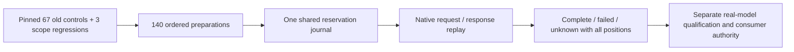

# Offline paired-review source qualification

Scope: [SC-A01..07](../../../designs/prose-review-scope-calibration.md) and the
[paired command contract](../../../designs/prose-review-pair-contract.md).
[Receipt](receipt.json) binds the exact command/test/input files and actual logs.
This is source and offline runtime evidence. No new provider call or model benefit
is claimed. HP-17's real comparison and HP-18's generation guidance remain open.

## Executed proof

| Instrument | Actual scope / outcome |
|---|---|
| Parent legacy golden test | All 67 published preparation and native request digests unchanged |
| Compiled CLI preparation | All 140 selected executions prepare without credentials or network; common study digest identical across variants |
| Compiled paired-baseline wire check | All 67 corresponding native request hashes equal the old published hashes |
| Compiled legacy native replay | Existing 67 real native outcomes reproduce the published report exactly, with no fresh calls/samples |
| Parent complete fake-native comparison | 140 calls, baseline false hold retained, paired candidate still runs, all 70 candidate controls matched |
| Parent boundary tests | Candidate stop, wrong variant/order/study pin, CUE false qualification, unknown reservation/lock, cancellation/help/output failures |
| Context/privacy | Every native payload retains the full corpus document facts and exact cited IDs; candidate changes only its prompt, no oracle/provenance/control ID leakage |
| CUE output/refusal checks | Actual prepare/report/content shapes pass; false qualification and invalid lane limits refuse |
| Full local gate | task validate passed; command package race tests 128.825 seconds |
| Windows/Linux amd64 builds | Compile with CGO disabled; no platform-native runtime claim |

The [complete preparation manifest](preparations.json) and representative
[baseline](baseline-prepared.json)/[candidate](candidate-prepared.json) metadata
show the model, protocol, source pins and declared budget caps. The binary was built
from the recorded working-tree source with vcs.modified=true. It is not a clean
release or a separately frozen paid-dispatch executable.

Fake responses and usage are independently authored by parent tests, not labels
returned from the new loader. Their 280 synthetic microdollars test settlement only.
Real direct-stage accounting remains $0.424414 across the previously recorded 89
calls. No new model observation, human judgment, accepted document or UI entry follows.
The old native replay is consistency evidence, not a new model repeat or authenticated
provider custody. A future live freeze must recheck current source, inputs and prices.

## Retained failures and repairs

The [differential review](../../../assessments/2026-10-25-prose-paired-review.md)
records exact scope and trust boundaries. Before commit, independent checks found:

- **SC-F1:** CUE accepted qualified=true with incomplete counters; its qualified
  branch now requires complete known baseline/candidate counts.
- **SC-F2:** Generic lane CUE accepted a provider/output range Go rejected; paired
  CUE now matches the selected Anthropic/output bounds.
- **SC-F3:** Unused reason files were tolerated for pending/unknown outcomes;
  artifact allowances now depend on the exact outcome state.
- **SC-F4:** Qualified counters could coexist with a missing/invalid row; every
  qualified row now has a known completed state, with parent negative vet cases.
- **SC-F5:** Two forged maximum int64 latencies wrapped the total; checked addition
  now refuses before emitting an invalid audited report.

One parent test also incorrectly treated empty refused report output as zero cost.
Independent root-cause review confirmed full reservation retention and the unknown
journal lock. The corrected test verifies both receipts, the lock and refusal of
the paired candidate. No journal recovery or weaker gate was introduced.

Encoding/cancellation failures write no JSON. An arbitrary writer may accept bytes
before returning an error; the command returns 2 but cannot revoke stdout. That
physical boundary is explicit rather than an atomic-output claim.

## Remaining gates

The candidate prompt has not been qualified with a real model. Do not run a new
generation study or relabel either failed pilot. HP-17 requires the independently
frozen 140-call comparison, complete denominators and cumulative spend checks.
HP-18's prospective generation wrapper, required long document, independent goals,
full headless/HITL/selection and UI entry remain open. Library roots/dependencies
are unchanged, so consumer checks were not rerun or upgraded here.

HP-16 source also passes strict structural plan proof at dec53f3. Runtime proof
comes from the separate executed instruments above. The completed worker was
archived with all 2,362 regular files and one symlink read back before removal.
The unverified native prose lane remains preserved; no stale Herdr IDs were used.
