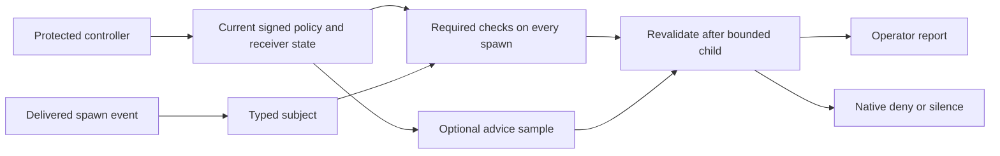

# Qualifying governed spawn checks

Experimental HSE profile, explicit build/test use. [0044 and HSE](designs/harness-spawn-economics.md)
define the contract. This guide does not install hooks, enroll keys, request native
authentication or change your coding-agent configuration.

Use a required check for a computable rule. Use sampling for optional observations.
Do not ask a model whether an omitted model, effort, tier or fork marker satisfies
an explicit policy. A model would add cost and uncertainty to that decision.



## Choose the surface

| Need | Surface | What its result means |
|---|---|---|
| Existing tokenomics guidance | `agent-hooks hook` | Existing economics behavior, including fallback and eventual denial-loop release |
| Test one explicit policy and typed subject | `agent-hooks evaluate-spawn` | Private peer result with required checks and no fallback, ledger, history or denial-loop release |
| Inspect governed selection and child outcome | `harnessctl hooks evaluate` | Current protected-boundary report with closed outcomes and process/write counters |
| Render a delivered native event | `harnessctl hooks run` | Denial/fault exits 2 with fixed stderr. Pass or scoped resume exits 0 silently |

Silence is absence of a hook decision. It is not permission to execute. The native
renderer does not prove that a host delivered every applicable event, honored a
denial, blocked a missing hook or protected its configuration.

## Start with synthetic tests

Use a physical absolute scratch directory outside the module. `/tmp` and `/var`
may be aliases on macOS. Resolve them before selecting controlled paths. Scope
environment settings to this invocation rather than changing your global config.

```sh
mkdir -p /absolute/private-scratch/hse/tmp
(
  export GOTMPDIR=/absolute/private-scratch/hse/tmp
  export TMPDIR=/absolute/private-scratch/hse/tmp
  go test -race -count=1 ./internal/jsonwire ./internal/hookeval ./cmd/agent-hooks
  go test -race -count=1 -tags harness_maintenance ./cmd/harnessctl
  cue vet ./internal/hookeval/...
  cue vet ./cmd/harnessctl/...
  go build -o /absolute/private-scratch/hse/agent-hooks ./cmd/agent-hooks
  go build -tags harness_maintenance -o /absolute/private-scratch/hse/harnessctl ./cmd/harnessctl
)
```

The tests use synthetic inputs and injected authority/native-process seams.
No real model, approver enrollment, authentication or installed hook is involved.
Ordinary `harnessctl` builds report unsupported before reading controls or input
or starting a process. Keep build identity with your observations.

## Establish independent selection

| Required input | Source of authority |
|---|---|
| Controller path, exact raw pin and hook argv | Protected operator selection outside candidate writes |
| HC8 registration and signed sources | Enrolled source-policy keys and exact project/principal selection |
| Required control | Mandatory `before-tool`, full sampling, hold on fault, no maintenance |
| Advice control | A different advisory `before-tool` control, hold on fault, delegated rate |
| Spawn profile | Closed pinned `harnessctl.spawn-profile/1` reference for that project and host |
| Policy and evaluator | Explicit exact bytes selected by the profile, not candidate discovery or PATH |
| HMT state and native clock | Protected receiver binding, storage and qualified native helper |
| Preparation namespace | Protected selected root and complete ancestor chain |

The [configuration guide](../cmd/harnessctl/README.md),
[maintenance guide](../cmd/harnessctl/maintenance.md) and HSE-2 specify these
records. Validate against their CUE definitions before invoking the receiver.
Existing controllers without `hooks` remain valid for their existing operations.
Adding a hook profile changes the immutable controller binding: it does not let
you replace the controller of an initialized receiver. Rollover is not implemented.
Do not reset state, delete binding evidence or copy synthetic test keys to enroll
a real receiver.

The selected host must have model mappings. Strict evaluation requires explicit
model selection, Codex effort and a `marker` or `deny` fork policy. Tier names,
model identifiers, effort values and escalation markers remain consumer policy
data. Claude forks retain native inherited-model semantics. Codex context forks
still require model/effort and add the configured context-fork check. Claude resume
is a scoped non-spawn only after the protected policy/profile is valid.

Do not use the HC8 README's toy unchanged: its advisory control is `after-tool`
and its signed team layer forbids maintenance. A candidate or new filename cannot
create missing authority. Synthetic HSE tests supply independently compatible
control fixtures.

## Inspect an explicit event

After independently establishing the prerequisites, use the exact selected native
event file. No transcript or agent-definition discovery is performed.

```text
harnessctl hooks evaluate --controller ABS --controller-sha256 HASH --project ABS --host codex --input ABS --format json
```

Expect `harnessctl.spawn-report/1`, `noActionAuthority:true`,
`coverage:"selected-project-spawn-events-only"` and `installation:"unobserved"`.
Public reports omit paths, IDs, digests, model names, prompt text, effective controls
and proof material. They distinguish attempted, invoked and completed evaluator
and native-clock processes, plus attempted and committed state writes.

| Exit | Meaning | Operator action |
|---|---|---|
| 0 | Required checks passed or valid scoped resume | Assess the declared coverage. This is not an effect approval |
| 1 | Complete structural denial | Correct the assignment or use the independently allowed escalation marker |
| 2 | Incomplete, unsupported, drifted or unavailable boundary | Inspect the fixed code and protected prerequisites before retrying |

Hold reports clear semantic decision/advice fields and preserve actual counters.
A process completion does not mean a valid result, committed state or host effect.
Uncertain output is not a reason to rerun a child automatically.

Advice selection is keyed to the delivered event and site. Repeating the same
event keeps its sample draw even if the prompt or rate changes. Rate changes move
the threshold, not the draw. Required checks always run, including during a valid
advisory maintenance window. Repeating a denial never releases it on this path.

## Native integration remains a qualification task

The candidate native command is:

```text
harnessctl hooks run --controller ABS --controller-sha256 HASH --project ABS --host claude
```

It consumes one bounded stdin event and takes no output-format or input-file flag.
Pass and valid resume are silent exit 0. Denial or fault has empty stdout, fixed
sanitized stderr and exit 2. It never emits an allow, ask, tool-input rewrite or
continuation directive. It forces advice off because no native observation
recipient has been admitted. GT15 owns that future privacy/retention contract.

Before installation, qualify the actual host version, event delivery, expected
tool aliases, crash/timeout/missing-executable behavior, configuration protection
and denial effect. Both selected host references document an exit-2 blocking path.
[OpenAI hooks](https://learn.chatgpt.com/docs/hooks) also describe uncovered paths.
[Claude hooks](https://code.claude.com/docs/en/hooks) documents `onFailure:"block"`
from 2.1.295. No equivalent Codex setting was established by the source lookup.
Source configuration and an external synthetic driver do not prove interception.

Missing policy, malformed native fields, stale roots, locked state, clock faults,
unknown child results, executable drift, timeouts, stderr or ambiguous cleanup hold.
No model can override any of these. Recover through the protected HMT procedure,
which creates locked state. Rearm requires fresh independently qualified authority.

## Evidence to retain

Record source and binary pins, actual platform/tool versions, selected case roster,
raw private failures and sanitized counts. Test the exact policy, native shapes,
required denials at advice rates 0/partial/full, active maintenance, post-child
drift and timeout/output faults. Include default unsupported behavior and legacy
output regression. Cross-compilation is a separate observation from native execution.

HSE's predeclared synthetic bars are pure evaluator p95 at most 25 ms, protected
receiver p95 at most 500 ms and max at most 1500 ms, plus nine alternating legacy
pairs with unchanged bytes and median overhead at most 25%. Retain cold and warm
results and workload identity. A miss requires tuning or parking this integration.
It does not justify changing the bar after observing the result.
