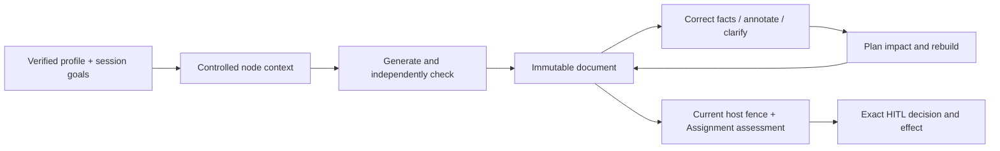

# Synthetic headless prose reference

Status: additive engine and consumer composition, tested offline with synthetic
ports. This is **not qualified realistic prose, production publication or UI entry**.
[HP acceptance](../../docs/designs/prose-headless-proof.md) and its independent
cohort remain authoritative. The separate transport canaries are not document proof.

## Ownership and dependency direction

| Layer | Owns |
|---|---|
| `kits/governed-prose-kit` | Session/profile/tree, context manifests, strict source/support checking, immutable versions and change closure |
| Catalog Kit | Resolved definitions, stable keys, bundle/node/policy identities |
| Assignment Kit | Required/stretch goal assessment from independent scope and eligible evidence |
| HITL | Exact decisions, atomic effect/receipt, revoke/consume and delivery reconciliation |
| This scenario | Synthetic host identity, clarification, source truth, effect fence and variant composition |
| Consumer | Real source/identity/persistence/destination authority and its qualification |

Prose core imports none of the other kits. Consumers can use supplied/freeform
profiles without a catalog server. Nothing in this package calls a model or network
on its own; the injected prose client and host sender own those effects.

## Core API

Import `github.com/geoffmilleraz/agentic-kit/kits/governed-prose-kit` as `prose`.
CUE and Go fields are defined beside `session_*.go` in that package.

| Task | API |
|---|---|
| Profile | `NewDocumentTypeProfile(DocumentTypeProfile)` |
| Session/revision | `NewDocumentSession(profile, SessionInput, parent *DocumentSession)` |
| Engine | `NewDocumentEngine(client, SourceProvider, SupportReviewer, DocumentConfig, clock)` |
| Generate | `engine.Generate(ctx, DocumentTarget)` |
| Plan/rebuild | `engine.PlanChange(previous, next, rebinds)`; `engine.Rebuild(ctx, previous, next, rebinds, RebuildOptions)` |
| Inspect/render | `InspectNode(version, id)`; `RenderMarkdown(version)`; `engine.Render(ctx, version)` |
| Integrity | `VerifyProfile`, `VerifySession`, `VerifyDocument` |

1. Supply or genuinely resolve a profile with required goals/sections, defaults and
   provenance. Freeform profiles still need base requirements. Catalog provenance
   in a struct is not a resolution proof; use the composition below.
2. Create a session with purpose, presentation, required/advisory/task-local goals,
   independently expected goal/section IDs, constraints and intended change.
   Defaults retain their source. A parent session creates a new digest revision.
3. Declare `DocumentSpec` nodes and independently expected semantic edges. Keep
   structural parent/order separate from `Summarizes` and `ContextNodeIDs`.
   Containers are document/section/list/table. Generated leaves are heading,
   paragraph/sentence/summary/list-item/caption. A summary declares its inputs.
4. Supply the authenticated principal and exact facts. Generate one completion per
   leaf in dependency order. Every factual leaf uses the strict support reviewer;
   model-controlled statuses, unknown keys, bad ranges and uncited facts refuse.
5. Rebuild after changing inputs. `Requested` may widen the deterministic floor,
   never shrink it. Rebind requires explicit same-value source equivalence plus
   fresh source/support checks. Unknown/missing/cyclic dependency coverage holds.

`ImpactPlan` partitions regenerate, rerender, rebind, review-again, reuse and hold,
with removed nodes separate. The actual generation and review manifests differ:
review sees the full authorized fact set. Reused words do not imply fresh evidence
or consent. `Projection` uses regenerated original leaves over the parent projection,
with added/rebound/review-only/removed nodes separate. Byte, node and semantic change
are different measurements; no semantic drift metric is claimed here.

`GenerationRecord.Model` is the configured requested identity, not an observed wire
model. Core and variant usage carry `usage_state: unqualified`: the shared completion
type cannot attest usage-field presence. Counters describe completed node records,
not all failed/retried wire attempts. Zero is not proof of free or absent work. Use
bound transport captures for actual model/usage/cost observations.

The document model wire is ordered `segments` with explicit assertion/label kind,
text, fact IDs, contradictions and reason. Go derives claim IDs and exact UTF-8
byte ranges. A label is permitted only for one heading segment and still needs
independent classification. `ProseLimits.MaxBytes` bounds complete wire and
derived artifacts, including JSON metadata; it is not a prose-only capacity.
Configure room for citations and structure. Limits fail closed without trimming.

## Consumer composition API

Import `github.com/geoffmilleraz/agentic-kit/scenarios/prose-headless` as `ph`.

| Task | API |
|---|---|
| Resolve profile | `SuppliedProfile(def)` or `CatalogProfile(bundle, stableKey, def)`; `ProfileSource.Verify`; `NewSession` |
| Assess goals | `AssessGoals(config, session, documentDigest, independentRequiredIDs, observations)` |
| Clarify | `NewQueue`; `Add`, `Answer`, `Ready`, `Disputed`, `Report`, `Record` |
| Apply answers | `ApplyAnswers(ctx, verifiedDocumentVersion, queue, questionIDs, SourceCorrector)` |
| Host fence | `NewMemoryFence`; `SetTruth`, `SetTask`, `SetObservations`, `Mutate` |
| Publish | `NewPublisher`; `NewOp`, `Readiness`, `Propose`, `Commit`, `Prepare`, `Send`, `Reconcile`, `Revoke`, `Install`, `SetPolicy`, `State` |
| Variants | `GenerateVariants`; `Projection`; `Independent`, `AllRequired` |

Catalog resolution verifies the bundle and exact definition digest facet; supplied
profiles cannot claim a catalog origin. `ProfileSource.Verify` refuses fabricated
origin, changed definition bytes and missing bundles. The checked-in definition is
one generic brief, not the six-type live corpus.

Goal exposure does not establish goal acceptance. `AssessGoals` composes canonical
Assignment criteria and binds eligible observations to document and policy epoch.
The required-goal roster is supplied independently. Missing, foreign, stale,
expired or ineligible evidence holds. Host observations remain trusted inputs;
this package cannot establish that a host or human told the truth.

The queue deduplicates by document/subject/version/kind. It preserves required
open/held/overflow work, stops on required overflow and bounds IDs, evidence, text
and history. Actor identity comes from host callbacks; deny lists and nested data
are owned copies. Resolve/correct/annotate differ from defer/dispute/unknown.
Applying answers requires their exact document and current subject; caller-built
records, duplicate IDs and stale replay refuse before correction. Next targets
are independent copies. A correction uses the host source port; annotations are
labeled untrusted presentation constraints, never source truth or effect authority.
Consumers must stage/authorize real source writes through the source owner.

## Exact synthetic effect boundary

Only a concrete non-nil `*MemoryFence` is qualified. An interface that merely
returns the supported qualification string is refused. The fence checks exact
scope, current sources, truth for generation/review exposure and recursive derived
inputs, task purpose, disputes/required questions and bound Assignment assessment.
It stays held across local apply, prepare and the selected synthetic send.

Queue writers take a shared mutation gate; the effect holds its exclusive side.
Direct `Queue.Add` and `Queue.Answer` therefore cannot interleave with the effect.
Truth/task/goal setters use the fence lock. **External source/current-pointer changes
must use `MemoryFence.Mutate`; independently mutable external systems are unsupported.**
Lock order is fence, queue mutation gate, queue/source ports, then HITL state.
Source/sender callbacks called under the fence must not reenter `Enter`/`Mutate`
or `Queue.Add`/`Queue.Answer`. Queue callbacks must not acquire the fence lock.
Do not nest a source write lock around a queue mutation. These reentrant callback
patterns are unsupported, not proven safe by the synthetic tests.

`Install`/`SetPolicy` require separate trusted host mutation authority. They advance
HITL target versions so old decisions refuse. Policy-listed purpose is insufficient:
the host task must attest it too. Actor attribution is HITL's atomic receipt, with
no second postcommit update. Approval binds document/session/profile/evidence,
policy, tenant, purpose, destination, account and expiry. Remote uncertainty requires
reconciliation; confirmed non-delivery does not renew a consumed decision.

## Evidence and limits

Parent-focused `go test -race ./scenarios/prose-headless ./kits/governed-prose-kit`
passes, including actual Go/CUE checks and targeted negative cases. Source review
and tests are separate evidence. Full integration/downstream/strict plan proof are
not supplied by this handoff. All scenario actors, assessments and effects in tests
are fixtures, not real human review or production identity.

Remaining capability gates:

- Real document cohort, semantic quality, paired decision economics and actual usage.
- Ordered model segments with Go-derived IDs/offsets. The current wire still asks
  for byte ranges and refuses incorrect ones; no deterministic generation claim.
- Session budget/deadline/escalation contracts beyond the current intent fields.
- Predecessor/selection mappings, split/merge and PDF coordinate remapping.
- Variant modes report generation/comparison cohort status only. They provide no
  group publication transaction or group approval authority. Individual publication
  needs the independent current fence; full PH-20/21 release remains open.
- Restricted-source projection/redaction, tokenization/reidentification authority
  and real destination/source/identity/store adapters are unsupported here.
- The in-memory fence holds during a sender call. Slow or reentrant senders are not
  a qualified production integration; no distributed or physical durability claim.
- No browser, accessibility, attended-task or UI-entry claim follows.
